# Diagram alur per role (konsep saat ini)

Kembali ke [README](README.md). Diagram Mermaid untuk modul programmer B,
dengan aktor = **role yang berlaku di kode sekarang**, ditulis
`Nama role - orang yang memegangnya`. Nama orang diambil dari data tim
2026-11-26 (`../validasi-konsep-saat-ini.md` Bagian 3); akun uji per role ada
di tabel bagian 0. Bisa dibuka di GitHub atau di VS Code (Markdown Preview
dengan dukungan Mermaid).

Sumber: hak akses di `packages/common/src/authorization/erp-permissions.ts`
dan tombol di web-admin, dibaca 2026-11-24. Versi ini menggantikan
`docs/user-guide/diagrams.md` (2026-11-06, sebagian usang) sampai
programmer kedua setuju memindahkannya ke folder bersama.

**Penulis:** disusun oleh Claude (asisten AI) atas permintaan programmer B
pada 2026-11-24, dari pembacaan kode. Tidak diturunkan dari ADR dan belum
ditinjau programmer kedua maupun Pemilik. Dokumen lain yang membahas role
tercantum di [catatan-skema-dan-alur.md](catatan-skema-dan-alur.md).

Aturan yang berlaku di semua diagram:
- **Pembuat dokumen tidak bisa menyetujui dokumennya sendiri**, termasuk
  Pemilik (ADR-0006 butir 6). Di kode, penyesuaian stok sengaja dikecualikan
  (pemegang hak setuju boleh menyetujui miliknya sendiri). Ini perlu
  keputusan (temuan M05 F4).
- **Pemilik (`admin`) boleh semua langkah.** Supaya diagram tidak ramai,
  Pemilik hanya digambar di langkah yang **hanya** bisa dilakukan Pemilik.

## 0. Siapa terlibat di modul apa

| Role (akun uji) | Dipegang oleh | M05 | M02 | M07 | M03 | M08 | M04 |
|---|---|---|---|---|---|---|---|
| Pemilik (`admin`) | Aqim | barang, gudang, batal PO | semua | semua | semua | setujui gaji | event n8n |
| Admin (`admin_seed`) | Aqim | lihat stok | - | buat/tugaskan tiket | lihat | catat absensi | FAQ, balas WA |
| Manajer Operasional (`operations_manager_seed`) | Aqim | setujui PR, PO, retur, penyesuaian | - | - | - | - | - |
| Pembelian (`purchasing_seed`) | Aqim | pemasok, PR, PO, retur | - | - | - | - | - |
| Gudang (`warehouse_seed`) | Agus, Bilal | terima barang, kirim retur, penyesuaian | surat jalan, terima retur | - | - | - | - |
| Penjualan (`sales_seed`) | Bilal | - | lead, pelanggan, SPH, SO, retur | - | kontrak, kunci, perpanjang | - | - |
| Manajer Penjualan (`sales_manager_seed`) | Agus MD, Bilal | - | setujui SPH, retur, batal SO, akun portal | - | semua lisensi | - | katalog |
| Keuangan (`finance_seed`) | Aqim | lihat HPP | invoice, pembayaran | lihat biaya | lihat | isi gaji | - |
| Manajer Proyek (`project_manager_seed`) | Agus, Jamil, Hatta | ajukan PR | - | proyek, BAST, garansi, tiket | - | - | - |
| Teknisi (`technician_seed`) | Fahri, Jamil, Agus, Alex, Ade | ajukan PR | - | kerjakan tiket | - | - | - |
| Layanan Pelanggan (`customer_service_seed`) | Bilal | - | - | tiket | lihat, salin kunci | - | balas WA* |
| Pemasaran (`marketing_seed`) | Bilal | - | - | - | - | - | katalog, FAQ |
| SDM (`hr_seed`) | usulan Aqim | - | - | - | - | karyawan, absensi, cuti, lembur, gaji | - |

\* Menu WhatsApp AI sekarang tampil untuk role ini (diperbaiki 2026-11-24, temuan M04 B7).

---

## 1. M05 - Pembelian sampai stok

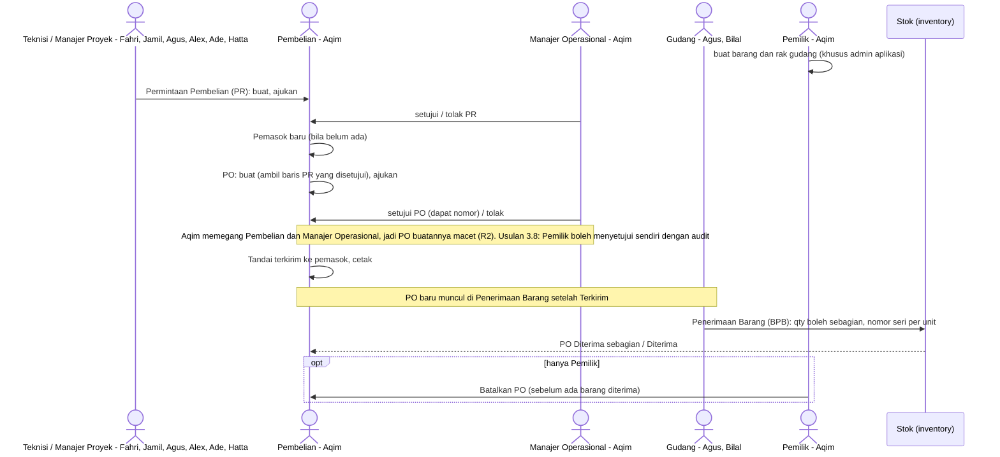

## 2. M05 - Retur pembelian dan penyesuaian stok

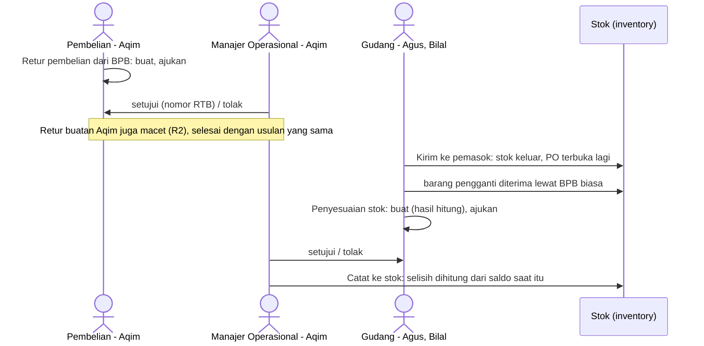

## 3. M02 - Lead sampai kas masuk

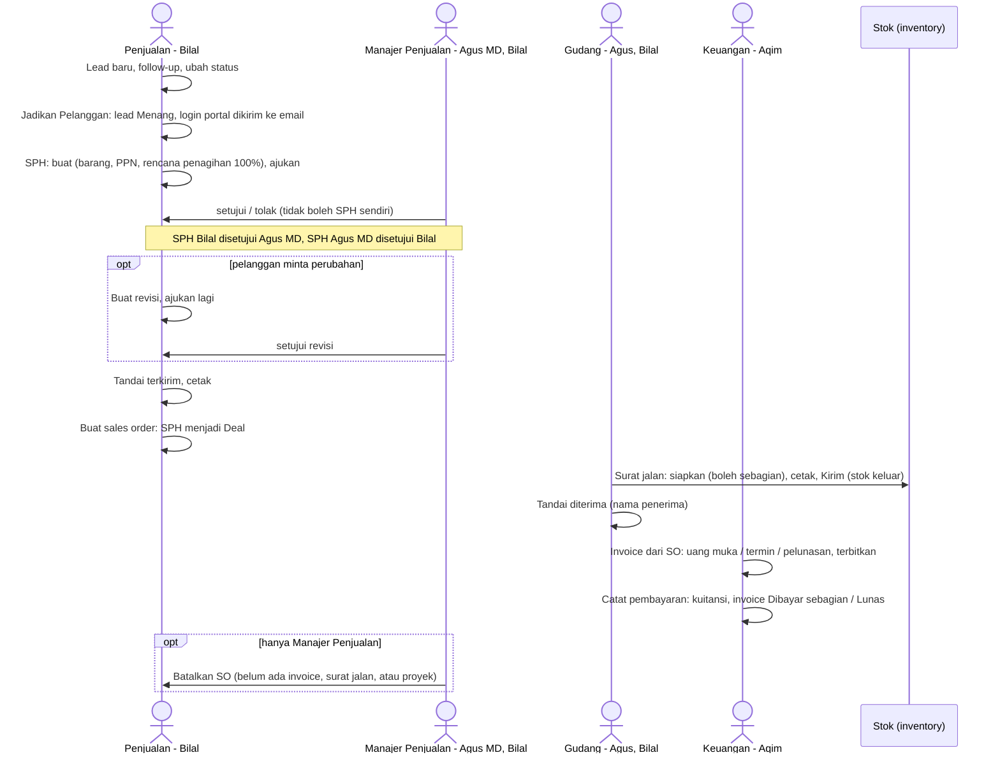

## 4. M02 - Retur penjualan

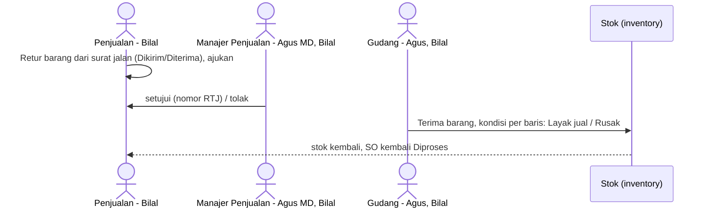

## 5. M07 - Proyek, BAST, garansi, tiket

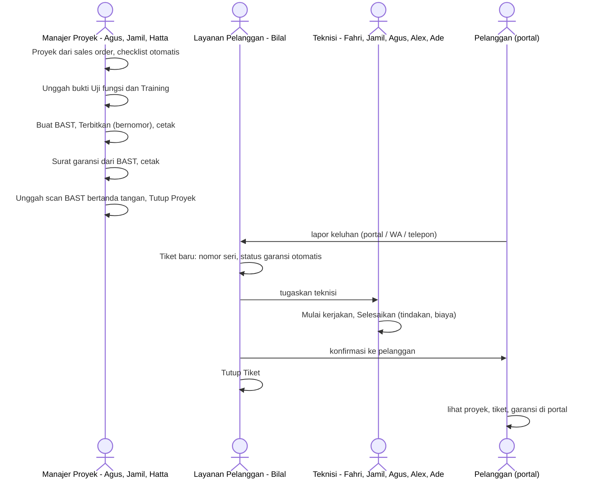

## 6. M03 - Lisensi

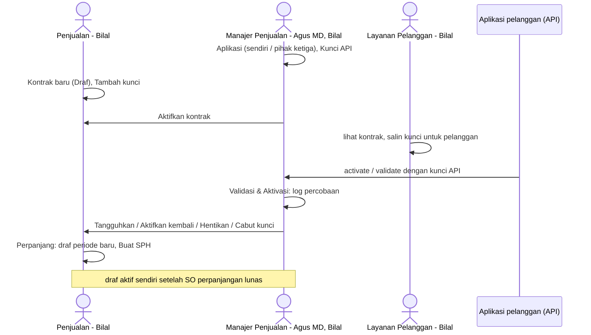

## 7. M08 - Karyawan, kehadiran, gaji

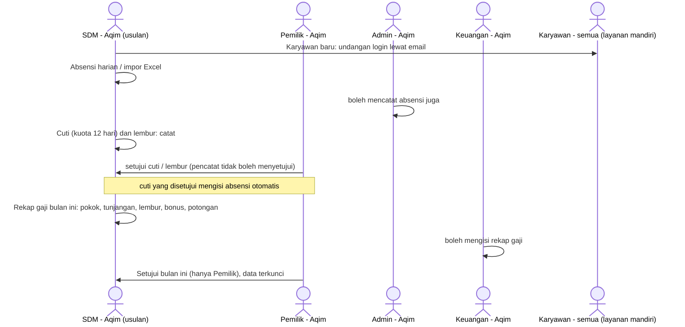

## 8. M04 - n8n, WhatsApp, katalog

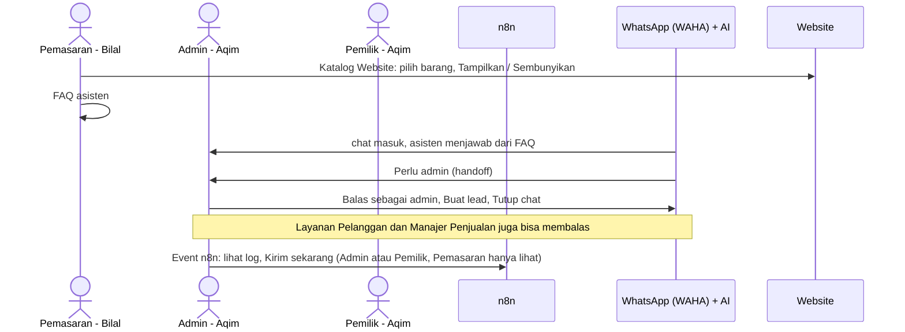

---

## 9. Status dokumen

### PR, PO, retur pembelian

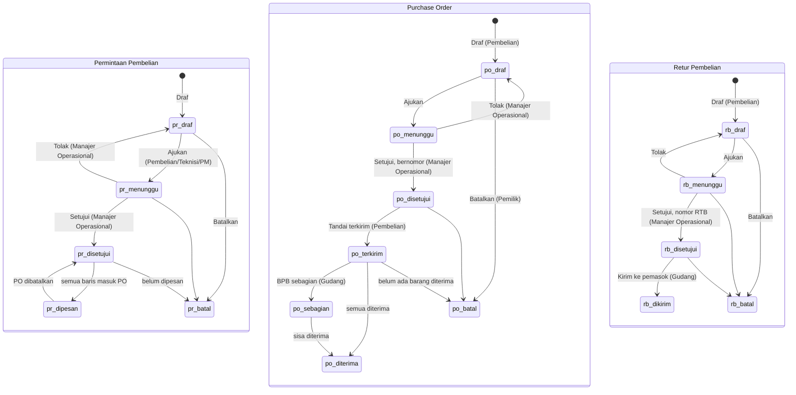

### Penyesuaian stok dan unit berseri

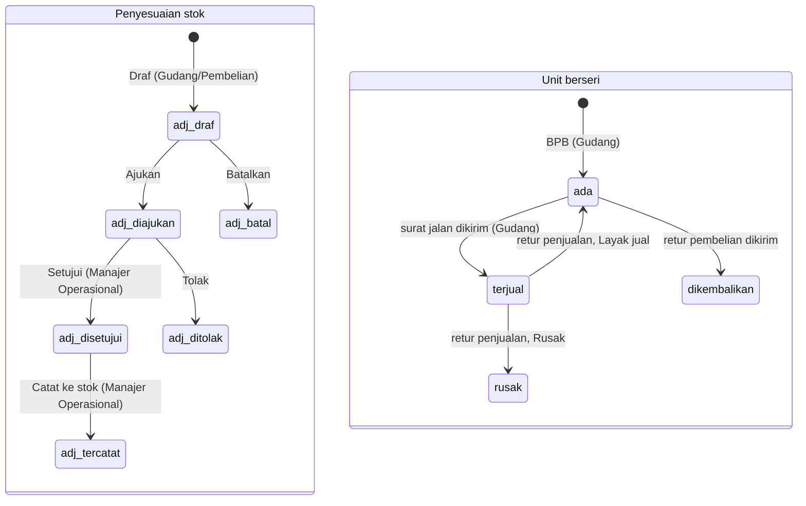

### SPH, sales order, surat jalan, invoice, retur penjualan

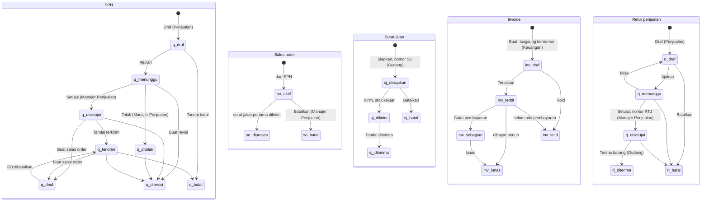

Catatan: "Tandai batal" pada SPH tersedia di semua status yang masih
terbuka. Di diagram hanya digambar dua supaya tidak ramai. SO tidak pernah
menjadi Selesai (temuan M02 C8).

### Proyek, BAST, tiket, kontrak lisensi, cuti

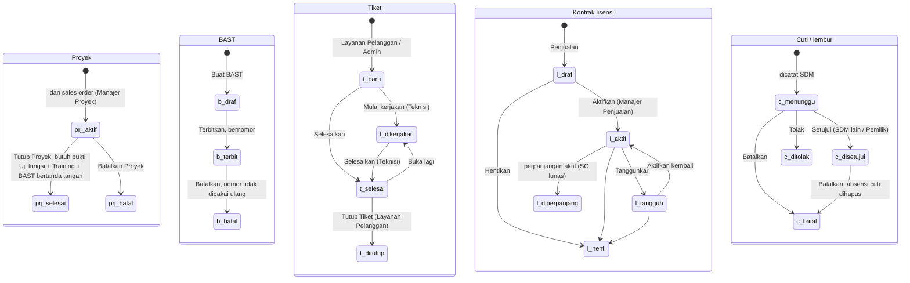
