# Alur lengkap ERP saat ini (end-to-end)

Disusun 2026-11-27. Kembali ke [diagram alur](README.md).

Satu dokumen untuk seluruh alur bisnis **sesuai kode hari ini** (`main`,
dicek 2026-11-27): dari barang masuk, gudang, aset, penjualan dan
surat-suratnya, proyek, kerja lapangan teknisi, purna jual, sampai jalur
pesanan dari website/portal dan input di web-admin. **Otomasi n8n tidak
digambar** (belum dijalankan); hanya disebut di titik event dikirim. Rancangan n8n
ada di [`../rancangan-n8n-whatsapp.md`](../rancangan-n8n-whatsapp.md).

**Ini kondisi sekarang, bukan sesudah perbaikan.** Perubahan yang sudah
diputuskan ada di [`sekarang-vs-sesudah.md`](sekarang-vs-sesudah.md); di
setiap bagian, titik yang akan berubah diberi nomor keputusannya.

**Tanda:** ✅ berjalan · ⚠️ setengah jadi / ada masalah · ❌ belum ada (hanya
tampilan atau belum dibangun).

**Aktor** ditulis "Role - orang" memakai **role yang ada di kode sekarang**
(sebelum K2 dikerjakan): Penjualan dan Manajer Penjualan masih terpisah,
Pembelian dan Manajer Operasional dipegang Aqim, Keuangan dan Akuntan
terpisah.

---

## 0. Peta besar

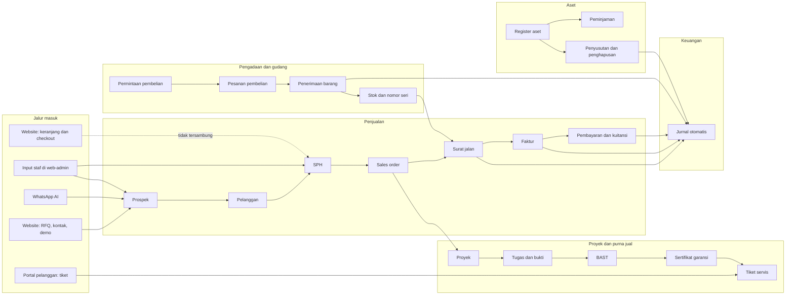

---

## 1. Data induk: barang, gudang, rak

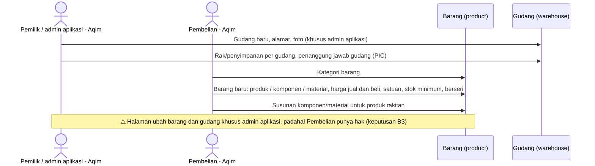

| Hal | Kondisi |
|---|---|
| Jenis barang | `product`, `component`, `material`. **Aset bukan barang**: aset dicatat terpisah (bagian 5) |
| Stok minimum | ⚠️ tersimpan, tetapi tidak ada peringatan; daftar "stok menipis" di dasbor masih data contoh (KF-G3) |
| Katalog website | ✅ Penjualan/Pemasaran memilih barang yang tampil di website (Integrasi → Katalog Website) |

---

## 2. Pengadaan sampai stok masuk

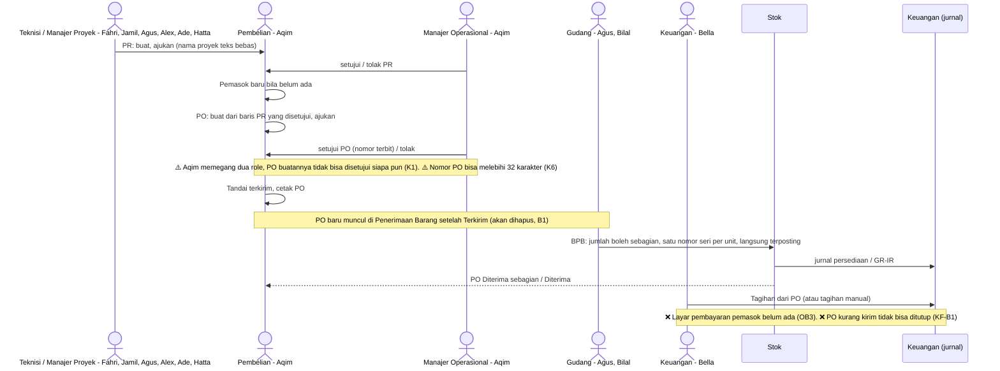

| Langkah | Dokumen keluar |
|---|---|
| PO | ✅ Halaman cetak (`purchase-orders/$id/print`) |
| BPB | ⚠️ Hanya tercatat di daftar dokumen, tidak ada halaman cetak |
| Tagihan pemasok | Tercatat di Keuangan → Utang |

---

## 3. Stok: retur pembelian, penyesuaian, keluar-masuk

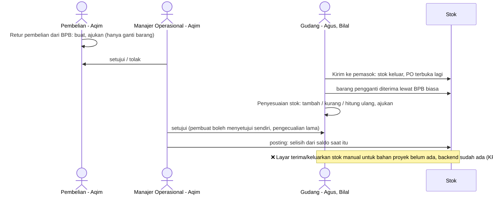

| Hal | Kondisi |
|---|---|
| Nomor seri | ✅ status: pre_order, in_stock, sold, returned, damaged, lost, applied_warranty (yang terakhir belum dipakai) |
| Mutasi stok | ⚠️ daftar tanpa saringan, belum ada kartu stok per barang (KF-G2) |
| Nilai persediaan | ✅ untuk yang berhak melihat harga pokok |
| Pindah stok antar-gudang, reservasi | ❌ belum ada (B-18) |

---

## 4. Jalur masuk pesanan

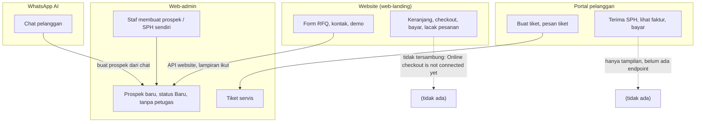

| Jalur | Kondisi sekarang |
|---|---|
| Website RFQ / kontak / demo | ✅ Membuat **prospek** (sumber website, nomor referensi publik, lampiran), event `lead.created` dikirim. Staf mengambilnya di Penjualan → Prospek |
| Katalog website | ✅ Barang, harga, stok, pencarian dibaca dari ERP |
| Keranjang dan checkout website | ❌ Tampilan ada, tetapi belum ada endpoint ERP; pengunjung diarahkan meminta penawaran |
| WhatsApp | ✅ Chat bisa dijadikan prospek; balasan oleh Penjualan / Layanan Pelanggan |
| Portal pelanggan | ✅ Masuk, akun, proyek, tiket (buat dan pesan), perangkat dan garansi. ❌ Pesanan, SPH (terima/revisi), faktur, pembayaran, dokumen, lokasi: hanya tampilan/data contoh |
| Input staf | ✅ Prospek, pelanggan, SPH, SO dibuat di web-admin (bagian 5) |

---

## 5. Penjualan sampai uang masuk (input di web-admin)

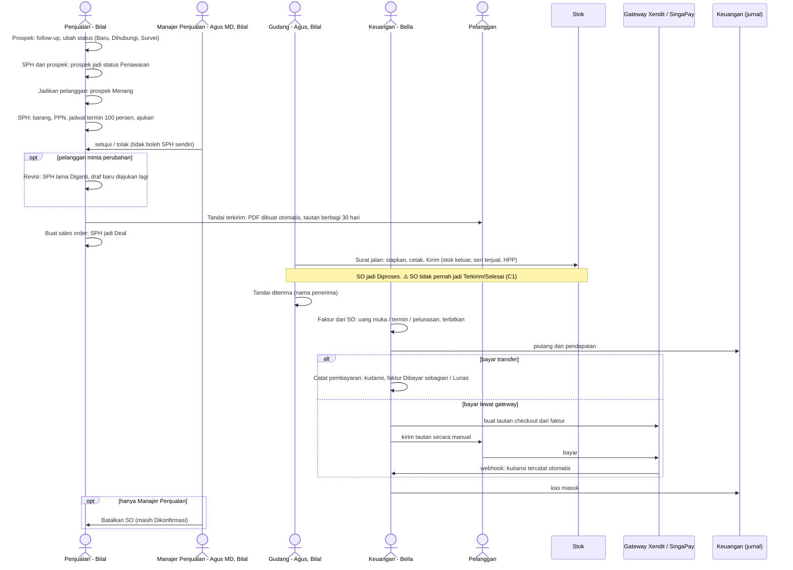

### 5a. Penagihan per termin (dari SPH yang Deal)

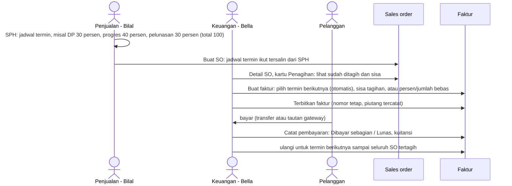

| Pertanyaan | Jawaban (kode saat ini) |
|---|---|
| Di mana jadwal termin dibuat? | Di **form SPH** (bagian Pembayaran: label + persen, total harus 100%) |
| Di mana faktur per termin dibuat? | **Detail SO → kartu Penagihan → Buat faktur**. Kartu menampilkan termin berikutnya dari jadwal SPH, bagian yang sudah ditagih, dan sisa |
| Di mana daftar tagihan per pelanggan? | **Penjualan → Faktur** (semua faktur), **Uang Muka** (faktur termin DP), **Kuitansi** (pembayaran), dan **Keuangan → Piutang** (umur piutang per pelanggan) |
| Bagaimana pembayaran tercatat? | Detail faktur → **Catat pembayaran** (manual), atau tautan gateway dari faktur (kuitansi otomatis lewat webhook) |
| Jenis termin | Uang muka (`down_payment`), angsuran/progres (`installment`), pelunasan (`settlement`) |
| Yang belum ada | Faktur tidak dibuat otomatis per termin (selalu diklik Bella); jatuh tempo belum wajib (FU9); pengingat piutang jatuh tempo (KF-K7); pelanggan belum bisa melihat/membayar faktur di portal (B-38); kuitansi belum bisa dicetak (B-37); PPh 23 dipotong pelanggan (KF-K3) |

**Retur penjualan:**

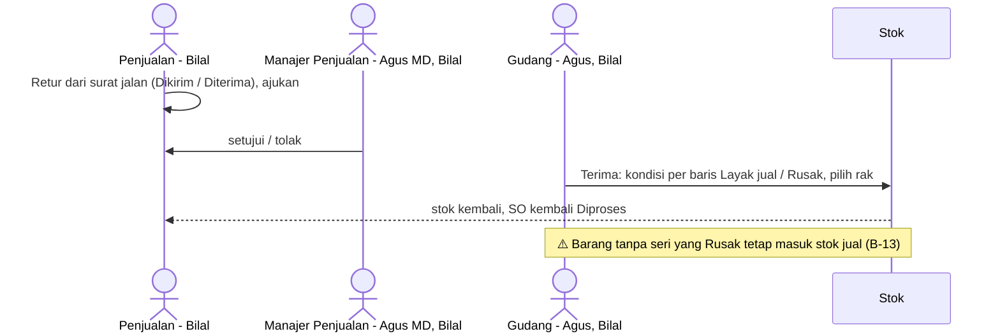

---

## 6. Surat-surat yang dihasilkan

| Dokumen | Cetak / PDF | Tercatat di daftar dokumen |
|---|---|---|
| SPH | ✅ Halaman cetak; **PDF otomatis saat Tandai terkirim** + tautan berbagi | ✅ |
| Sales order | ❌ Tidak ada cetak/PDF | ✅ |
| Surat jalan | ✅ Halaman cetak | ✅ |
| Faktur | ✅ Halaman cetak | ✅ |
| Kuitansi | ❌ Tidak ada cetak/PDF | ✅ |
| PO | ✅ Halaman cetak | ✅ |
| BPB, retur pembelian, retur penjualan | ❌ Tidak ada cetak | ✅ |
| BAST | ✅ Halaman cetak | ✅ |
| Sertifikat garansi | ✅ Halaman cetak | ✅ |
| Slip gaji | ✅ **PDF otomatis** saat gaji bulan disetujui; unduh di portal karyawan | ✅ |
| Perjanjian kerja | ✅ PDF | ✅ |
| Dokumen bertanda tangan | ✅ PDF bertanda tangan | ✅ |

Setiap dokumen di daftar bisa dibagikan lewat **tautan publik** manual
(Dokumen → Berkas → Buat tautan). PDF di server butuh Chromium; bila belum
diatur, PDF dilewati (catatan X-5).

---

## 7. Proyek

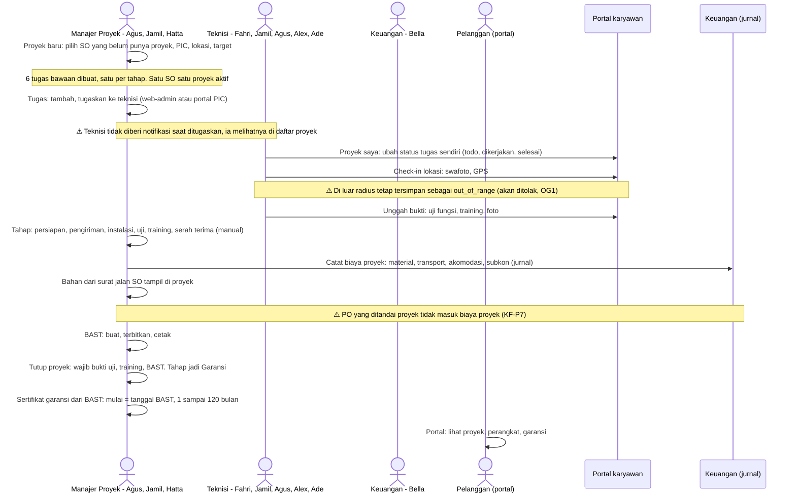

---

## 8. Kerja lapangan dan mobilitas karyawan

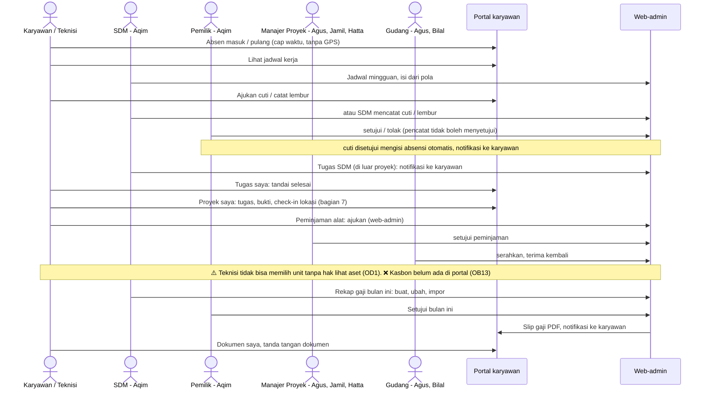

| Hal | Kondisi |
|---|---|
| Dua jenis tugas | **Tugas proyek** (per tahap, tanpa notifikasi) dan **tugas SDM** (tanpa proyek, ada notifikasi). Keduanya tampil di portal karyawan |
| Absen kantor | ✅ cap waktu tanpa GPS/swafoto |
| Absen lokasi proyek | ✅ swafoto + GPS, jarak dihitung PostGIS (radius bawaan 100 m); ⚠️ di luar radius tetap diterima |
| Kasbon | ⚠️ ada di web-admin Keuangan, teknisi tidak bisa membuka menunya (OB13) |

---

## 9. Aset dan peralatan

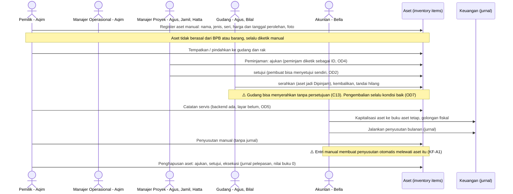

---

## 10. Purna jual: tiket servis dan garansi

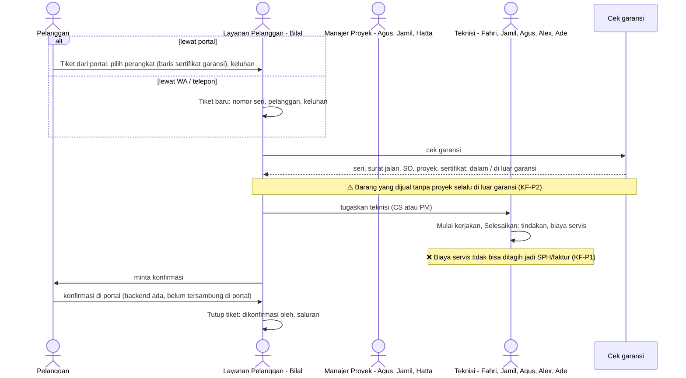

---

## 11. Status dokumen

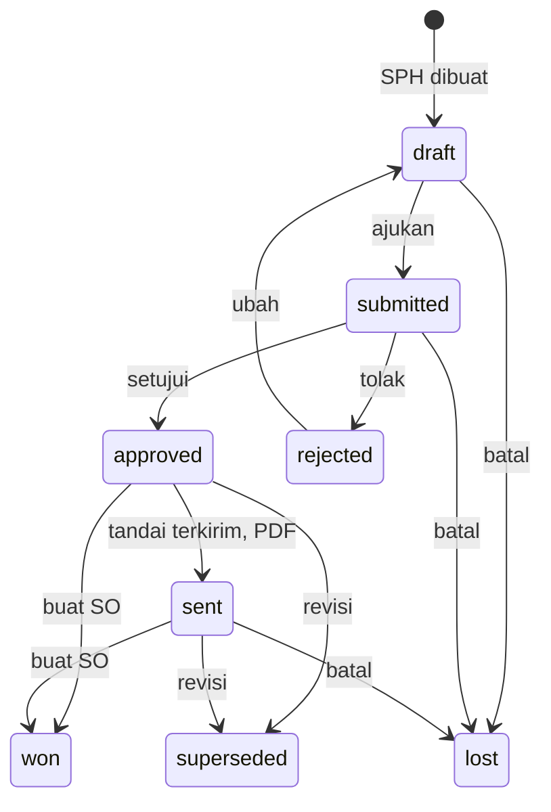

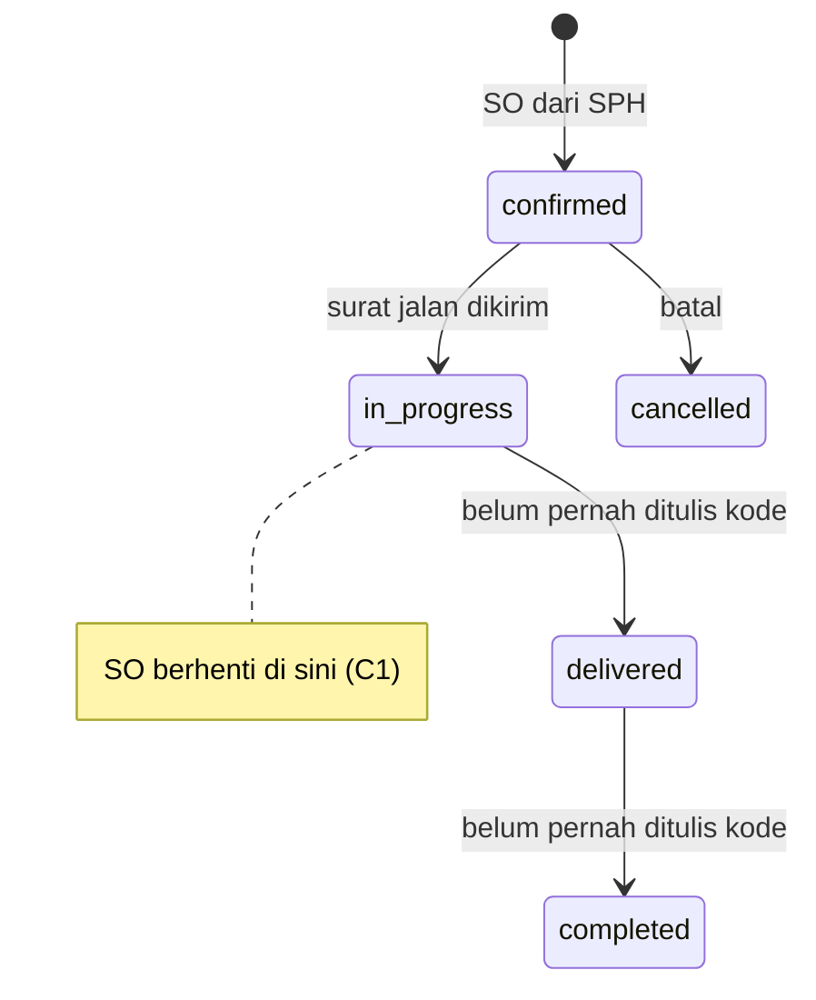

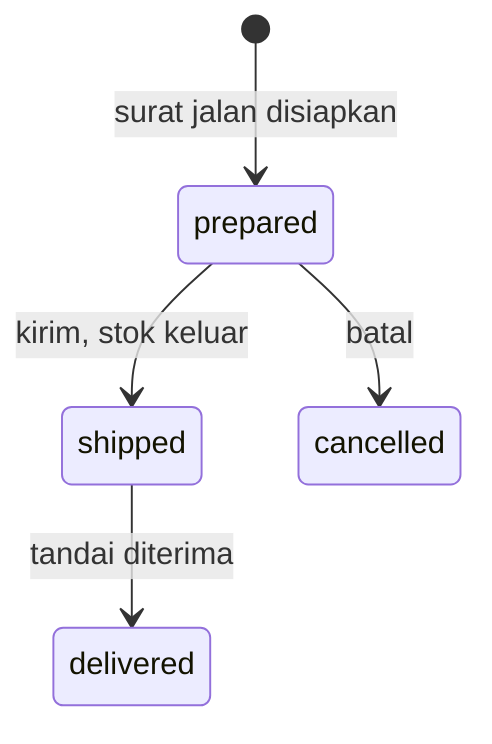

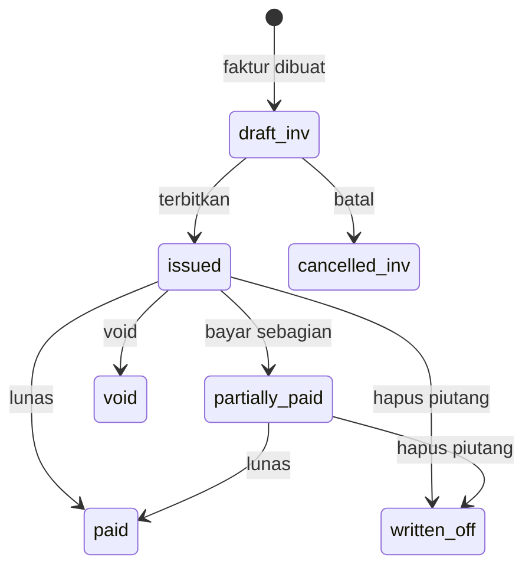

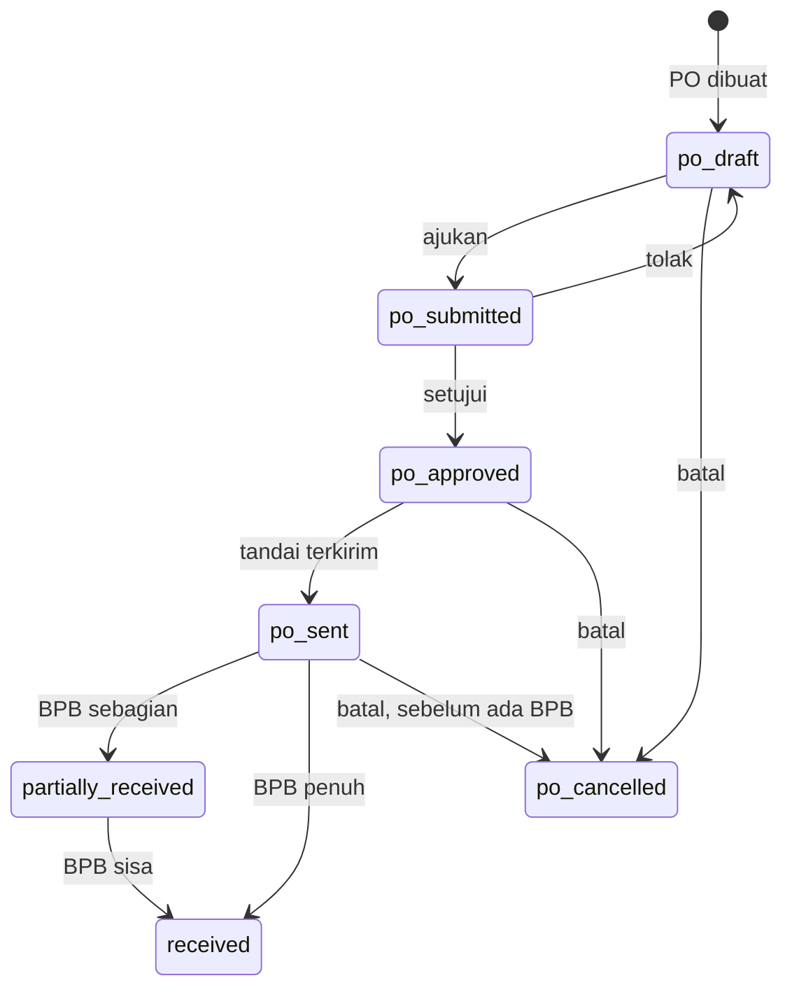

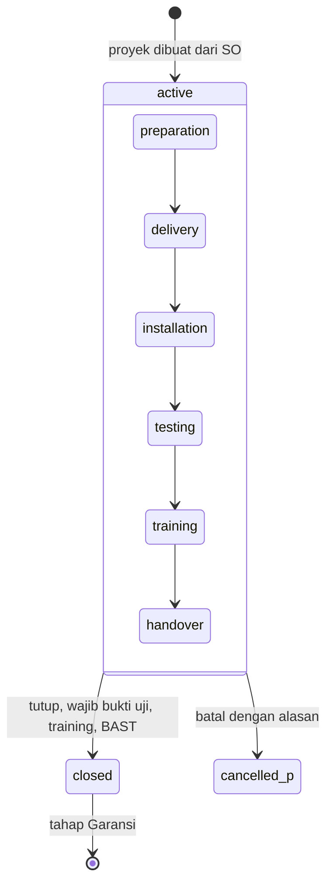

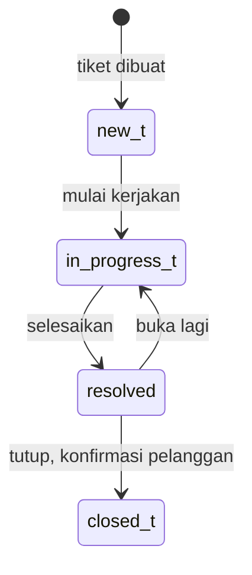

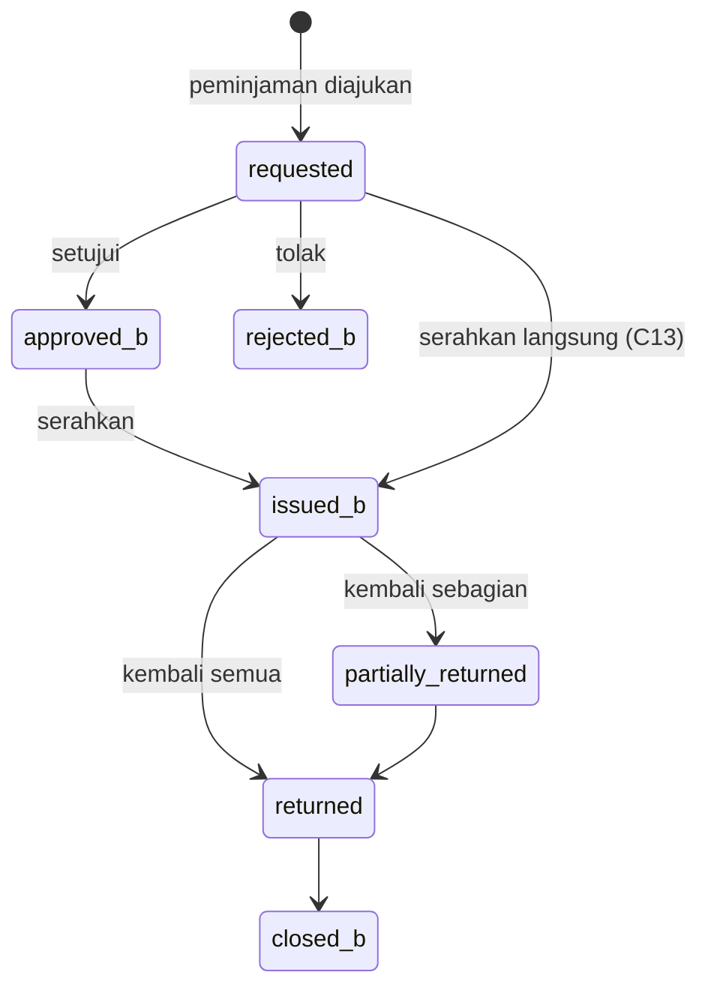

---

## 12. Titik putus saat ini (ringkas)

| No | Titik | Bagian | Keputusan / rencana |
|---|---|---|---|
| 1 | PO, PR, retur buatan Aqim tidak bisa disetujui | 2, 3 | K1 |
| 2 | Nomor PO bisa melebihi 32 karakter | 2 | K6, L-2 |
| 3 | "Tandai terkirim" menahan PO dari gudang | 2 | B1 |
| 4 | Pembayaran pemasok belum ada; PO kurang kirim tidak bisa ditutup | 2 | OB3, KF-B1 |
| 5 | Bahan proyek tidak bisa dikeluarkan dari stok secara manual | 3, 7 | KF-G1 |
| 6 | Checkout website dan pesanan/SPH/faktur di portal belum tersambung | 4 | B-38 (T21, T25) |
| 7 | SO tidak pernah Terkirim/Selesai | 5 | C1 |
| 8 | Retur rusak masuk stok jual | 5 | B-13 |
| 9 | Kuitansi, SO, BPB, retur tanpa cetak | 6 | B-37 |
| 10 | Teknisi tidak diberi notifikasi tugas proyek | 7 | B-35, RM3 |
| 11 | Absen lokasi di luar radius tetap diterima | 7, 8 | OG1, PK-1 |
| 12 | Biaya proyek tanpa PO proyek | 7 | KF-P7 |
| 13 | Kasbon tidak terjangkau teknisi | 8 | OB13 |
| 14 | Peminjaman: ID mentah, serah tanpa persetujuan, kondisi kembali | 9 | OD1, OD4, C13, OD7 |
| 15 | Penyusutan manual vs otomatis bentrok | 9 | KF-A1 |
| 16 | Garansi barang tanpa proyek; tiket berbayar tidak bisa ditagih | 10 | KF-P2, KF-P1 |
| 17 | Konfirmasi tiket di portal belum tersambung | 10 | B-36 |
