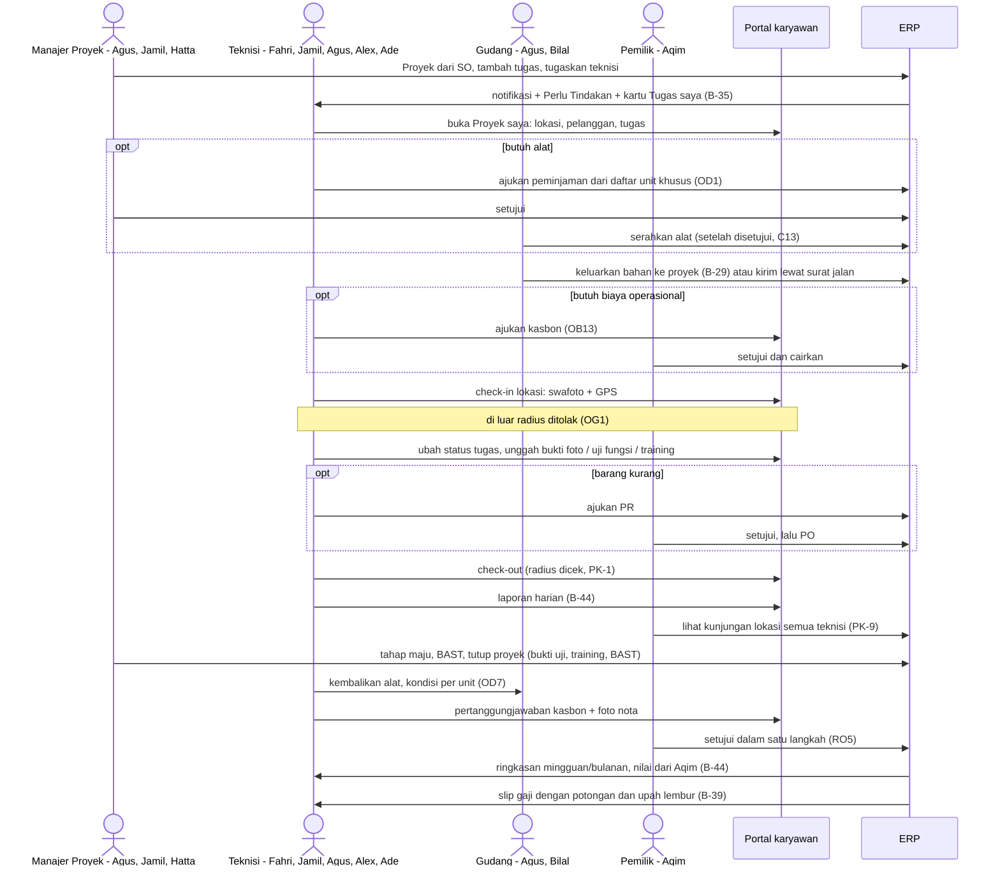
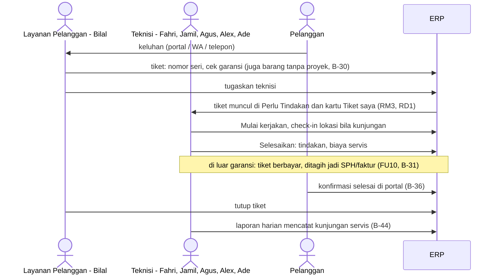

# Alur teknisi: dari ditugaskan sampai proyek selesai

Disusun 2026-11-28. Kembali ke [diagram alur](README.md).

Alur kerja teknisi (Fahri, Jamil, Agus, Alex, Ade) **sesudah keputusan yang
disetujui** (target), dengan catatan kondisi kode sekarang di setiap
langkah. Kondisi sekarang lengkap ada di
[`alur-lengkap-saat-ini.md`](alur-lengkap-saat-ini.md) bagian 7, 8, 10.

Teknisi bekerja dari **portal karyawan** (ponsel). Web-admin hanya untuk
yang perlu (tiket servis, sampai tiket masuk portal karyawan, KF-P4).

---

## 1. Gambaran langkah

| No | Langkah | Di mana | Yang dilakukan teknisi | Sekarang (kode) | Sesudah (keputusan) |
|---|---|---|---|---|---|
| 1 | **Ditugaskan** | Portal: Proyek saya, Perlu Tindakan, dasbor | Melihat tugas baru | Muncul di daftar proyek, **tanpa notifikasi** | Notifikasi + Perlu Tindakan + kartu "Tugas saya hari ini" (B-35, RM3, RD1) |
| 2 | **Lihat detail proyek** | Portal: detail proyek | Lokasi, pelanggan, kontak, tahap, tugas, bukti (tanpa biaya) | ✅ ada | sama |
| 3 | **Pinjam alat** | Peminjaman | Ajukan dari **daftar unit khusus** → Manajer Proyek menyetujui → Gudang menyerahkan | Teknisi tidak bisa memilih unit; Gudang bisa menyerahkan tanpa persetujuan | OD1, C13 |
| 4 | **Ambil bahan** | Gudang | Tidak menginput; Gudang mengeluarkan bahan ke proyek atau mengirim lewat surat jalan SO | Hanya lewat surat jalan SO | Layar keluar stok ke proyek (B-29) |
| 5 | **Kasbon** (bila perlu biaya operasional) | Portal: Kasbon | Ajukan kasbon → Aqim menyetujui dan mencairkan | Tidak bisa (menu Keuangan tertutup) | Kasbon di portal (OB13); ditolak bila kasbon lama belum dipertanggungjawabkan (FU12) |
| 6 | **Tiba di lokasi** | Portal: Proyek → Check-in | Swafoto + GPS | Di luar radius **tetap diterima** (ditandai) | **Ditolak** di luar radius (OG1); Aqim melihat semua kunjungan (PK-9) |
| 7 | **Kerjakan tugas** | Portal: tugas proyek | Ubah status tugas: Belum → Dikerjakan → Selesai (hanya tugas sendiri) | ✅ ada | sama |
| 8 | **Unggah bukti** | Portal: Bukti | Foto, uji fungsi, training, terkait tugasnya | ✅ ada | sama |
| 9 | **Butuh barang tambahan** | Permintaan Pembelian | Ajukan PR → Aqim menyetujui → PO | ✅ ada (web-admin) | sama; PR terhubung ke proyek (KF-P8, daftar tunggu) |
| 10 | **Pulang dari lokasi** | Portal: Check-out | Check-out | Tanpa cek radius | Radius dicek juga (PK-1) |
| 11 | **Laporan harian** | Portal: Laporan Kerja | Pekerjaan, proyek/tugas, jam, foto, kendala, rencana besok | **Belum ada** | Wajib setiap hari kerja; pengingat sore; menyusul maks. 2 hari (B-44) |
| 12 | **Serah terima** | — | Mendukung PM: bukti uji fungsi dan training lengkap | PM membuat BAST, menutup proyek | sama |
| 13 | **Kembalikan alat** | Peminjaman | Gudang menerima, **kondisi per unit** Baik/Rusak/Tidak lengkap | Selalu kondisi baik | OD7; lewat tanggal → Terlambat + pengingat (FU13) |
| 14 | **Pertanggungjawaban kasbon** | Portal: Kasbon | Isi pengeluaran + foto nota | Tidak bisa | Satu langkah disetujui Aqim (RO5) |
| 15 | **Evaluasi** | Portal / Aqim | Ringkasan mingguan/bulanan otomatis, tambah catatan | Belum ada | Aqim menilai skor 1–5 + komentar, PDF per karyawan (B-44) |
| 16 | **Gaji** | Portal: Slip gaji | Unduh slip | ✅ ada | Potongan alpa/izin tanpa gaji/terlambat, upah lembur dihitung (B-39) |

## 2. Diagram (sesudah keputusan)

## 3. Setelah proyek: tiket servis

## 4. Yang masih perlu diingat

| Hal | Keterangan |
|---|---|
| Dua jenis tugas | **Tugas proyek** (dari PM, per tahap) dan **tugas SDM** (dari Aqim, di luar proyek). Keduanya tampil di portal karyawan; teknisi hanya melihat tugasnya sendiri (D4) |
| Tiket di portal karyawan | Belum ada (KF-P4, daftar tunggu "Tambahan"); sementara teknisi membuka tiket di web-admin |
| Alat "pinjaman saya" | Kartu dasbor Teknisi menampilkan pinjaman yang harus kembali (RD1); layar khusus di portal masih daftar tunggu (KF-A7) |
| Absen kantor | Tetap cap waktu tanpa GPS; absen lokasi hanya untuk proyek |
