# Diagram alur: sekarang vs sesudah perbaikan

[Kembali ke indeks diagram](README.md). Disusun 2026-11-27.

**Tujuan.** Untuk setiap alur yang akan berubah, file ini memberi dua diagram
Mermaid berurutan:

- **Sekarang**: perilaku kode hari ini, dengan titik macet atau bermasalah
  ditandai di `Note`.
- **Sesudah (usulan)**: alur menurut **jawaban programmer B 27/11**
  (bagian 0 [`../lembar-keputusan-rapat.md`](../../2-keputusan/lembar-keputusan-rapat.md)),
  disetujui Pemilik 27/11 (tinjauan Oki di PR #171). Butir yang belum dijawab memakai
  rekomendasi lembar rapat.

Di bawah setiap pasangan ada daftar singkat **yang perlu diubah di kode**
(wilayah dan pemiliknya, tanpa kode). File ini satu set dengan diagram
kondisi sekarang di [`../uat-modul/diagram-alur-per-role.md`](../../1-validasi/uat-modul/diagram-alur-per-role.md)
(modul programmer B) dan [`sekarang-modul-oki.md`](sekarang-modul-oki.md)
(modul Oki). Gaya aktornya sama: `Role - nama orang`.

> **Status 2026-11-27: disetujui.** Pada rapat 27/11 Pemilik menyetujui semua
> keputusan sesuai usulan (lembar rapat, ringkasan untuk Pemilik), termasuk
> K8, K9 (portal karyawan dan fitur lain diterima sebagai tambahan), K11, dan
> OB11. Diagram **Sesudah** sekarang adalah **target yang disetujui**; label
> "usulan" dan "jawaban programmer B 27/11" di bawah dibaca sebagai
> "disetujui 27/11". Oki masih meninjau lewat PR #171. Belum ada kode yang diubah.

**Sumber:** `../lembar-keputusan-rapat.md`, `../bahan-keputusan.md`,
`../bahan-keputusan-modul-oki.md`, `../rencana-perubahan.md`,
`../rencana-perubahan-modul-oki.md`, `../validasi-konsep-saat-ini.md` (3.7–3.9),
`../validasi-konsep-modul-oki.md` (3.7–3.8). Perilaku "Sekarang" yang paling
penting dicek ulang ke kode `main` pada 2026-11-27: cek pembuat ≠ penyetuju di
`purchase-request.service.ts:204`, `purchase-order.service.ts:225`,
`purchase-return.service.ts:342`, `quotation.service.ts:367`,
`sales-return.service.ts:350`, `leave.service.ts:152`; pengecualian
`canSelfApprove` di `adjustment.controller.ts:68` dan `adjustment.service.ts:374`;
penerimaan barang hanya untuk PO `sent`/`partially_received`
(`goods-receipt.service.ts:193`); tombol Google di
`apps/web-admin/src/components/form/login-form.tsx:98` dan di
`apps/web-employee/src/components/form/login-form.tsx`; header
`x-organization-id` di `apps/web-admin/src/lib/admin-api.ts:31`.

**Label status yang dipakai:**

| Label | Arti |
|---|---|
| **usulan** | Rekomendasi di catatan, belum ada isian di lembar rapat |
| **jawaban programmer B 27/11** | Dijawab programmer B lewat tanya-jawab 2026-11-27 (lembar rapat bagian 0), disetujui Pemilik 27/11 |
| **menunggu keputusan** | Ada beberapa pilihan, belum ada isian, atau isiannya bertentangan dengan rekomendasi |

**Susunan role yang dipakai di diagram Sesudah** (K2 = (a), K2a, K2b (a), K2c (a),
K2d (a), X4; diperbarui 2026-11-27): Aqim = Pemilik + SDM (+ tanda admin
aplikasi); Agus MD dan Bilal = Penjualan (gabungan); Bilal juga Gudang, Layanan
Pelanggan, Pemasaran; Agus = Manajer Proyek, Teknisi, Gudang; Jamil = Manajer
Proyek, Teknisi; Hatta = Manajer Proyek; Fahri, Alex, Ade = Teknisi; Bella =
Keuangan (gabungan Akuntan + Keuangan, K2d); Dafrin, Oki = Pekerja Lepas saja.
Role Anggota dan role organisasi Admin dihapus; Manajer Operasional, Pembelian,
dan Auditor tidak diberikan ke siapa pun.

## Daftar isi

1. [Persetujuan dokumen pembelian (PR, PO, retur pembelian)](#1-persetujuan-dokumen-pembelian-pr-po-retur-pembelian)
2. [PO sampai terima barang](#2-po-sampai-terima-barang)
3. [SPH sampai SO dan pengiriman](#3-sph-sampai-so-dan-pengiriman)
4. [Penyesuaian stok](#4-penyesuaian-stok)
5. [Cuti, lembur, dan SDM](#5-cuti-lembur-dan-sdm)
6. [Login, undangan, organisasi, role](#6-login-undangan-organisasi-role)
7. [Keuangan: periode, jurnal manual, tutup bulan](#7-keuangan-periode-jurnal-manual-tutup-bulan)
8. [Kasbon dan pertanggungjawaban](#8-kasbon-dan-pertanggungjawaban)
9. [Peminjaman aset](#9-peminjaman-aset)
10. [Absensi lokasi portal karyawan](#10-absensi-lokasi-portal-karyawan)
11. [Peta bentrok sesudah](#11-peta-bentrok-sesudah)
12. [Ketidakcocokan antar-catatan](#12-ketidakcocokan-antar-catatan)

---

## 1. Persetujuan dokumen pembelian (PR, PO, retur pembelian)

**Yang berubah dan mengapa.** Aturan "pembuat tidak boleh menyetujui" berlaku
juga untuk Pemilik. Aqim satu-satunya penyetuju (Manajer Operasional/Pemilik)
sekaligus pembuat PO dan retur, jadi PO dan retur buatan Aqim **selalu macet**,
begitu juga PR buatan Aqim. Usulannya: hanya Pemilik boleh menyetujui dokumennya
sendiri, dan kejadian itu wajib tercatat di audit **dalam transaksi yang sama**
(bila audit gagal, persetujuan gagal). Role Pembelian tidak dipakai (K2c), jadi
Aqim membeli sebagai Pemilik.

| Keputusan | Isi | Status |
|---|---|---|
| K1 | Pemilik boleh menyetujui dokumennya sendiri, tercatat di audit | jawaban programmer B 27/11: (b) |
| K2 | Susunan role per orang | jawaban programmer B 27/11: (a) |
| K2c | Role Pembelian tidak dipakai | jawaban programmer B 27/11: (a) |
| OA5–OA7 | Audit ikut transaksi, daftar peristiwa wajib, tanda `meta.self_approved` | jawaban programmer B 27/11: wajib, dikerjakan sebelum K1 |

### Sekarang

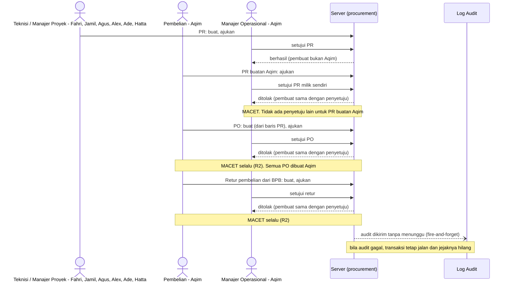

### Sesudah (disetujui 27/11)

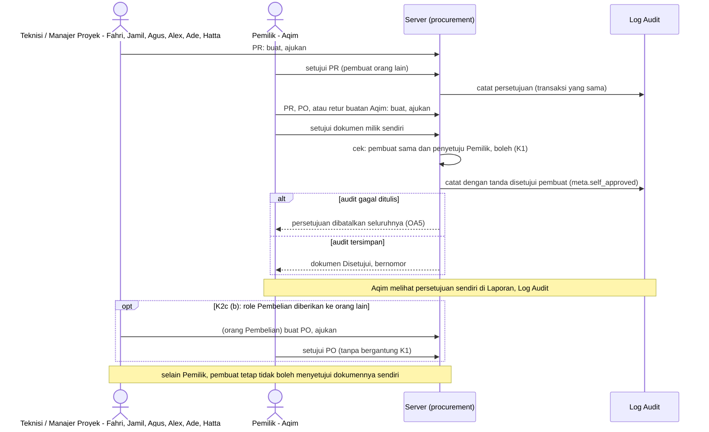

**Yang perlu diubah di kode:**

- Satu aturan persetujuan bersama "pembuat boleh menyetujui bila Pemilik" di
  service PR, PO, retur pembelian (`procurement`), dipakai juga oleh bagian 3,
  4, 5. Wilayah programmer B (`rencana-perubahan.md` B-1, X-2).
- Tombol **Setujui** tampil untuk Pemilik pada dokumennya sendiri, dengan
  keterangan "tercatat di audit" (web-admin, programmer B).
- Penulis audit di transaksi bisnis dan tanda `meta.self_approved` (modul
  `audit`, Oki: M12-1, L-1). Harus selesai **sebelum** aturan K1 dinyalakan.
- ADR-0006 butir 6 dan `security-and-access.md` diubah (Oki, DO-1).

---

## 2. PO sampai terima barang

**Yang berubah dan mengapa.** Empat masalah di satu alur: nomor PO lebih dari
32 karakter membuat persetujuan gagal (K6); PO baru muncul di Penerimaan Barang
setelah "Tandai terkirim" (B1); Gudang tidak bisa membuka PO dari BPB (B4);
hanya Pemilik yang bisa membatalkan PO (B2); halaman barang dan gudang hanya
untuk admin aplikasi (B3).

| Keputusan | Isi | Status |
|---|---|---|
| K6 | Kode pemasok otomatis dipersingkat (misal `SUP-00001`) | jawaban programmer B 27/11: (a) |
| B1 | PO yang disetujui langsung bisa diterima, tanpa "Tandai terkirim" | jawaban programmer B 27/11: (b) |
| B2 | Batal PO: Pembelian (draf miliknya) dan Manajer Operasional | jawaban programmer B 27/11: (b) |
| B3 | Halaman barang dan gudang mengikuti hak role | jawaban programmer B 27/11: (b) |
| B4 | Gudang diberi hak baca PO dan SO | jawaban programmer B 27/11: (b) |

### Sekarang

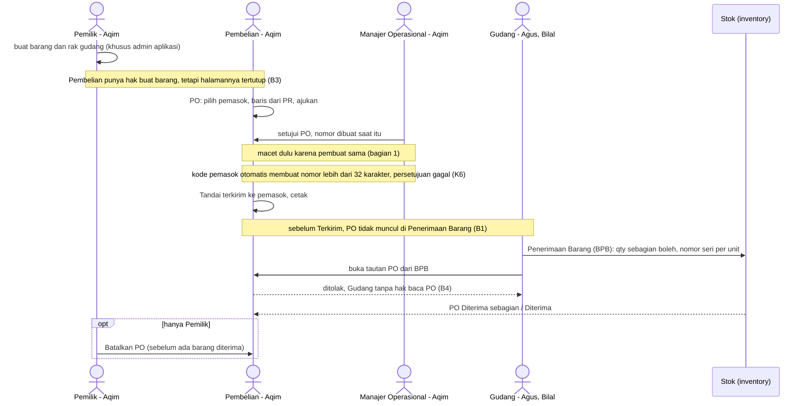

### Sesudah (disetujui 27/11)

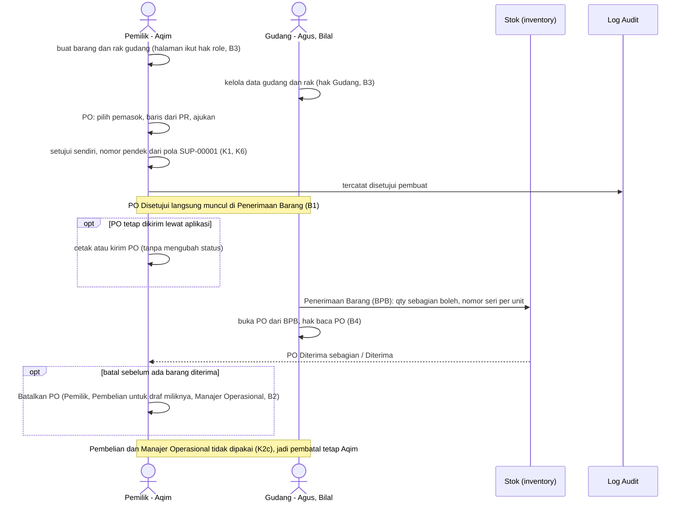

**Yang perlu diubah di kode:**

- Pola kode pemasok bawaan dipersingkat lewat Administrasi → Nomor Kode, dan
  pratinjau Nomor Kode memakai kode pemasok sungguhan (Bersama, L-2/X-3;
  `src/shared/numbering` belum punya pemilik, K11).
- Penerimaan Barang menerima PO berstatus Disetujui (`goods-receipt.service.ts`
  dan daftar PO terbuka; langkah "Tandai terkirim" dihapus (B1, jawaban
  programmer B 27/11); diagram status PO ikut berubah). Programmer B.
- Hak `purchase_order:cancel` untuk Pembelian (draf milik sendiri) dan Manajer
  Operasional; hak baca PO dan SO untuk Gudang (`erp-permissions.ts`, Oki, lalu
  `bun docs/architecture/gen-role-permission.ts`).
- Halaman Produk/Gudang memakai hak role, bukan `appAdminOnly` (guard Oki,
  halaman programmer B, X-11).

---

## 3. SPH sampai SO dan pengiriman

**Yang berubah dan mengapa.** Manajer Penjualan dan Penjualan digabung menjadi
satu role **Penjualan** dengan hak Manajer Penjualan sekarang (K2b); Agus MD dan
Bilal tetap saling menyetujui SPH. SO sekarang berhenti di **Diproses** walau
semua barang terkirim dan lunas (C1). Menu Uang Muka tidak bisa dibuka siapa
pun (C2). Bilal boleh mengirim SO-nya sendiri, diawasi lewat laporan (K7).

| Keputusan | Isi | Status |
|---|---|---|
| K2b | Satu role Penjualan: `sales_manager` dihapus, `sales` ("Penjualan") memegang semua haknya (diubah 28/11) | jawaban programmer B 27/11: (a) gabung |
| C1 | SO otomatis Terkirim saat semua barang terkirim, Selesai saat lunas | jawaban programmer B 27/11: (a) |
| K7 | Bilal boleh membuat SO lalu mengirim barangnya sendiri | jawaban programmer B 27/11: (a) |
| C2 | Menu Uang Muka dibuka untuk pemegang hak baca invoice | jawaban programmer B 27/11: (a) |
| K1 | Pemilik boleh menyetujui SPH buatannya sendiri | jawaban programmer B 27/11: (b) |

### Sekarang

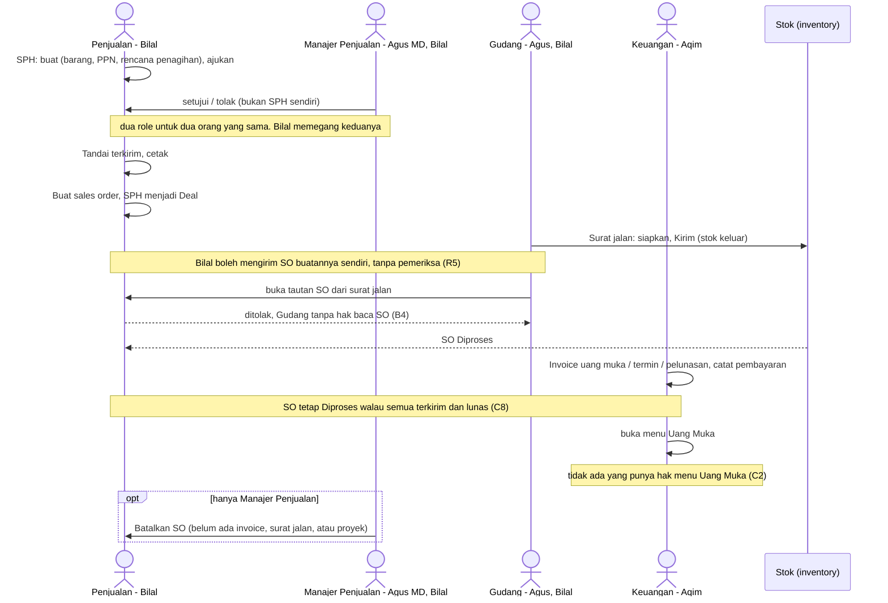

### Sesudah (disetujui 27/11)

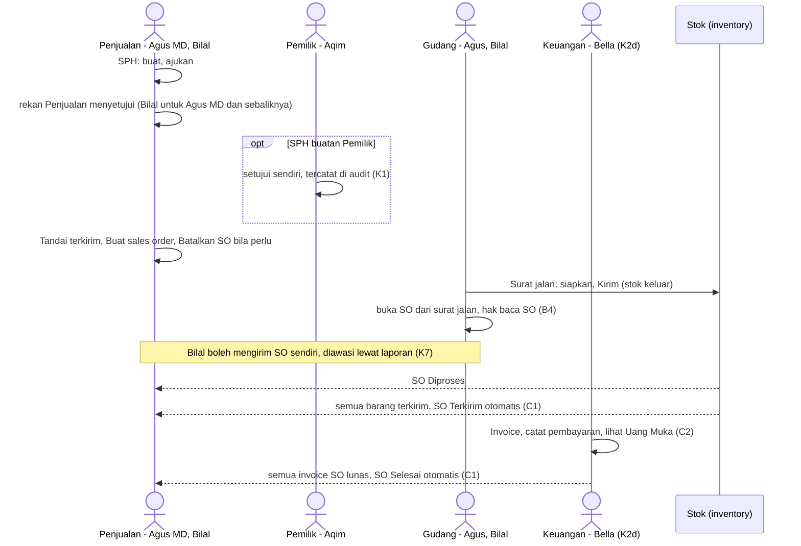

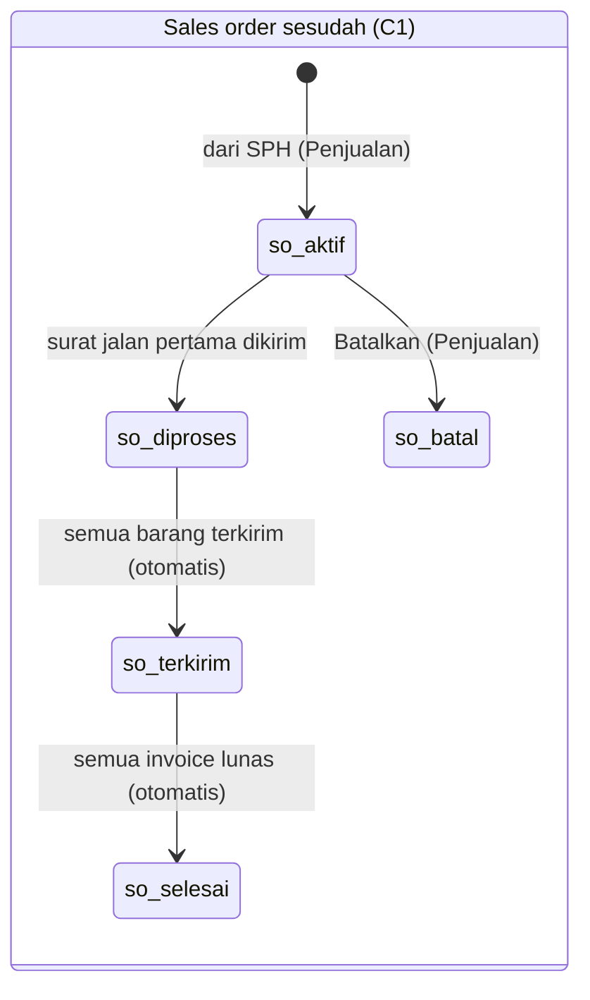

**Yang perlu diubah di kode:**

- Role `sales_manager` dihapus; `sales` ("Penjualan") mendapat semua haknya,
  dan data anggota `sales_manager` dipindah ke `sales` lewat migrasi data
  (`erp-permissions.ts`, locale, seeder, Oki: OA11/M12-5/P7-4; diubah 28/11).
- Status SO otomatis Terkirim/Selesai dari surat jalan dan pelunasan invoice
  (`sale`, programmer B). Kolom status sudah mengenal `delivered` dan
  `completed`; yang belum ada adalah transisinya.
- Hak menu Uang Muka untuk pemegang hak baca invoice (`nav-config`, hak web,
  programmer B dengan izin Oki untuk `erp-permissions.ts`).
- Hak baca SO untuk Gudang (sama dengan bagian 2). Laporan pengawasan SO
  yang dikirim pembuatnya sendiri (K7) masih usulan, belum ada desainnya.

---

## 4. Penyesuaian stok

**Yang berubah dan mengapa.** Di kode, setiap pemegang hak setuju penyesuaian
stok boleh menyetujui penyesuaian buatannya sendiri (`canSelfApprove`), tanpa
tanda di audit. Ini satu-satunya dokumen pembelian/gudang yang sudah boleh
disetujui sendiri, dan berlaku untuk siapa saja yang kelak diberi hak setuju.
Usulannya: pengecualian ini diganti aturan K1 (hanya Pemilik, tercatat audit).

| Keputusan | Isi | Status |
|---|---|---|
| K1 | Aturan bersama menggantikan pengecualian penyesuaian stok | jawaban programmer B 27/11: (b) |
| OA5–OA7 | Persetujuan sendiri tercatat dalam transaksi | jawaban programmer B 27/11: wajib, sebelum K1 |

### Sekarang

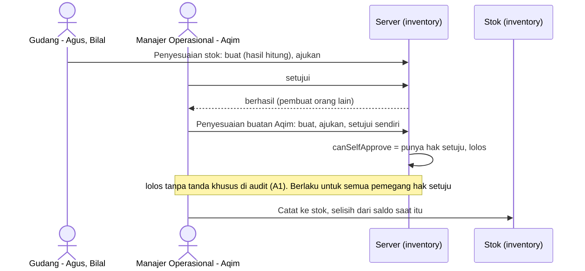

### Sesudah (disetujui 27/11)

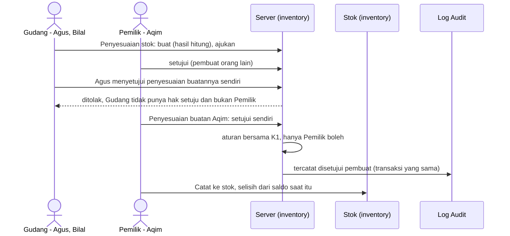

**Yang perlu diubah di kode:**

- Hapus `canSelfApprove` di `adjustment.controller.ts` dan
  `adjustment.service.ts`, ganti aturan bersama dari bagian 1 (programmer B).
- Test: pemegang hak setuju non-Pemilik ditolak untuk miliknya sendiri; Pemilik
  lolos dengan audit.

---

## 5. Cuti, lembur, dan SDM

**Yang berubah dan mengapa.** Pencatat cuti/lembur tidak boleh menyetujui
catatannya sendiri (`leave.service.ts:152`, `:185`, `:287`). Cuti yang diajukan
karyawan sendiri dari portal aman (pencatatnya karyawan itu). Masalahnya ada
saat Aqim, satu-satunya SDM dan Pemilik, **mencatat cuti atas nama karyawan**:
tidak ada orang lain yang bisa menyetujuinya. Role SDM sekarang belum dipegang
siapa pun (usulan Aqim). Usulannya: role SDM hanya Aqim (K2a), dan persetujuan
oleh SDM mengikuti K1. Aqim sendiri tidak mengambil cuti (A3a), jadi tidak perlu
penyetuju untuk cuti Aqim.

| Keputusan | Isi | Status |
|---|---|---|
| K2a | Role SDM hanya untuk Aqim | jawaban programmer B 27/11: (a) |
| A3 | Cuti yang dicatat SDM: mengikuti K1 karena SDM juga Pemilik | jawaban programmer B 27/11: (b) dengan catatan |
| A3a | Cuti Aqim: tidak ada, jadi tidak perlu penyetuju | jawaban programmer B 27/11 |
| K1 | Pemilik boleh menyetujui catatannya sendiri, tercatat audit | jawaban programmer B 27/11: (b) |

### Sekarang

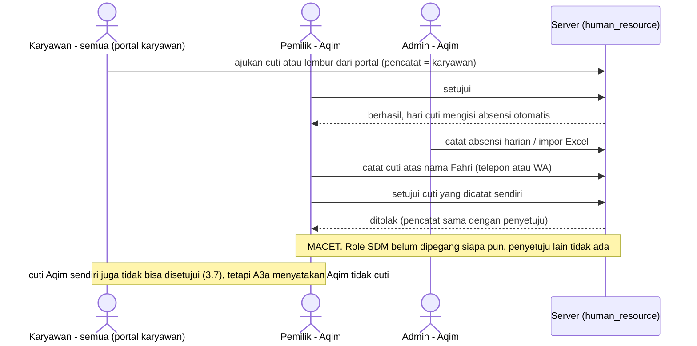

### Sesudah (disetujui 27/11)

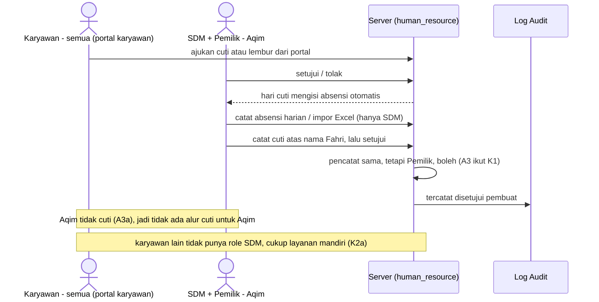

**Yang perlu diubah di kode:**

- `leave.service.ts` (cuti dan lembur) memakai aturan bersama dari bagian 1
  (programmer B, M08).
- Atur role: Aqim diberi SDM; role organisasi Admin dihapus (27/11), jadi
  pencatatan absensi hanya oleh SDM (Aqim, Administrasi → Pengguna). Penghapusan
  role Admin dan Anggota dari daftar role ada di bagian 6 (Oki).
- Tolak/batal cuti diberi alasan dan konfirmasi (B-17, tidak bergantung
  keputusan).

---

## 6. Login, undangan, organisasi, role

**Yang berubah dan mengapa.** ERP dipakai satu perusahaan, tetapi role disimpan
per organisasi (`auth.members.role`), web-admin mengirim header
`x-organization-id`, ada pemilih organisasi di sidebar, dan `organization_id` ada
di 18 file skema. Usulannya dihapus ~~bertahap~~; **diubah 28/11: tidak dihapus, tetap satu organisasi** (K12). Login web-admin cukup
email/username + kata sandi tanpa Google; portal pelanggan memakai Google (K13).
Portal karyawan juga tanpa Google: karyawan diundang, mengganti kata sandi,
lalu login (K13, 27/11). Pelanggan memakai satu jenis akun tanpa pilihan
perorangan/perusahaan saat login; data perusahaan diisi belakangan di profil
(OA4, 27/11). Akuntan digabung ke Keuangan (K2d), role Anggota dan role
organisasi Admin dihapus, dan perubahan role wajib diaudit (sekarang tidak).

| Keputusan | Isi | Status |
|---|---|---|
| K12 / OA1 / OA2 | Hapus organisasi bertahap: tahap 1 sembunyikan pemilih, tahap 2 role ke pengguna, tahap 3 buang `organization_id`. Selama peralihan kolom tetap diisi organisasi tunggal | jawaban programmer B 27/11: (b) bertahap → **diubah 28/11: tetap satu organisasi, tambah organisasi dimatikan, pemilih disembunyikan (M12-2)**; ADR singkat |
| K13 / OA3 | Web-admin tanpa Google | jawaban programmer B 27/11: (a) |
| K13 / OA4 | Portal pelanggan dengan Google, dicocokkan ke kontak lewat email; **satu jenis akun**, data perusahaan diisi di profil | jawaban programmer B 27/11 (mengganti "pelanggan perusahaan diundang dulu") |
| OA3 / RO19 | Portal karyawan tanpa Google; karyawan diundang, mengganti kata sandi, lalu login | jawaban programmer B 27/11 |
| K2b / K2d / OA9–OA11 | Label "Penjualan"; Akuntan digabung ke Keuangan (Bella); role Anggota dan role organisasi Admin dihapus, tanda admin aplikasi Aqim tetap | jawaban programmer B 27/11: K2b (a), K2d (a), X4 |
| OA5–OA6 | Perubahan role dan pengeluaran anggota diaudit dalam transaksi | jawaban programmer B 27/11: wajib, sebelum K1 |


### Sekarang

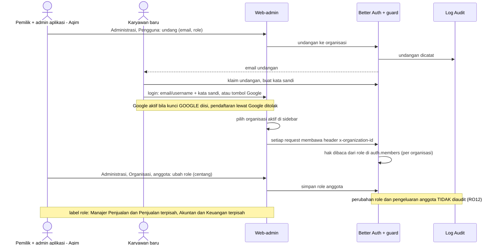

### Sesudah (disetujui 27/11, diubah 28/11) - web-admin

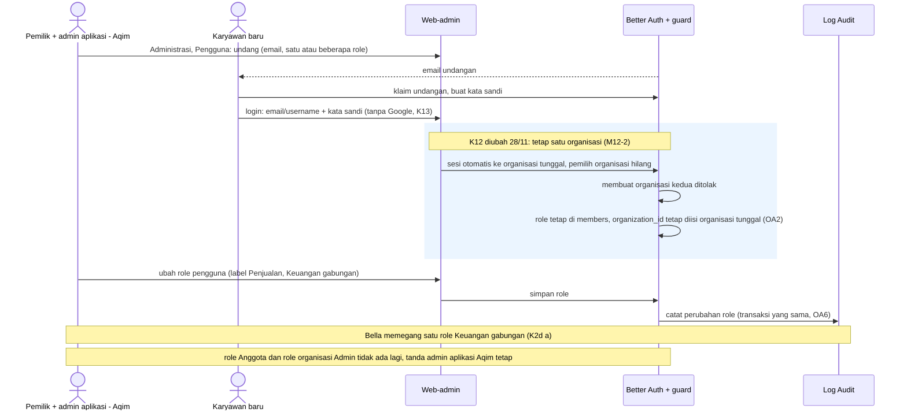

### Sesudah (disetujui 27/11) - portal pelanggan dan portal karyawan

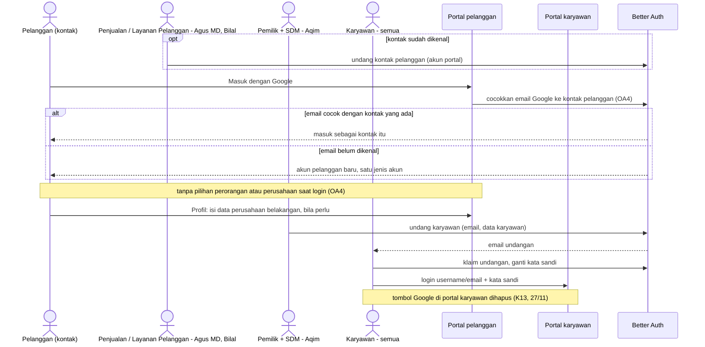

**Yang perlu diubah di kode:**

- K12 (diubah 28/11, Oki: M12-2): tetap satu organisasi. Server menolak
  organisasi kedua, tombol Tambah organisasi dihapus, pemilih organisasi
  disembunyikan, sesi otomatis ke organisasi tunggal. Halaman Organisasi,
  role, undangan, dan `organization_id` tetap. ADR singkat mengubah
  ADR-0001/0007/0012 (multi-organisasi). M12-3 gugur.
- Hapus tombol Google di `apps/web-admin/src/components/form/login-form.tsx`
  dan di `apps/web-employee` (K13, 27/11); isi `GOOGLE_*` di server dan
  aktifkan tombol Google di `apps/web-customer-portal` (Oki: konfigurasi
  Better Auth; programmer B: portal M07).
- Portal karyawan: undangan karyawan, klaim lalu ganti kata sandi (Oki).
- Portal pelanggan: satu jenis akun, tanpa pilihan perorangan/perusahaan saat
  login atau daftar; data perusahaan diisi di profil (OA4, programmer B: M07).
- Label dan daftar role yang bisa diberikan: Penjualan gabungan, Keuangan
  mendapat hak Akuntan, role Anggota dan role organisasi Admin dihapus, tanda
  admin aplikasi tetap (`erp-permissions.ts`, locale, Oki: M12-5); form tambah
  pengguna mendukung beberapa role (M12-8).
- Audit perubahan role, pengeluaran anggota, aktif/nonaktif akun
  (`organization.service.ts`, `user-admin.service.ts`; Oki: M12-1).

---

## 7. Keuangan: periode, jurnal manual, tutup bulan

**Yang berubah dan mengapa.** Tidak ada role yang bisa **menyiapkan periode
akuntansi**, termasuk Pemilik: route meminta `accounting_period:create` yang
tidak ada di kosakata hak (RO1). Tanpa periode, posting faktur, kuitansi,
tagihan, dan jurnal diduga gagal. Jurnal manual sudah maker-checker (pembuat
tidak boleh menyetujui) dan **tetap** begitu (K1a). Buka kembali periode
terkunci sekarang juga bisa dilakukan Akuntan, padahal rencana M09 hanya
Pemilik (RO4).

| Keputusan | Isi | Status |
|---|---|---|
| RO1 / OB4 | Tambah hak `create` periode untuk Pemilik dan Keuangan (gabungan Akuntan) | jawaban programmer B 27/11: (a) |
| K1a / OB9 | Jurnal manual tetap butuh orang kedua (Bella dan Aqim saling memeriksa) | jawaban programmer B 27/11: (b) |
| RO4 / OB6 | Buka kembali periode hanya Pemilik, dengan alasan dan audit; route memeriksa hak `reopen` | jawaban programmer B 27/11: (a) |
| K2d | Akuntan digabung ke Keuangan, dipegang Bella | jawaban programmer B 27/11: (a) gabung |

### Sekarang

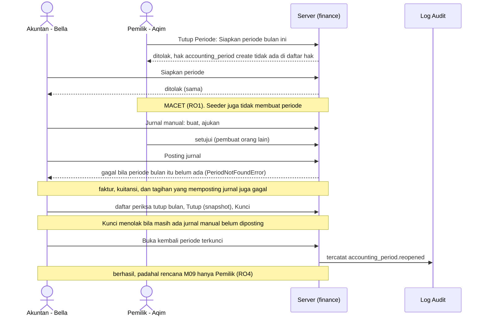

### Sesudah (disetujui 27/11)

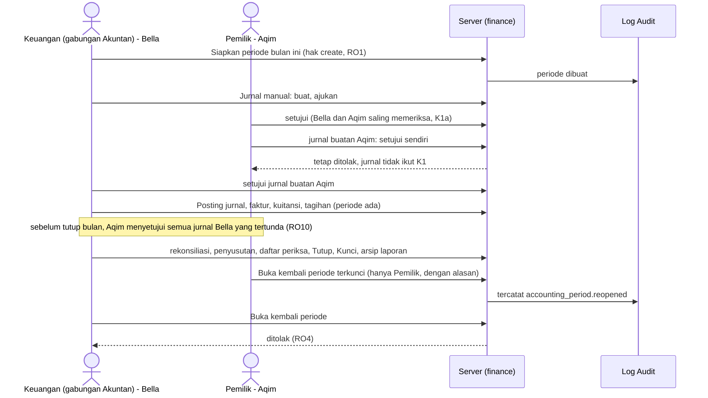

**Yang perlu diubah di kode:**

- Tambah aksi `create` di `accounting_period` dan berikan ke Pemilik dan Keuangan gabungan
  (`erp-permissions.ts`, `ledger.controller.ts`; Oki: M09). Alternatif yang
  ditolak rekomendasi: periode dibuat otomatis saat posting pertama.
- Buka kembali hanya Pemilik: route pembuka periode memeriksa hak `reopen`
  (sekarang hanya `close`), dan `reopen` tidak ikut ke role Keuangan gabungan
  (Oki, OB6).
- Jurnal manual: tidak ada perubahan kode (cek `manual-journal.service.ts:132`
  tetap). K2d (a) diputuskan programmer B 27/11: role `finance` mendapat hak
  `accountant` di `erpRoleGrants` (Oki, OA10).
- Teks daftar periksa tutup bulan diterjemahkan (OB15, tanpa keputusan).

---

## 8. Kasbon dan pertanggungjawaban

**Yang berubah dan mengapa.** Pertanggungjawaban butuh dua orang berbeda:
verifikator ≠ pengaju, penyetuju ≠ verifikator (`employee-advance.service.ts:217`,
`:235`). Hak verifikasi dan setuju hanya Pemilik dan Manajer Operasional, keduanya
Aqim, jadi persetujuan **selalu macet** (RO5). Halaman kasbon ada di Keuangan →
Beban yang tertutup bagi teknisi, PM, dan Pekerja Lepas (RO6). Keuangan dan
Akuntan tidak punya hak `advance`/`settlement` (OB13). Jawaban programmer B
27/11: pertanggungjawaban cukup **satu langkah oleh Aqim** (aturan verifikator ≠
penyetuju dihapus), kasbon dan pertanggungjawaban ikut K1, dan Aqim **tidak
mengajukan kasbon**, jadi titik macet kasbon buatan Aqim tidak ada lagi.

| Keputusan | Isi | Status |
|---|---|---|
| RO5 / X2 | Pertanggungjawaban satu langkah oleh Aqim; aturan verifikator ≠ penyetuju dihapus | jawaban programmer B 27/11: satu langkah oleh Aqim (mengganti rekomendasi lembar: Bella memverifikasi) |
| RO6 | Halaman kasbon dan pertanggungjawaban untuk pengaju, usul di portal karyawan | disetujui 27/11: halaman kasbon di portal karyawan |
| OB13 | Kasbon dicairkan **Aqim** (bukan Bella); pengaju memilih dirinya sendiri | disetujui 27/11 (mengganti rekomendasi lama: Bella diberi hak `advance`) |
| K1a / OB9 / X1 | Kasbon dan pertanggungjawaban ikut K1; jurnal manual tetap butuh orang kedua; Aqim tidak mengajukan kasbon | jawaban programmer B 27/11 (mengganti isian "B") |


### Sekarang

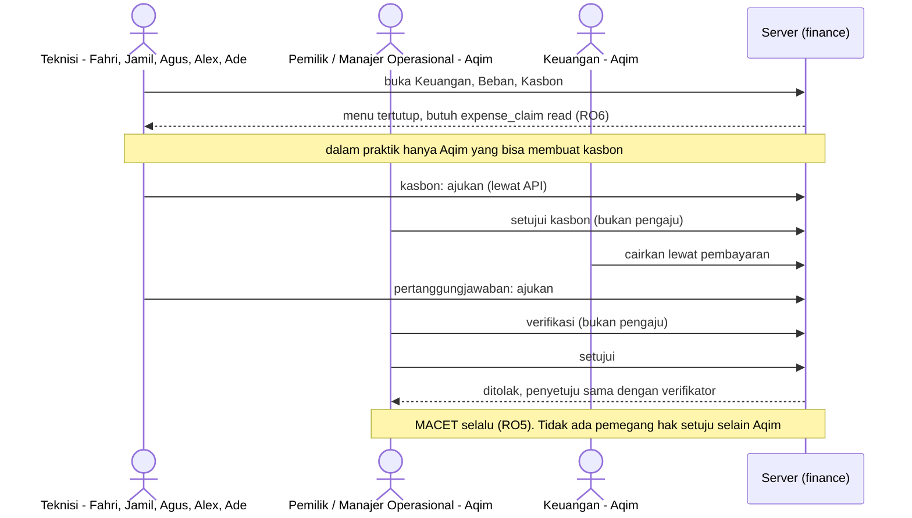

### Sesudah (disetujui 27/11)

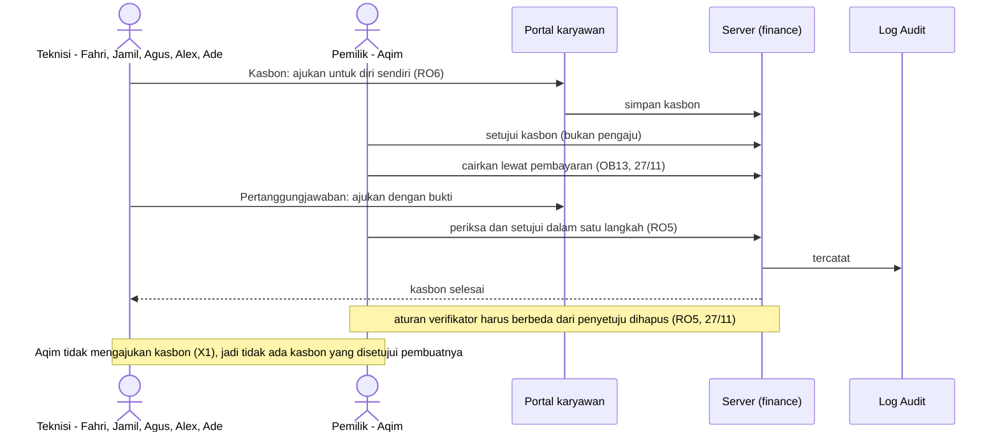

**Yang perlu diubah di kode:**

- Pertanggungjawaban satu langkah oleh Aqim: ubah `employee-advance.service.ts:217`,
  `:235` (verifikasi dan persetujuan digabung, cek verifikator ≠ penyetuju
  dihapus) (Oki, RO5).
- Hak pencairan kasbon untuk Keuangan gabungan bila OB13 diterima
  (`erp-permissions.ts`, Oki).
- Halaman kasbon dan pertanggungjawaban untuk pengaju: portal karyawan
  (`apps/web-employee`) atau menu sendiri di web-admin dengan hak
  `advance.read`/`settlement.read` (Oki).
- Data karyawan untuk semua teknisi (data oleh Aqim; seeder HR milik
  programmer B, OG4).

---

## 9. Peminjaman aset

**Yang berubah dan mengapa.** Teknisi punya hak mengajukan, tetapi form memuat
unit dari `/inventory/items` yang dijaga `asset:read`, jadi form tidak bisa
dipakai (OD1). Larangan menyetujui pinjaman sendiri tidak pernah berlaku karena
`canApprove` diisi dari hak setuju (`borrowing.controller.ts:38`), jadi PM bisa
menyetujui pinjamannya sendiri (OD2). Gudang juga boleh menyerahkan unit yang
belum disetujui (M06 C13).

| Keputusan | Isi | Status |
|---|---|---|
| OD1 / X7 | Daftar unit pinjam khusus (endpoint pilihan unit tersedia yang dijaga `asset_borrowing:create`) | jawaban programmer B 27/11: (a) daftar unit khusus |
| OD2 / K7a | Pembuat tidak boleh menyetujui, kecuali Pemilik dengan audit | jawaban programmer B 27/11: OD2 diperbaiki |
| C13 | Serah tanpa persetujuan hanya untuk Pemilik | disetujui 27/11 |

### Sekarang

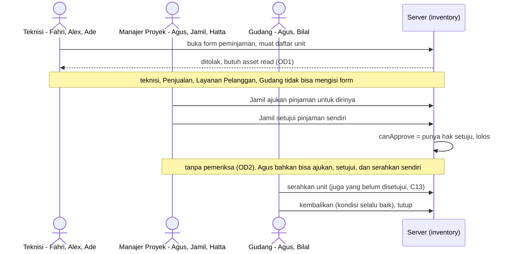

### Sesudah (disetujui 27/11)

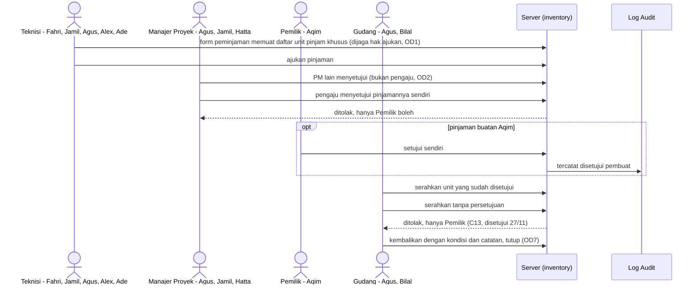

**Yang perlu diubah di kode:**

- `canApprove` di `borrowing.controller.ts` diganti aturan bersama (Pemilik
  saja yang boleh menyetujui sendiri) di `borrowing-request.service.ts` (Oki).
- Endpoint pilihan unit untuk peminjaman tanpa `asset:read`, dan nama (bukan
  id) di layar (Oki, OD1/OD4).
- Serah tanpa persetujuan dibatasi Pemilik di `borrowing.service.ts` bila C13
  diputuskan (Oki).
- Pilihan kondisi saat pengembalian (OD7, Oki).

---

## 10. Absensi lokasi portal karyawan

**Yang berubah dan mengapa.** Sekarang absen di luar radius tetap disimpan,
hanya ditandai `out_of_range`, petunjuk "Radius 100 m" tertulis mati, dan tidak
ada cek radius saat check-out. Jawaban programmer B 27/11: absen di luar radius
**ditolak** (OG1 (a)), berbeda dari rekomendasi lama (simpan dan tandai, lalu
ditinjau). Karena data di luar radius tidak pernah tersimpan, layar tinjau
tidak dibutuhkan. Pekerja non-PIC diusulkan bisa melihat kunjungannya sendiri
(OG2). Portal karyawan diterima sebagai tambahan (K9, rapat 27/11).

| Keputusan | Isi | Status |
|---|---|---|
| OG1 | Absen lokasi di luar radius ditolak | jawaban programmer B 27/11: (a) tolak |
| PK-1 | Radius dari pengaturan; cek radius yang sama saat check-out | usulan |
| OG2 | Non-PIC melihat kunjungannya sendiri | usulan |
| K9 | Portal karyawan diterima sebagai tambahan kontrak | disetujui rapat 27/11 |

### Sekarang

```mermaid
sequenceDiagram
    actor K as Teknisi / Manajer Proyek - Fahri, Jamil, Agus, Alex, Ade, Hatta
    participant EP as Portal karyawan
    participant SV as Server (project, PostGIS)

    K->>EP: proyek, Kunjungan lokasi saya
    EP-->>K: non-PIC tidak melihat kunjungannya sendiri (OG2)
    K->>EP: izinkan lokasi, ambil selfie, Check-in
    EP->>SV: simpan titik dan foto
    SV->>SV: hitung jarak dari titik proyek
    alt di dalam radius
        SV-->>K: tersimpan
    else di luar radius
        SV-->>K: tetap tersimpan, ditandai out_of_range
    end
    K->>EP: Check-out
    Note over EP,SV: tanpa cek radius saat check-out. Petunjuk radius 100 m tertulis mati
    Note over K,SV: tidak ada layar tinjau untuk absen di luar radius
```

### Sesudah (disetujui 27/11)

```mermaid
sequenceDiagram
    actor K as Teknisi / Manajer Proyek - Fahri, Jamil, Agus, Alex, Ade, Hatta
    participant EP as Portal karyawan
    participant SV as Server (project, PostGIS)

    K->>EP: proyek, Kunjungan lokasi saya
    EP-->>K: non-PIC melihat kunjungannya sendiri (OG2, usulan)
    K->>EP: izinkan lokasi, ambil selfie, Check-in
    EP->>SV: kirim titik dan foto
    SV->>SV: hitung jarak dari titik proyek, radius dari pengaturan (PK-1)
    alt di dalam radius
        SV-->>K: tersimpan
    else di luar radius
        SV-->>K: ditolak, tidak tersimpan, tampil jarak ke lokasi (OG1 a)
    end
    K->>EP: Check-out
    SV->>SV: cek radius yang sama saat check-out (PK-1, usulan)
    Note over K,SV: layar tinjau tidak perlu, karena absen di luar radius tidak pernah tersimpan
```

**Yang perlu diubah di kode:**

- `site-attendance.service.ts`: tolak check-in di luar radius (OG1, Oki);
  pesan galat en + id di `apps/web-employee`.
- Radius dari pengaturan, bukan teks mati "100 m"; cek radius saat check-out
  (PK-1, Oki, usulan).
- Data lama bertanda `out_of_range` dibiarkan sebagai riwayat (usulan).
- Rute "kunjungan saya" untuk non-PIC (`portal-project.controller.ts`, Oki,
  OG2).

---

## 11. Peta bentrok sesudah

Semua titik persetujuan dari `validasi-konsep-saat-ini.md` 3.7 dan
`validasi-konsep-modul-oki.md` 3.7, dengan status sekarang dan status bila
usulan di file ini diterima. Susunan role mengikuti K2 dan K2d (a), jawaban
programmer B 27/11 (diperbarui 2026-11-27 sesuai keputusan tanya-jawab).

| Dokumen | Sekarang | Sesudah (usulan) | Keputusan yang mengubah |
|---|---|---|---|
| Permintaan pembelian | 🟢 dibuat teknisi/PM, 🔴 dibuat Aqim | 🟢 semua (buatan Aqim disetujui sendiri dengan audit) | K1, OA5–OA7 |
| PO | 🔴 selalu macet (R2), plus nomor > 32 karakter (K6) | 🟢 Aqim menyetujui sendiri dengan audit, nomor pendek | K1, K6, OA5–OA7 |
| Retur pembelian | 🔴 selalu macet (R2) | 🟢 Aqim menyetujui sendiri dengan audit | K1 |
| Batal PO | 🟡 hanya Pemilik | 🟡 Pemilik (Pembelian/Manajer Operasional tidak dipakai) | B2, K2c |
| Penyesuaian stok | 🟢 dibuat Gudang, 🟡 buatan Aqim lolos lewat pengecualian | 🟢 dibuat Gudang, 🟢 buatan Aqim dengan audit (pengecualian dihapus) | K1 |
| SPH | 🟢 Agus MD dan Bilal saling menyetujui | 🟢 sama, satu role Penjualan; SPH Aqim disetujui sendiri dengan audit | K2b, K1 |
| Retur penjualan | 🟢 | 🟢 | K2b |
| SO → surat jalan | 🟡 Bilal mengirim SO-nya sendiri | 🟡 diterima, diawasi lewat laporan | K7 |
| Cuti / lembur diajukan karyawan | 🟢 disetujui Aqim | 🟢 | K2a |
| Cuti dicatat Aqim atas nama karyawan | 🔴 macet | 🟢 disetujui sendiri dengan audit | A3, K1 |
| Cuti Aqim sendiri | 🔴 macet (3.7) | tidak berlaku: Aqim tidak cuti | A3a |
| Klaim garansi | 🟡 Bilal membuat dan menyetujui | 🟡 diterima | K7a |
| Gaji | 🟡 Aqim menyiapkan, menyetujui, membayar | 🟡 Aqim menyiapkan dan menyetujui dengan audit, 🟢 dibayar Bella (K2d a) | K1, K7a, K2d |
| Pembayaran | 🟡 tanpa pemeriksa | 🟡 diterima, diawasi lewat audit dan rekonsiliasi | K7a, OB7 |
| Klaim biaya | 🟡 tanpa pemeriksa | 🟡 diterima, diawasi lewat laporan dan audit (OB8, 27/11) | OB8 |
| Tagihan pemasok | 🟡 tanpa pemeriksa | 🟡 diterima | K7a |
| Jurnal manual | 🟢 Bella dan Aqim saling menyetujui | 🟢 tidak berubah (tertahan bila salah satu tidak ada) | K1a |
| Penghapusan piutang | 🟢 | 🟢 tidak berubah | K1a |
| Periode akuntansi: siapkan | 🔴 tidak ada pemegang hak | 🟢 Bella (Keuangan gabungan) atau Aqim, tidak macet lagi | RO1 |
| Periode: tutup, kunci | 🟡 Bella tanpa pemeriksa | 🟡 diterima | K7a |
| Periode: buka kembali | 🟡 Bella juga bisa | 🟡 hanya Aqim, route memeriksa `reopen`, dengan alasan dan audit | RO4 |
| Kasbon diajukan teknisi | 🟢 disetujui Aqim (halaman tertutup) | 🟢 dari portal karyawan | RO6 |
| Kasbon diajukan Aqim | 🔴 macet | tidak berlaku: Aqim tidak mengajukan kasbon; bila suatu saat mengajukan, ikut K1 (disetujui sendiri dengan audit) | K1a, X1 |
| Pertanggungjawaban: verifikasi | 🟢 Aqim | digabung ke persetujuan (satu langkah) | RO5, X2 |
| Pertanggungjawaban: persetujuan | 🔴 selalu macet | 🟢 satu langkah oleh Aqim (pengaju teknisi, bukan Aqim) | RO5, X2 |
| Catatan pajak dan pemotongan | 🟡 Bella membuat dan memverifikasi | 🟡 diterima, Aqim memeriksa rekap | RO13 |
| Penghapusan aset | 🟡 Aqim sendiri | 🟡 Aqim sendiri, dengan audit disetujui pembuat | K1 |
| Peminjaman aset | 🟡 PM menyetujui pinjamannya sendiri, Gudang serah tanpa persetujuan | 🟢 PM lain atau Aqim (dengan audit); serah tanpa persetujuan hanya Aqim | OD1, OD2, C13 |
| Perubahan role anggota | 🟡 tanpa pemeriksa, tidak diaudit | 🟡 tanpa pemeriksa, diaudit dalam transaksi | OA5, OA6 |
| Bagi hasil investor | ⚪ belum dibangun | ⚪ ditunda, halaman investor hanya Pemilik | OE1, K10 **[Diubah 28/11, IV-1: M11 dibangun lengkap sekarang, `rancangan-investor-m11.md`]** |
| Absen lokasi di luar radius | 🟡 tersimpan dengan tanda, tanpa layar tinjau | 🟢 ditolak di server, tidak ada data yang perlu ditinjau | OG1 |

Keterangan: 🔴 macet (aplikasi menolak), 🟡 berjalan tanpa orang kedua,
🟢 ada orang kedua atau persetujuan Pemilik dengan audit, ⚪ belum ada.

**Ringkasan sesudah:** semua 🔴 menjadi 🟢 **dengan syarat** K1, RO1, RO5 (sudah
disetujui Pemilik 27/11) dan audit ikut transaksi
(OA5–OA7) dikerjakan lebih dulu. Sisa 🔴 kasbon buatan Aqim hilang karena Aqim
tidak mengajukan kasbon dan kasbon ikut K1 (X1).

---

## 12. Ketidakcocokan antar-catatan

Ditemukan saat menyusun file ini (2026-11-27). Belum dibetulkan di file
sumbernya; dicatat supaya dibereskan saat menyalin hasil rapat.

Diperbarui 2026-11-27 sesuai keputusan tanya-jawab: butir 2–9 sudah dijawab
programmer B (lembar rapat bagian 0 dan 8b, X1–X7) dan disalin ke file
sumbernya; tinggal dikonfirmasi Pemilik dan Oki. Butir 10 masih terbuka.

1. **Cuti Aqim.** `validasi-konsep-saat-ini.md` 3.7 masih menulis "Cuti Aqim
   sendiri macet" dan 3.8 "Cuti Aqim disetujui sendiri", sedangkan isian A3a di
   lembar rapat: Aqim tidak cuti, tidak perlu penyetuju.
2. **K1a.** Kolom Keputusan lembar rapat berisi "B" (tidak berlaku untuk
   jurnal, kasbon, dan pertanggungjawaban), padahal kolom rekomendasi memisahkan:
   (b) untuk jurnal, (a) untuk kasbon dan pertanggungjawaban.
   `validasi-konsep-modul-oki.md` 3.8 aturan 1 malah memasukkan kasbon ke daftar
   yang boleh disetujui sendiri oleh Pemilik. Akibat K1a (b): kasbon buatan Aqim
   butuh penyetuju kedua yang belum punya hak (OB9, OB13). → Dijawab 27/11 (X1): kasbon dan pertanggungjawaban ikut K1, jurnal tetap orang kedua, Aqim tidak mengajukan kasbon.
3. **RO5.** Lembar rapat merekomendasikan (a) Bella memverifikasi;
   `validasi-konsep-modul-oki.md` 3.3 dan 3.8 menyebut "satu langkah oleh Aqim"
   sebagai pilihan pertama. Diagram bagian 8 memakai pilihan lembar. → Dijawab 27/11 (X2): satu langkah oleh Aqim; diagram bagian 8 sudah diganti.
4. **K2d.** Tabel daftar role di lembar rapat berisi "Akuntan: Merging ke
   keuangan", sedangkan rekomendasi K2d dan OA10 adalah (b) dua role tanpa ubah
   kode, dan kolom Keputusan K2d masih kosong. `rencana-perubahan-modul-oki.md`
   sudah mencatat bentrok ini. → Dijawab 27/11 (X3): (a) gabung di kode.
5. **Anggota.** Lembar rapat: Anggota "Hapus"; tetapi tabel usulan K2 di lembar
   yang sama dan `validasi-konsep-saat-ini.md` 3.8 masih memberi Dafrin dan Oki
   "Pekerja Lepas, Anggota". → Dijawab 27/11 (X4): Anggota dihapus, Dafrin dan Oki hanya Pekerja Lepas.
6. **K2b belum diisi.** Banyak dokumen (dan diagram Sesudah di sini) sudah
   memakai satu role Penjualan, tetapi kolom Keputusan K2b di lembar rapat
   masih kosong. Di tabel daftar role, baris Penjualan sudah berisi "Merging
   dengan penjualan". → Dijawab 27/11 (X5): K2b (a).
7. **B1.** `bahan-keputusan.md` merekomendasikan (a) atau (b) bergantung cara
   PO dikirim; lembar rapat merekomendasikan (b) dan sudah terisi "B". Kolom
   Keputusan di `bahan-keputusan.md` masih kosong untuk semua butir. → Dijawab 27/11 (X5): B1 (b), langkah dihapus; kolom Keputusan `bahan-keputusan.md` sudah diisi.
8. **B2 tanpa efek nyata.** Pilihan (b) memberi hak batal PO ke Pembelian dan
   Manajer Operasional, padahal keduanya tidak dipakai (K2, K2c). Dalam praktik
   pembatal tetap Aqim. → Dijawab 27/11 (X6): (a) biarkan, berlaku bila nanti ada staf pembelian.
9. **OD1.** Lembar rapat 8a merekomendasikan "(a) perbaiki keduanya", sedangkan
   `bahan-keputusan-modul-oki.md` OD1 merekomendasikan pilihan (b) (endpoint
   unit pinjam, bukan memberi `asset:read`). Tidak bertentangan, tetapi cara
   perbaikannya perlu satu jawaban. → Dijawab 27/11 (X7): daftar unit khusus.
10. **Pemegang SDM sekarang.** `uat-modul/diagram-alur-per-role.md` bagian 0
    menulis SDM "usulan Aqim", dan daftar role Aqim sekarang (Pemilik, Admin,
    Manajer Operasional, Pembelian, Keuangan) tidak memuat SDM. Diagram M08 di
    file itu memakai aktor "SDM - Aqim (usulan)" untuk kondisi sekarang.
