# Autentikasi dan hak akses

Kembali ke [README](README.md). Dicatat 2026-11-26, dicek ke kode di `main`\
(9974a817). Pemilik wilayah: **Oki (M12 Laporan & Hak Akses)**. Semua modul\
memakai lapisan ini, jadi perubahan apa pun di sini berdampak ke modul\
programmer B juga.

## Kondisi saat ini

### Better Auth

* Better Auth dipasang langsung ke rantai plugin Elysia (`apps/backend/src/providers/better-auth/`). Handler-nya di-mount mentah di `apps/backend/src/app/app.ts` (`.mount(auth.handler)`), jadi rute `/api/auth/*` mengikuti bentuk respons Better Auth, bukan envelope ERP.

* Plugin aktif (`providers/better-auth/plugins/`): `admin`, `organization`, `username`, `api-key`, `email-otp`, `magic-link`, `passkey`, `multi-session`, `last-login-method`, `i18n`, `open-api`, `identifier`. Login Google tersedia tetapi `disableSignUp: true` (`options/social-providers.auth.ts`).

* Tabel Better Auth ada di schema `auth` (`drizzle/schemas/auth.schema.ts`), diubah **manual** (jangan jalankan `auth:generate`, lihat AGENTS.md).

* Sesi disimpan juga di Redis (`options/secondary-storage.auth.ts`). Karena itu seeder yang menjalankan `flushall` mengeluarkan semua orang (lihat [infrastruktur-dan-pengembangan.md](infrastruktur-dan-pengembangan.md)).

### Dua lapis role (ADR-0006, ADR-0018)

| Lapis           | Disimpan di         | Isi                                                                                                                                                                                                                    | Fungsi                                                                                        |
| --------------- | ------------------- | ---------------------------------------------------------------------------------------------------------------------------------------------------------------------------------------------------------------------- | --------------------------------------------------------------------------------------------- |
| Role aplikasi   | `auth.users.role`   | `admin`, `investor`, `customer` (`appRoleNames` = investor, customer; `admin` dari plugin Better Auth)                                                                                                                 | Administrasi akun (admin) dan identitas portal (investor, customer). Tidak memberi hak bisnis |
| Role organisasi | `auth.members.role` | 17 role `erpRoleNames` (owner, admin, member, operations_manager, sales_manager, sales, project_manager, technician, freelancer, purchasing, warehouse, finance, accountant, hr, customer_service, marketing, auditor) | Semua hak bisnis per organisasi                                                               |

* **Beberapa role per anggota:** `members.role` berisi daftar dipisah koma. Hak digabung. Halaman ubah anggota memakai centang per role; impor undangan menerima beberapa role; hanya form tambah pengguna yang memilih satu role (dicek 2026-11-26, lihat `../validasi-konsep-saat-ini.md` 1.1).

* **Satu sumber hak:** `packages/common/src/authorization/erp-permissions.ts` (`erpStatements`, `erpRoleGrants`, `appRoleGrants`). Backend, web-admin, dan seeder memakai file ini. Daftar route dan guard dibuat skrip di `docs/architecture/role-permission.md` (`bun docs/architecture/gen-role-permission.ts`).

* **Pencegahan eskalasi:** `assignableOrganizationRoles` / `grantableOrganizationRoles` di file yang sama; hanya owner yang bisa memberi owner, owner terakhir tidak bisa dihapus.

### Pemeriksaan di backend vs frontend

| Tempat                | Mekanisme                                                                                                                                                                                                                             | Sifat               |
| --------------------- | ------------------------------------------------------------------------------------------------------------------------------------------------------------------------------------------------------------------------------------- | ------------------- |
| Backend: guard        | `domainPlugin({ guards })` di `src/http/plugin.ts`: `none`, `session`, `erp`, `erp+session`; izin per route `erp: { permission: ['resource:action'] }` dicek lewat `IPermissionResolver` (`src/authorization/permission-resolver.ts`) | **Yang memutuskan** |
| Backend: guard khusus | `warehouseGuard` (penanggung jawab gudang, ADR-0017), `employeePortal` guard, `portalGuard` (portal pelanggan), `publicApi` (kunci website), `adminOrErpGuard` (nomor kode)                                                           | Yang memutuskan     |
| Backend: service      | Kepemilikan data, status dokumen, larangan menyetujui sendiri                                                                                                                                                                         | Yang memutuskan     |
| Frontend (web-admin)  | Menu dan tombol disembunyikan menurut hak (`nav-config.ts`, `CODE_NUMBER_READ`, dll.)                                                                                                                                                 | **Hanya tampilan**  |

### Aturan "pembuat tidak boleh menyetujui sendiri"

ADR-0006 butir 6 dan `docs/architecture/security-and-access.md` berbunyi\
"no self-approval regardless of roles". Di kode, aturannya dijalankan per\
service:

| Dokumen                       | Service (baris)                                                                                                | Error                                 | Perilaku                                                                                                |
| ----------------------------- | -------------------------------------------------------------------------------------------------------------- | ------------------------------------- | ------------------------------------------------------------------------------------------------------- |
| SPH                           | `sale/services/quotation.service.ts:367`                                                                       | `QuotationSelfApprovalError`          | Ditolak, termasuk Pemilik                                                                               |
| Retur penjualan               | `sale/services/sales-return.service.ts:350`                                                                    | `SalesReturnSelfApprovalError`        | Ditolak                                                                                                 |
| Permintaan pembelian          | `procurement/services/purchase-request.service.ts:204, 214`                                                    | `PurchaseRequestSelfApprovalError`    | Ditolak                                                                                                 |
| PO                            | `procurement/services/purchase-order.service.ts:225`                                                           | `PurchaseOrderSelfApprovalError`      | Ditolak                                                                                                 |
| Retur pembelian               | `procurement/services/purchase-return.service.ts:342`                                                          | `PurchaseReturnSelfApprovalError`     | Ditolak                                                                                                 |
| Cuti, lembur                  | `human-resource/services/leave.service.ts:152, 185, 287`                                                       | `SelfDecisionError`                   | Ditolak bila pencatat = pemutus                                                                         |
| Jurnal manual                 | `finance/services/manual-journal.service.ts:132`                                                               | `JournalSelfApprovalError`            | Ditolak (wilayah Oki)                                                                                   |
| Penghapusan piutang           | `finance/services/receivable-adjustment.service.ts:205`                                                        | `WriteOffSelfApprovalError`           | Ditolak (wilayah Oki)                                                                                   |
| Kasbon dan pertanggungjawaban | `finance/services/employee-advance.service.ts:126, 217, 235`                                                   | `AdvanceSameActorError`               | Ditolak (wilayah Oki)                                                                                   |
| **Penyesuaian stok**          | `inventory/services/adjustment.service.ts:374` + `inventory/controllers/adjustment.controller.ts:60-71`        | `SelfApprovalForbiddenError`          | **Pengecualian:** boleh bila pembuat punya `stock_adjustment:approve` ("documented bypass", 2026-11-03) |
| **Peminjaman aset**           | `inventory/services/borrowing-request.service.ts:259-265` + `inventory/controllers/borrowing.controller.ts:38` | `BorrowingSelfApprovalForbiddenError` | **Pengecualian:** boleh bila pembuat punya `asset_borrowing:approve` (wilayah Oki, M06)                 |
| Gaji (periode)                | `human-resource/services/salary.service.ts:198`                                                                | —                                     | Tidak ada cek pembuat; hanya `payroll:approve`                                                          |

### Login hanya lewat undangan (ADR-0029)

* Tidak ada pendaftaran bebas untuk staf. Akun dibuat dari undangan (`/admin/invitations`, klaim publik `/invitations/claim/:token`).

* `providers/better-auth/ac/login-gate.ts`: akun harus `active` (bukan `pending` undangan, bukan `deactivated`, tidak terhapus). Web-admin hanya untuk admin aplikasi atau anggota dengan minimal satu role organisasi internal. Pengguna portal saja (investor/customer, tanpa keanggotaan) ditolak.

### Akun portal

| Portal                                 | Siapa                                                  | Guard                                                                                                                                                            | Catatan                                                                                     |
| -------------------------------------- | ------------------------------------------------------ | ---------------------------------------------------------------------------------------------------------------------------------------------------------------- | ------------------------------------------------------------------------------------------- |
| Pelanggan (`apps/web-customer-portal`) | Kontak pelanggan, role aplikasi `customer`             | `portalGuard` (`src/authorization/portal-auth.ts`): cookie sesi Better Auth disimpan server portal, bukan browser; `customer.customers.portal_status = 'active'` | Diundang dari `/admin/customers/portal-accounts`; perorangan bisa daftar sendiri (kode OTP) |
| Karyawan (`apps/web-employee`)         | Karyawan dengan baris `human_resource.employees` hidup | `employee-portal-guard.ts`: menolak role aplikasi `admin`, `investor`, `customer`                                                                                | Lihat [portal-dan-website.md](portal-dan-website.md)                                        |
| Investor (`apps/web-investor`)         | Role aplikasi `investor`                               | Belum ada API                                                                                                                                                    | Masih template Vite                                                                         |

## Alur lintas modul

```mermaid
flowchart LR
  U["Pengguna login"] --> BA["Better Auth sesi"]
  BA --> LG["login-gate: akun aktif dan role internal"]
  LG --> G["domainPlugin guard erp"]
  G --> PR["permission-resolver dari erp-permissions.ts"]
  PR --> C["Controller modul"]
  C --> S["Service: status, kepemilikan, cek pembuat"]
  S --> AU["Audit log"]
  FE["web-admin nav-config"] -.->|"hanya tampilan"| U
```

Setiap modul bisnis bergantung pada tiga hal milik M12: daftar hak di\
`erp-permissions.ts`, guard di `src/http/plugin.ts` dan `src/authorization/`,\
dan audit (`src/shared/audit/audit.writer.ts` ke modul `audit`). Menambah\
hak untuk fitur modul programmer B berarti mengubah file milik Oki.

## Catatan dan temuan

1. **Pengecualian persetujuan sendiri lebih luas dari yang tercatat.** Untuk penyesuaian stok dan peminjaman aset, route approve sendiri sudah mewajibkan izin `approve`, dan pengecualiannya juga memakai izin yang sama. Akibatnya aturan "pembuat tidak boleh menyetujui" **tidak pernah berlaku** di dua dokumen itu: siapa pun yang bisa menyetujui bisa menyetujui miliknya sendiri. Catatan sebelumnya (`../ringkasan-arsitektur.md` D5) hanya menyebut penyesuaian stok; peminjaman aset (M06, Oki) ternyata sama.

2. **Gaji tidak punya cek pembuat.** Persetujuan periode gaji hanya butuh `payroll:approve`. Dengan tim sekarang, Aqim menyiapkan dan menyetujui sendiri (🟡 di `../validasi-konsep-saat-ini.md` 3.7). Ini sesuai arah A1, tapi tidak ada catatan audit khusus "disetujui pembuat".

3. **Akun&#x20;**`admin`**&#x20;Aqim tidak bisa masuk portal karyawan.** Guard portal karyawan menolak role aplikasi `admin`. Bila Aqim ingin absen atau melihat slip gaji sendiri lewat portal, ia perlu akun kedua tanpa tanda admin.

4. **Halaman Produk dan Gudang memakai tanda admin aplikasi**, bukan hak role (`appAdminOnly` di seksi nomor kode gudang, dan B3 di `../bahan-keputusan.md`). Ini mencampur lapis akun dengan lapis bisnis, berlawanan dengan ADR-0006.

5. Dokumen `security-and-access.md` masih menulis 19 role organisasi dan batas nominal `approval_rule` yang tidak ada di kode (E3, E4 di `../bahan-keputusan.md`).

6. Banyak metode login (passkey, magic link, email OTP, Google) aktif, padahal kontrak hanya meminta "login peran". Lihat [di-luar-scope.md](di-luar-scope.md).

## Perubahan mendatang

| Perubahan                                                                                                                                                                              | Sumber                                                                | Dampak                                                                                                                                                                                                                                                  | Status                                                                          |
| -------------------------------------------------------------------------------------------------------------------------------------------------------------------------------------- | --------------------------------------------------------------------- | ------------------------------------------------------------------------------------------------------------------------------------------------------------------------------------------------------------------------------------------------------- | ------------------------------------------------------------------------------- |
| Pemilik boleh menyetujui dokumennya sendiri, dicatat di audit ("disetujui oleh pembuat (Pemilik)"), untuk SPH, PR, PO, retur pembelian, retur penjualan, penyesuaian stok, cuti/lembur | `../validasi-konsep-saat-ini.md` 3.8, `../bahan-keputusan.md` A1 (b)  | Satu aturan bersama dipakai 7 service milik programmer B; tombol Setujui tampil untuk Pemilik; test; ±1 hari                                                                                                                                            | disetujui Pemilik 27/11 (K1); audit OA5–OA7 dikerjakan lebih dulu |
| Ubah ADR-0006 butir 6 dan `security-and-access.md` sesuai A1                                                                                                                           | `../bahan-keputusan.md` E5                                            | Dokumen milik Oki; harus lebih dulu dari perubahan kode                                                                                                                                                                                                 | K1 disetujui 27/11; ADR-0006 diubah Oki sebelum kode. `security-and-access.md` belum diubah (arahan programmer B) |
| Ganti pengecualian penyesuaian stok (semua pemegang hak setuju) dengan aturan "hanya Pemilik"                                                                                          | 3.8 aturan 4                                                          | Perilaku `adjustment.controller.ts`/`adjustment.service.ts` berubah; test bypass diganti                                                                                                                                                                | direncanakan (setelah A1)                                                       |
| Putuskan nasib pengecualian peminjaman aset (sama polanya dengan penyesuaian stok)                                                                                                     | temuan 1 di atas                                                      | Wilayah Oki (M06); sebaiknya ikut aturan A1 supaya seragam                                                                                                                                                                                              | usulan                                                                          |
| Catatan audit untuk persetujuan gaji oleh orang yang sama                                                                                                                              | temuan 2                                                              | `salary.service.ts` (programmer B, T19/T20)                                                                                                                                                                                                             | usulan                                                                          |
| Halaman Produk/Gudang mengikuti hak role, bukan tanda admin aplikasi                                                                                                                   | `../bahan-keputusan.md` B3                                            | web-admin route guard + `appAdminOnly`; hak sudah ada di server                                                                                                                                                                                         | disetujui Pemilik 27/11 (B3) |
| Hak tambahan: Admin boleh tambah pelanggan (C3), Gudang baca PO/SO (B4), Admin baca proyek (D3)                                                                                        | `../bahan-keputusan.md`                                               | Ubah `erp-permissions.ts` (Oki) lalu `bun docs/architecture/gen-role-permission.ts`                                                                                                                                                                                  | B4 disetujui Pemilik 27/11; C3 dan D3 tidak berlaku (role organisasi Admin dihapus) |
| Form tambah pengguna mendukung beberapa role                                                                                                                                           | `../bahan-keputusan.md` D2                                            | web-admin saja; backend sudah mendukung                                                                                                                                                                                                                 | usulan                                                                          |
| Atur ulang role anggota sesuai rekomendasi (16 → 12 role terpakai; dengan K2b, K2d, dan Anggota dihapus menjadi 10, 27/11)                                                                                                                     | 3.8                                                                   | Data saja, oleh Aqim di Administrasi → Pengguna                                                                                                                                                                                                         | disetujui Pemilik 27/11 |
| **Diubah 28/11: tetap satu organisasi** (tambah organisasi dimatikan, pemilih disembunyikan; M12-2). Rencana lama: ~~Hapus lapisan organisasi~~ (satu perusahaan, tanpa pilihan organisasi; role tidak lagi per organisasi)                                                                               | Arah baru programmer B 2026-11-26; `../lembar-keputusan-rapat.md` K12 | Besar: role di `auth.members` pindah ke tingkat pengguna, kolom `organization_id` di 18 file skema, header `x-organization-id`, pemilih organisasi di sidebar, undangan organisasi, ADR-0006 dan ERP-0031 (tautan gudang–organisasi). Butuh ADR baru, `docs.dbml`, migrasi, seed, test | disetujui Pemilik 27/11: (b) bertahap (1 sembunyikan pemilih organisasi, 2 role ke tingkat pengguna, 3 hapus `organization_id`, ADR baru) |
| **Login web-admin dan portal karyawan hanya username/email + kata sandi**; tombol Google dihapus; karyawan diundang, mengganti kata sandi, lalu login                                                                                                           | Arah baru 2026-11-26; K13                                             | web-admin `login-form.tsx` (`signIn.social`); Better Auth Google tetap aktif untuk portal pelanggan; `apps/web-employee` tombol Google dihapus, alur undangan karyawan                                                                                                                                                               | disetujui Pemilik 27/11 (K13 (a), OA3) |
| **Portal pelanggan login dengan Google, satu jenis akun**; tanpa pilihan perorangan/perusahaan saat login, data perusahaan diisi belakangan di profil                                                                                                                                               | Arah baru 2026-11-26; K13                                             | `web-customer-portal` (tombol masih "segera hadir"), pencocokan akun Google ke kontak lewat email, `GOOGLE_*` di server                                                                                                                                 | disetujui Pemilik 27/11 (K13, OA4) |
| Gabung Manajer Penjualan + Penjualan menjadi satu role "Penjualan"                                                                                                                     | K2b                                                                   | `erp-permissions.ts`: `sales` tidak ditawarkan, label `sales_manager` = "Penjualan"                                                                                                                                                                     | disetujui Pemilik 27/11 (K2b (a)) |
| Role Akuntan digabung ke Keuangan (atau Bella diberi dua role)                                                                                                                         | K2d                                                                   | Digabung: ubah `erpRoleGrants` (`finance` mendapat hak `accountant`, Oki); Bella melihat gaji dan rekening karyawan                                                                                                                                                                                           | disetujui Pemilik 27/11 (K2d (a) gabung) |
| Hapus role Anggota (Dafrin, Oki hanya Pekerja Lepas) dan role organisasi Admin; tanda admin aplikasi Aqim tetap | `../lembar-keputusan-rapat.md` bagian 0, X4 | `erp-permissions.ts`, seeder, test, locale (Oki); Pekerja Lepas tanpa absensi/slip gaji di aplikasi | disetujui Pemilik 27/11 |
