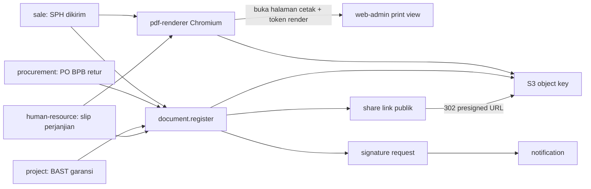

# Dokumen, tanda tangan, dan file

Kembali ke [README](README.md). Dicatat 2026-11-26, dicek ke kode di `main`.
Modul `document` dipakai oleh penjualan, pembelian, proyek, tiket, SDM,
inventaris, dan pembayaran, tetapi **tidak masuk pembagian modul M01–M12**.
Penyimpanan file (S3) dan galeri foto juga lapisan bersama.

## Kondisi saat ini

### Register dokumen (schema `document`)

- Modul: `apps/backend/src/app/document/`. Tabel di
  `drizzle/schemas/document.schema.ts`: `templates`, `documents` (register +
  penerbitan), `files`, `signatures`, `access_logs`, `shares`, `tags`,
  `tag_links`, `signature_requests`, `user_signatures`, `settings`,
  `code_numberings`.
- Modul lain mendaftarkan dokumennya lewat token `DOCUMENT_SERVICE_TOKEN`
  (`DocumentService.register`, `issue`, `attachGeneratedFileTo`,
  `listBySource`). Pemakai di `main`: `sale` (SPH, SO, surat jalan, invoice,
  retur), `procurement` (PO, BPB, retur pembelian), `project` (BAST, garansi,
  lisensi), `ticket`, `human-resource` (dokumen karyawan, perjanjian kerja,
  slip gaji, undangan), `inventory` (dokumen barang), `payment` (checkout
  gateway).
- `documents.code` adalah `varchar(32)`; nomor dokumen sumber disalin ke sini
  (lihat masalah panjang PO di [penomoran-dokumen.md](penomoran-dokumen.md)).
- Tautan berbagi publik: `/documents/public/v1/shares/:token` (tanpa login),
  file-nya diarahkan (302) ke URL S3 bertanda tangan.
- Portal karyawan: `/documents/me` (dokumen milik sendiri dan permintaan
  tanda tangan).

### Render PDF (Chromium)

- `apps/backend/src/providers/pdf/pdf-renderer.ts`: `ChromiumPdfRenderer`
  memakai `playwright-core` dan membuka **halaman cetak web-admin**, menunggu
  `[data-render-ready="true"]`, lalu mencetak A4 (locale `id-ID`, zona
  Asia/Jakarta). Browser tidak dibundel.
- Konfigurasi (nama env saja): `PDF_CHROMIUM_PATH` (path Chrome/Chromium),
  `PDF_RENDER_BASE_URL` (fallback `APP_WEB_URL`), `PDF_LINK_DAYS` (bawaan 30).
  Bila Chromium atau URL tidak diatur, `configured = false` dan PDF dilewati
  tanpa error.
- Halaman cetak dibuka tanpa sesi memakai token render pendek (HMAC, 2 menit;
  `providers/pdf/render-token.ts`) lewat rute publik:
  `/sales/public/v1/render/quotations`,
  `/human-resources/public/v1/render/payslips`,
  `/human-resources/public/v1/render/employment-agreements`.
- Pemakai: `sale/services/quotation-delivery.service.ts` (PDF SPH otomatis saat
  dikirim, ERP-0067), `human-resource/services/payslip.service.ts` (slip gaji,
  lewat antrean), `human-resource/services/agreement-pdf.service.ts`.
- Lokal: `PDF_CHROMIUM_PATH` menunjuk Chrome di Program Files
  (`../catatan-progres.md` 2026-11-26).

### Tanda tangan

- `document/services/signature.service.ts` (ERP-0048): permintaan tanda
  tangan per dokumen, penanda tangan menandatangani dari portal (karyawan),
  PDF bertanda tangan dilampirkan. Kedaluwarsa dihitung saat dibaca (tidak ada
  job). Pemberitahuan lewat modul `notification`.
- URL unduhan PDF bertanda tangan dan gambar tanda tangan berlaku 300 detik.

### Penyimpanan objek (S3)

- Klien: `apps/backend/src/providers/s3/s3.ts` (S3 bawaan Bun). Port:
  `providers/s3/object-storage.ts` (`OBJECT_STORAGE_TOKEN`: `put`, `get`,
  `presignGet`).
- Env (nama saja): `S3_ACCESS_KEY`, `S3_SECRET_KEY`, `S3_REGION`,
  `S3_BUCKET`, `S3_ENDPOINT`, `S3_USE_PATH_STYLE`.
- Database **tidak pernah menyimpan URL**, hanya object key. Unduhan memakai
  URL presigned pendek (bawaan 300 detik; portal pelanggan memakai
  `PORTAL_FILE_URL_TTL_SECONDS`).
- Aturan lampiran dokumen (`providers/s3/document-file.ts`): PDF atau
  PNG/JPG/WebP, maksimal 10 MB, key baru setiap unggah (file lama yang
  dirujuk dokumen terbit tidak tertimpa). Gambar dinormalkan ke WebP
  (`document-image.ts`).
- **Lokal:** container `ims-erp-s3-1` memakai image `rustfs/rustfs`
  (kompatibel S3, port 9000/9001, volume `ims-erp-s3-data`,
  `--restart unless-stopped`), karena image MinIO tidak bisa diunduh lagi
  (`../catatan-progres.md` 2026-11-25). Container ini dibuat manual; **tidak
  ada di `docker-compose.yml`**.

### Galeri foto

- `apps/backend/src/shared/media/image-gallery.ts`: aturan bersama untuk
  `product`, `inventory` (aset), dan `warehouse`. Maksimal 10 foto per
  pemilik; foto pertama menjadi sampul dan key-nya disalin ke kolom lama
  `image_object_key` (dipakai SPH, stok, katalog publik). Hapus = soft delete.
- Tiap modul punya tabel `<owner>_images` dan repository sendiri
  (`product/repositories/product-image.repository.ts`,
  `inventory/repositories/item-image.repository.ts`, dan seterusnya).

## Alur lintas modul

## Catatan dan temuan

1. **Pemilik modul `document` tidak jelas.** Tidak ada di M01–M12. Padahal
   register dokumen menentukan batas panjang nomor semua modul, dan schema-nya
   punya penomoran sendiri (`DOC`).
2. **PDF tidak jalan di image Docker.** Tahap runtime
   `apps/backend/Dockerfile` (`alpine:3.24`) tidak memasang Chromium, dan
   `docker-compose.yml` tidak mengisi `PDF_CHROMIUM_PATH`. Di server, SPH
   terkirim tanpa PDF dan slip gaji tidak dibuat (sudah tercatat "Docker
   Chromium open" sejak ERP-0067).
3. **S3 tidak ada di compose.** `docker-compose.yml` meneruskan `S3_*` ke
   backend, tetapi tidak menyediakan layanan S3. Lokal maupun server harus
   menyiapkan penyimpanan sendiri. Tanpa itu, unggah foto/lampiran gagal
   dengan pesan "an unexpected error has occurred" (UAT M05 A2–A7).
4. **Render bergantung pada web-admin.** PDF dibuat dari halaman web-admin,
   jadi backend butuh web-admin yang bisa diakses dari server
   (`PDF_RENDER_BASE_URL`). Perubahan tampilan cetak di web-admin langsung
   mengubah PDF.
5. Komentar tabel `templates` masih menyebut `code_number.series` (usang).
6. Kontrak M02 hanya meminta "satu template per dokumen"; tanda tangan
   digital, tautan berbagi, tag, dan log akses di luar kontrak (lihat
   [di-luar-scope.md](di-luar-scope.md)).

## Perubahan mendatang

| Perubahan | Sumber | Dampak | Status |
|---|---|---|---|
| Tetapkan pemilik modul `document` (dan `shared/numbering`, `shared/media`) | temuan 1 | Keputusan tim; menentukan siapa boleh mengubah `documents.code` | diputuskan 27/11 (K11): dipegang bersama, perubahan lewat PR dan diberitahukan |
| Perlebar `document.documents.code` bila opsi 3 penomoran dipilih | [penomoran-dokumen.md](penomoran-dokumen.md) | Migrasi append-only + `docs.dbml` + validasi | usulan |
| Pasang Chromium di image backend (atau layanan renderer terpisah) dan isi `PDF_CHROMIUM_PATH`/`PDF_RENDER_BASE_URL` di compose | temuan 2, ERP-0067 | Dockerfile + compose (wilayah deploy, Oki); ukuran image naik | direncanakan (belum dijadwalkan) |
| Tambahkan layanan S3 (RustFS atau penyedia awan) ke compose dev/server | temuan 3, `../catatan-progres.md` 2026-11-25 | `docker-compose.yml` (wilayah Oki); dokumen runbook | usulan |
| Perbarui `docs/architecture/runbook.md` dengan container RustFS lokal | temuan 3 | Dokumen saja | usulan |
| Rapikan komentar `templates` | temuan 5 | Komentar saja | usulan |
