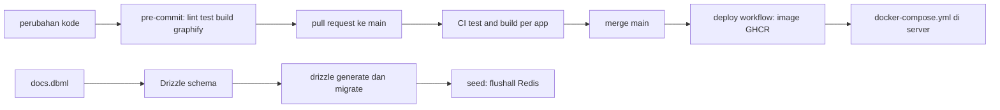

# Infrastruktur dan pengembangan

Kembali ke [README](README.md). Dicatat 2026-11-26, dicek ke repo di `main`.
Hal di sini dipakai kedua programmer dan tidak dimiliki satu modul. Perintah
lengkap dan status verifikasinya ada di `docs/architecture/runbook.md` dan
tabel "Command status" di `AGENTS.md`; catatan ini merangkum dan menambah
temuan.

## Kondisi saat ini

### Monorepo

- Bun workspaces + Turborepo (`turbo.json`: `build`, `test`, `lint`,
  `format`, `typecheck`, `dev`).
- Aplikasi: `apps/backend` (Elysia), `apps/web-admin`, `apps/web-employee`,
  `apps/web-investor` (template), `apps/web-landing`,
  `apps/web-customer-portal`. Folder `apps/api-docs` hanya berisi `dist` dan
  `node_modules` (tidak ada file yang dilacak git).
- Paket: `packages/common` (hak akses, tipe bersama; **harus di-build ulang**
  setelah berubah, kalau tidak web-admin melihat tipe lama), `design-tokens`,
  `locales`, `react-email`, `ui`.

### Stack dev lokal (Docker)

| Layanan | Container | Image / catatan |
|---|---|---|
| PostgreSQL | `ims-erp-postgres-1`, port 15432, volume `ims-erp-pgdata-postgis` | `postgis/postgis:18-3.6`. **Wajib** sejak migrasi `20261125201740_postgis_extension` (`CREATE EXTENSION postgis`). Database lama `postgres:18-alpine` disimpan sebagai `ims-erp-postgres-old-20261126` |
| Redis | `ims-erp-redis-1` | Cache (`REDIS_DB`), sesi Better Auth, antrean BullMQ (`REDIS_QUEUE_DB`, bawaan 1) |
| Mailpit | `ims-erp-mailpit-1`, UI :8025 | Email dev; dibuat manual |
| S3 | `ims-erp-s3-1`, port 9000/9001 | `rustfs/rustfs`; dibuat manual (MinIO tidak bisa diunduh lagi) |
| Chromium | — | Chrome lokal lewat `PDF_CHROMIUM_PATH` |

`docker-compose.yml` adalah file **deploy** (image dari GHCR): `postgres`
(postgis), `redis`, `dicebear`, `backend`, `web-admin`, `web-employee`,
`web-landing`, `web-customer-portal`. `docker-compose.local.yml` hanya
menimpa image aplikasi agar dibangun dari source. Mailpit dan S3 tidak ada di
kedua file.

### Migrasi dan seed (di `apps/backend`)

| Perintah | Isi |
|---|---|
| `bun run drizzle:generate` | `bunx --bun drizzle-kit generate` (wajib `--bun`, driver `bun-sql`) |
| `bun run drizzle:migrate` | Terapkan migrasi; `main` sekarang 41 migrasi, 20 schema, 192 tabel (dicek 2026-11-26) |
| `bun run drizzle:seed` | `database/seeders/index.ts`; deterministik (`faker.seed`), aman dijalankan dua kali |
| `bun run drizzle:migrate-reset` | `database/migrate-reset.ts` (hanya database sekali pakai) |
| `bun run drizzle:push` | Hanya database sekali pakai |

- Migrasi **append-only**; arsip lama di `database/migrations-archive/`.
- **Seeder menjalankan `redisClient.flushall()`**
  (`database/seeders/index.ts:49`). Akibatnya: semua sesi login (web-admin,
  portal, Playwright `e2e/.state/`) hilang, cache kosong, dan antrean BullMQ
  yang belum diproses ikut terhapus. Untuk seed database sekali pakai, pakai
  Redis terpisah.
- Seeder `main` (2026-11-26): 40 akun, 3 produk, 29 karyawan, proyek demo;
  tidak ada pemasok/pelanggan contoh.
- Urutan sinkron skema (AGENTS.md): ubah `docs/database/docs.dbml` dulu, lalu
  Drizzle, lalu `bun docs/database/gen-logical-references.ts` dan
  `bun docs/database/validate-dbml.ts` (harus `OK`).

### Pengujian

| Jenis | Perintah | Catatan |
|---|---|---|
| Unit (semua workspace) | `bun run test` (root, lewat turbo) | Hasil terakhir 2026-11-26: backend 1631, web-admin 217, locales 110, 0 gagal |
| Backend saja | `cd apps/backend && bun test` | DB dan Redis di-mock lewat injeksi konstruktor |
| Tipe web-admin | `cd apps/web-admin && bunx tsc -p tsconfig.app.json --noEmit` | Root `typecheck` **tidak** mencakup web-admin |
| Astro | `bun run typecheck` di tiap app Astro | `astro check` |
| E2E (Playwright) | `cd apps/web-admin && bun run test:e2e` (`:ui`, `:headed`, `:report`) | Butuh stack dev menyala (:5173/:3001). File `*.e2e.ts` di `apps/web-admin/e2e/`: `auth.setup` (login 7 role), `m05-a-barang`, `m05-akses`, `m05-ui`. Tidak ikut `bun test` |
| Locale | ikut `bun run test` | Paritas en/id, kunci mati |

### Hook pre-commit (`.husky/pre-commit`)

```
bun run lint
bun run test
bun run build
graphify update .
```

`graphify` tidak terpasang di mesin ini, jadi hook berhenti di langkah
terakhir. Commit 2026-11-26 dibuat dengan `--no-verify` setelah lint, test,
dan build dijalankan manual dan lulus (`../catatan-progres.md`).

### CI (`.github/workflows/`)

- `main-test-and-build-*.yml` untuk backend, web-admin, web-employee,
  web-landing, web-customer-portal; jalan pada push dan PR ke `main`.
  Backend: lint, typecheck, unit test + cakupan (tanpa database sungguhan).
- `main-deploy-*.yml`: membangun dan menerbitkan image ke GHCR
  (`ghcr.io/okifirsyah404/ims-erp-*`).
- Tidak ada workflow untuk `web-investor`, e2e Playwright, atau uji migrasi ke
  Postgres.

### Aturan dokumen (AGENTS.md)

- Setiap perubahan kode memperbarui `docs/plan/progress.md` (entri bertanggal,
  perintah, hasil) dan `docs/plan/backlog.md` (status `ERP-*`), serta
  `docs/plan/features.md` bila status berubah.
- Perubahan route/guard/hak: jalankan `bun docs/architecture/gen-role-permission.ts`.
- Perubahan struktur tabel: `docs/database/` ikut di perubahan yang sama.
- Teks web-admin wajib ada di `en` dan `id` (`packages/locales`).
- Arahan programmer B: catatan konsep saat ini ditulis di `docs/adjustment/`
  dalam bahasa Indonesia; `progress.md`/`backlog.md` bersama tidak diubah
  tanpa persetujuan (`../catatan-progres.md` 2026-11-26).

## Alur lintas modul



## Catatan dan temuan

1. **Layanan dev tidak terdokumentasi di compose.** Mailpit dan RustFS
   dibuat manual; anggota tim baru tidak akan tahu tanpa membaca
   `../uat-modul/README.md`.
2. **Image backend tanpa Chromium** (PDF mati di server) dan compose tanpa S3
   (lihat [dokumen-tanda-tangan-dan-file.md](dokumen-tanda-tangan-dan-file.md)).
3. **Nama env tidak konsisten:** CI backend dan `runbook.md` memakai
   `SMTP_*`, sedangkan `config/loaders/config.loader.ts` membaca
   `MAIL_SMTP_*`. Tidak berpengaruh ke unit test, tapi menyesatkan saat
   deploy.
4. **Hook pre-commit bergantung pada `graphify`** yang tidak dipasang semua
   orang.
5. **Backup/restore belum ada.** `runbook.md` bagian "Backup/restore": "Not
   established". Ini isi T17 kontrak.
6. **Tabel "Command status" di AGENTS.md usang:** menyebut 20 folder baseline
   migrasi; sekarang 41 migrasi termasuk PostGIS, dan jumlah test sudah
   berbeda.
7. `apps/api-docs` tidak punya source di git; tampaknya sisa build lama.

## Perubahan mendatang

| Perubahan | Sumber | Dampak | Status |
|---|---|---|---|
| Tambahkan Mailpit dan S3 (RustFS) ke compose dev atau file compose dev terpisah | temuan 1, `../catatan-progres.md` 2026-11-25 | Wilayah deploy (Oki); dokumen runbook | usulan |
| Chromium di image backend | temuan 2, ERP-0067 | Dockerfile, ukuran image | direncanakan (belum dijadwalkan) |
| Samakan nama env SMTP di CI/runbook dengan `MAIL_SMTP_*` | temuan 3 | Workflow + dokumen | usulan |
| Langkah `graphify` di hook dibuat opsional (lewati bila tidak terpasang) | temuan 4 | `.husky/pre-commit` | usulan |
| Prosedur backup/restore Postgres dan uji restore | T17 kontrak, runbook | Script + dokumen; wajib sebelum rilis | direncanakan (T17) |
| Perbarui tabel "Command status" AGENTS.md (migrasi 41, PostGIS, test terbaru) | temuan 6 | Dokumen | usulan |
| Seeder tidak memakai `flushall` (hapus kunci tertentu saja) | memori "seeder flushes Redis" | `database/seeders/index.ts`; sesi dev tidak hilang | usulan |
| E2E Playwright dan uji migrasi di CI | temuan CI | Workflow baru, butuh Postgres postgis di CI | usulan |
