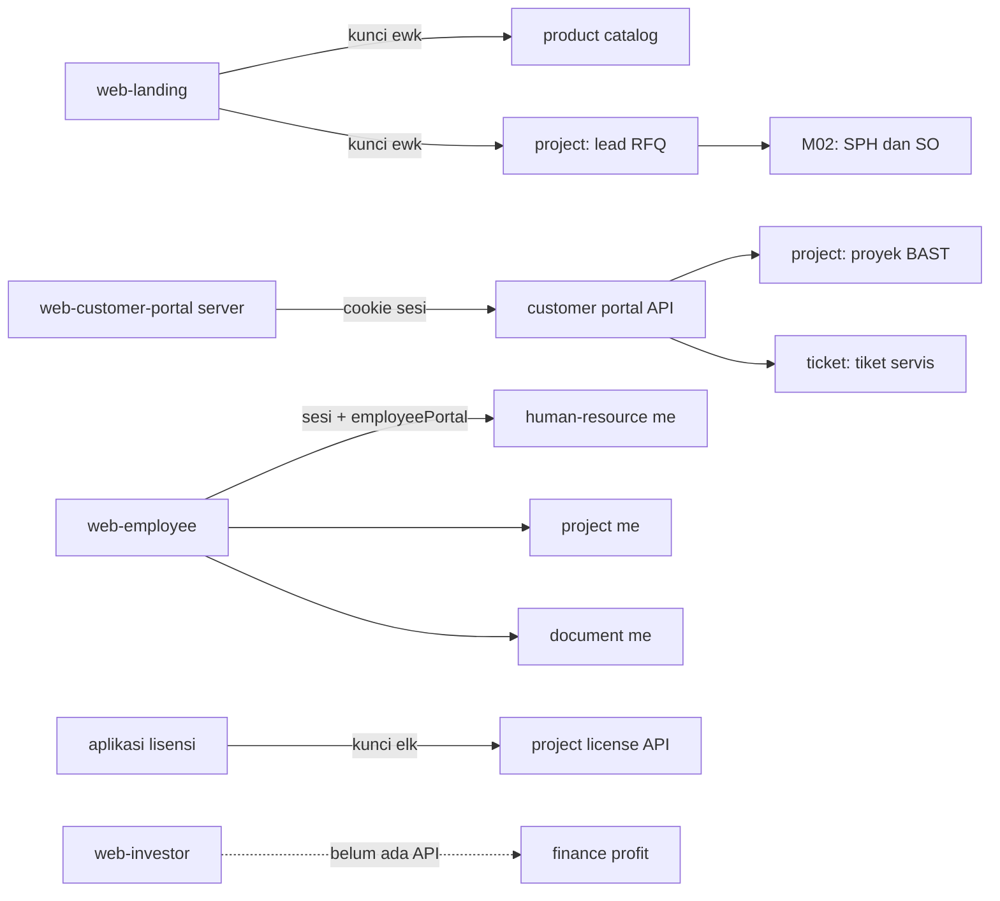

# Portal dan website

Kembali ke [README](README.md). Dicatat 2026-11-26, dicek ke kode di `main`.
Empat aplikasi di luar web-admin memakai API backend yang sama. Semuanya
lintas modul: satu layar portal bisa memanggil `customer`, `project`,
`ticket`, `sale`, dan `product` sekaligus.

## Kondisi saat ini

| Aplikasi | Folder | Teknologi | Port dev | Status |
|---|---|---|---|---|
| Website (landing) | `apps/web-landing` | Astro 7 | 4321 | Berjalan: katalog, profil, formulir |
| Portal pelanggan | `apps/web-customer-portal` | Astro 7 (server menyimpan sesi) | 4322 | Sebagian: banyak layar masih `/coming-soon` |
| Portal karyawan | `apps/web-employee` | React + Vite + TanStack | 5174 | Berjalan |
| Portal investor | `apps/web-investor` | React + Vite | (bawaan Vite) | **Template Vite kosong**, belum ada fitur |

`bun run dev` menjalankan semuanya lewat Turborepo; ada juga
`dev:website`, `dev:portal`, `dev:employee` di `package.json` root.

### API publik dan cara autentikasinya

| Jalur | Pemakai | Autentikasi | Modul pemilik |
|---|---|---|---|
| `/products/public/v1/catalog` (`/products`, `/products/:slug`, `/categories`, `/facets`, `/stock`, `/pricing`, `/solutions`, `/search`, `POST /cart/price`) | Website, portal | Kunci API website `ewk_…` (`Authorization: Bearer`, server ke server; `src/authorization/public-api-auth.ts`) | `product` |
| `/projects/public/v1` (`/rfq`, `/contact`, `/demo`) | Website | Kunci website yang sama | `project` (menjadi lead) |
| `/customers/portal/v1/auth/*` | Portal pelanggan | Tanpa sesi (login, daftar, verifikasi email, reset password) | `customer` |
| `/customers/portal/v1/*` | Portal pelanggan | `portalGuard`: cookie sesi Better Auth yang disimpan **server portal**, bukan browser (ADR-0027); `portal_status = 'active'` | `customer` (memanggil `project`, `ticket`) |
| `/human-resources/me`, `/projects/me`, `/documents/me` | Portal karyawan | Sesi Better Auth + `employeePortal` guard (baris karyawan hidup; menolak role aplikasi `admin`, `investor`, `customer`) | `human-resource`, `project`, `document` |
| `/projects/api/v1/licenses` | Aplikasi milik sendiri (M03) | Kunci aplikasi `elk_…` (`Authorization: Bearer`) | `project` |
| `/documents/public/v1/shares/:token` | Siapa pun yang memegang tautan | Token di URL | `document` |
| `/sales/public/v1/render/quotations`, `/human-resources/public/v1/render/*` | Renderer PDF | Token render HMAC 2 menit | `sale`, `human-resource` |
| `/webhooks/{xendit,singapay,whatsapp}` | Penyedia | Tanda tangan/token penyedia | `webhook` → `payment`, `automation` |

Kunci website dibuat dengan `apps/backend/scripts/create-website-api-key.ts`
(Better Auth API key, config `website`).

### Portal pelanggan (M07 + M12/T25)

- Akun: diundang dari `/admin/customers/portal-accounts` (bisnis), atau daftar
  sendiri (perorangan) dengan kode email. Hanya role aplikasi `customer` yang
  dipertahankan sesinya oleh portal.
- Yang sudah punya route backend: akun dan sesi, perangkat, anggota akun,
  beranda/badge, proyek, tiket (buat, daftar, detail, pesan), produk.
- `apps/web-customer-portal/src/services/portal/erp-routes.ts` mencatat
  layar yang **belum punya route backend** (tahap 2): pesanan, SPH
  (daftar/terima/revisi), invoice dan pembayaran, dokumen, notifikasi,
  perangkat, booking servis, profil, lokasi, wishlist, lacak pesanan publik,
  RFQ. Middleware menampilkan `/coming-soon` untuk layar itu.

### Website (M04/T15, T21)

- Katalog dan harga dibaca dari ERP; formulir RFQ/kontak/demo menjadi lead
  bernomor `RFQ-`/`MSG-`/`DEMO-` di `project`.
- Halaman `cart.astro` dan `checkout.astro` ada, tetapi data checkout
  (`src/data/checkout`) statis; di backend `main` tidak ditemukan endpoint
  pembuatan pesanan online dari website (hanya `POST /cart/price`).
- Konten website (testimoni, gambar): hak `marketing` ada, halaman admin belum
  ada (`../bahan-keputusan.md` D5).

### Portal karyawan

Absen mandiri, jadwal, tugas, cuti/lembur, slip gaji, proyek (PIC/tugas,
bukti, absen lokasi), notifikasi, dokumen dan tanda tangan, profil. Absen di
lokasi proyek memakai titik GPS (`project.addresses.site_point`, kolom
geometri PostGIS untuk cek radius `ST_DWithin`, migrasi
`20261125201752_project_site_point_geometry`; catatan absen di
`project.site_attendances`).

### Portal investor (M11/T29, T30)

`apps/web-investor/src` hanya berisi `App.tsx` bawaan template; tidak ada
route backend investor. Schema `investor` dihapus ADR-0024. Finance sudah
menyediakan `ExportedProfitService` (laba periode terkunci, ERP-0153/ADR-0030)
sebagai satu-satunya angka yang boleh dibaca modul bagi hasil nanti.

## Alur lintas modul

## Catatan dan temuan

1. **Portal karyawan di luar kontrak.** M12 versi 5.1 menulis "Tanpa
   aplikasi pegawai". Portal ini sudah dibangun (absen, slip, tanda tangan,
   proyek). Absen GPS juga melewati batas M08 ("Tanpa mesin/GPS absensi").
2. **Portal investor belum dimulai**, padahal T29/T30 ada di kontrak tahap 2.
   Pembagian kontrak memberi T13/T29/T30 ke kolom B, tetapi pembagian modul
   memberi M11 ke Oki. Lihat [di-luar-scope.md](di-luar-scope.md).
3. **Checkout dan pesanan online (T21) belum tersambung** ke backend, baik di
   website maupun portal; pembayaran gateway baru dari invoice di web-admin.
4. **Portal pelanggan tahap 2 (T25) belum lengkap:** dokumen, invoice, dan
   pembayaran milik pelanggan belum punya route.
5. **Aplikasi deploy:** `docker-compose.yml` memuat `web-admin`,
   `web-employee`, `web-landing`, `web-customer-portal`; **tidak** memuat
   `web-investor`, dan tidak ada workflow CI untuk `web-investor`.
6. Aqim (akun `admin` dengan tanda admin aplikasi) ditolak portal karyawan
   (lihat [autentikasi-dan-hak-akses.md](autentikasi-dan-hak-akses.md)).

## Perubahan mendatang

| Perubahan | Sumber | Dampak | Status |
|---|---|---|---|
| Pesanan online dari portal dan website dengan cek stok/harga ERP | memori ERP-0070, kontrak T21 | Endpoint baru di `sale`/`customer`, checkout `payment`, layar portal dan website | direncanakan |
| Route portal untuk SPH, invoice, pembayaran, dokumen, notifikasi | `erp-routes.ts` daftar "no backend route yet", T25 | `customer` portal controller memanggil `sale`, `document`, `notification` lewat kontrak | direncanakan |
| Portal investor: modul bagi hasil baru (ADR baru, karena schema `investor` dihapus) + `web-investor` | kontrak T13, T29, T30 | Modul + schema baru, role aplikasi `investor` sudah ada | ditunda (K10/OE1, disetujui Pemilik 27/11); halaman investor hanya Pemilik |
| Halaman admin konten website | `../bahan-keputusan.md` D5 | web-admin + API `product`/konten | ditunda (D5 (b), jawaban programmer B 27/11) |
| Catat portal karyawan dan absen GPS sebagai tambahan di luar kontrak (atau minta persetujuan Pemilik) | temuan 1 | Administrasi kontrak, bukan kode | usulan |
| Tambahkan `web-investor` ke compose/CI saat mulai dibangun | temuan 5 | Wilayah deploy (Oki) | usulan |
| Portal pelanggan login dengan Google, satu jenis akun (data perusahaan diisi di profil, OA4); web-admin dan portal karyawan tanpa Google, karyawan diundang dan login dengan kata sandi | `../lembar-keputusan-rapat.md` K13 (arah baru 2026-11-26) | `web-customer-portal` login dan daftar tanpa pilihan tipe akun, pencocokan email ke kontak, `GOOGLE_*`; `web-employee` undangan + kata sandi | disetujui Pemilik 27/11 (K13, OA4) |
