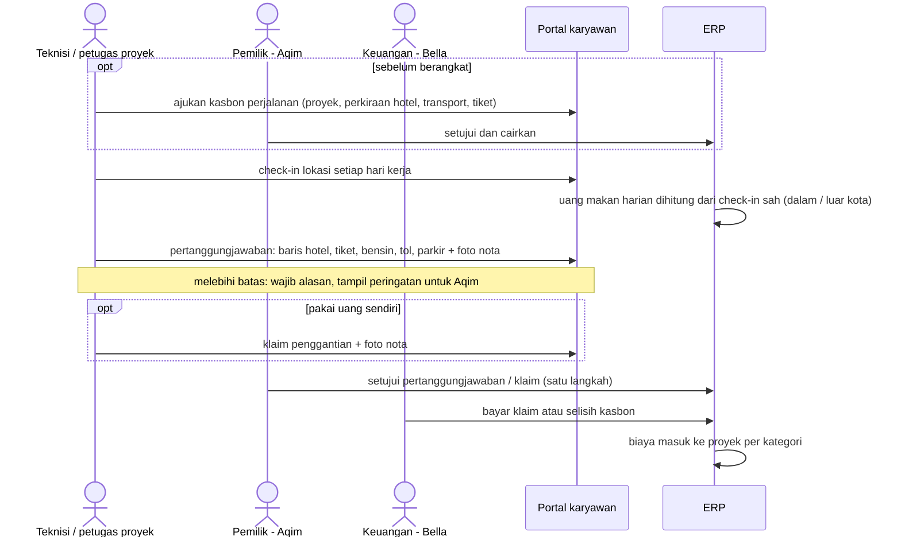

# Rancangan biaya perjalanan dan mobilitas teknisi

Disusun 2026-11-28. Kembali ke [catatan penyesuaian](../README.md).

**Status: keputusan programmer B lewat tanya-jawab 2026-11-28.** Belum ada
kode. Berlaku untuk siapa pun yang punya tugas proyek (teknisi, karyawan
kantor yang ditugaskan, freelance; KL-7, KL-10).

**Yang sudah ada di kode:** biaya proyek dengan kategori material,
transport, akomodasi, subkon, lain-lain dan sumber dana (klaim karyawan,
kas kecil, bank); kasbon dan pertanggungjawaban di Keuangan (diputuskan
pindah ke portal karyawan, OB13/RO6); klaim biaya diisi Keuangan.

## 1. Keputusan

| No | Keputusan |
|---|---|
| BP-1 | **Dua jalan:** (a) **kasbon sebelum berangkat** lalu **pertanggungjawaban** dengan foto nota per baris; (b) bila memakai uang sendiri, **klaim penggantian di portal karyawan**, dibayar Bella. Semua otomatis masuk **biaya proyek** |
| BP-2 | **Uang makan harian tetap** per hari lapangan, nominal diatur di pengaturan (misal **dalam kota** dan **luar kota**), dihitung dari **check-in lokasi yang sah**, tanpa nota |
| BP-3 | **Hotel, transport, tiket, bensin, tol, parkir memakai nota** (foto) |
| BP-4 | **Batas di pengaturan + peringatan:** misal hotel maks. Rp X per malam; melebihi batas tetap boleh diajukan dengan **alasan**, Aqim yang memutuskan |
| BP-5 | **Kategori:** penginapan/hotel; **makan/konsumsi** (baru); transport dengan rincian bensin, tol, parkir; **tiket perjalanan** (pesawat, kapal, kereta) untuk proyek luar pulau |
| BP-6 | Persetujuan: kasbon, pertanggungjawaban, dan klaim disetujui **Aqim** (RO5, K1); pencairan/pembayaran oleh Aqim (kasbon) atau Bella (klaim) |

## 2. Alur

## 3. Tampilan

| Layar | Isi |
|---|---|
| Portal: Kasbon | Ajukan kasbon (proyek, keperluan, jumlah); daftar kasbon dan status; tombol pertanggungjawaban |
| Portal: Pertanggungjawaban / Klaim | Tabel baris: tanggal, kategori, keterangan, jumlah, foto nota; total vs kasbon ("sisa dikembalikan Rp X" / "kekurangan dibayar Rp X"); peringatan bila melebihi batas + isian alasan |
| Portal: Rekap uang makan | Hari lapangan sah per bulan × nominal (dalam/luar kota) |
| Pengaturan → Perjalanan (Pemilik) | Uang makan dalam kota / luar kota; batas hotel per malam; batas lain per kategori |
| Detail proyek → Biaya | Biaya perjalanan per kategori (hotel, makan, transport, tiket) dan per orang |
| Perlu Tindakan Aqim | Kasbon, pertanggungjawaban, klaim yang menunggu; tanda "melebihi batas" |

## 4. Yang perlu diperhatikan saat desain

| Hal | Catatan |
|---|---|
| Wilayah | Kasbon/klaim/pembayaran: Oki (M09); kategori biaya proyek dan uang makan dari check-in: Dafrin (M07/M08); layar portal: Oki; pengaturan: bersama |
| Skema | Kategori `meal` dan `travel_ticket` di `project.cost_categories` (CHECK sekarang: material, transport, accommodation, subcontract, other); rincian transport (bensin/tol/parkir); pengaturan uang makan dan batas; dicek ke `docs.dbml` |
| Klaim karyawan di portal | Mengangkat KF-K10 (sebelumnya "Tambahan", daftar tunggu) menjadi bagian keputusan ini |
| Freelance | Uang makan harian berlaku juga untuk freelance kecuali tarif harian sudah termasuk makan (ditentukan per orang saat desain) |
