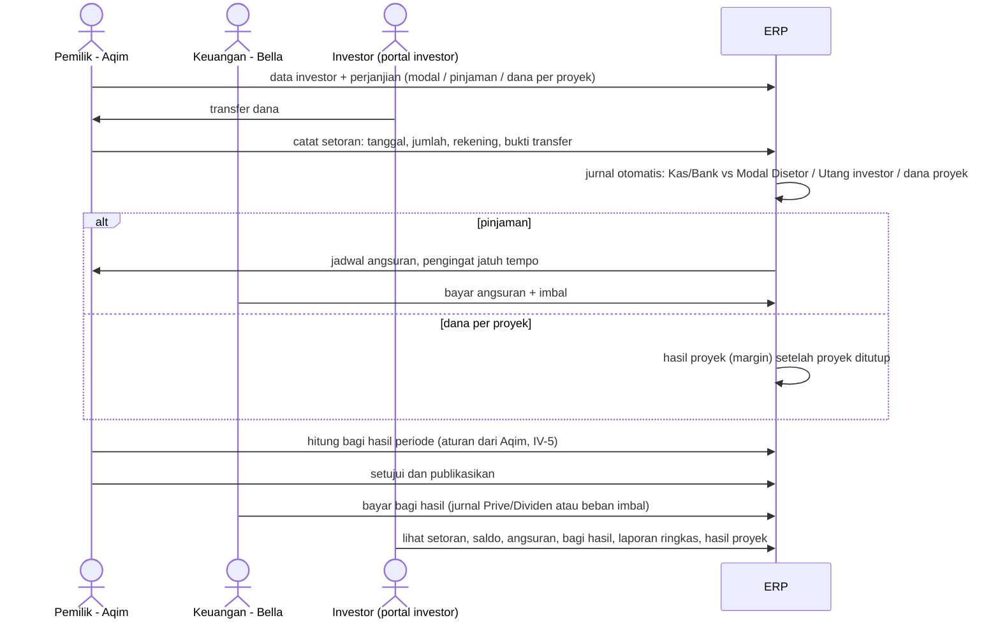

# Rancangan investor dan suntikan dana (M11)

Disusun 2026-11-28. Kembali ke [catatan penyesuaian](../README.md).

**Status: keputusan programmer B lewat tanya-jawab 2026-11-28, langsung
berlaku. Mengubah K10** (rapat 27/11: "M11 ditunda") **menjadi: M11 dibangun
lengkap sekarang, prioritas Tinggi**; perhitungan bagi hasil menunggu aturan
dari Aqim. Belum ada kode. M11 wilayah **Oki** (kontrak T13, T29, T30).

**Kondisi sekarang:** tiga halaman "Segera hadir" di Keuangan → Bonus &
Investor; schema `investor` sudah dihapus (ADR-0024, ADR-0030); izin
investor masih ada di `erp-permissions.ts`; `apps/web-investor` templat
kosong; kontrak laba periode terkunci (`ExportedProfitService`) sudah ada
di finance. Daftar akun punya **Modal Disetor (3-1000)** dan **Prive dan
Dividen (3-4000)**.

## 1. Keputusan

| No | Keputusan |
|---|---|
| IV-1 | **M11 dibangun lengkap sekarang** (mengganti K10, OE1–OE4, MN5); prioritas **Tinggi** di langkah 8 |
| IV-2 | **Tiga bentuk dana:** (a) **modal** (masuk Modal Disetor, ikut bagi hasil); (b) **pinjaman** (masuk utang, dibayar kembali + imbal); (c) **dana per proyek** (membiayai proyek tertentu, mendapat bagian dari hasil proyek itu) |
| IV-3 | **Aqim sendiri** yang mencatat setoran dan perjanjian investor (tercatat di audit) |
| IV-4 | **Pinjaman:** pokok, **imbal/bunga tetap** (persen atau nominal), **jadwal angsuran**, pengingat jatuh tempo, pembayaran lewat Keuangan |
| IV-5 | **Aturan bagi hasil (jawaban 28/11):** periode **tahunan**; dasar **laba sesudah pajak**, dengan **rincian** perhitungan ditampilkan; porsi berupa **persen per investor di pengaturan**; ada **cadangan** (persen di pengaturan) sebelum laba dibagi; **dana per proyek** mendapat bagian dari **margin proyek**, rinciannya dibahas lebih detail saat desain |
| IV-7 | **Banyak investor**; contoh data uji memakai nama samaran **"Bapak Budi Santoso"** (bukan orang sungguhan) |
| IV-8 | **Bentuk dan jumlah dana ditentukan investor** sesuai perjanjian dengan Aqim; **dicatat Aqim saja**, investor tidak mengajukan dari portal |
| IV-9 | **Login portal investor:** didaftarkan Aqim → **undangan email** → investor membuat **kata sandi**; **kode verifikasi email** setiap masuk dari perangkat baru (2 langkah) |
| IV-10 | **Dasbor investor satu halaman, gaya analitik, terinci, bisa diekspor Excel dan PDF** (bagian 3a) |
| IV-6 | **Portal investor** (`apps/web-investor`): investor melihat **setoran dan saldo modal/pinjaman miliknya** (riwayat, sisa pinjaman, jadwal angsuran), **bagi hasil dan pembayarannya**, **laporan ringkas perusahaan** yang dipublikasikan Aqim (bukan buku besar), dan **hasil proyek yang ia danai** (nilai kontrak, biaya, margin, bagiannya) |

## 2. Alur

## 3. Tampilan

| Layar | Isi |
|---|---|
| Web-admin: Investor → Daftar Investor | Data investor (nama, kontak, NPWP, rekening), login portal, ringkasan dana |
| Web-admin: Investor → Dana | Setoran per investor dan bentuknya; pinjaman dengan jadwal angsuran; dana per proyek dengan proyeknya; bukti transfer |
| Web-admin: Investor → Bagi Hasil | Periode, dasar perhitungan, porsi per investor, status (draf / disetujui / dibayar), publikasi ke portal |
| Web-admin: Investor → Laporan | Laporan ringkas yang dipublikasikan (misal laba rugi tahunan) |
| Portal investor | **Satu halaman dasbor analitik** (bagian 3a), ditambah halaman masuk, undangan, dan kode verifikasi |
| Dasbor Aqim | Kartu total dana investor per bentuk; angsuran jatuh tempo |

### 3a. Dasbor investor (satu halaman, gaya analitik)

Urutan dari atas ke bawah, semua angka milik investor yang sedang masuk:

| Bagian | Isi |
|---|---|
| **Kepala** | Nama investor, saringan **tahun** (bawaan tahun berjalan), tombol **Ekspor PDF** dan **Ekspor Excel** (isi mengikuti saringan) |
| **Kartu ringkas** | Total dana ditanam; saldo modal; sisa pinjaman; bagi hasil tahun ini; total bagi hasil sejak awal; **imbal hasil (%)** = total bagi hasil ÷ total dana; setiap kartu dengan perubahan vs tahun lalu |
| **Grafik** | Batang per tahun: setoran vs bagi hasil diterima; garis kumulatif imbal hasil; komposisi dana (modal / pinjaman / per proyek) |
| **Rincian perhitungan bagi hasil** (per tahun, bisa dibuka) | Laba sebelum pajak → pajak → **laba sesudah pajak** → cadangan (%) → laba yang dibagi → **porsi investor (%)** → **bagian investor** → status (dihitung / disetujui / dibayar, tanggal bayar) |
| **Pinjaman** | Pokok, imbal, jadwal angsuran (lunas / jatuh tempo / terlambat), sisa |
| **Proyek yang didanai** | Nama proyek, nilai kontrak, biaya, margin, porsi, bagian investor, status proyek (berjalan / selesai) |
| **Kinerja ringkas perusahaan** | Pendapatan dan laba bersih per tahun dari laporan yang **dipublikasikan Aqim** (bukan buku besar) |
| **Riwayat setoran** | Tanggal, bentuk, jumlah, bukti |

Prinsip tampilan: angka besar dan jelas, format rupiah `Rp 1.250.000.000`,
grafik dengan keterangan, warna konsisten (masuk / keluar), tabel bisa
diurutkan, nyaman di ponsel, mode terang/gelap. PDF ekspor memakai kop
perusahaan dan tanggal cetak; Excel berisi sheet per bagian.

## 4. Yang perlu diperhatikan saat desain

| Hal | Catatan |
|---|---|
| ADR dan skema | Butuh **ADR baru** dan schema baru (letak tabel, misal schema `investor` baru atau di `finance`); `docs.dbml` dulu (Gate 1); jumlah schema di AGENTS.md dan `docs/database/` ikut berubah |
| Wilayah | Oki (M11, finance, portal investor); dana per proyek membaca margin proyek dari modul `project` (Dafrin) lewat kontrak antarmodul |
| Akun | Utang investor (pinjaman), beban imbal/bunga, Prive dan Dividen (3-4000) untuk bagi hasil modal; dicek dengan Bella |
| Persetujuan | Setoran dicatat Aqim (IV-3); bagi hasil disetujui Aqim; pembayaran oleh Bella |
| Pertanyaan untuk Aqim | Rincian bagi hasil dana per proyek (IV-5); data investor sungguhan (sementara samaran "Bapak Budi Santoso"); laporan apa yang dipublikasikan ke investor |
