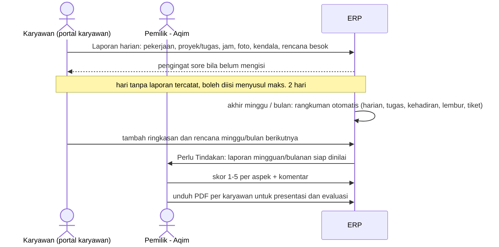

# Rancangan laporan kerja karyawan dan potongan gaji

Disusun 2026-11-28. Kembali ke [catatan penyesuaian](../README.md).

**Status: tambahan dari programmer B, diputuskan lewat tanya-jawab
2026-11-28. Keduanya prioritas Tinggi** (langkah 8). Belum ada kode.

Dasar yang sudah ada di kode:
- Pengaturan gaji (tanggal gajian, PPh 21, BPJS) di Pengaturan → Gaji;
  gaji bulanan, persetujuan Pemilik, slip PDF (lihat
  [`kekurangan-fitur.md`](kekurangan-fitur.md) KF-H1, KF-H2).
- Absensi harian, jadwal kerja (shift per tanggal), cuti dan lembur.
- Tabel `project.daily_reports`, `kpi_definitions`, `kpi_evaluations`
  **baru ada di `docs.dbml` sebagai target** (belum ada di Drizzle maupun
  database; S6, keputusan T-4 "dibangun").

---

## 1. Pengaturan potongan gaji (bagian dari B-39)

| No | Keputusan |
|---|---|
| PG-1 | Diatur Aqim di **Pengaturan → Gaji** |
| PG-2 | **Potongan per hari = gaji pokok ÷ jumlah hari kerja bulan itu**; hari kerja diambil dari jadwal kerja karyawan |
| PG-3 | Yang dipotong: **tidak hadir tanpa keterangan (alpa)**, **izin tanpa gaji** (jenis cuti yang ditandai tidak dibayar), **terlambat**, dan **pro-rata** karyawan yang masuk/keluar di tengah bulan |
| PG-4 | **Terlambat:** ada **toleransi** (misal 15 menit) dan **nominal per kejadian** di atas toleransi; keduanya diatur di pengaturan. Jam masuk acuan dari jadwal kerja |
| PG-5 | Potongan muncul sebagai baris terpisah di rekap gaji dan slip gaji (alpa, izin tanpa gaji, terlambat, pro-rata), bisa diubah SDM sebelum Aqim menyetujui |

Isian pengaturan (usulan, dicek saat desain): aktif/tidak per jenis potongan,
toleransi terlambat (menit), nominal per keterlambatan, daftar jenis cuti
yang tidak dibayar. Hari libur nasional belum dihitung (KF-H3, daftar
tunggu), jadi hari kerja hanya dari jadwal.

## 2. Laporan kerja karyawan

| No | Keputusan |
|---|---|
| LK-1 | **Laporan harian wajib untuk semua karyawan**, diisi di **portal karyawan** (Pekerja Lepas juga bila ditugaskan) |
| LK-2 | Isi laporan harian: apa yang dikerjakan, proyek/tugas terkait, jam kerja, foto bukti, kendala, rencana besok |
| LK-3 | **Lupa mengisi:** pengingat di portal sore hari; hari tanpa laporan **tercatat** dan tampil di rekap mingguan dan dasbor Aqim; boleh diisi menyusul paling lambat 2 hari |
| LK-4 | **Laporan mingguan dan bulanan dibuat otomatis** dari laporan harian dan data lain (tugas selesai, jam kerja, proyek, kehadiran, keterlambatan, lembur, tiket); karyawan menambah ringkasan dan rencana |
| LK-5 | **Penilai: Aqim saja** |
| LK-6 | **Penilaian: skor 1–5 per aspek + komentar.** Aspek usulan: kehadiran, ketepatan waktu tugas, kualitas kerja, kelengkapan laporan. Angka kehadiran dan tugas terisi otomatis sebagai bahan, skor tetap diisi Aqim |
| LK-7 | **Unduhan untuk presentasi: PDF per karyawan** per minggu dan per bulan. Rekap per tim belum sekarang, tetapi rancangannya disiapkan agar bisa ditambah nanti |

## 3. Yang perlu diperhatikan saat desain

| Hal | Catatan |
|---|---|
| Letak data | Laporan harian bisa memakai rancangan `project.daily_reports` di `docs.dbml` (belum ada di database, jadi butuh migrasi baru); laporan mingguan/bulanan dan penilaian butuh tabel baru (Gate 1). Laporan karyawan non-proyek (staf kantor) tidak punya proyek, jadi pemilik tabel diputuskan saat grill: modul `human_resource` (laporan kerja karyawan) atau `project` |
| Wilayah | Data dan backend: programmer B (M07/M08). Layar portal karyawan: aplikasi `web-employee` (Oki); dikerjakan lewat PR bersama (K11) |
| Hubungan dengan S6 | Butir laporan harian dan KPI di B-26 (T-4) tercakup oleh rancangan ini; rencana kerja (`work_plans`) dan milestone tetap di B-26 |
| Kontrak | Tambahan dari programmer B; fitur di luar kontrak diterima (K9) |
| Dasbor | Kartu "laporan harian belum diisi" untuk Aqim (menambah RD1); kartu "laporan saya hari ini" untuk karyawan |
