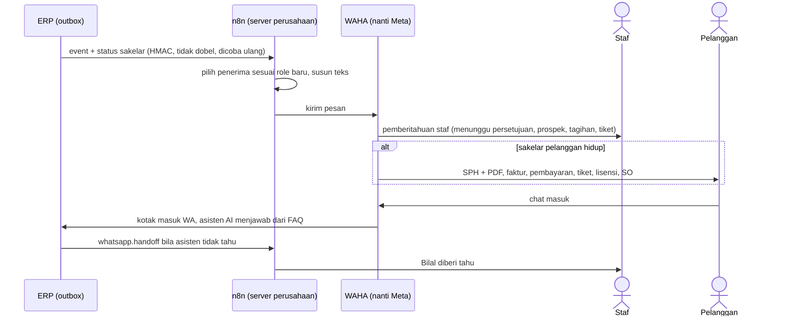

# Rancangan n8n, WhatsApp, dan asisten AI

Disusun 2026-11-28. Kembali ke [catatan penyesuaian](../README.md).

**Status: keputusan programmer B lewat tanya-jawab 2026-11-28. Prioritas
Tinggi, sebelum rilis** (kontrak T14, T27, T28). Belum ada kode.

## 1. Kondisi sekarang

**Sudah dibangun (sisi ERP dan workflow):**
- ERP mengirim event lewat **outbox** ke n8n (`POST /webhook/erp-events`,
  ditandatangani HMAC, tidak dobel, dicoba ulang bila gagal; ADR-0020). Log
  terlihat di Integrasi → Webhook (n8n).
- **13 event:** `lead.created`, `invoice.issued`, `receipt.recorded`,
  `license.due`, `service_ticket.updated`, `whatsapp.handoff`,
  `lead.follow_up_due`, `quotation.follow_up_due`, `quotation.sent` (dengan
  PDF), `supplier_bill.recorded`, `supplier_bill.due`,
  `purchase_return.updated`, `sales_return.updated`.
- **Workflow n8n siap impor** `docs/integrations/n8n/erp-event-router.workflow.json`
  (satu workflow untuk semua topik; penerima dan teks di satu node), skrip
  uji `send-test-event.ts`, panduan
  `docs/integrations/n8n/guide-workflows.id.md` dan
  `docs/integrations/whatsapp/waha-n8n-setup.id.md`.
- **WhatsApp:** adaptor WAHA (`automation/adapters/waha.ts`); kotak masuk WA,
  FAQ, dan serah ke admin di web-admin; asisten AI lewat adaptor yang
  kompatibel OpenAI (`openai-compatible.ts`).
- **Meta Cloud API:** workflow sudah bisa mengirim template Meta; panduan
  pendaftaran lengkap di `docs/integrations/whatsapp/meta-cloud-api.id.md`.
  **Asisten chat masuk lewat Meta belum dibangun** (panduan bagian 9).

**Belum berjalan:** server n8n, nomor WhatsApp, penyedia AI, persetujuan teks
pesan pelanggan, dan penerima di workflow masih memakai role lama
(Manajer Operasional, Pembelian, Manajer Penjualan).

## 2. Keputusan

| No | Keputusan |
|---|---|
| N8-1 | **n8n self-host di server perusahaan** (Docker, n8n Community), alamat HTTPS publik, ikut backup harian (NM-3) |
| N8-2 | **WhatsApp pakai WAHA dulu**, dengan nomor khusus perusahaan (bukan nomor pribadi). **Pindah ke Meta Cloud API resmi nanti** untuk verifikasi dan menghindari blokir (bagian 5) |
| N8-3 | **Pemberitahuan staf: WA lewat n8n** untuk hal mendesak, dan semuanya tetap tercatat di halaman **Perlu Tindakan**. Notifikasi lonceng di aplikasi (KF-N1) tetap daftar tunggu |
| N8-4 | **Penerima staf mengikuti role baru** (bagian 3); nomor WA tiap orang diambil dari profil pengguna di ERP |
| N8-5 | **Pesan ke pelanggan: semua jenis** (SPH terkirim + PDF, faktur terbit, pembayaran diterima, tiket diperbarui, lisensi akan habis, retur, SO terkirim/selesai), masing-masing punya **sakelar on/off** di pengaturan; semua **mati** sampai Aqim menyetujui teksnya |
| N8-6 | **Event baru:** dokumen menunggu persetujuan (ke penyetuju, X-6), pesanan online masuk (B-38), SO terkirim/selesai (C1), pengingat laporan harian (B-44) |
| N8-7 | **Asisten AI aktif saat go-live**; penyedia dan anggaran token **dipilih Aqim**; menjawab hanya dari FAQ yang disetujui, selebihnya diserahkan ke admin (Bilal) |
| N8-9 | **Teks pesan dikelola dan disetujui langsung di n8n** (node "3. Compose messages"): teks awal dari [`teks-pesan-wa-pelanggan.md`](teks-pesan-wa-pelanggan.md) dimasukkan ke workflow, Pak Aqim melihat hasilnya saat uji dengan nomor tim, perubahan langsung di n8n. **Sakelar on/off tetap di ERP** (N8-5) |
| N8-10 | Nama perusahaan di pesan: **CV Inti Multi Solusi** |
| N8-8 | **Prioritas Tinggi, sebelum rilis:** disiapkan di langkah 8, diuji di langkah 9 memakai nomor tim dulu, lalu checklist go-live panduan n8n |

## 3. Penerima staf (role baru)

| Event | Penerima |
|---|---|
| Prospek baru (`lead.created`), pesanan online masuk | Penjualan: **Bilal** (petugas bawaan), Agus MD ikut |
| Follow-up prospek / SPH jatuh tempo | Penjual pemilik prospek / pembuat SPH |
| **SPH menunggu persetujuan** | Rekan Penjualan (SPH Bilal → Agus MD, sebaliknya) |
| **PO, PR, retur, penyesuaian stok, cuti, lembur, kasbon, gaji menunggu** | **Aqim** |
| Jurnal manual menunggu | Penyetuju kedua (Bella ↔ Aqim, K1a) |
| Tagihan pemasok dicatat / jatuh tempo | **Bella**; lewat jatuh tempo → juga **Aqim** |
| Faktur terbit, pembayaran diterima, SO terkirim/selesai | Bella (dan pelanggan bila sakelar on) |
| Retur pembelian disetujui / dikirim | Gudang (Bilal, Agus) |
| Retur penjualan disetujui | Gudang + Penjualan |
| Tiket baru, chat WA perlu admin (`whatsapp.handoff`) | **Bilal** (Layanan Pelanggan) |
| Lisensi akan habis | Penjualan (dan pelanggan bila sakelar on) |
| Pengingat laporan harian | Karyawan yang belum mengisi |

## 4. Pengaturan pesan pelanggan (sakelar)

Halaman baru **Pengaturan → Notifikasi WhatsApp** (Pemilik):

| Sakelar | Bawaan |
|---|---|
| SPH terkirim (dengan PDF) | Mati |
| Faktur terbit (dengan tautan bayar portal, PP-5) | Mati |
| Pembayaran diterima | Mati |
| SO terkirim / selesai | Mati |
| Tiket servis diperbarui | Mati |
| Lisensi akan habis (H-30, H-7, berakhir) | Mati |
| Retur penjualan diperbarui | Mati |
| Pesan ke pemasok (retur dikirim) | Mati |

Cara kerja: ERP menyertakan status sakelar di setiap event; workflow n8n
hanya mengirim ke pelanggan bila sakelarnya hidup (menggantikan
`notifyCustomers` / `notifySuppliers` yang sekarang diatur di node n8n).
Teks pesan tetap di n8n (ADR-0020); Aqim menyetujui teks sebelum sakelar
dihidupkan.

## 5. Pindah ke Meta Cloud API (nanti)

Panduan lengkap: **`docs/integrations/whatsapp/meta-cloud-api.id.md`**. Ringkasan
langkah:

1. **Siapkan:** akun Meta Business atas nama perusahaan (CV), dokumen
   perusahaan untuk verifikasi bisnis, **nomor khusus** yang belum dipakai di
   aplikasi WhatsApp biasa, situs web dan email domain perusahaan.
2. **Daftar langsung ke Meta** (tanpa BSP): buat aplikasi di Meta for
   Developers → tambahkan produk WhatsApp → hubungkan nomor → verifikasi
   bisnis di Business Manager.
3. **Buat token permanen** (system user) dan catat Phone Number ID serta
   WhatsApp Business Account ID; simpan sebagai rahasia di server n8n.
4. **Ajukan template pesan** (pesan yang dimulai perusahaan wajib template):
   skrip `docs/integrations/n8n/create-meta-templates.ts` dan
   `meta-templates.json` sudah menyiapkan template untuk semua topik;
   periksa status dengan `check-meta-templates.ts`.
5. **Aktifkan Meta di workflow n8n** (panduan bagian 7), uji dengan nomor
   tim, lalu pelanggan.
6. **Opt-in penerima** (panduan bagian 8) dan perhatikan **batas kirim dan
   biaya per percakapan** (bagian 5–6; biaya ditanggung perusahaan).
7. **Yang harus dibangun saat pindah:** asisten chat masuk lewat webhook Meta
   (panduan bagian 9; sekarang hanya lewat WAHA).

## 6. Alur

## 7. Yang dibutuhkan

| Hal | Dari siapa |
|---|---|
| Nomor WhatsApp khusus perusahaan untuk WAHA | Aqim |
| Akses server untuk n8n dan alamat HTTPS | Aqim / Oki (deploy) |
| Penyedia AI dan anggaran token | Aqim |
| Melihat dan menyetujui teks pesan **saat uji di n8n** (N8-9; teks awal di [`teks-pesan-wa-pelanggan.md`](teks-pesan-wa-pelanggan.md)) | Aqim |
| Nomor WA tiap staf di profil pengguna ERP | Setiap staf / Aqim |
