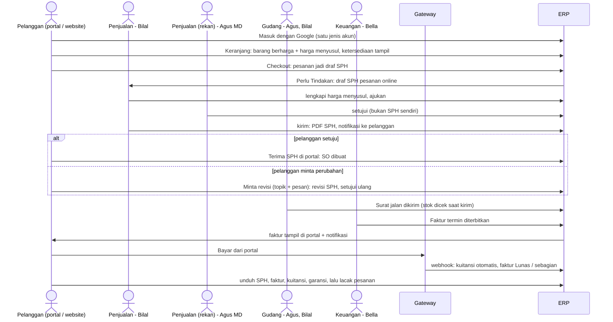

# Rancangan portal pelanggan dan pesanan online (B-38)

Disusun 2026-11-28. Kembali ke [catatan penyesuaian](../README.md).

**Status: keputusan programmer B 2026-11-28** (tanya-jawab, menegaskan dan
**Disetujui Pemilik 28/11 (dilaporkan programmer B).**
menyesuaikan keputusan Pemilik 14/11, 19/11, 20/11, 23/11). Belum ada kode.
Pengerjaannya mengikuti rencana port `docs/plan/port-portal-onto-main.md`
(P1 sudah masuk `main` lewat PR #139); dokumen ini mencatat apa yang
berubah dari rencana itu.

**Kondisi sekarang** (lihat
[`diagram-alur/alur-lengkap-saat-ini.md`](diagram-alur/alur-lengkap-saat-ini.md)
bagian 4): website RFQ/kontak/demo membuat prospek; keranjang dan checkout
website belum tersambung; portal tersambung untuk akun, proyek, tiket,
perangkat/garansi; pesanan, SPH, faktur, bayar, dokumen di portal masih
tampilan. Sebagian besar sudah dibangun di cabang lama
`feat/erp-0069-portal-session` (ERP-0069..0081) dan harus di-port, bukan
digabung.

---

## 1. Keputusan

| No | Keputusan | Asal |
|---|---|---|
| PP-1 | **Alur pesanan:** pesanan dari portal atau website → **draf SPH** → Penjualan memeriksa, mengajukan, rekan/Aqim menyetujui (K1, K2b), mengirim → pelanggan **menerima** (atau minta revisi) di portal → **SO** → faktur → bayar lewat gateway | Pemilik 14/11, ditegaskan 28/11 |
| PP-2 | **Keranjang:** barang berharga dan barang "harga menyusul" masuk **satu draf SPH**; harga yang menyusul diisi Penjualan. Barang "minta penawaran" tetap lewat **form RFQ terpisah** | 20/11, 23/11, ditegaskan 28/11 |
| PP-3 | **Akun portal:** satu jenis akun, masuk dengan **Google** (K13, OA4). **Anggota akun dan peran dalam portal dihapus** (approver/finance/viewer, batas persetujuan, undang anggota). Pelanggan perusahaan boleh punya beberapa kontak yang masing-masing login sendiri | 28/11 (mengganti rancangan portal lama dan keputusan D4 port) |
| PP-4 | **Pemegang SPH pesanan online:** **Bilal** sebagai petugas bawaan (di pengaturan, bisa diganti). SPH Bilal disetujui Agus MD (K2b) | 28/11 |
| PP-5 | **Bayar per termin:** setiap faktur termin yang diterbitkan Bella **tampil di portal dengan tombol Bayar**; tautan gateway dibuat otomatis untuk pelanggan (tidak lagi dikirim manual); kuitansi tercatat otomatis lewat webhook dan bisa diunduh | 28/11 |
| PP-6 | **Stok:** keranjang **menampilkan ketersediaan** (tersedia / inden) dari ERP, tanpa memesan stok; stok dicek lagi saat surat jalan dikirim (FU5) | 28/11 |
| PP-7 | **Data perusahaan dari portal** (nama, NPWP, industri) menjadi **permintaan** yang diperiksa Penjualan, bukan langsung berubah; NPWP tetap unik (FU2) | 20/11, ditegaskan 28/11 |
| PP-8 | **Cakupan dan urutan (semua prioritas Tinggi):** (1) **P2 + P7** halaman akun dan modul website, (2) **P3** pesanan, SPH, faktur, bayar, (3) **P5** unduh dokumen + notifikasi pelanggan, (4) **P4** lacak pesanan | 28/11 |

**Catatan PP-4:** aturan lama ERP-0070 mendahulukan petugas penjualan
pelanggan (bila sudah ada) sebelum petugas bawaan. Dicek ulang dengan
programmer B saat desain P3.

## 2. Alur sesudah (target)

## 3. Urutan kerja dan ketergantungan

| Urutan | Bagian port | Isi | Butuh | Catatan sesudah keputusan 28/11 |
|---|---|---|---|---|
| 1 | P2 (ERP-0100, ERP-0101) | Profil, permintaan ubah data perusahaan (PP-7), lokasi/site, pengaturan | P1 ✅ | Anggota akun dan peran **tidak** di-port (PP-3); login Google (K13) |
| 1 | P7 (ERP-0096, ERP-0099, ERP-0097) | Modul `website` (ADR baru), editor di web-admin, web-landing membaca ERP; keranjang/wishlist di `customer`; RFQ terhubung ke akun | P1 ✅, keputusan D1 | Menambah **schema ke-21** (`website`): `docs.dbml`, AGENTS.md, dan `docs/database/` ikut berubah; perlu ADR |
| 2 | P3 (ERP-0095, ERP-0103) | Keranjang → draf SPH, terima/revisi SPH, pesanan, faktur, bayar | P1 ✅ | Pemegang SPH (PP-4), checkout pelanggan membuat tautan gateway sendiri (PP-5), ketersediaan stok (PP-6) |
| 3 | P5 (ERP-0104, ERP-0102) | Unduh dokumen, notifikasi pelanggan | P3 | Butuh cetak/PDF SO dan kuitansi (B-37) |
| 4 | P4 (ERP-0098, ERP-0105) | Lacak pesanan publik dan portal; kurir/no. resi | P3 | SO harus berstatus Terkirim/Selesai otomatis (C1) agar tahap lacak benar |

Gate 1 (baca `docs/database/`) dan Gate 2 (grill) tetap dijalankan per
bagian sebelum kode; keputusan di dokumen ini menjadi bahan grill-nya.

## 4. Yang berubah dari rencana port lama

| Rencana port | Sekarang |
|---|---|
| D4: akun = kontak perusahaan atau perorangan, dengan anggota dan peran | Satu jenis akun, tanpa anggota dan peran (PP-3) |
| Login portal email + kata sandi, daftar dua langkah (perorangan/perusahaan) | Login Google (K13); data perusahaan menyusul di profil (OA4) |
| Pemegang SPH online: petugas pelanggan, lalu pengaturan | Petugas bawaan Bilal (PP-4) |
| Tautan bayar dikirim staf | Pelanggan membayar sendiri dari portal (PP-5) |
| Urutan P2 → P3 → P4 → P5 → P6 → P7 | P2 + P7 → P3 → P5 → P4; P6 (tiket) dibahas terpisah, sebagian sudah B-36 |
