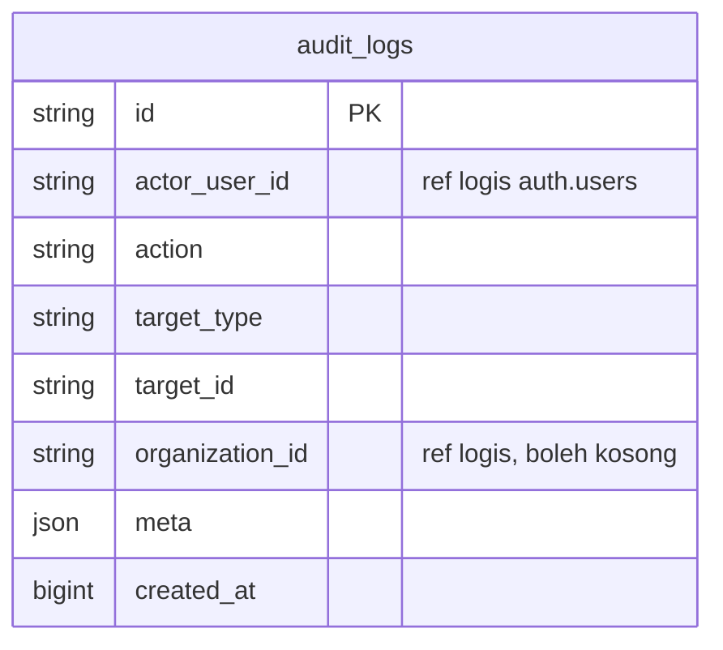

# Schema audit

Jejak audit milik ERP: siapa melakukan apa, terhadap apa, kapan. Hanya ditambah (append-only).

- **Modul/pemilik:** inti bersama (dibaca di Laporan -> Audit; terkait M12 hak akses).
- **Path backend:** `apps/backend/src/app/audit/` (`audit.service.ts` penulis, `audit-query.service.ts` pembaca, `audit.controller.ts` -> `GET /admin/audit`).
- **Drizzle:** `apps/backend/drizzle/schemas/audit.schema.ts` (juga berisi konstanta `AUDIT_ACTIONS`).

## Tabel

| Tabel | Fungsi | Kolom penting | Status (vocabulary) |
|---|---|---|---|
| `audit_logs` | Satu baris per kejadian yang diaudit | `id` (**text**, bukan uuid), `actor_user_id`, `actor_email` (salinan), `action`, `target_type`, `target_id`, `organization_id` (`NULL` = aksi global admin aplikasi), `meta` (jsonb: sebelum/sesudah, email, nama role), `ip_address`, `user_agent`, `created_at` | tidak ada kolom status. `action` dijaga kode (`AUDIT_ACTIONS`, 94 nilai), tanpa CHECK di database |

Tidak ada `updated_at` dan `deleted_at`: tabel insert-only, dikecualikan dari aturan soft delete. Indeks: `created_at`, `organization_id`, `actor_user_id`, `action`, (`target_type`, `target_id`).

Kelompok `action` saat ini (awalan: jumlah): `asset` 22, `warehouse` 7, `journal` 7, `stock_adjustment` 6, `borrowing` 8, `invitation` 5, `user` 4, `role` 3, `member` 2, `org` 1, `item` 3, `storage` 3, `stock` 2, `asset_category` 3, `accounting_period` 3, `chart_of_account` 3, `cost_center` 3, `posting_rule` 3, `credit_memo` 3, `receivable` 3.

## Relasi

Tidak ada foreign key (0 Ref). Semua penunjuk adalah referensi logis agar user yang dihapus tidak menghapus jejak.

| Kolom | Target | Contract yang mengecek |
|---|---|---|
| `actor_user_id` | `auth.users.id` | tidak dicek saat tulis (diambil dari sesi) |
| `organization_id` | `auth.organizations.id` | kontrak Identity (organisasi yang sama dengan otorisasi permintaan, ADR-0006) |
| `target_type` + `target_id` | baris di modul mana pun (`invitation`, `user`, `member`, `item`, `warehouse`, jurnal, periode, ...) | tidak dicek; polimorfik |

## Alur data

1. **Kejadian** di service modul (undangan dikirim/diklaim, role/anggota diubah, penyesuaian stok disetujui/diposting, peminjaman aset, item/gudang dibuat, jurnal diajukan/disetujui/dibalik, periode ditutup/dibuka ulang, aturan posting diubah, nota kredit, write-off) memanggil `AuditService.record(entry)`.
2. `record` menulis satu baris `audit_logs` lewat repository. **Fire-and-forget**: kegagalan hanya dicatat di log dan tidak menggagalkan transaksi bisnis (dan tidak ikut transaksi itu).
3. Penulis saat ini: modul `user` (undangan, user, role, anggota, organisasi), `finance`, `inventory`, `product`, `warehouse`. Modul `sale`, `procurement`, `human_resource`, `payment` **belum** menulis audit untuk persetujuan SPH, PO, PR, retur, cuti/lembur, atau pembayaran.
4. **Baca**: `GET /admin/audit` dengan filter `action`, `actorUserId`, `organizationId`, `from`/`to`, dan `targetType` (filter ini hanya menerima `invitation`/`user`/`role`/`member`/`organization`, jadi baris jurnal, stok, aset tidak bisa disaring per target; ERP-0061).

(Satu tabel tanpa relasi.)

## Penomoran

Tidak ada `code_numberings`.

## Catatan dan temuan

- `validate-dbml.ts` (2026-11-26): `OK`, 0 drift kolom.
- `id` bertipe `text`, berbeda dengan konvensi `uuid` (uuidv7) tabel lain.
- Kosakata `target_type` di dbml hanya contoh (`'invitation' | 'user' | ... | 'warehouse' | ...`); daftar lengkap tidak dijaga di database.
- Karena fire-and-forget, audit **bisa hilang** bila penulisan gagal setelah transaksi bisnis berhasil. Untuk aturan "persetujuan sendiri wajib tercatat" (3.8 butir 2) hal ini perlu diputuskan: tetap fire-and-forget atau tulis di transaksi yang sama.
- `stock_adjustment.approved` sudah tercatat, termasuk persetujuan oleh pembuatnya sendiri (pengecualian kode 2026-11-03, D5 di `ringkasan-arsitektur.md`), tetapi tanpa penanda khusus "disetujui pembuat".
- ERP-0061 (audit sebagai umpan aktivitas bisnis, memperluas `target_type`) belum selesai; dashboard membaca invoice/kuitansi langsung.
- ERP-0087 (refactor audit/automation) masih `in-progress` di backlog.

## Perubahan mendatang

| Perubahan | Sumber | Dampak ke schema | Status |
|---|---|---|---|
| Catat setiap persetujuan oleh pembuatnya sendiri (Pemilik) dengan penanda "disetujui oleh pembuat (Pemilik)", tampil di Laporan -> Audit | A1 (b) `bahan-keputusan.md`; `validasi-konsep-saat-ini.md` 3.8 butir 1-2; R2 | aturan: `action` baru (mis. `purchase_order.approved` + `meta.self_approved = true`, atau aksi `*.self_approved`) untuk SPH, PR, PO, retur pembelian/penjualan, cuti/lembur, penyesuaian stok; tanpa kolom baru | disetujui 27/11 (K1); ADR-0006 butir 6 diubah Oki |
| Penulis audit baru di `sale`, `procurement`, `human_resource` (persetujuan) dan mungkin `payment` | 3.8 "Yang perlu dikerjakan", R6 | aturan (vocabulary `AUDIT_ACTIONS`) | disetujui 27/11 (OA5–OA7), dikerjakan sebelum K1 |
| Ganti pengecualian penyesuaian stok dengan aturan Pemilik saja, tercatat audit | 3.8 butir 4, D5 | aturan | disetujui 27/11 (K1) |
| Putuskan audit persetujuan sendiri ikut transaksi bisnis (tidak boleh hilang) | temuan | aturan | usulan |
| Audit sebagai umpan aktivitas bisnis (`target_type` diperluas, filter bisnis) | ERP-0061 | aturan | direncanakan |
| Pemeriksaan uang keluar-masuk lewat audit log dan rekonsiliasi Bella (semua titik 🟡) | 3.7 | none | usulan |
