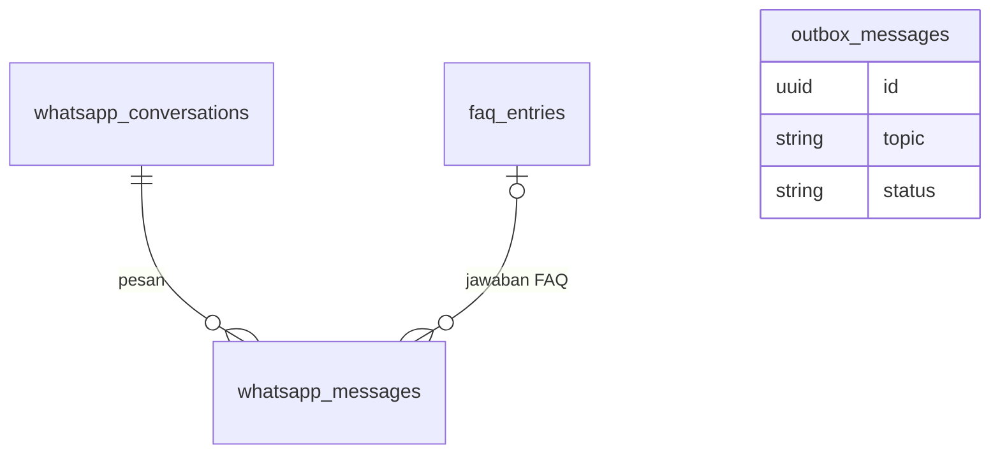

# Schema automation

Integrasi keluar-masuk: outbox transaksional yang dikirim ke n8n, FAQ untuk asisten WhatsApp, dan log percakapan WhatsApp.

- **Modul/pemilik:** M04 (Integrasi), programmer B.
- **Backend:** `apps/backend/src/app/automation/` (services `outbox`, `whatsapp`, `assistant`, `faq`, `exported-whatsapp-webhook`; antrean di `queues/`). Webhook masuk lewat modul `webhook` (tanpa schema) di `/webhooks/whatsapp`. Drizzle: `apps/backend/drizzle/schemas/automation.schema.ts`.
- **Lingkup:** seluruh perusahaan (ADR-0012). Keputusan M04 ada di ADR-0020 (status `proposed`).

## Tabel

| Tabel | Fungsi | Kolom penting | Status (vocabulary) |
|---|---|---|---|
| `outbox_messages` | Event bisnis yang dicatat bersama perubahan data, lalu dikirim ke webhook n8n oleh antrean | `id` (juga id event untuk dedupe n8n), `topic`, `aggregate_type`, `aggregate_id`, `payload` (jsonb), `attempts`, `response_status`, `error_message`, `dedupe_key` (unik bila diisi) | `status`: pending, published, failed |
| `faq_entries` | Jawaban yang disetujui untuk asisten WhatsApp | `question`, `answer`, `keywords`, `sort_order` | `is_active` (boolean) |
| `whatsapp_conversations` | Satu chat WhatsApp dengan nomor perusahaan | `chat_id` (WAHA, unik), `phone`, `contact_name`, `handoff_reason`, `assigned_user_id`, `lead_id`, `last_message_at` | `status`: assistant, handoff, closed. `handoff_reason`: no_provider, not_found, human_requested, restricted, error |
| `whatsapp_messages` | Setiap pesan dalam chat | `conversation_id`, `direction`, `author`, `external_id`, `body`, `faq_entry_id`, `sent_by`, `attempts` | `status`: received, processed, pending, sent, failed. `direction`: inbound, outbound. `author`: customer, assistant, admin, system |

Schema ini tidak punya `settings` maupun `code_numberings`. Konfigurasi WAHA, n8n, dan penyedia AI ada di variabel lingkungan.

**Topik outbox** (`automation/contracts/outbox.contract.ts`): `lead.created`, `lead.follow_up_due`, `quotation.follow_up_due`, `quotation.sent`, `invoice.issued`, `receipt.recorded`, `license.due`, `service_ticket.updated`, `whatsapp.handoff`, `supplier_bill.recorded`, `supplier_bill.due`, `purchase_return.updated`, `sales_return.updated`.

## Relasi

FK di dalam schema: `whatsapp_messages.conversation_id` → `whatsapp_conversations.id` (restrict); `whatsapp_messages.faq_entry_id` → `faq_entries.id` (set null). Unik: `whatsapp_messages` (direction, external_id) untuk menolak webhook ganda.

### Referensi lintas modul

| Kolom | Target | Diperiksa oleh |
|---|---|---|
| `whatsapp_conversations.lead_id` | `project.leads` | `LeadService.captureFromChat` (membuat lead dan mengembalikan id) |
| `whatsapp_conversations.assigned_user_id`, `whatsapp_messages.sent_by`, `faq_entries.created_by/updated_by` | `auth.users` | Sesi |
| `outbox_messages.organization_id` | `auth.organizations` | Kontrak organization (biasanya NULL, event seluruh perusahaan) |
| `outbox_messages.aggregate_id` | berbagai (`project.lead`, `sale.invoice`, `ticket.ticket`, ...) | Teks biasa, bukan referensi logis; tidak diperiksa |

## Alur data

1. **Event ke n8n**: modul bisnis memanggil `outbox.publish(topic, aggregate, payload)` di dalam transaksi bisnisnya → insert `outbox_messages` (pending). Antrean (BullMQ) mengirim ke webhook n8n: sukses → published + `published_at`; gagal → failed + `error_message`, `attempts` naik, diulang kecuali error 4xx (selain 408/429). Bila n8n belum diatur, pesan tetap pending. Gangguan antrean/webhook tidak pernah menggagalkan transaksi bisnis. `dedupe_key` mencegah event yang sama dua kali (contoh `license.due:<kontrak>:<akhir>:<ambang>`). Admin bisa mengirim ulang dari menu Integrasi → Webhook.
2. **Pesan WhatsApp masuk** (`/webhooks/whatsapp`, WAHA): `ExportedWhatsappWebhookService` → cari/buat `whatsapp_conversations`, insert `whatsapp_messages` (inbound, received; ganda ditolak lewat `external_id`). Chat `closed` kembali ke `assistant`.
3. **Asisten**: bila chat berstatus assistant dan penyedia AI tersedia, jawaban dicari dari `faq_entries` → pesan outbound (author assistant, `faq_entry_id`). Tidak ketemu / diminta manusia / error → **handoff**: status handoff, `handoff_reason`, satu balasan penahan, outbox `whatsapp.handoff`.
4. **Balasan admin**: insert `whatsapp_messages` outbound (pending → sent/failed, `attempts`). Tutup chat → closed.
5. **Jadikan lead**: dari chat → `project.leads` dibuat (source whatsapp), `lead_id` diisi.

## Penomoran

Tidak ada. Schema ini tidak menerbitkan nomor dokumen.

## Catatan dan temuan

- **Parity:** kolom, tipe, dan CHECK sama (validator OK; CHECK Drizzle memakai referensi kolom `${table.x}` tetapi isinya sama).
- **Catatan dbml `topic` usang:** hanya menyebut 6 topik (`lead.created`, `invoice.issued`, `receipt.recorded`, `license.due`, `service_ticket.updated`, `whatsapp.handoff`); kode punya 13.
- **Temuan M04:** alasan "The n8n webhook is not configured" tampil dalam bahasa Inggris; asisten FAQ butuh penyedia AI, bukan hanya WAHA; "Tutup chat" tanpa konfirmasi; tidak ada chat WhatsApp contoh di seeder sehingga alur chat tidak bisa diuji tanpa WAHA.
- Risiko blokir nomor WAHA: alur n8n mendukung template Meta Cloud API, tetapi asisten masuk (inbound) ERP di Meta belum dibuat; `chat_id` dan webhook masih berbentuk WAHA.
- ADR-0020 (outbox dan WhatsApp) masih `proposed`.

## Perubahan mendatang

| Perubahan | Sumber | Dampak ke schema | Status |
|---|---|---|---|
| Event baru: dokumen menunggu persetujuan, pesanan online masuk, SO terkirim/selesai, pengingat laporan harian; status sakelar pesan pelanggan di payload event | N8-5, N8-6, B-46 | kosakata `OUTBOX_EVENTS` + pengaturan sakelar (pengaturan perusahaan atau kolom baru; dicek ke `docs.dbml`) | diputuskan 28/11, Tinggi |
| Asisten WhatsApp masuk lewat Meta Cloud API (selain WAHA) | Catatan M04 (risiko blokir WAHA), PR #114 | aturan (mungkin kolom penyedia di `whatsapp_conversations`) | usulan |
| Terjemahkan alasan gagal kirim outbox | Temuan M04 no. 1 | none | usulan |
| Konfirmasi sebelum Tutup chat | Temuan M04 no. 5 | none | usulan |
| Chat WhatsApp contoh di seeder untuk UAT | Temuan M04 no. 15 | none (seed) | usulan |
| Perbarui catatan dbml daftar topik outbox | Temuan dokumen ini | none (dokumen) | usulan |
| Penerimaan ADR-0020 | ADR-0020 `proposed` | none | diputuskan 27/11 (T-6): ditandai accepted lewat PR programmer B, ditinjau Oki |