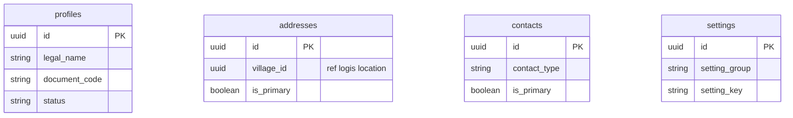

# Schema company

Profil satu-satunya badan hukum di balik semua organisasi (ADR-0011): identitas, kop surat, alamat kantor, kontak, dan pengaturan tingkat perusahaan.

- **Modul/pemilik:** Oki (M12). Semua baris berlaku untuk seluruh perusahaan, **tanpa** `organization_id`.
- **Path backend:** `apps/backend/src/app/company/` (`CompanyService`, `ExportedCompanyService`), URL `/companies`.
- **Drizzle:** `apps/backend/drizzle/schemas/company.schema.ts`.

## Tabel

| Tabel | Fungsi | Kolom penting | Status (vocabulary) |
|---|---|---|---|
| `profiles` | Profil hukum dan tampilan perusahaan (satu baris hidup) | `legal_name`, `trading_name`, `document_code` (token `{COMPANY}`, huruf besar/angka), `tax_id` (NPWP), `logo_object_key`, `signature_object_key`, `onboarding_object_key`, `signatory_name/title`, syarat default SPH/invoice, teks garansi | `status`: `active` / `inactive` |
| `addresses` | Alamat kantor | `label` (default `head_office`), `address_line`, `village_id`, `postal_code`, `is_primary` (alamat di kop surat) | tidak ada |
| `contacts` | Kontak perusahaan | `contact_type`, `value`, `label`, `is_primary` (satu per jenis untuk kop) | `contact_type`: `phone` / `email` / `whatsapp` / `fax` / `other` |
| `settings` | Key-value pengaturan perusahaan | `setting_group`, `setting_key`, `setting_value`, `value_type`, `is_secret` (selalu `false`), `updated_by` | `value_type`: `string`/`number`/`boolean`/`json`/`date` |

Satu baris hidup di `profiles` dijaga indeks unik parsial `profiles_singleton_uq ON ((true)) WHERE deleted_at IS NULL`.

## Relasi

Tidak ada foreign key di dalam schema (0 Ref).

**Referensi lintas modul:**

| Kolom | Target | Contract yang mengecek |
|---|---|---|
| `addresses.village_id` | `location.villages.id` | `ExportedLocationService.assertVillage` saat tulis; jalur lewat `resolveVillagePath` |
| `profiles.updated_by`, `settings.updated_by` | `auth.users.id` | kontrak modul Identity (`ExportedUserService`) |

Arah sebaliknya: modul lain membaca perusahaan lewat `ExportedCompanyService` (`getLetterhead`, `getDocumentCode`, `requireDocumentCode`, `getDisplayName`), tidak pernah membaca tabel ini langsung. Rekening bank untuk invoice **bukan** di sini lagi: ada di `finance.cash_bank_accounts` (`invoice_usage`).

## Alur data

1. **Simpan profil** (Pemilik/Admin, Pengaturan -> Perusahaan): `CompanyService` menulis `profiles`, alamat utama di `addresses`, dan `contacts` dalam **satu transaksi**. Simpan pertama wajib `legal_name` dan `document_code`.
2. **Unggah gambar** (logo, tanda tangan/stempel, gambar login): file WebP ke object storage, kuncinya di kolom `*_object_key`.
3. **Cetak dokumen** (SPH, invoice, PO, BAST, slip gaji): modul pemilik dokumen memanggil `getLetterhead()` -> nama, alamat utama, kontak utama, logo, penandatangan.
4. **Alokasi nomor dokumen**: layanan penomoran semua modul memanggil `requireDocumentCode()` untuk mengisi token `{COMPANY}`.
5. **Halaman login** (tanpa sesi): branding publik (nama tampilan + gambar onboarding) saja.
6. **Pengaturan**: `settings` dibuat/diganti per (`setting_group`, `setting_key`).

(Tidak ada garis relasi: keempat tabel berdiri sendiri, terikat secara konsep ke satu profil perusahaan.)

## Penomoran

Tidak ada `code_numberings` di schema ini. Tetapi `profiles.document_code` adalah sumber token `{COMPANY}` untuk semua pola nomor, mis. pola default `{SEQ:4}/{TYPE}/{COMPANY}/{MM_ROMAN}/{YY}` (`apps/backend/src/shared/numbering/domain.ts`). Mengubah `document_code` mengubah nomor dokumen **berikutnya**, bukan nomor lama.

## Catatan dan temuan

- `validate-dbml.ts` (2026-11-26): `OK`, tidak ada drift dbml vs Drizzle.
- "Satu alamat utama" (`addresses_primary_uq`) dan "satu kontak utama per jenis" (`contacts_primary_per_type_uq`) dijaga indeks unik parsial yang hanya ada di Drizzle; dbml hanya menulisnya di catatan kolom karena DBML tidak bisa menyatakan indeks parsial.
- `settings.is_secret` dicadangkan dan selalu `false` sampai jalur baca rahasia ada (ERP-0045).
- `profiles.status` ada tetapi tidak ada alur yang menonaktifkan perusahaan.
- `contacts.value` hanya diindeks biasa; nilai ganda diperbolehkan.
- ERP-0073 (refactor company: `addresses`, rekening bank keluar, `/companies`) masih `in-progress` di backlog walau backend sudah selesai 2026-11-19.

## Perubahan mendatang

| Perubahan | Sumber | Dampak ke schema | Status |
|---|---|---|---|
| Admin (bukan hanya Pemilik) mengelola profil, nomor kode, data master: sudah sesuai matriks | `validasi-konsep-saat-ini.md` 3.8 (tabel Pemilik vs Admin) | none | — |
| Jalur baca pengaturan rahasia (`is_secret = true`) | ERP-0045 | aturan (kolom sudah ada) | usulan |
| Tutup ERP-0073 (UI dan bukti exit) | ERP-0073 | none | direncanakan |
