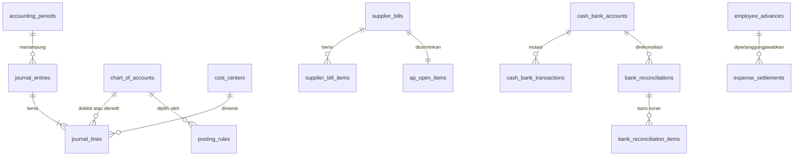

# Schema finance

Buku besar (GL) sebagai sumber kebenaran keuangan: bagan akun, periode, jurnal, piutang/utang, kas/bank dan rekonsiliasi, uang muka dan klaim karyawan, aset tetap, anggaran proyek, dan bahan laporan.

- **Modul/pemilik:** Oki (M09 Keuangan). Menyerap modul lama `accounting` (ADR-0024 Q19); cakupan ERP-grade diterima di ADR-0030 (2026-11-25). Gaji tetap di `human_resource` (Q39).
- **Path backend:** `apps/backend/src/app/finance/` (35 file service, a.l. `posting.service.ts`, `period.service.ts`, `manual-journal.service.ts`, `supplier-bill.service.ts`, `ledger-settlement.port.service.ts`, `bank-reconciliation.service.ts`, `employee-advance.service.ts`, `fixed-asset.service.ts`, `project-budget.service.ts`). URL `/finance/*` dan `/reports/*`.
- **Drizzle:** `apps/backend/drizzle/schemas/finance.schema.ts`. Rincian desain: `docs/architecture/modules/finance.md` (dihapus 2026-11-28, ada di riwayat git).

Semua uang `bigint` rupiah sen dengan `currency_code = 'IDR'` (CHECK, ERP-0132). Semua tabel bisnis punya `organization_id` (referensi logis) dan `deleted_at`, kecuali yang disebut.

## Tabel

### A. Buku besar (GL)

| Tabel | Fungsi | Kolom penting | Status (vocabulary) |
|---|---|---|---|
| `chart_of_accounts` | Bagan akun (94 akun Indonesia, format `X-XXXX`, ERP-0127) | `code`, `account_type`, `normal_balance`, `parent_account_id`, `is_postable`, `is_system`, `cash_flow_category` | `account_type`: `asset`/`liability`/`equity`/`revenue`/`expense`; `normal_balance`: `debit`/`credit`; `cash_flow_category`: `operating`/`investing`/`financing` |
| `accounting_periods` | Periode bulanan | `period_year`, `period_month`, `start_date`, `end_date`, `closed_by/at`, `reopened_by/at` | `open` -> `closed` (soft close) -> `locked` |
| `journal_entries` | Header jurnal | `code` (diisi saat posting), `accounting_period_id`, `entry_date`, `source_module`, `source_type/id`, `event_type`, `idempotency_key`, `is_adjusting`, `total_debit = total_credit`, `prepared_by`, `approved_by`, `posted_by`, `reverses_entry_id`, `reversed_by_entry_id` | `draft`/`submitted`/`approved`/`posted`/`reversed`/`void`; `source_module`: `finance`/`sale`/`procurement`/`inventory`/`payment`/`tax`/`human_resource`/`project` |
| `journal_lines` | Baris jurnal | `line_no`, `account_id`, `debit` XOR `credit`, dimensi `cost_center_id`, `project_id`, `party_type/id`, `product_id` | tidak ada |
| `posting_rules` | Penentuan akun untuk `postBusinessEvent` (ADR-0030) | `event_type` (atau `*`), `role` (receivable, revenue, vat_output, ...), `discriminator_type/value`, `account_id` | `discriminator_type`: `''`/`product_category`/`tax`/`cash_bank_account`/`expense_category`/`asset_category`/`cost_category`/`payment_method`/`item_kind` |
| `cost_centers` | Pusat biaya (hierarki) | `code`, `parent_cost_center_id`, `is_active` | `is_active` |
| `opening_balances` | Saldo awal per akun saat mulai sistem | `account_id`, `as_of_date`, `debit_balance`, `credit_balance`, `posted_at` | belum/sudah posting (`posted_at`) |
| `opening_subledger_items` | Rincian saldo awal piutang/utang dari impor CSV (ERP-0142) | `ledger`, `customer_id`/`supplier_company_id`, `party_code/name` (snapshot), `document_number`, `amount`, `ar_open_item_id`, `supplier_bill_id`, `ap_open_item_id` | `ledger`: `ar`/`ap` |
| `account_balances` | Snapshot saldo akun saat periode ditutup | `account_id`, `accounting_period_id`, `debit_total`, `credit_total`, `closing_balance` | tidak ada |
| `journal_templates` | Template jurnal (mis. jurnal gaji bulanan) | `code`, `line_definitions` | **status: target**, hanya di dbml, belum ada di Drizzle |

### B. Piutang dan utang (AR/AP)

| Tabel | Fungsi | Kolom penting | Status (vocabulary) |
|---|---|---|---|
| `ar_open_items` | Cermin piutang per invoice (bukan hasil baca tabel `sale`) | `invoice_id`, `customer_id`, `original_amount`, `paid_amount`, `outstanding_amount`, `adjusted_amount`, kolom write-off (maker-checker) | `open`/`partially_paid`/`paid`/`written_off`/`void`. **Tanpa** `deleted_at` (proyeksi) |
| `credit_memos` | Nota kredit atas invoice (ERP-0135) | `invoice_id`, `customer_id`, `amount`, `tax_amount`, `journal_entry_id`, `issued_by` | `draft`/`issued`/`applied`/`void` |
| `deferred_revenue_schedules` | Pendapatan diterima di muka per baris invoice berperiode (ERP-0135) | `invoice_id`, `invoice_item_id`, `issue_entry_id`, `total_amount`, `recognized_amount`, `recognized_through` (YYYY-MM) | `active`/`completed`/`cancelled` |
| `supplier_bills` | Tagihan pemasok (dari PO atau saldo awal) | `supplier_company_id`, `purchase_order_id`, `supplier_invoice_number`, `subtotal`, `tax_total`, `grand_total`, `paid_total`, `outstanding_total` | `draft`/`approved`/`partially_paid`/`paid`/`overdue`/`void` |
| `supplier_bill_items` | Baris tagihan dari baris PO (ERP-0012) | `purchase_order_item_id`, `product_id`, `quantity`, `unit_price`, `tax_base`, `is_stock`, `grir_amount` | tidak ada |
| `ap_open_items` | Cermin utang per tagihan | `supplier_bill_id`, `supplier_company_id`, `original/paid/outstanding_amount` | `open`/`partially_paid`/`paid`/`void`. **Tanpa** `deleted_at` |
| `payment_terms` | Syarat bayar (mis. 30 hari) | `code`, `days`, `discount_percent`, `discount_days` | `is_active` |

### C. Kas, bank, mutasi rekening

| Tabel | Fungsi | Kolom penting | Status (vocabulary) |
|---|---|---|---|
| `cash_bank_accounts` | Rekening kas/bank/e-wallet/kliring; juga rekening gaji karyawan (`employee_id`) dan rekening di invoice | `code`, `account_type`, `account_number`, `current_balance` (saldo berjalan), `invoice_usage`, `employee_id`, `statement_mapping` (format CSV mutasi), `is_primary` | `account_type`: `cash`/`bank`/`ewallet`/`clearing`; `invoice_usage`: `vat`/`non_vat` |
| `bank_account_links` | Rekening -> akun GL (satu per rekening) | `cash_bank_account_id` (unik), `chart_of_account_id` | `is_active` |
| `cash_bank_transactions` | Mutasi kas/bank dari pembayaran atau entri manual | `code`, `direction`, `amount`, `source_type/id`, `balance_after`, `reference_number` | `direction`: `in`/`out`; `status`: `draft`/`posted`/`reversed` |
| `bank_reconciliations` | Satu rekening koran yang direkonsiliasi | `cash_bank_account_id`, `reconciliation_date`, `statement_balance`, `book_balance`, `difference` | `draft`/`in_progress`/`reconciled`/`closed` |
| `bank_reconciliation_items` | Baris rekening koran (impor CSV, ERP-0143) dan pasangannya | `cash_bank_transaction_id`, `statement_date`, `statement_amount`, `direction`, `match_method`, `is_matched` | `match_method`: `auto`/`manual`/`created` |
| `cash_forecast_lines` | Baris manual prakiraan kas 13 minggu (ERP-0149) | `expected_date`, `direction`, `amount`, `description` | tidak ada |

### D. Karyawan: klaim, uang muka (kasbon), pertanggungjawaban

| Tabel | Fungsi | Kolom penting | Status (vocabulary) |
|---|---|---|---|
| `expense_claims` | Klaim biaya karyawan (ERP-0013) | `employee_id`, `project_id`, `total_amount`, `submitted_by`, `approved_by`, `payment_id` | `draft`/`submitted`/`approved`/`rejected`/`paid`/`cancelled` |
| `expense_claim_items` | Baris klaim | `category_code` (kode akun biaya), `amount`, `tax_amount`, `receipt_document_id` | tidak ada |
| `employee_advances` | Kasbon karyawan (ERP-0144) | `employee_id`, `project_id`, `amount`, `settled_amount`, `requested_by`, `approved_by`, `disbursed_at`, `payment_id` | `draft`/`submitted`/`approved`/`disbursed`/`settled`/`cancelled` |
| `expense_settlements` | Pertanggungjawaban kasbon / biaya | `settlement_type`, `employee_advance_id`, `advance_offset_amount`, `payable_amount`, `paid_amount`, `journal_entry_id`, `verified_by`, `approved_by` | `settlement_type`: `expense`/`advance`; `draft`/`submitted`/`verified`/`approved`/`rejected`/`paid`/`cancelled` |
| `expense_settlement_items` | Baris pertanggungjawaban | `category_code`, `amount`, `is_advance_offset`, `project_id`, `receipt_document_id` | tidak ada |

### E. Aset tetap, anggaran, laporan, pengaturan

| Tabel | Fungsi | Kolom penting | Status (vocabulary) |
|---|---|---|---|
| `fixed_asset_books` | Buku aset tetap per item inventaris yang dikapitalisasi (ERP-0145) | `item_id`, `fiscal_group`, `capitalized_on`, `capitalized_amount`, `counterpart_account_id`, `capitalization_entry_id`, `disposal_entry_id` | `active`/`disposed`; `fiscal_group`: `kelompok_1..4`, `bangunan_permanen`, `bangunan_tidak_permanen` |
| `asset_depreciations` | Jejak penyusutan bulanan per item | `item_id`, `period_year/month`, `depreciation_method`, `depreciation_amount`, `opening/closing_book_value`, `journal_entry_id` | `depreciation_method`: `straight_line`/`declining_balance`/`none` |
| `project_budgets` | Anggaran proyek berversi (ERP-0146) | `project_id`, `version`, `control_mode`, `activated_by/at` | `draft` -> `active` -> `superseded`; `control_mode`: `warn`/`block` |
| `project_budget_lines` | Nilai anggaran per akun per bulan | `project_budget_id`, `account_id`, `period` (YYYY-MM), `amount` | tidak ada |
| `report_archives` | Snapshot laporan bulan yang sudah ditutup | `period_year/month`, `report_type`, `payload` (jsonb), `generated_by` | `report_type`: `profit_and_loss`/`balance_sheet`/`cash_flow`/`management_pack` |
| `settings` | Key-value pengaturan keuangan | `setting_group`, `setting_key`, `setting_value` | tidak ada |
| `code_numberings` | Seri nomor modul keuangan | `code_type`, `pattern`, `reset_policy`, `period_key`, `next_number` | `reset_policy`: `never`/`yearly`/`monthly` |

## Relasi

FK di dalam schema (33 Ref). Yang utama:

- `chart_of_accounts.parent_account_id` -> `chart_of_accounts` (restrict); `cost_centers.parent_cost_center_id` -> `cost_centers` (restrict)
- `journal_entries.accounting_period_id` -> `accounting_periods` (restrict); `reverses_entry_id`, `reversed_by_entry_id` -> `journal_entries` (set null)
- `journal_lines.journal_entry_id` -> `journal_entries` (cascade); `account_id` -> `chart_of_accounts`, `cost_center_id` -> `cost_centers` (restrict)
- `posting_rules.account_id`, `bank_account_links.chart_of_account_id`, `project_budget_lines.account_id`, `fixed_asset_books.counterpart_account_id` -> `chart_of_accounts` (restrict)
- `opening_balances.account_id`, `account_balances.account_id` -> `chart_of_accounts`; `account_balances.accounting_period_id` -> `accounting_periods` (cascade)
- Ke `journal_entries` (set null): `credit_memos`, `deferred_revenue_schedules.issue_entry_id`, `ar_open_items.write_off_entry_id`, `asset_depreciations`, `expense_settlements`, `fixed_asset_books` (kapitalisasi, pelepasan)
- `supplier_bill_items` -> `supplier_bills` (cascade); `ap_open_items.supplier_bill_id` -> `supplier_bills` (restrict)
- `opening_subledger_items` -> `ar_open_items`, `supplier_bills`, `ap_open_items`
- `cash_bank_transactions`, `bank_reconciliations` -> `cash_bank_accounts` (restrict); `bank_account_links` -> `cash_bank_accounts` (cascade)
- `bank_reconciliation_items` -> `bank_reconciliations` (cascade), -> `cash_bank_transactions` (set null)
- `expense_claim_items` -> `expense_claims`; `expense_settlement_items` -> `expense_settlements` (cascade); `expense_settlements.employee_advance_id` -> `employee_advances` (set null)
- `project_budget_lines.project_budget_id` -> `project_budgets` (cascade)

### Referensi lintas modul

| Kolom | Target | Contract yang mengecek |
|---|---|---|
| `ar_open_items.invoice_id`, `credit_memos.invoice_id`, `deferred_revenue_schedules.invoice_id` | `sale.invoices.id` | `ExportedInvoiceService` (invoice tidak void) |
| `deferred_revenue_schedules.invoice_item_id` | `sale.invoice_items.id` | kontrak modul Sale |
| `ar_open_items.customer_id`, `credit_memos.customer_id`, `opening_subledger_items.customer_id` | `customer.customers.id` | `ExportedCustomerService` (`findCustomerByCode` saat impor saldo awal) |
| `supplier_bills.supplier_company_id`, `ap_open_items.*`, `opening_subledger_items.*` | `supplier.companies.id` | `ExportedSupplierService.assertActiveCompany` / `findCompanyByCode` |
| `supplier_bills.purchase_order_id` | `procurement.purchase_orders.id` | `ExportedPurchaseOrderService` |
| `supplier_bill_items.purchase_order_item_id` | `procurement.purchase_order_items.id` | `ExportedPurchaseOrderService` (baris milik PO itu) |
| `journal_lines.product_id`, `supplier_bill_items.product_id` | `product.products.id` | kontrak modul Product (dicek modul sumber sebelum posting) |
| `journal_lines.project_id`, `project_budgets`, `expense_claims`, `employee_advances`, `expense_settlements`, `expense_settlement_items` (`.project_id`) | `project.projects.id` | `ProjectLookupService.getProject` / `ExportedProjectService` |
| `cash_bank_accounts.employee_id`, `expense_claims`, `employee_advances`, `expense_settlements` (`.employee_id`) | `human_resource.employees.id` | `ExportedEmployeeService.findEmployeeById` |
| `expense_claims.payment_id`, `employee_advances.payment_id`, `expense_settlements.payment_id` | `payment.payments.id` | `ExportedPaymentService.requireExecuted` |
| `expense_claim_items.receipt_document_id`, `expense_settlement_items.receipt_document_id` | `document.documents.id` | kontrak modul Document (dokumen terbit) |
| `asset_depreciations.item_id`, `fixed_asset_books.item_id` | `inventory.items.id` | `ItemService.getItem` / `ExportedInventoryService` |
| `organization_id`, semua `*_by` | `auth.organizations.id`, `auth.users.id` | kontrak Identity |

Arah masuk: `payment.payments.cash_bank_account_id` (-> `ExportedCashBankAccountService`), `sale.invoices.payment_term_id` (-> `ExportedFinanceService`), serta `journal_entry_id` di `human_resource.employee_salary_records`, `procurement.purchase_returns`, `project.costs`.

## Alur data

Aturan dasar: **modul lain tidak pernah menulis baris jurnal langsung.** Semua lewat `PostingService` (`post` atau `postBusinessEvent`) dalam satu transaksi: periode dicek (`open`, atau `closed` hanya untuk jurnal penyesuaian), akun dicari lewat `posting_rules` (event+diskriminator -> event -> `*`+diskriminator -> `*`; tidak ada aturan = gagal), debit = kredit, `idempotency_key` mencegah posting ganda, nomor `JE` dialokasikan saat `posted`.

| Kejadian | Tabel yang ditulis (urutan) | Status |
|---|---|---|
| Invoice terbit (`sale.invoice_issued`) | `journal_entries` + `journal_lines` (Dr piutang / Cr pendapatan per kategori / Cr PPN keluaran; DP ke uang muka pelanggan) -> `ar_open_items` (baru) -> `deferred_revenue_schedules` bila ada periode layanan | open item `open` |
| Kuitansi/penerimaan (`sale.receipt_posted`, `payment.settled`) | `payment.payments` executed -> jurnal Dr kas/kliring gateway / Cr piutang -> `ar_open_items.paid_amount` -> `cash_bank_transactions` + `cash_bank_accounts.current_balance` | `partially_paid` / `paid` |
| Penerimaan barang (`procurement.goods_received`) | jurnal Dr persediaan / Cr GR/IR | — |
| Tagihan pemasok dicatat lalu disetujui (`finance.supplier_bill_recorded`) | `supplier_bills` + `supplier_bill_items` (`draft`) -> setujui: jurnal Dr GR/IR atau biaya + PPN masukan / Cr utang (selisih harga ke PPV) -> `ap_open_items` | `draft` -> `approved` |
| Bayar pemasok | `payment.payments` (`draft` -> `submitted` -> `approved` -> `executed`) + `payment_allocations` -> jurnal Dr utang / Cr bank (PPh dipotong ke utang PPh) -> `ap_open_items`, `supplier_bills.paid_total` -> `cash_bank_transactions` | `partially_paid` / `paid` |
| Surat jalan dikirim, retur, penyesuaian stok | jurnal HPP / persediaan (`sale.delivery_shipped`, `sale.return_received`, `inventory.adjustment_posted`, `procurement.purchase_returned`) | — |
| Nota kredit / write-off | `credit_memos` -> jurnal Dr retur + PPN / Cr piutang -> `ar_open_items.adjusted_amount`; write-off: diminta lalu disetujui **orang lain** -> jurnal Dr cadangan 1-1390 / Cr piutang | memo `draft` -> `applied` -> `void`; open item `written_off` |
| Jurnal manual (maker-checker) | `journal_entries` (`draft`, tanpa kode) -> `submitted` -> disetujui **orang lain** = `posted` (kode JE) ; tolak -> `draft`; buang -> `void`; koreksi = jurnal balik (`reverses_entry_id`, alasan wajib) | `reversed` untuk yang dibalik |
| Kasbon karyawan | `employee_advances` `draft` -> `submitted` -> `approved` (bukan peminta) -> pembayaran `payment` -> `disbursed` -> pertanggungjawaban | `settled` |
| Pertanggungjawaban | `expense_settlements` + items `submitted` -> `verified` -> `approved` (dua orang berbeda) -> jurnal Dr biaya / Cr uang muka karyawan / Cr utang klaim -> sisa dibayar lewat `payment` | `paid` |
| Klaim biaya | `expense_claims` `draft` -> `submitted` -> `approved` (jurnal `finance.expense_claim_approved`) -> dibayar `payment` | `paid` |
| Mutasi bank | impor CSV ke `bank_reconciliation_items` (duplikat dilewati) -> cocok otomatis (nominal, arah, +-3 hari, referensi) atau manual -> baris tak cocok dibukukan sebagai `cash_bank_transactions` (`created`) | rekonsiliasi `draft` -> `in_progress` -> `reconciled` -> `closed` |
| Aset tetap | kapitalisasi `fixed_asset_books` + jurnal -> penyusutan bulanan `asset_depreciations` + jurnal (idempoten per item/bulan; nilai buku item ditulis lewat `ItemService.applyDepreciation`) -> pelepasan: jurnal pelepasan | `active` -> `disposed` |
| Anggaran proyek | `project_budgets` (`draft`) + `project_budget_lines` -> aktifkan (versi lama `superseded`) -> dicek saat setujui PO, ajukan klaim, catat biaya proyek | `warn` / `block` |
| Pajak | penyelesaian PPN (`finance.ppn_settled`), bayar pajak (`finance.tax_paid`), pemotongan PPh (`payment.withholding_recorded`) | lihat `tax.md` |
| Gaji disetujui (HR) | jurnal gaji via posting service; `human_resource.employee_salary_records.journal_entry_id` | — |
| Tutup bulan | daftar periksa (dihitung saat diminta) -> `account_balances` (snapshot) -> periode `closed` (hanya jurnal penyesuaian) -> `locked` (tidak ada jurnal manual belum posting) -> `report_archives`; buka ulang tercatat audit, `locked -> open` hanya Pemilik | `open` -> `closed` -> `locked` |
| Saldo awal | `opening_balances` + impor `opening_subledger_items` -> posting ditolak bila total rincian beda dengan akun kontrol -> membuat `ar_open_items` / `supplier_bills` + `ap_open_items` | `posted_at` terisi |

## Penomoran

`finance.code_numberings` (tanpa `organization_id`, seri berlaku seluruh perusahaan). Pola default `{SEQ:4}/{TYPE}/{COMPANY}/{MM_ROMAN}/{YY}`, reset `yearly` (dari `apps/backend/src/shared/numbering/domain.ts`); pola dan reset bisa diubah di halaman nomor kode.

| `code_type` | `{TYPE}` | Dipakai di |
|---|---|---|
| `journal_entry` | JE | `journal_entries.code` (saat posting) |
| `supplier_bill` | SB | `supplier_bills.code` |
| `expense_claim` | EC | `expense_claims.code` |
| `cash_bank_transaction` | CB | `cash_bank_transactions.code` |
| `bank_reconciliation` | REC | `bank_reconciliations.code` |
| `asset_depreciation` | DEP | penyusutan |
| `employee_bank_account` | REK | `cash_bank_accounts.code` rekening gaji (ERP-0119) |
| `credit_memo` | CN | `credit_memos.code` |
| `employee_advance` | ADV | `employee_advances.code` |
| `expense_settlement` | SET | `expense_settlements.code` |

Kode `chart_of_accounts`, `cost_centers`, `payment_terms`, `cash_bank_accounts` (non-karyawan), dan `accounting_periods` diketik manual/seed, bukan dari seri.

## Catatan dan temuan

- `validate-dbml.ts` (2026-11-26): `OK`, 0 drift kolom dbml vs Drizzle.
- **Catatan dbml usang:** `finance.code_numberings.code_type` menyebut 5 jenis; kode memakai 10 (tabel di atas).
- **Komentar Drizzle usang:** kepala `finance.schema.ts` menyebut `employee_advances` dan `expense_settlements` sebagai target-only, padahal sudah dibangun (ERP-0144).
- **Jumlah tabel usang:** `module-ownership.md` menulis finance 30 tabel; dbml kini 35 (Drizzle 34 + `journal_templates` target).
- `journal_templates`: hanya di dbml (`status: target`), belum ada tabel.
- `finance.settings`: ada di Drizzle tetapi tidak dipakai kode; catatan dbml "termasuk status daftar periksa tutup bulan" tidak benar, daftar periksa dihitung saat diminta (`close-checklist.repository.ts`).
- Nilai status yang tidak ditemukan penulisannya di service (dicek dengan grep 2026-11-26): `supplier_bills.status = overdue` (jatuh tempo dihitung saat baca), `credit_memos.status = issued` (alur `draft` -> `applied` -> `void`), `cash_bank_transactions.status = draft` (mutasi dibuat langsung `posted`).
- `ar_open_items` dan `ap_open_items` sengaja tanpa `deleted_at` (proyeksi saldo berjalan).
- `cash_bank_accounts` mencampur rekening perusahaan dan rekening gaji karyawan (`employee_id`); query kas/bank wajib menyaring `employee_id IS NULL`.
- Pemisahan tugas di finance sudah dikunci di service: jurnal manual (`JournalSelfApprovalError`), write-off, kasbon (penyetuju bukan peminta), pertanggungjawaban (verifikator dan penyetuju berbeda). Akibatnya tabel 3.7 `validasi-konsep-saat-ini.md` ("Jurnal: Bella membuat, Bella menyetujui") **tidak akurat**: jurnal manual Bella harus disetujui orang lain (Aqim).
- Klaim biaya (`expense_claims`) dan tagihan pemasok **tidak** punya larangan menyetujui sendiri.

## Perubahan mendatang

| Perubahan | Sumber | Dampak ke schema | Status |
|---|---|---|---|
| Pemilik boleh menyetujui sendiri (tercatat audit): tentukan apakah berlaku juga untuk jurnal manual, write-off, kasbon, pertanggungjawaban | A1 `bahan-keputusan.md`, 3.8; temuan di atas | aturan (service + audit; kolom `approved_by` sudah ada) | disetujui 27/11 (K1a): kasbon dan pertanggungjawaban ikut K1; jurnal manual tetap orang kedua; write-off tetap tidak boleh menyetujui pengajuan sendiri |
| Pembayaran dan gaji tanpa pemeriksa kedua; Bella memeriksa lewat jurnal dan rekonsiliasi | R6 (3.2), 3.7 | none | usulan |
| Tutup buku akhir tahun ke laba ditahan 3-2000 (idempoten per tahun) | ERP-0131 | aturan (mungkin kolom penanda di `journal_entries`/`settings`) | direncanakan |
| Tes khusus jejak audit buka ulang periode | ERP-0017 | none | direncanakan |
| Laporan dan rekap pajak: gerbang keuangan D12/D14/D18 | ERP-0016 | none | diputuskan 27/11 (T-5): Bella mengisi tarif di master pajak (tanggal berlaku) saat UAT; pembulatan ke rupiah penuh per dokumen; Aqim mengonfirmasi |
| `journal_templates` dibangun (jurnal berulang) | dbml target | tabel | usulan |
| Belum dibangun: alokasi nota kredit ke invoice lain dan refund, nota kredit pemasok (GR/IR), impor laporan settlement gateway, kapitalisasi dari penerimaan barang, peringatan GR/IR > 30 hari, blokir anggaran per akun/bulan | `docs/architecture/modules/finance.md` (dihapus 2026-11-28, ada di riwayat git) "Not built" | kolom/tabel (sebagian) | usulan |
| Kontrak laba periode terkunci untuk M11 bagi hasil/investor (`ExportedProfitService`) sudah ada; modul M11 belum | ERP-0153, ERP-0023 | none di finance | ditunda (K10, disetujui 27/11) **[Diubah 28/11, IV-1: M11 dibangun lengkap sekarang, `rancangan-investor-m11.md`]** |
| Rapikan catatan dbml `code_type`, `finance.settings`, komentar Drizzle, angka di `module-ownership.md` | temuan | none (dokumen) | usulan |
| Write-off piutang langsung ke beban kerugian piutang, tanpa cadangan (akun cadangan 1-1390 tidak lagi didebit oleh write-off) | OB10 (jawaban programmer B 27/11) | aturan (`receivable-adjustment.service.ts`, `posting_rules` role untuk write-off) | disetujui Pemilik 27/11 |
| Layar pembayaran pemasok (alokasi ke `supplier_bills`/`ap_open_items`, potongan PPh) | OB3 (jawaban programmer B 27/11) | none (backend `payment` sudah mendukung) | disetujui Pemilik 27/11 |
| Tagihan pemasok manual memilih akun beban (bukan selalu 6-2900) | OB14 (jawaban programmer B 27/11) | mungkin kolom akun di baris tagihan manual; dicek ke `docs.dbml` sebelum dikerjakan | disetujui Pemilik 27/11 |
| Nilai `fixed_asset_books`/`asset_depreciations` mengikuti aturan sen di penyimpanan, rupiah di layar | OD3 (jawaban programmer B 27/11), ADR-0002 | none | disetujui Pemilik 27/11 |
| Data aset tetap: nilai tetap di `finance`, fisik di `inventory` (tanpa schema `assets`) | OD8 (jawaban programmer B 27/11) | none | disetujui Pemilik 27/11 |
| Kasbon dan pertanggungjawaban ikut K1; pertanggungjawaban satu langkah oleh Aqim; jurnal manual tetap orang kedua | K1a/X1, RO5 (jawaban programmer B 27/11) | aturan (`employee-advance.service.ts`) | disetujui Pemilik 27/11 |
