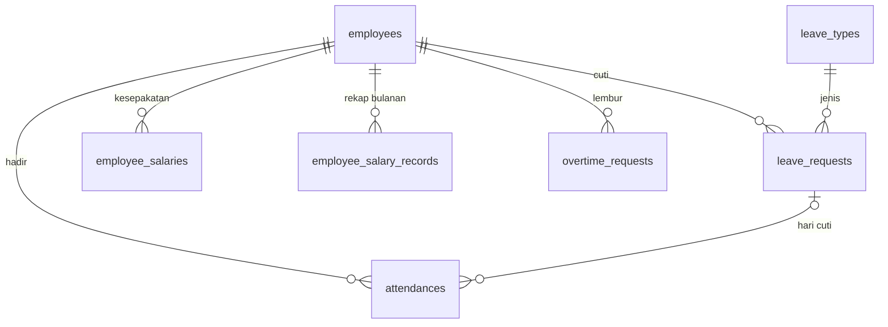

# Schema human_resource

Data karyawan: master karyawan, alamat, kehadiran, cuti, lembur, tugas non-proyek, gaji (kesepakatan dan rekap bulanan), dan jadwal kerja.

- **Modul/pemilik:** M08 (Karyawan & Kehadiran), programmer B. Penggajian otomatis (ERP-0018) bagian Oki.
- **Backend:** `apps/backend/src/app/human-resource/` (dulu `hr`). Portal karyawan: `employee-portal.service.ts`. Drizzle: `apps/backend/drizzle/schemas/human-resource.schema.ts`.
- **Lingkup:** `employees.organization_id` boleh NULL (karyawan tingkat perusahaan); jenis cuti, cuti, lembur seluruh perusahaan. Uang = bigint rupiah minor.

## Tabel

| Tabel | Fungsi | Kolom penting | Status (vocabulary) |
|---|---|---|---|
| `employees` | Master karyawan; boleh punya login (`user_id`, unik) | `employee_code`, `full_name`, `national_id` (NIK), `tax_id` (NPWP), `ptkp_status`, `bpjs_*_number`, `hire_date`, `termination_date` (unix ms, bukan tanggal bisnis), `manager_employee_id` | `employment_status`: active, inactive, terminated. `employment_type`: permanent, contract, probation, internship, outsourced. `work_type`: onsite, remote, hybrid. `ptkp_status`: TK/0..TK/3, K/0..K/3 |
| `employee_addresses` | Alamat karyawan (diisi karyawan saat klaim undangan, ERP-0121); satu alamat utama | `employee_id`, `kind`, `village_id`, `is_primary` | `kind`: residence, current, birth, other |
| `attendances` | Kehadiran, satu baris per karyawan per hari | `employee_id`, `attendance_date`, `check_in_at`, `check_out_at`, `source`, `leave_request_id`, `recorded_by` | `status`: present, permit, sick, leave, absent, holiday. `source`: manual, import, leave, self |
| `leave_types` | Jenis cuti (seed: cuti tahunan 12 hari berkuota, sakit, izin, cuti khusus) | `code`, `attendance_status`, `uses_quota`, `annual_quota_days` | `attendance_status`: leave, sick, permit; `is_active` |
| `leave_requests` | Pengajuan cuti | `employee_id`, `leave_type_id`, `start_date`, `end_date`, `days` (hari kerja, Minggu tidak dihitung), `decided_by`, `decision_note` | `status`: submitted, approved, rejected, cancelled |
| `overtime_requests` | Lembur | `employee_id`, `work_date`, `hours` (0–24), `decided_by` | `status`: submitted, approved, rejected, cancelled |
| `employee_tasks` | Tugas sederhana di luar proyek | `employee_id`, `title`, `due_date`, `done_at` | `status`: open, done, cancelled |
| `employee_salaries` | Kesepakatan gaji berlaku per periode | `base_salary`, `fixed_allowances`, `effective_from`, `effective_to` | `is_active` |
| `employee_salary_records` | Rekap gaji bulanan per karyawan; disetujui Pemilik lalu terkunci | `period` (YYYY-MM), `base_salary`, `allowances`, `overtime_pay`, `bonus`, `deductions`, `pph21_amount`, `bpjs_employee_amount`, `bpjs_company_amount`, `ter_rate`, `tax_method`, `net_pay`, `journal_entry_id` | `status`: draft, approved. `tax_method`: ter, annual |
| `schedules` | Jadwal shift per karyawan per tanggal (ERP-0118) | `work_date`, `shift_start`, `shift_end`, `is_day_off` | — |
| `settings`, `code_numberings` | Pengaturan dan seri nomor | — | — |

Rekening gaji karyawan tidak di sini, tetapi di `finance.cash_bank_accounts.employee_id` (ERP-0119). Tabel PPh 21 (PTKP, TER, tarif) ada di schema `tax`.

## Relasi

FK di dalam schema: `employees.manager_employee_id` → `employees` (set null); `employee_addresses`, `attendances`, `leave_requests`, `overtime_requests`, `employee_tasks`, `employee_salary_records`, `schedules` → `employees` (restrict); `employee_salaries` → `employees` (cascade); `attendances.leave_request_id` → `leave_requests`; `leave_requests.leave_type_id` → `leave_types`. Unik di antara baris hidup: (employee_id, attendance_date), (employee_id, effective_from), (period, employee_id), (employee_id, work_date).

### Referensi lintas modul

| Kolom | Target | Diperiksa oleh |
|---|---|---|
| `employees.user_id` | `auth.users` | Klaim undangan karyawan (`employee-invite.service`) |
| `employees.organization_id` | `auth.organizations` | Kontrak modul organization |
| `employee_addresses.village_id` | `location.villages` | `ExportedLocationService.assertVillage` |
| `employee_salary_records.journal_entry_id` | `finance.journal_entries` | Hasil `finance.postPayroll` saat periode disetujui |
| `*.recorded_by`, `decided_by`, `approved_by`, `created_by` | `auth.users` | Sesi |

Yang merujuk ke sini (lewat `ExportedEmployeeService.findEmployeeById` / `findEmployeeByUserId`): `warehouse.warehouses.responsible_employee_id`, `inventory.items/tool_sets/maintenances`, `project.site_attendances`, `finance.cash_bank_accounts/employee_advances/expense_claims/expense_settlements`.

## Alur data

1. **Tambah karyawan**: insert `employees` (kode EMP); undangan → karyawan mengklaim akun, `user_id` terisi, alamat tempat tinggal masuk `employee_addresses`. Arsipkan = soft delete (`deleted_at`), bukan mengubah `employment_status`.
2. **Kehadiran**: HR mengisi lembar harian (`source = manual`) atau impor file (`import`); karyawan check-in dari portal (`self`). Satu baris per hari.
3. **Cuti**: HR/karyawan mengajukan → `leave_requests` (submitted). Setujui (bukan pencatatnya) → approved dan baris `attendances` dibuat per hari kerja (`source = leave`, `leave_request_id`). Batalkan cuti yang sudah disetujui → baris kehadiran itu dihapus. Tolak → rejected.
4. **Lembur**: `overtime_requests` submitted → approved/rejected. Jam yang disetujui hanya ditampilkan di rekap gaji; uang lembur tidak dihitung otomatis.
5. **Gaji**: kesepakatan di `employee_salaries` (periode baru menutup periode lama). Rekap bulanan: "Isi dari bulan lalu" atau impor → `employee_salary_records` (draft); PPh 21 dan BPJS dihitung setiap kali draf disimpan. Pemilik menyetujui seluruh periode → approved (terkunci) dan jurnal gaji diposting. Pembayaran dialokasikan di modul payment (`payable_type employee_salary_record`).
6. **Jadwal**: diisi per sel atau dari pola mingguan; belum dibandingkan dengan kehadiran.

## Penomoran

| `code_type` | Singkatan | Pola bawaan | Reset |
|---|---|---|---|
| `employee` | EMP | `{TYPE}-{SEQ:5}` (contoh EMP-00001) | never |

## Catatan dan temuan

- **Parity:** kolom dan tipe sama (validator OK). Migrasi `20261124112024_slimy_gideon` menghapus `legal_name` dan `whatsapp` dari `employees`; `20261125160412_employee_portal_attendance_source` menambah `source = self`.
- **`hire_date` dan `termination_date` bertipe bigint unix ms**, padahal maknanya tanggal bisnis (Asia/Jakarta); berbeda dengan konvensi kolom `date` lain (dikirim begitu di ERP-0034).
- **Temuan M08:** tidak ada layar ubah data karyawan (backend PATCH ada); status Nonaktif/Berhenti tidak bisa diatur dari layar; contoh template impor memakai `EMP-0001` (seharusnya `EMP-00001`); tidak ada kotak alasan Tolak/Batalkan (backend menerima `note`); teknisi melihat dan mengubah semua tugas organisasi.
- **R1:** role SDM membuka data pribadi dan gaji semua karyawan; diusulkan hanya untuk Aqim.
- Cuti Aqim sendiri macet bila SDM hanya Aqim (peta bentrok 3.7).

## Perubahan mendatang

| Perubahan | Sumber | Dampak ke schema | Status |
|---|---|---|---|
| Pengaturan potongan gaji: alpa, izin tanpa gaji, terlambat (toleransi + nominal), pro-rata; baris potongan di rekap dan slip | PG-1–PG-5, B-39 | aturan + kemungkinan kolom/pengaturan baru (jenis cuti tidak dibayar, toleransi, nominal); dicek ke `docs.dbml` | diputuskan 28/11, Tinggi |
| Penempatan Kantor/Lapangan; nilai `freelance` di `employment_type`; jenis dan nilai tarif freelance (harian/borongan) | KL-1–KL-4, B-45 | kolom baru + CHECK diperluas; `docs.dbml` dulu | diputuskan 28/11, Tinggi |
| Laporan kerja karyawan: harian, mingguan, bulanan, penilaian Aqim | LK-1–LK-7, B-44 | tabel baru (atau `project.daily_reports` dari dbml untuk laporan proyek); pemilik tabel diputuskan saat grill | diputuskan 28/11, Tinggi |
| Pemilik boleh menyetujui cuti/lembur miliknya sendiri, dengan audit | A1 (b), A3, 3.8 | aturan | disetujui 27/11 (K1); Aqim tidak cuti lewat aplikasi (A3a) |
| Role SDM hanya untuk Aqim; yang lain layanan mandiri | R1 | none (pemberian role) | disetujui 27/11 (K2a) |
| Uang lembur dihitung otomatis dari jam disetujui | Temuan M08 no. 4, ERP-0018 | aturan | direncanakan (ERP-0018 planned, Oki) |
| Layar ubah karyawan dan atur `employment_status` | Temuan M08 no. 1–2 | none (kolom ada) | usulan |
| Kotak alasan Tolak/Batalkan cuti dan lembur, tampilkan `decision_note` | Temuan M08 no. 8 | none (kolom ada) | usulan |
| Teknisi hanya melihat tugasnya sendiri | D4, temuan M08 no. 10 | aturan | disetujui 27/11 (D4) |
| Ubah `hire_date`/`termination_date` menjadi `date` | Temuan dokumen ini | kolom (migrasi baru) | usulan |
| Bandingkan kehadiran dengan jadwal (telat, tidak masuk) | Catatan dbml `schedules` | aturan | usulan |
