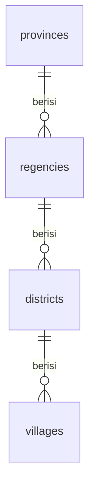

# Schema location

Data referensi wilayah administratif Indonesia: provinsi, kabupaten/kota, kecamatan, desa/kelurahan.

- **Modul/pemilik:** inti bersama (dipakai semua modul yang menyimpan alamat). Data global, **tanpa** `organization_id`.
- **Path backend:** `apps/backend/src/app/location/` (`LocationService`, `ExportedLocationService`).
- **Drizzle:** `apps/backend/drizzle/schemas/location.schema.ts`. Seed dari `apps/backend/database/seeders/raw/location/*.json`.

## Tabel

| Tabel | Fungsi | Kolom penting | Status (vocabulary) |
|---|---|---|---|
| `provinces` | Provinsi | `code` (unik, kode Kemendagri), `name`, `deleted_at` | tidak ada (hanya soft delete) |
| `regencies` | Kabupaten/kota | `code` (unik), `name`, `province_id` | tidak ada |
| `districts` | Kecamatan | `code` (unik), `name`, `regency_id` | tidak ada |
| `villages` | Desa/kelurahan | `code` (unik), `name`, `district_id` | tidak ada |

Semua tabel memakai `id uuid` (uuidv7), `created_at`/`updated_at`/`deleted_at` dalam unix ms, dan indeks pada `name` untuk pencarian.

## Relasi

Foreign key di dalam schema (`ON DELETE CASCADE`):

- `regencies.province_id` -> `provinces.id`
- `districts.regency_id` -> `regencies.id`
- `villages.district_id` -> `districts.id`

**Referensi lintas modul** (masuk ke schema ini; schema ini sendiri tidak menunjuk keluar):

| Kolom yang merujuk | Target | Contract yang mengecek |
|---|---|---|
| `company.addresses.village_id` | `location.villages.id` | `ExportedLocationService.assertVillage` saat tulis; jalur lengkap lewat `resolveVillagePath` |
| `customer.addresses`, `customer.company_addresses`, `supplier.addresses`, `supplier.company_addresses`, `project.addresses`, `human_resource.employee_addresses`, `warehouse.warehouse_addresses` (`.village_id`; total 8 kolom dengan company) | `location.villages.id` | sama |

Aturan ADR-0024 Q10: tabel alamat di modul lain **hanya menyimpan `village_id`**. Kecamatan, kabupaten, dan provinsi diturunkan saat dibaca, tidak pernah disimpan.

## Alur data

1. **Seeder** (`drizzle:seed`) mengisi keempat tabel dari JSON resmi secara idempoten (dijalankan dua kali tidak menambah baris). Data ini **tidak boleh** dibuat dengan faker.
2. **Form alamat** di web-admin memanggil endpoint lokasi berjenjang: pilih provinsi -> kabupaten -> kecamatan -> desa.
3. **Simpan alamat** di modul lain: service modul itu memanggil `assertVillage(villageId)` sebelum menulis `village_id`.
4. **Tampil/cetak alamat**: service memanggil `resolveVillagePath(ids[])` (batch) untuk mendapat nama desa sampai provinsi. Bacaan referensi ini di-cache di Redis.

Tidak ada status atau transisi: data hanya dibaca setelah seed.

## Penomoran

Tidak ada `code_numberings`. Kolom `code` adalah kode wilayah resmi dari data seed, bukan nomor yang dialokasikan aplikasi.

## Catatan dan temuan

- `validate-dbml.ts` (2026-11-26): `OK`, tidak ada drift dbml vs Drizzle.
- FK berjenjang memakai `CASCADE`, padahal aturan umumnya data master di-soft delete. Dalam praktik baris wilayah tidak pernah dihapus permanen, jadi cascade tidak pernah terpicu; tetap perlu diingat bila ada skrip pembersihan.
- `updated_at` boleh kosong (nullable) di keempat tabel, berbeda dengan tabel bisnis yang mewajibkannya.
- Kolom induk (`province_id`, `regency_id`, `district_id`) nullable di dbml, walau secara data selalu terisi.
- ERP-0071 (refactor lokasi, `ExportedLocationService`, alamat hanya `village_id`) masih tercatat `in-progress` di backlog.

## Perubahan mendatang

| Perubahan | Sumber | Dampak ke schema | Status |
|---|---|---|---|
| Tutup ERP-0071 (bukti exit modul lokasi) | ERP-0071 | none | direncanakan |
| Tidak ada perubahan keputusan A–E yang menyentuh schema ini | `bahan-keputusan.md`, `validasi-konsep-saat-ini.md` 3.2–3.8 | none | — |
