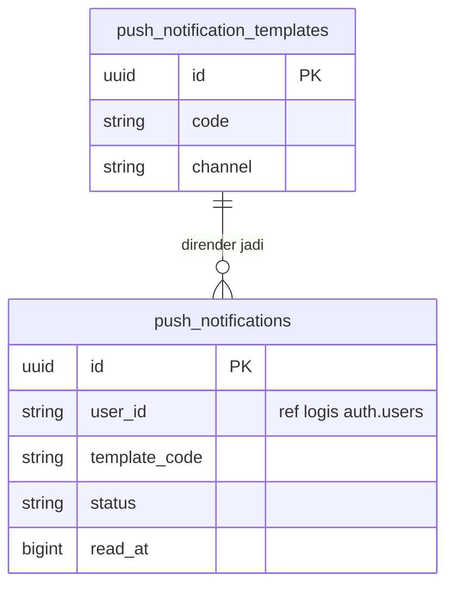

# Schema notification

Notifikasi dalam aplikasi (lonceng) dan template-nya, dikirim lewat antrean dan satu socket realtime (ADR-0016).

- **Modul/pemilik:** inti bersama. Lingkup **aplikasi**, bukan organisasi: notifikasi milik satu user dan terbaca dari organisasi mana pun, jadi **tanpa** `organization_id`; nama organisasi dibawa sebagai tag.
- **Path backend:** `apps/backend/src/app/notification/` (`notification.service.ts`, `exported-notification.service.ts`, `queues/notification.queue.ts`, `queues/notification.worker.ts`).
- **Drizzle:** `apps/backend/drizzle/schemas/notification.schema.ts`. Seeder template: `apps/backend/database/seeders/seed/notification-templates.seeder.ts`.

## Tabel

| Tabel | Fungsi | Kolom penting | Status (vocabulary) |
|---|---|---|---|
| `push_notification_templates` | Teks satu jenis kejadian, kode `module.event` (mis. `org.member_added`) | `code` (unik), `name`, `channel`, `subject_template`, `body_template`, `variables` (jsonb, nama variabel) | `channel`: `email`/`whatsapp`/`in_app`/`webhook`; `is_active` |
| `push_notifications` | Satu notifikasi untuk satu user | `user_id`, `notification_template_id`, `template_code` (salinan saat kirim), `title`, `body`, `tags` (jsonb), `variables`, `metadata` (tujuan navigasi; bukan untuk otorisasi), `sent_at`, `read_at`, `source_type/id` | `status`: `queued`/`sending`/`sent`/`delivered`/`read`/`failed`/`cancelled`; `channel` sama dengan template |

Template yang di-seed saat ini (11): `org.member_added`, `org.org_created`, `document.signature_requested`, `document.signature_signed`, `document.signature_declined`, `hr.leave_decided`, `hr.payroll_draft_ready`, `hr.payslip_ready`, `hr.task_assigned`, `project.attendance_recorded`, `sales.invoice_issued`.

## Relasi

FK di dalam schema:

- `push_notifications.notification_template_id` -> `push_notification_templates.id` (set null)

**Referensi lintas modul:**

| Kolom | Target | Contract yang mengecek |
|---|---|---|
| `push_notifications.user_id` | `auth.users.id` | kontrak Identity (penerima ditentukan modul pengirim) |
| `push_notifications.source_type/id` | baris modul pengirim (dokumen, cuti, tugas, ...) | tidak dicek; hanya penunjuk navigasi |

Modul lain **tidak** menulis tabel ini. Satu-satunya pintu masuk: `ExportedNotificationService` (hanya memasukkan job ke antrean, tidak menyentuh database, tidak pernah menggagalkan alur bisnis pemanggil).

## Alur data

1. **Kejadian bisnis** (mis. anggota ditambahkan, permintaan tanda tangan, cuti diputuskan, slip gaji siap): service modul pengirim memanggil `ExportedNotificationService` dengan kode template, penerima, variabel, tag. Satu job per penerima (Redis/BullMQ). Bila Redis mati, hanya dicatat di log; transaksi bisnis tetap berhasil.
2. **Worker**: mencari template aktif berdasarkan kode; bila tidak ada -> job `skipped` (tidak ada baris). Bila ada -> isi `{{variabel}}` -> tulis `push_notifications` langsung `status = sent`, `sent_at`.
3. **Push realtime**: worker mengirim frame lewat socket user; klien (TanStack Query) memuat ulang daftar.
4. **Baca**: user membuka/menandai -> `status = read`, `read_at`; tab lain user yang sama diberi tahu. Kepemilikan dicek di filter repository (baris milik orang lain = 404).
5. **Retensi**: job berulang `prune` menghapus **permanen** notifikasi yang sudah dibaca dan lebih tua dari `notificationRetentionDays` (pengecualian sengaja dari aturan soft delete, D10).

## Penomoran

Tidak ada `code_numberings`. `push_notification_templates.code` adalah kode kejadian `module.event` yang ditulis di kode/seeder.

## Catatan dan temuan

- `validate-dbml.ts` (2026-11-26): `OK`, 0 drift kolom.
- Status yang dipakai kode hanya `sent` dan `read`; `queued`, `sending`, `delivered`, `failed`, `cancelled` tidak pernah ditulis. Kanal yang dipakai hanya `in_app` (email/WhatsApp lewat jalur lain: email Better Auth, `automation` untuk WhatsApp).
- Kode template campur awalan lama: `sales.invoice_issued` (modul kini `sale`), `hr.*` (modul kini `human_resource`), `org.*`.
- Prune adalah hapus permanen walau tabel punya `deleted_at`; tujuannya penyimpanan, bukan fitur.
- Menu "Notifikasi" di sidebar dihapus (ERP-0154) karena tidak ada halamannya; notifikasi dibuka dari lonceng.
- ERP-0086 (refactor `push_*`) masih `in-progress` di backlog.

## Perubahan mendatang

| Perubahan | Sumber | Dampak ke schema | Status |
|---|---|---|---|
| Notifikasi "menunggu persetujuan" / "disetujui pembuat (Pemilik)" bila A1 diterapkan | A1 (b), 3.8 | none (baris template baru di seeder) | K1 disetujui 27/11; perlu tidaknya template baru ditentukan saat desain K1 |
| Rapikan kosakata status/kanal yang tidak terpakai atau mulai memakainya (mis. `failed`) | temuan | aturan | usulan |
| Seragamkan awalan kode template dengan nama modul (`sale.*`, `human_resource.*`) | temuan | none (data) | usulan |
| Tutup ERP-0086 | backlog | none | direncanakan |
