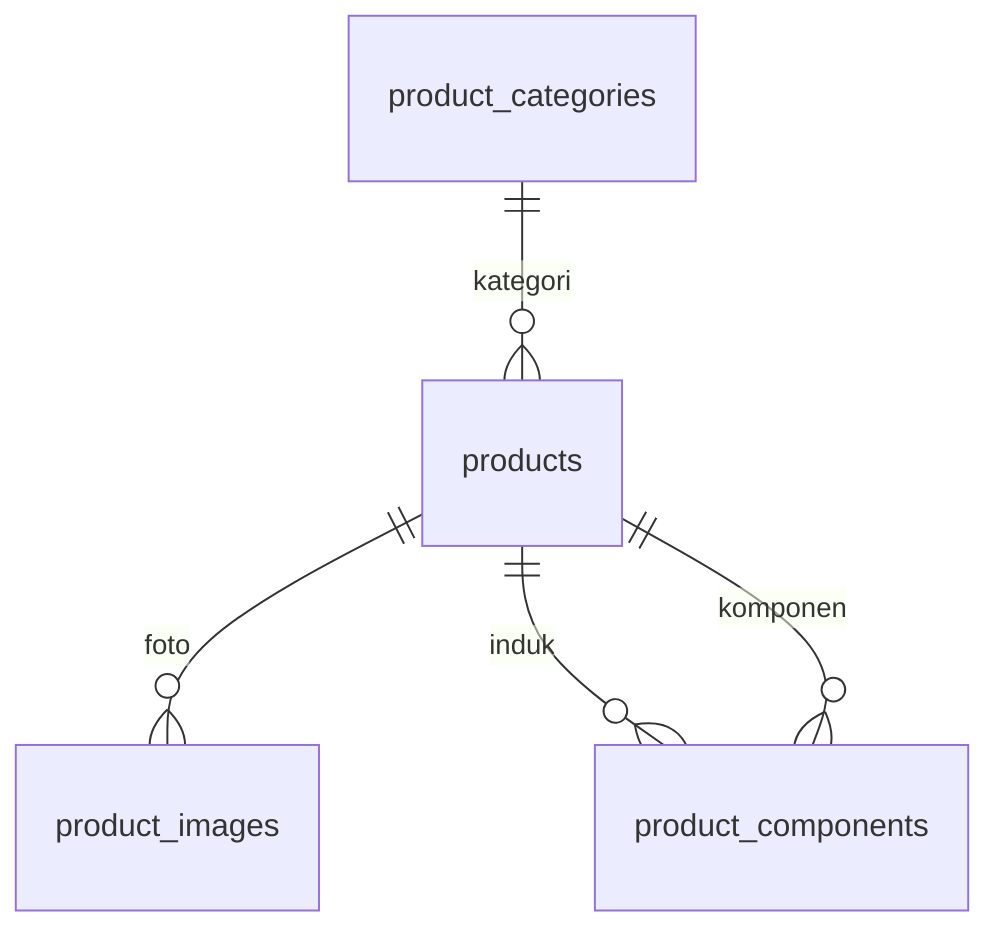

# Schema product

Master barang (SKU): produk dagangan, komponen, dan material, beserta kategori, foto, susunan komponen (BOM), dan kolom listing katalog website.

- **Modul/pemilik:** M05 (master barang) dan M04 (katalog website), programmer B.
- **Backend:** `apps/backend/src/app/product/` (dipisah dari `inventory` oleh ADR-0026). Drizzle: `apps/backend/drizzle/schemas/product.schema.ts`.
- **Lingkup:** `organization_id` boleh kosong = global (ADR-0008). Kategori seluruh perusahaan.

## Tabel

| Tabel | Fungsi | Kolom penting | Status (vocabulary) |
|---|---|---|---|
| `products` | Master SKU satu-satunya di ERP | `code`, `sku` (tidak bisa diubah), `name`, `product_kind`, `product_category_id`, `unit_label`, `is_serialized`, `is_stock_tracked`, `min_stock_qty`, `selling_price`, `purchase_price` (bigint rupiah minor), listing: `slug`, `is_published`, `price_mode`, `out_of_stock_mode`, `applications`, `popularity` | `is_active` (boolean). `product_kind`: product, component, material. `unit_label`: pcs, unit, set, paket, titik, m, roll, kg, jam, bulan, tahun, lic, lot, pulau. `price_mode`: list, rfq. `out_of_stock_mode`: out, preorder, request |
| `product_images` | Galeri foto (maks. 10 hidup); foto pertama = sampul | `product_id`, `object_key`, `sort_order` | — |
| `product_components` | Susunan komponen/material sebuah produk (informasi saja) | `product_id`, `component_id`, `quantity` | — |
| `product_categories` | Kategori satu level, slug sama dengan website | `slug`, `name`, `sort_order` | `is_active` (boolean) |
| `settings` | Pengaturan modul | `setting_group`, `setting_key` | `value_type`: string, number, boolean, json, date |
| `code_numberings` | Seri kode barang | `code_type`, `pattern` | `reset_policy`: never, yearly, monthly |

Alat/aset fisik **bukan** di sini, tetapi di `inventory.items` (S5). Jasa tidak distok dan tidak berseri.

## Relasi

Foreign key di dalam schema:

- `products.product_category_id` → `product_categories.id` (restrict; kategori yang masih punya produk hidup tidak bisa diarsipkan).
- `product_images.product_id` → `products.id` (cascade).
- `product_components.product_id` → `products.id` (cascade); `component_id` → `products.id` (restrict). Produk induk harus `product`, komponen harus `component`/`material` (dicek service). Unik (product_id, component_id) di antara baris hidup.

### Referensi lintas modul

| Kolom | Target | Diperiksa oleh |
|---|---|---|
| `products.organization_id` | `auth.organizations` | Kontrak modul organization |
| `products.created_by`, `settings.updated_by` | `auth.users` | Diisi dari sesi |

Yang merujuk ke `products.id` (16 kolom): `sale.*_items`, `procurement.*_items`, `inventory.movements/stocks/item_serials/stock_adjustment_items/documents`, `finance.journal_lines`, `finance.supplier_bill_items`. Kontraknya `ExportedProductService`: `assertProduct`, `isProductActive`, `productsById`, `getNameMap`, `productKinds`, `countUnits`, `findBySearch`.

## Alur data

1. **Tambah barang** (menu Inventaris → Produk/Komponen/Material; saat ini hanya admin aplikasi): insert `products`. Kode kosong → `code_numberings` sesuai jenis (`item_product`, `item_component`, `item_material`).
2. **Foto**: unggah → insert `product_images` (WebP, key baru tiap unggah); `ProductImageService` menyalin key foto pertama ke `products.image_object_key`.
3. **Susunan komponen**: daftar diganti sekaligus; baris lama di-soft-delete, baris baru di-insert. Tidak menggerakkan stok atau HPP.
4. **Listing website** (menu Integrasi → Katalog website, M04): update kolom listing di `products` (`slug`, `is_published`, `published_at`, `price_mode`, dst.). Website membaca lewat `/products/public/v1/catalog`.
5. **Dipakai dokumen**: SPH, PO, BPB, surat jalan menyalin `sku`, `name`, `specification`, dan harga ke baris dokumen (snapshot). Stok barang tidak disimpan di sini, tetapi di `inventory.stocks` (S2).

## Penomoran

| `code_type` | Singkatan | Pola bawaan | Reset |
|---|---|---|---|
| `item_product` | PRD | `{TYPE}-{COMPANY}-{SEQ:5}` (contoh PRD-IMS-00001) | never |
| `item_component` | CMP | `{TYPE}-{COMPANY}-{SEQ:5}` | never |
| `item_material` | MAT | `{TYPE}-{COMPANY}-{SEQ:5}` | never |

## Catatan dan temuan

- **Parity:** kolom dan tipe sama (validator OK). Indeks unik parsial untuk `code`/`sku` (per organisasi dan global) dan `slug` ada di Drizzle sesuai dbml.
- **Singkatan CMP dipakai dua kali**: `item_component` (schema product) dan `customer_company` (schema customer). Polanya berbeda (`CMP-IMS-00001` vs `CMP-00001`), jadi tidak bentrok di database, tetapi membingungkan saat membaca kode.
- **Halaman Produk hanya untuk admin aplikasi** (A2, M05 A11), padahal role Pembelian punya hak buat/ubah barang di server.
- **Temuan M04:** pilihan barang di katalog ikut memuat bahan dan komponen; barang yang sudah punya listing masih bisa dipilih dan menyimpannya menimpa listing lama tanpa peringatan (`product-listing.service.ts`). Pesan validasi slug/popularitas berbahasa Inggris.
- `products.serial_number` (serial master) berbeda dengan serial per unit di `inventory.item_serials`; nama kolomnya mudah tertukar.

## Perubahan mendatang

| Perubahan | Sumber | Dampak ke schema | Status |
|---|---|---|---|
| Halaman Produk mengikuti hak role (Pembelian, dan Gudang bila perlu), bukan hanya admin aplikasi | B3 (`bahan-keputusan.md`), A2 | none (guard halaman) | disetujui 27/11 (B3) |
| Katalog: saring hanya `product_kind = product`, cegah menimpa listing yang sudah ada | Temuan UAT M04 no. 8 | aturan | usulan |
| Halaman konten website (testimoni, gambar) untuk Pemasaran | D5, M04 C9 | belum jelas (hak `web_content` ada, route/halaman belum ada) | ditunda (D5, disetujui 27/11) |
| Bedakan singkatan komponen dari perusahaan pelanggan (misalnya `CMP` → `KMP`) | Temuan dokumen ini | none (nilai `CODE_TYPE_CODES`) | usulan |
