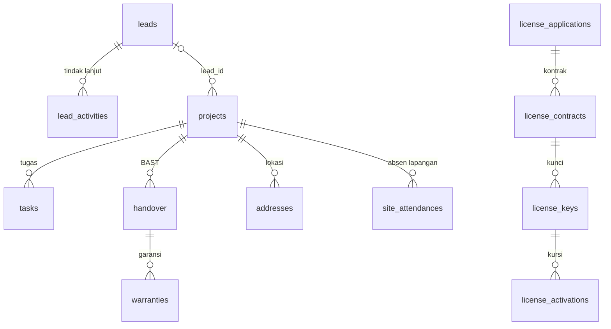

# Schema project

Schema gabungan: proyek pelaksanaan SO (tugas, bukti, biaya, BAST, garansi, absensi lapangan), **lead** (CRM), dan **lisensi** (langganan). Nama schema tidak sama dengan menu (S1).

- **Modul/pemilik:** M07 (proyek & purna jual), M02 (lead), M03 (langganan & lisensi), programmer B. Absensi lapangan: portal karyawan (ERP-0160).
- **Backend:** `apps/backend/src/app/project/` (services: `project`, `lead`, `website-inquiry`, `handover`, `warranty`, `licensing`, `license-api`, `site-attendance`). Drizzle: `apps/backend/drizzle/schemas/project.schema.ts`.
- **Lingkup:** seluruh perusahaan (ADR-0011). Tabel target berkolom `organization_id`.

## Tabel

| Tabel | Fungsi | Kolom penting | Status (vocabulary) |
|---|---|---|---|
| `projects` | Proyek dari satu SO (satu proyek hidup per SO) | `code`, `order_id`, `order_code`, `customer_id`, `company_id`, `lead_id`, `address_id`, `contract_value`, `pic_user_id`, `target_start/end_date` | `status`: active, closed, cancelled. `stage`: preparation, delivery, installation, testing, training, handover, warranty |
| `tasks` | Checklist tugas proyek | `project_id`, `stage`, `assignee_user_id`, `due_date`, `position` | `status`: todo, in_progress, done |
| `evidence` | Bukti file (uji fungsi, pelatihan, BAST bertanda tangan, foto) | `project_id`, `task_id`, `kind`, `storage_key` | `kind`: testing, training, bast, photo, other |
| `costs` | Biaya langsung proyek (diposting ke GL, ERP-0141) | `category`, `amount`, `payment_source`, `journal_entry_id`, `voided_at` | `category`: material, transport, accommodation, subcontract, other. `payment_source`: employee_claim, petty_cash, bank |
| `handover` | BAST (boleh lebih dari satu per proyek) | `code`, `bast_date`, pihak pertama/kedua, `items`, `scope` (jsonb) | `status`: issued, cancelled |
| `addresses` | Alamat lokasi proyek | `village_id`, `latitude`, `longitude`, `site_point` (PostGIS `geometry(point,4326)`, indeks GiST) | `kind`: site, billing, other |
| `site_attendances` | Absen lapangan karyawan (selfie wajib, jarak dihitung PostGIS) | `project_id`, `employee_id`, `user_id`, `business_date`, `check_in_at`, `latitude`, `longitude`, `distance_meters`, `radius_meters`, `selfie_key` | `status`: verified, out_of_range |
| `warranties` | Surat Keterangan Garansi dari BAST | `code`, `project_id`, `handover_id`, `start_date` (= tanggal BAST), `months`, `end_date`, `coverage` | — |
| `leads` | Prospek sebelum jadi pelanggan | `name`, `company_id`, `source`, `owner_user_id`, `next_follow_up_at`, `customer_id`, `channel`, `reference`, `idempotency_key` | `status`: new, contacted, survey, quotation, won, lost. `source`: website, whatsapp, instagram, phone, referral, walk_in, other. `channel`: rfq, contact, demo |
| `lead_activities` | Log tindak lanjut lead | `activity_type`, `notes`, `occurred_at` | `activity_type`: call, whatsapp, email, meeting, survey, note |
| `lead_attachments` | File dari RFQ website | `storage_key`, `file_name` | — |
| `license_applications` | Aplikasi yang dilisensikan | `code`, `name`, `source` | `status`: active, retired. `source`: third_party, own |
| `license_contracts` | Kontrak lisensi pelanggan | `code`, `customer_id`, `license_application_id`, `order_id`, `start_date`, `end_date` (null = selamanya), `billing_cycle`, `renewed_from_contract_id` | `status`: draft, active, suspended, terminated, renewed |
| `license_keys` | Kunci lisensi per kontrak | `license_key`, `key_source`, `max_activations`, `expires_on` | `status`: active, revoked |
| `license_activations` | Satu kursi kunci yang dipakai instalasi | `license_key_id`, `instance_id`, `last_seen_at` | `status`: active, deactivated |
| `license_events` | Log panggilan API lisensi dan tindakan staf (append-only) | `event_type`, `result`, `instance_id` | `event_type`: validated, activated, deactivated, renewed, suspended, reactivated, terminated, key_revoked |
| `license_api_keys` | Kunci mesin aplikasi milik sendiri untuk API lisensi | `license_application_id`, `api_key_id`, `key_start` | `status`: active, revoked |
| `types`, `phases`, `task_dependencies`, `milestones`, `daily_reports`, `site_assignments`, `kpi_definitions`, `kpi_evaluations`, `changes`, `work_plans` | **Target**: hanya di dbml, belum ada di Drizzle/DB (S6) | — | lihat dbml |
| `daily_reports`, `kpi_definitions`, `kpi_evaluations` dipakai untuk **laporan kerja karyawan** (B-44, LK-1–LK-7, 28/11); sisa tabel target tetap B-26 | B-44 | migrasi baru saat dibangun | diputuskan 28/11, Tinggi |
| **Jam mulai lapangan** (opsional) per tugas proyek atau jadwal, acuan terlambat di hari lapangan | KL-9, B-45 | kolom baru (dicek ke `docs.dbml`) | diputuskan 28/11, Tinggi |
| `settings`, `code_numberings` | Pengaturan (mis. `site_radius_meters`, bawaan 100) dan seri nomor | — | — |

## Relasi

FK di dalam schema: `addresses.project_id` → `projects` (cascade); `projects.address_id` → `addresses` (set null); `projects.lead_id` → `leads` (set null); `lead_activities`, `lead_attachments` → `leads`; `warranties` → `projects` dan → `handover`; `license_contracts` → `license_applications` dan → dirinya (`renewed_from_contract_id`); `license_keys` → `license_contracts`; `license_activations` → `license_keys`; `license_events` → keys, contracts, api keys; `license_api_keys` → `license_applications`. **Tanpa FK** (sengaja, dicek service): `tasks.project_id`, `evidence.project_id/task_id`, `costs.project_id`, `handover.project_id`, `site_attendances.project_id`.

### Referensi lintas modul

| Kolom | Target | Diperiksa oleh |
|---|---|---|
| `projects.order_id`, `license_contracts.order_id` | `sale.orders` | `SalesFulfilmentService.getLiveOrder` (SO tidak batal) |
| `projects/warranties/license_contracts/leads.customer_id` | `customer.customers` | Kontrak modul customer |
| `projects/warranties/license_contracts/leads.company_id` | `customer.companies` | Kontrak modul customer |
| `addresses.village_id` | `location.villages` | `ExportedLocationService.assertVillage` |
| `site_attendances.employee_id`, `user_id` | `human_resource.employees`, `auth.users` | Guard portal karyawan (sudah membuktikan data karyawan dari sesi); service hanya mengizinkan proyek tempat karyawan menjadi PIC atau punya tugas hidup |
| `costs.journal_entry_id` | `finance.journal_entries` | Hasil `PostingService.postBusinessEvent` |
| `license_api_keys.api_key_id` | `auth.apikeys` | Better Auth api-key (diterbitkan atas nama anggota) |

Yang merujuk ke sini: `sale.quotations.lead_id`, `automation.whatsapp_conversations.lead_id` (lead), `procurement.purchase_orders.project_id`, `sale.invoices.project_id`, `ticket.tickets.project_id`/`warranty_id`, `inventory.borrowing_items.project_id`, banyak tabel `finance` (proyek). Kontrak: `ProjectLookupService.getProject`, `hasLiveProject`, `liveProjectOfOrder`.

## Alur data

1. **Lead**: manual (menu CRM → Prospek), dari form website (`website-inquiry.service`: `channel`, `reference` web_*, `idempotency_key`, `submission`, lampiran), atau dari chat WhatsApp (`captureFromChat`). Outbox `lead.created`, `lead.follow_up_due`. Tindak lanjut → `lead_activities`. Membuat SPH dengan lead → lead `quotation`. "Jadikan pelanggan" → `customers` dibuat, lead `won` + `customer_id` + `converted_at`. Kalah → `lost`.
2. **Proyek**: dari SO hidup → insert `projects` (stage preparation, status active) + `tasks` bawaan per tahap sampai handover. Tugas, bukti, biaya ditambah selama active; biaya diposting ke jurnal, dibatalkan dengan void (jurnal dibalik).
3. **BAST**: "Terbitkan BAST" → insert `handover` (status issued, nomor diberi) + daftar di `document.documents`. **Tutup proyek** butuh bukti testing, training, dan BAST bertanda tangan → stage warranty, status closed.
4. **Garansi**: dari BAST → insert `warranties` (mulai = tanggal BAST, `end_date` dihitung). Dipakai `ticket` untuk cek garansi.
5. **Lisensi**: aplikasi → kontrak (draft → active; butuh tanggal mulai) → kunci → API lisensi (`/projects/api/v1/licenses`) menulis `license_activations` dan `license_events`. Perpanjangan = kontrak draft baru; saat aktif, kontrak lama `renewed`, kunci pindah. Aktivasi otomatis bila invoice SO perpanjangan lunas. Pengingat 30/7 hari → outbox `license.due` (`dedupe_key`).
6. **Absen lapangan** (portal karyawan): check-in dengan GPS + selfie → insert `site_attendances`; jarak = `ST_Distance` ke `addresses.site_point`; di dalam radius → verified, di luar → out_of_range (tetap disimpan). Satu kunjungan per proyek per karyawan per hari.

## Penomoran

| `code_type` | Singkatan | Pola bawaan | Reset |
|---|---|---|---|
| `project` | PRJ | `{SEQ:4}/{TYPE}/{COMPANY}/{MM_ROMAN}/{YY}` | yearly |
| `bast` | BAST | `{SEQ:3}/{TYPE}/{COMPANY}/{MM_ROMAN}/{YYYY}` | yearly |
| `warranty` | SG-GARANSI | `{SEQ:3}/{TYPE}/{COMPANY}-{CUSTOMER}/{YYYY}` | yearly |
| `license_contract` | LIC | pola bawaan | yearly |
| `web_rfq`, `web_contact`, `web_demo` | RFQ, MSG, DEMO | `{TYPE}-{YYYY}-{SEQ:5}` (contoh RFQ-2026-00123) | yearly |
| `lead_reference` | LEAD | `{TYPE}-{YYYY}-{SEQ:5}` | yearly |

## Catatan dan temuan

- **Parity:** kolom dan tipe sama (validator OK); 10 tabel target tidak ada di Drizzle (validator mengecualikannya).
- **`projects.company_id` dan `projects.lead_id` tidak pernah diisi** oleh `ProjectService.create` (hanya `customer_id`), sejalan dengan SO yang juga tidak mengisinya. FK `projects.lead_id` jadi tidak berguna.
- **`lead_reference` tidak dipakai** kode; nomor referensi website memakai `web_*`. Catatan dbml `project.code_numberings` tidak menyebut `web_*` (justru ditulis di `sale`).
- **Aturan "intra-modul = FK" tidak diikuti** untuk `tasks`, `evidence`, `costs`, `handover`, `site_attendances` (tertulis "no FK by design").
- `module-ownership.md` masih menghitung 28 tabel; dbml sudah 29 (`site_attendances`).
- Temuan M03: perpanjangan bisa kurang sehari melewati 29 Februari; perpanjangan dini memindahkan kunci sehingga API menjawab "Belum mulai"; aktivasi manual tidak menulis `license_events`; kode/sumber aplikasi bisa diubah setelah dipakai.
- Temuan M07: tugas tanpa isian tenggat walau kolom `due_date` ada; Admin tidak punya hak proyek (D3).

## Perubahan mendatang

| Perubahan | Sumber | Dampak ke schema | Status |
|---|---|---|---|
| Isi `company_id`/`lead_id` proyek dari SO/SPH | Temuan dokumen ini | aturan | usulan |
| Perpanjangan lisensi: jangan pindahkan kunci sebelum periode baru mulai; hitung masa dengan tahun kalender | Temuan M03 no. 1–2 | aturan | diputuskan 27/11 (T-2): masa dihitung tahun/bulan kalender; kunci tetap di kontrak lama sampai periode baru mulai, lalu pindah otomatis |
| Kunci `code`/`source` aplikasi lisensi setelah dipakai | Temuan M03 no. 13 | aturan | diputuskan 27/11 (T-3): dikunci setelah aplikasi punya kontrak atau kunci API; nama dan deskripsi tetap bisa diubah |
| Catat aktivasi manual kontrak di `license_events` | Temuan M03 no. 10 | aturan (`event_type` mungkin perlu nilai baru) | usulan |
| Admin diberi hak baca proyek | D3 | none (hak) | tidak berlaku (role Admin dihapus, 27/11) |
| Isian tenggat tugas di form | Temuan M07 no. 10 | none | usulan |
| Putuskan tabel target (laporan harian, milestone, KPI, dll.) | S6 | tabel | diputuskan 27/11 (T-4): alurnya **dibangun**, setelah perbaikan prioritas tinggi; tiap kelompok dirancang dulu sebelum kode |
| Hapus `lead_reference` atau pakai; rapikan catatan dbml penomoran | Temuan dokumen ini | none (dokumen) | usulan |
