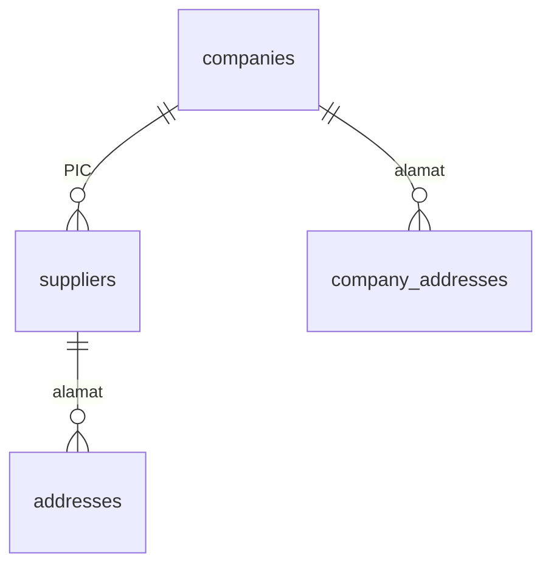

# Schema supplier

Data pemasok: perusahaan pemasok (tujuan PO), orang/PIC pemasok, dan alamatnya.

- **Modul/pemilik:** M05 (Inventaris & Pembelian), programmer B.
- **Backend:** `apps/backend/src/app/supplier/` (dipisah dari `procurement`, ADR-0024 Q17). Drizzle: `apps/backend/drizzle/schemas/supplier.schema.ts`.
- **Lingkup:** seluruh perusahaan, tanpa `organization_id`. Data rekening bank dibatasi (hanya dengan hak `supplier:read_bank`).

## Tabel

| Tabel | Fungsi | Kolom penting | Status (vocabulary) |
|---|---|---|---|
| `companies` | Perusahaan pemasok | `code` (juga token `{SUPPLIER}` di nomor PO), `name`, `supplier_type`, `tax_id`, `bank_name`, `bank_account_number`, `bank_account_holder` | `status`: active, inactive. `supplier_type`: company, government |
| `suppliers` | PIC pemasok, atau pemasok perorangan bila `company_id` kosong | `company_id`, `name`, `title` (jabatan, dicetak di PO), `phone`, `email`, `is_primary` | `status`: active, inactive |
| `addresses` | Alamat orang/PIC | `supplier_id`, `kind`, `village_id`, `is_primary` | `kind`: office, other |
| `company_addresses` | Alamat perusahaan pemasok | `company_id`, `kind`, `contact_name`, `contact_phone`, `village_id` | `kind`: office, factory, warehouse, billing, other |
| `settings` | Pengaturan modul | `setting_group`, `setting_key` | `value_type`: string, number, boolean, json, date |
| `code_numberings` | Seri kode pemasok | `code_type`, `pattern`, `next_number` | `reset_policy`: never, yearly, monthly |

ERP-0116 menghapus kolom `whatsapp` dan syarat pembayaran dari pemasok: syarat pembayaran sekarang milik PO (`procurement.purchase_orders.payment_terms`).

## Relasi

Foreign key di dalam schema:

- `suppliers.company_id` → `companies.id` (restrict).
- `addresses.supplier_id` → `suppliers.id` (cascade).
- `company_addresses.company_id` → `companies.id` (cascade).
- Maksimal satu PIC `is_primary` hidup per perusahaan (indeks unik parsial di Drizzle).

### Referensi lintas modul

| Kolom | Target | Diperiksa oleh |
|---|---|---|
| `addresses.village_id`, `company_addresses.village_id` | `location.villages` | `ExportedLocationService.assertVillage` |
| `companies.created_by`, `suppliers.created_by`, `*.updated_by` | `auth.users` | Diisi dari sesi |

Yang merujuk ke schema ini: `procurement.purchase_orders.supplier_company_id` dan `supplier_pic_id`, `procurement.purchase_returns.supplier_company_id`, `inventory.items.supplier_company_id`, `finance.supplier_bills`, `finance.ap_open_items`. Kontraknya `ExportedSupplierService`: `assertActiveCompany`, `findPerson` (PIC harus milik perusahaan yang sama), `getPurchaseSnapshot`, `getBankDetails`, `findCompanyByCode`.

## Alur data

1. **Tambah pemasok** (menu Pembelian → Pemasok): insert `companies` (+ `company_addresses`); kode kosong → `code_numberings` (`supplier_company`).
2. **Tambah PIC**: insert `suppliers` dengan `company_id`; tandai satu sebagai `is_primary` (PIC yang dicetak di PO).
3. **Buat PO**: modul procurement memanggil `assertActiveCompany` + `findPerson`, lalu menyalin nama, alamat, NPWP, dan PIC ke `purchase_orders.supplier_snapshot`. Perubahan pemasok sesudahnya tidak mengubah PO lama.
4. **Nonaktifkan**: `status = inactive`, pemasok tidak bisa dipakai di PO baru. Hapus = soft delete (`deleted_at`).

## Penomoran

| `code_type` | Singkatan | Pola bawaan | Reset |
|---|---|---|---|
| `supplier_company` | SUP | `{COMPANY}-{ORG}-{TYPE}-{SEQ:5}` (contoh IMS-PT-ENTRAGATE-SUP-00001) | never |

`{ORG}` adalah slug organisasi yang mendaftarkan pemasok. Kode hasil generate harus muat di `varchar(32)`. Karena kode pemasok masuk ke nomor PO (`{SUPPLIER}`) dan nomor PO dibatasi 32 karakter di registri dokumen, kode pemasok sebaiknya diketik pendek (misalnya `HIT`).

## Catatan dan temuan

- **Parity:** dbml dan Drizzle sama (validator OK 2026-11-26).
- **Kode panjang membuat PO gagal disetujui.** Pola bawaan menghasilkan kode yang panjang; bila dipakai sebagai `{SUPPLIER}`, nomor PO bisa melewati 32 karakter. Kode sekarang menolaknya dengan pesan penomoran (bukan error SQL), tetapi penyebabnya ada di pola bawaan kode pemasok (`apps/backend/src/shared/numbering/domain.ts`, `CODE_MAX_LENGTH`).
- Pemasok perorangan bisa disimpan di `suppliers` dengan `company_id` kosong, tetapi PO **wajib** memilih perusahaan pemasok (`supplierCompanyId` wajib di `procurement/contracts/purchase-order.contract.ts`). Jadi pemasok perorangan tidak bisa menerima PO; ia harus didaftarkan sebagai `companies` juga.
- Tidak ada menu atau langkah UAT yang mempersoalkan schema ini (UAT M05 hanya memakai pemasok sebagai prasyarat).

## Perubahan mendatang

| Perubahan | Sumber | Dampak ke schema | Status |
|---|---|---|---|
| Pola bawaan kode pemasok yang pendek (misalnya `{TYPE}-{SEQ:4}`) agar aman sebagai `{SUPPLIER}` di nomor PO | Temuan dokumen ini | none (nilai bawaan `code_numberings`) | usulan |
| Putuskan nasib pemasok perorangan: izinkan PO tanpa perusahaan, atau hapus opsi perorangan dari form | Temuan dokumen ini | aturan (atau kolom `company_id` menjadi wajib) | usulan |
| Sisa pekerjaan refactor modul supplier | ERP-0075 (in-progress) | none | direncanakan |
