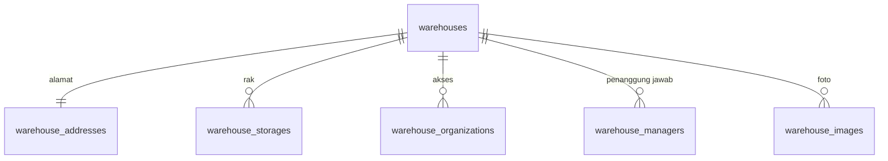

# Schema warehouse

Data fisik gudang: gudang, alamatnya, rak/lokasi simpan, foto, penanggung jawab, akses organisasi, dan pengaturan per gudang.

- **Modul/pemilik:** M05 (Inventaris & Pembelian), programmer B.
- **Backend:** `apps/backend/src/app/warehouse/` (dipisah dari `inventory` oleh ADR-0026). Drizzle: `apps/backend/drizzle/schemas/warehouse.schema.ts`.
- **Lingkup:** semua gudang global; `warehouses.organization_id` dibekukan NULL (ADR-0010). Akses organisasi lewat `warehouse_organizations`. Menulis data gudang hanya untuk admin aplikasi.

## Tabel

| Tabel | Fungsi | Kolom penting | Status (vocabulary) |
|---|---|---|---|
| `warehouses` | Master gudang | `code`, `name`, `responsible_employee_id`, `is_default`, `image_object_key` | `is_active` (boolean) |
| `warehouse_images` | Galeri foto gudang (maks. 10) | `warehouse_id`, `object_key`, `sort_order` | — |
| `warehouse_addresses` | Alamat gudang, tepat 1:1 | `warehouse_id` (unik), `address_line`, `rt`, `rw`, `village_id`, `latitude`, `longitude` | — |
| `warehouse_storages` | Rak/lokasi simpan, satu level (gudang → rak) | `warehouse_id`, `code`, `bin_type`, `capacity` | `is_active` (boolean) |
| `warehouse_managers` | Penanggung jawab gudang per pengguna (ADR-0017); bukan role, tidak memberi hak operasi stok | `warehouse_id`, `user_id`, `assigned_by` | — |
| `warehouse_organizations` | Organisasi mana yang boleh memakai gudang (ADR-0010) | `warehouse_id`, `organization_id` | — |
| `warehouse_settings` | Pengaturan per gudang | `warehouse_id`, `setting_key` | `value_type`: string, number, boolean, json, date |
| `settings` | Pengaturan modul | `setting_group`, `setting_key` | `value_type` sama |
| `code_numberings` | Seri kode gudang | `code_type`, `pattern` | `reset_policy`: never, yearly, monthly |

## Relasi

Foreign key di dalam schema: semua tabel anak → `warehouses.id` dengan `delete: cascade` (`warehouse_addresses`, `warehouse_images`, `warehouse_storages`, `warehouse_managers`, `warehouse_organizations`, `warehouse_settings`). Unik: (warehouse_id, code) rak; (warehouse_id, user_id) manajer; (warehouse_id, organization_id) link.

### Referensi lintas modul

| Kolom | Target | Diperiksa oleh |
|---|---|---|
| `warehouses.responsible_employee_id` | `human_resource.employees` | `ExportedEmployeeService.findEmployeeById` |
| `warehouse_addresses.village_id` | `location.villages` | `ExportedLocationService.assertVillage` |
| `warehouse_managers.user_id`, `assigned_by` | `auth.users` | Modul `user` / sesi |
| `warehouse_organizations.organization_id` | `auth.organizations` | Kontrak modul organization |

Yang merujuk ke sini: `inventory.movements/stocks/item_serials/items/stock_adjustments`, `procurement.goods_receipts`, `procurement.purchase_returns`, `sale.delivery_notes`, `sale.returns` (gudang dan rak). Kontraknya `ExportedWarehouseService`: `warehouseExists`, `warehouseIsActive`, `storageInWarehouse` (rak harus milik gudang yang sama), `isLinked`, `organizationScope`, `idsInScope`, `getNameMap`, `hasAddress`.

## Alur data

1. **Buat gudang** (admin aplikasi): insert `warehouses` + `warehouse_addresses` (1:1); kode kosong → `code_numberings` (`warehouse`).
2. **Tambah rak**: insert `warehouse_storages`.
3. **Beri akses organisasi**: insert `warehouse_organizations` (tercatat di audit). Unlink ditolak selama organisasi itu punya peminjaman aktif di gudang tersebut.
4. **Tunjuk penanggung jawab**: insert `warehouse_managers`.
5. **Dipakai transaksi**: BPB, surat jalan, retur, dan penyesuaian memilih gudang + rak; modul lain memanggil `warehouseIsActive` dan `storageInWarehouse` sebelum menulis `inventory.movements`. Saldo stok tidak disimpan di sini (S2).

## Penomoran

| `code_type` | Singkatan | Pola bawaan | Reset |
|---|---|---|---|
| `warehouse` | WH | `{TYPE}-{COMPANY}-{SEQ:4}` (contoh WH-IMS-0001) | never |

## Catatan dan temuan

- **Parity:** kolom dan tipe sama (validator OK). Drizzle punya indeks unik parsial "satu gudang default" (`is_default`) per lingkup yang tidak ditulis di dbml.
- `warehouses.image_url` adalah kolom lama yang tidak lagi ditulis atau dibaca (diganti `image_object_key`); dipertahankan karena migrasi append-only.
- `warehouses.organization_id` selalu NULL; kolomnya tetap ada hanya untuk riwayat ADR-0010.
- **Halaman Gudang hanya untuk admin aplikasi** (A2, M05 A11). Role Gudang tidak bisa menambah rak sendiri.
- ADR-0010 (link gudang-organisasi) masih berstatus `proposed`, padahal tabelnya sudah dipakai (ERP-0031 slice 1–2 selesai).

## Perubahan mendatang

| Perubahan | Sumber | Dampak ke schema | Status |
|---|---|---|---|
| Data gudang dan rak dikelola role Gudang, bukan hanya admin aplikasi | B3 (`bahan-keputusan.md`) | none (guard halaman/hak) | disetujui 27/11 (B3): data gudang dan rak ikut hak role / PIC |
| Penerimaan ADR-0010 (link gudang-organisasi) | ERP-0031, ADR-0010 `proposed` | none (tabel sudah ada) | ikut K12 (disetujui 27/11): tautan gudang–organisasi tetap (K12 diubah 28/11: satu organisasi, tidak dihapus) |
| Pindah stok antar gudang/rak | ERP-0032 (lihat `inventory.md`) | none di schema ini | usulan (ADR-0010 belum diterima) |
| Hapus kolom `image_url` lewat migrasi baru | Temuan dokumen ini | kolom | usulan |
