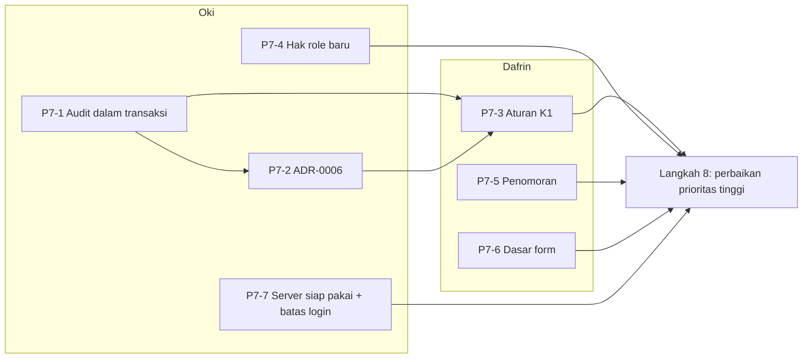

# Rencana langkah 7: fondasi kode

Disusun 2026-11-28. Kembali ke [catatan penyesuaian](../README.md).

**Status: draf rencana, belum ada kode.** Langkah 7 berisi pekerjaan dasar
yang dipakai hampir semua perbaikan di langkah 8. Dimulai setelah PR #171
masuk ke `main` (sudah, 2026-11-28) dan programmer B menyatakan catatan
beres.

## 1. Daftar paket kerja

Satu paket = satu PR ke `main`. Nomor `ERP-*` dan ADR **dipesan saat PR
dibuat**, setelah mengecek `main`, semua branch, dan PR terbuka (nomor
terakhir di backlog: ERP-0178).

| Paket | Isi | Pemegang | Sumber keputusan | Butuh lebih dulu | Skema / migrasi |
|---|---|---|---|---|---|
| **P7-1 Audit di dalam transaksi** | Penulis audit (`src/shared/audit/audit.writer.ts`) menulis di dalam transaksi bisnis yang sama (sekarang fire-and-forget, bisa hilang); peristiwa wajib: perubahan role, hapus anggota, ekspor, **persetujuan oleh pembuat sendiri** (`meta.self_approved`); penulis audit di `sale`, `procurement`, `human_resource`, `payment` | Oki | OA5–OA7, M12-1, X-4, L-1 | — | Mungkin kolom/indeks di `audit`; `docs.dbml` dulu bila ada |
| **P7-2 Ubah ADR-0006** | Butir 6: Pemilik boleh menyetujui dokumennya sendiri, tercatat di audit; jurnal manual tetap orang kedua (K1a) | Oki | K1, K1a, E5 | — | Tidak |
| **P7-3 Aturan persetujuan K1** | Satu aturan bersama "pembuat ≠ penyetuju, kecuali Pemilik (dicatat audit)" dipakai di 7 service: PR (`purchase-request.service.ts:204`), PO (`purchase-order.service.ts:241`, dicek ulang 28/11), retur pembelian (`purchase-return.service.ts:342`), SPH (`quotation.service.ts:367`), retur penjualan (`sales-return.service.ts:350`), cuti/lembur (`leave.service.ts:152`), penyesuaian stok (ganti pengecualian `canSelfApprove`, `adjustment.controller.ts:68`); tombol Setujui tampil untuk Pemilik; pesan dan konfirmasi K1 (FU3, FU6) | **Dafrin** | K1, A1, B-1, X-2 | P7-1, P7-2 | Tidak |
| **P7-4 Hak role baru** | `packages/common/src/authorization/erp-permissions.ts`: Penjualan digabung (label "Penjualan" untuk `sales_manager`, `sales` tidak ditawarkan, K2b); Akuntan digabung ke Keuangan (K2d); Admin, Anggota, Auditor tidak ditawarkan; Pekerja Lepas diperluas untuk freelance (proyek yang ditugaskan, pinjam alat, kasbon; KL-6); kasbon untuk siapa pun yang punya tugas proyek (KL-10); `accounting_period:create` untuk Pemilik + Keuangan (RO1); buka kembali periode hanya Pemilik (RO4); Gudang baca PO/SO (B4); Log Audit hanya Pemilik (OA8); hak mengundang dicabut dari SDM (OA12); lalu seeder, locale, test, dan `bun docs/architecture/gen-role-permission.ts` | Oki | K2, K2b, K2d, X4, KL-6, KL-10, RO1, RO4, B4, OA8, OA12, M12-5 | — (data role per orang diatur Aqim setelah rilis, tindak lanjut 3) | Tidak (data `auth.members.role` diatur ulang, bukan migrasi skema) |
| **P7-5 Penomoran** | Nomor diambil **di dalam transaksi** penyimpanan dokumen (tanpa celah, T-1); pola bawaan kode pemasok pendek dan pratinjau memakai kode asli (K6, L-2); `warranty` di `CODE_MAX_LENGTH` | Bersama (Dafrin menulis, Oki meninjau) | T-1, K6, L-2, B-27, X-3 | — | Mungkin tidak; cek `src/shared/numbering` |
| **P7-6 Dasar form** | (a) Server mengirim **semua** kesalahan validasi dengan nama isian dan **kunci terjemahan** (`src/http/plugin.ts`, TF-1, L-7); (b) satu pembaca kesalahan API di web-admin menggantikan salinan di ±40 `lib/*-api.ts` (TF-2); (c) komponen form bersama: label wajib \*, pesan di bawah isian, ringkasan di atas form, fokus ke isian salah (TF-3); (d) TanStack Form + skema zod bersama lewat `packages/common` (TF-A); (e) konfirmasi baku memakai `confirm-dialog.tsx`; (f) nomor referensi untuk kesalahan server (RF-27) | Bersama (Dafrin menulis, Oki meninjau) | RF-A, TF-A, TF-1–TF-3, RF-27 | — | Tidak |
| **P7-7 Server siap pakai dan batas login** | Lingkungan uji: Chromium untuk PDF, S3 (RustFS), SMTP `MAIL_SMTP_*`, `SCHEDULER_ENABLED=true`, compose dev lengkap; batas percobaan login Better Auth; backup harian disiapkan (uji restore di langkah 9) | Oki (deploy) | NM-5, NM-6, L-10, L-11, X-13, L-3–L-6 | Akses server dan akun SMTP dari Aqim untuk produksi | Tidak |

## 2. Urutan dan jalur paralel

| Jalur | Urutan |
|---|---|
| Oki | P7-1 → P7-2 → P7-4; P7-7 kapan saja (tidak bergantung) |
| Dafrin | P7-5 dan P7-6 **langsung dimulai** (tidak menunggu Oki) → P7-3 setelah P7-1 dan P7-2 masuk |
| Bersama | P7-5 dan P7-6 menyentuh bagian bersama (`src/shared`, `src/http`, `packages/common`): PR ditinjau Oki dan diberitahukan (K11) |

## 3. Aturan setiap PR

Sesuai `AGENTS.md` (Definition of done):

1. Gate 1 (baca `docs/database/`) dan Gate 2 (grill) dijalankan bila
   menyentuh skema atau modul; jawabannya dicatat.
2. Typecheck, `bun run lint`, dan test hijau; test baru untuk otorisasi,
   kepemilikan, dan validasi yang berubah.
3. Perubahan skema: `docs.dbml` dulu, `gen-logical-references.ts`,
   `validate-dbml.ts` harus `OK`, migrasi baru diperiksa dan dicoba di
   database lokal yang bisa dibuang; seed dijalankan dua kali.
4. `docs/plan/progress.md`, `docs/plan/backlog.md` (nomor `ERP-*`), dan
   `docs/plan/features.md` diperbarui di PR yang sama; catatan juga
   di `docs/adjustment/catatan-progres.md` dan status di README langkah 7.
5. Perubahan rute/guard/role: `bun docs/architecture/gen-role-permission.ts`.
6. Teks layar dalam `en` dan `id` (locale parity).
7. Komentar Playwright yang menunjuk `docs/adjustment/uat-modul/` dibetulkan
   ke `docs/adjustment/1-validasi/uat-modul/` di PR kode pertama.

## 4. Selesai bila

| Kriteria | Cek |
|---|---|
| Audit | Persetujuan, perubahan role, hapus anggota, ekspor tercatat dalam transaksi yang sama; test gagal-simpan tidak meninggalkan audit setengah jadi |
| K1 | Aqim bisa menyetujui PO/PR/retur/SPH/penyesuaian buatannya sendiri dan tercatat "disetujui oleh pembuat"; orang lain tetap tidak bisa menyetujui dokumennya sendiri; jurnal manual tetap orang kedua |
| Role | Form tambah/ubah anggota hanya menawarkan role yang dipakai; Bella memegang hak Keuangan gabungan; freelance bisa melihat proyek yang ditugaskan |
| Penomoran | Simpan gagal tidak memakan nomor; nomor PO ke pemasok tidak lebih dari batas |
| Dasar form | Satu form contoh (misalnya Prospek, FU1) memakai komponen baru: label \*, pesan per isian berbahasa Indonesia dari server, ringkasan kesalahan, konfirmasi |
| Server | PDF SPH, unggah foto, email undangan, dan pengingat terjadwal jalan di lingkungan uji; login dibatasi setelah beberapa kali gagal |

## 4a. Penutup langkah 7

- **L-16 rombak seeder uji** (akun per orang sesuai K2, data per alur) setelah P7-4, supaya langkah 8 dan UAT memakai data yang sama (`../3-rancangan/rancangan-data-seeder.md`).
- Contoh form P7-6 sudah menerapkan **informasi penggunaan** RF-28–RF-34.

## 5. Sesudah langkah 7

Langkah 8 dimulai dari halaman **Tinggi** di
[`peta-halaman.md`](peta-halaman.md). Yang harus didahulukan di awal
langkah 8: **M12-14** (ubah role dari halaman Pengguna) dan **M12-2**
(K12: tetap satu organisasi, diubah 28/11), dan rancangan **B-38**
(portal pesanan) dibahas lebih dulu karena paling besar.
