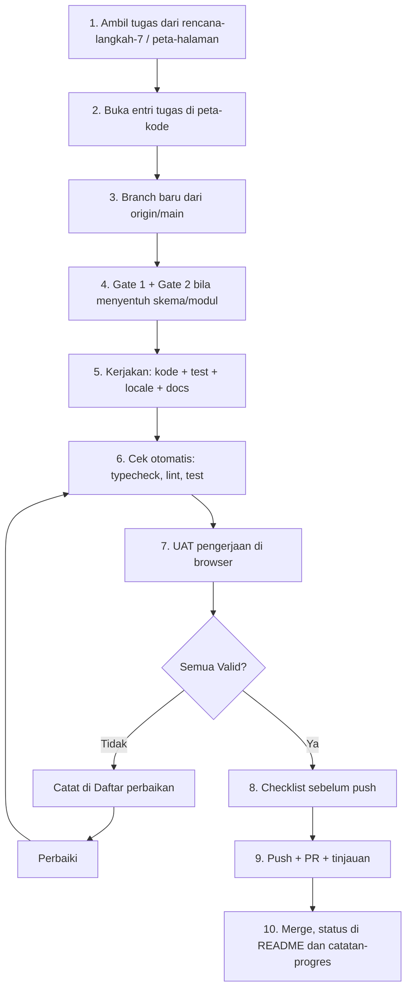

# Aturan pengerjaan kode

Disusun 2026-11-28. Kembali ke [catatan penyesuaian](../README.md).

Berlaku untuk **semua penulis kode** (Dafrin, Oki, dan AI yang membantu)
mulai langkah 7. Catatan dinyatakan **beres** oleh programmer B pada
2026-11-28, jadi perubahan kode boleh dimulai sesuai rencana.

Aturan ini **melengkapi** `AGENTS.md` (aturan repo yang tetap berlaku:
batas modul, skema, i18n, uang, waktu, soft delete, rahasia, dan Definition
of done). Bila bertentangan, `AGENTS.md` yang menang.

## Isi folder

| File | Kegunaan |
|---|---|
| `README.md` | Aturan ini |
| [`peta-kode-dafrin.md`](peta-kode-dafrin.md) | Per tugas programmer B: seharusnya, sekarang, file yang diubah, skema, test, UAT, ketergantungan |
| [`peta-kode-oki.md`](peta-kode-oki.md) | Sama, untuk tugas Oki |
| [`uat-pengerjaan.md`](uat-pengerjaan.md) | Format UAT setelah pengerjaan, status Valid/Tidak valid, daftar perbaikan |
| [`prompt-ai.md`](prompt-ai.md) | Trik prompt supaya AI langsung ke file yang dituju dan hemat token |
| `uat/` | Satu file UAT per paket/tugas (dibuat saat mengerjakan) |

---

## 1. Alur satu tugas



### Langkah rinci

1. **Ambil tugas.** Urutan dari
   [`../4-rencana-kerja/rencana-langkah-7.md`](../4-rencana-kerja/rencana-langkah-7.md)
   (langkah 7) lalu baris **Tinggi** di
   [`../4-rencana-kerja/peta-halaman.md`](../4-rencana-kerja/peta-halaman.md)
   (langkah 8). Satu PR = satu paket/tugas. Jangan mengerjakan tugas yang
   ketergantungannya belum masuk `main`.
2. **Buka entri di peta kode.** Hanya buka file yang tercantum. Bila ternyata
   perlu file lain, tambahkan ke entri peta kode di PR yang sama.
3. **Branch** dari `origin/main` terbaru, nama `feat/erp-XXXX-<slug>` atau
   `fix/erp-XXXX-<slug>`. Nomor `ERP-*` (dan ADR) dipesan setelah mengecek
   `main`, semua branch, dan PR terbuka. Tanpa worktree. Push dan PR hanya
   dengan akun GitHub tim yang sudah ditentukan.
4. **Gate 1 dan Gate 2** (`AGENTS.md`, "Feature module lifecycle") bila
   menyentuh skema, endpoint, atau batas modul: baca `docs/database/`, lalu
   grill rancangan; jawaban dicatat di deskripsi PR.
5. **Kerjakan** sesuai "Seharusnya" di peta kode dan keputusan yang
   dirujuk. Tidak menambah fitur di luar tugas. Teks layar dalam `en` dan
   `id`. Form mengikuti aturan RF-1–RF-27
   (`../3-rancangan/rancangan-menu-dasbor-dan-form.md`).
6. **Cek otomatis** (perintah di `AGENTS.md`/`runbook.md`):
   - `bun run typecheck`, dan untuk web-admin
     `cd apps/web-admin && bunx tsc -p tsconfig.app.json --noEmit`
   - `bun run lint`
   - `bun run test` (atau test file terkait saat iterasi, test penuh
     sebelum push)
   - skema: `bun docs/database/gen-logical-references.ts` lalu
     `bun docs/database/validate-dbml.ts` harus `OK`; migrasi dicoba di
     database lokal yang bisa dibuang, seed dua kali
   - rute/guard/role berubah: `bun docs/gen-role-permission.ts`
7. **UAT pengerjaan** di browser sesuai [`uat-pengerjaan.md`](uat-pengerjaan.md).
   Setiap langkah ditandai **Valid** atau **Tidak valid**. Yang tidak valid
   **wajib dicatat** di Daftar perbaikan, diperbaiki, lalu diuji ulang.
8. **Checklist sebelum push** (bagian 3). Push hanya bila **semua UAT
   Valid** dan **tidak ada perbaikan terbuka**.
9. **PR** dengan templat bagian 4. Bagian bersama (K11: `src/shared`,
   `src/http`, `packages/*`, dokumen, notifikasi, webhook, deploy) ditinjau
   programmer lain.
10. **Setelah merge:** perbarui status tugas di README langkah 7/8,
    `catatan-progres.md`, dan bila perlu peta kode.

---

## 2. Aturan saat menulis kode

| No | Aturan |
|---|---|
| A-1 | Ikuti `AGENTS.md`: controller hanya HTTP, service memegang aturan, repository memegang query; tidak ada akses ke tabel modul lain; referensi lintas modul nullable |
| A-2 | Keputusan di `../2-keputusan/` dan `../3-rancangan/` adalah acuan. Bila kode menunjukkan keputusan tidak bisa dijalankan, **berhenti dan tanyakan**, jangan mengubah keputusan diam-diam |
| A-3 | `docs/database/docs.dbml` diubah **sebelum** skema Drizzle; migrasi append-only |
| A-4 | Uang integer sen; waktu unix milidetik; tanggal bisnis Asia/Jakarta |
| A-5 | Semua teks layar di `packages/locales` (`en` + `id`); pesan server lewat kunci terjemahan |
| A-6 | Setiap perubahan aturan bisnis punya test (otorisasi, kepemilikan, validasi) |
| A-7 | Tidak ada rahasia di kode, log, commit, atau PR |
| A-8 | Satu PR fokus satu tugas; perubahan kecil lain yang ketemu dicatat sebagai tugas baru, bukan diselipkan |
| A-10 | **Data seeder:** fitur baru ikut menambah data ujinya di seeder (rancangan `../3-rancangan/rancangan-data-seeder.md`), deterministik dan idempoten (dijalankan dua kali) |
| A-11 | **Informasi penggunaan:** menu, halaman, tabel, form, status, dan kartu dasbor yang disentuh diberi keterangan cara pakai dan aturan validasi (RF-28–RF-34) |
| A-12 | **ADR hanya dibuka bila tugas menulis atau mengubah ADR** (P7-2 ADR-0006, ADR K12, M11-4 investor, ADR schema `website` B-38, B-28 status ADR). Di luar itu ADR adalah riwayat: aturannya sudah dirangkum di `AGENTS.md` dan keputusan di `docs/adjustment/`; jangan mengambil perilaku dari ADR lama |
| A-13 | `docs/architecture/security-and-access.md` **ditahan**: tidak dibuka dan tidak diubah sampai ada arahan (T-6) |
| A-9 | Dokumen yang ikut berubah di PR yang sama: `docs/plan/progress.md`, `docs/plan/backlog.md`, `docs/plan/plans/features.md`, `docs/adjustment/catatan-progres.md`, file UAT tugas, dan `docs/database/` bila skema berubah |

---

## 3. Checklist sebelum push

- [ ] Semua langkah UAT tugas ini **Valid** (file `uat/<tugas>.md`)
- [ ] Daftar perbaikan tugas ini **kosong** (semua status Selesai)
- [ ] Typecheck (backend, web-admin, Astro bila disentuh), lint, test **hijau**
- [ ] Skema: `validate-dbml.ts` `OK`, migrasi dicoba, seed dua kali
- [ ] Locale `en`/`id` lengkap (test locale parity hijau), termasuk teks bantuan RF-28–RF-34
- [ ] Seeder diperbarui untuk fitur ini dan dijalankan dua kali tanpa baris ganda (A-10)
- [ ] `docs/plan/progress.md`, `backlog.md`, `features.md` diperbarui
- [ ] `docs/adjustment/catatan-progres.md` diperbarui, status tugas di README
- [ ] `docs/role-permission.md` dibuat ulang bila rute/role berubah
- [ ] Tidak ada rahasia; pesan commit Conventional Commits
- [ ] Bila hook pre-commit gagal karena `graphify` tidak terpasang: lint/test/build dijalankan manual dan dicatat di PR sebelum memakai `--no-verify`

## 4. Templat deskripsi PR

```markdown
## Ringkasan
<Tugas ID dan judul> — <apa yang berubah, 2–4 kalimat>

## Keputusan yang dijalankan
<ID keputusan, misal K1, FU6, B-21>

## Gate 1 / Gate 2
<dokumen database yang dibaca; jawaban grill singkat, atau "tidak menyentuh skema/modul">

## Cek otomatis
- typecheck: <hasil>
- lint: <hasil>
- test: <jumlah lulus>
- validate-dbml: <OK / tidak berlaku>

## UAT
File: docs/adjustment/5-pengerjaan/uat/<tugas>.md — <n> langkah, semua Valid.
Perbaikan yang ditemukan dan ditutup: <ID / tidak ada>

## Catatan untuk peninjau
<bagian bersama yang disentuh, risiko, hal di luar tugas yang dicatat sebagai tugas baru>
```

## 5. Bila UAT gagal setelah merge

Temuan dari UAT ulang (langkah 9) atau dari pemakai dicatat sebagai baris
baru di Daftar perbaikan tugas asal (atau file `uat/` baru bila tugasnya
sudah tutup), diberi prioritas, lalu dikerjakan sebagai PR perbaikan dengan
alur yang sama.
