# Diagram alur sekarang: modul Oki (M06, M09, M10, M12, gaji, portal karyawan)

[Kembali ke indeks diagram](README.md)

**Tujuan.** Menggambarkan alur modul programmer kedua (Oki) **seperti kode
berjalan hari ini**, supaya Pemilik dan Oki bisa melihat di langkah mana alur
macet atau berjalan tanpa pemeriksa. Ini **kondisi sekarang, belum ada
perubahan**: tidak ada usulan yang sudah dikerjakan.

**Tanggal:** 2026-11-27. **Status:** draf, disusun oleh Claude (asisten AI)
dari pembacaan kode dan catatan, belum diperiksa Oki maupun Pemilik. Belum ada
langkah yang dicoba di aplikasi untuk dokumen ini.

**Cara membaca** (sama dengan
[uat-modul/diagram-alur-per-role.md](../uat-modul/diagram-alur-per-role.md)):

* Aktor ditulis `Role - nama orang`, memakai susunan role yang
  direkomendasikan ([validasi-konsep-modul-oki.md](../validasi-konsep-modul-oki.md)
  3.1 dan 3.8): Aqim = Pemilik + SDM (pekerjaan keuangan, pembelian, dan
  operasional dikerjakannya sebagai Pemilik), Bella = Akuntan (+ Keuangan bila
  K2d b), Agus MD dan Bilal = Penjualan, Bilal juga Gudang / Layanan Pelanggan /
  Pemasaran, Agus = Manajer Proyek / Teknisi / Gudang, Jamil = Manajer Proyek /
  Teknisi, Hatta = Manajer Proyek, Fahri / Alex / Ade = Teknisi, Dafrin / Oki =
  Pekerja Lepas.
* Orang yang **seharusnya** bertindak tetap digambar. Bila kode menolaknya,
  ada `Note` berisi **DITOLAK KODE** atau **MACET**.
* Nomor temuan: RO1–RO20 di [validasi-konsep-modul-oki.md](../validasi-konsep-modul-oki.md)
  Bagian 3.2; OA–OH di [bahan-keputusan-modul-oki.md](../bahan-keputusan-modul-oki.md).

**Sumber, dibaca 2026-11-27:**

* Kode: `apps/backend/src/app/finance/services/` (`manual-journal`, `period`,
  `posting`, `supplier-bill`, `employee-advance`, `receivable-adjustment`,
  `fixed-asset`, `bank-reconciliation`), `finance/controllers/ledger.controller.ts`,
  `receivables.controller.ts`, `fixed-asset.controller.ts`;
  `payment/services/payment.service.ts`; `tax/services/tax.service.ts`;
  `inventory/services/` (`borrowing-request`, `borrowing`, `disposal`),
  `inventory/controllers/borrowing.controller.ts`;
  `human-resource/services/` (`salary`, `employee-portal`, `leave`);
  `project/services/site-attendance.service.ts`;
  `user/services/invitation.service.ts`, `organization/services/organization.service.ts`;
  `apps/web-admin/src/components/form/login-form.tsx`,
  `components/sidebar/organization-switcher.tsx`; `apps/web-employee/src/routes/`;
  status di `apps/backend/drizzle/schemas/{finance,payment,tax,inventory,human-resource}.schema.ts`;
  hak di `packages/common/src/authorization/erp-permissions.ts`.
* Catatan: [validasi-konsep-modul-oki.md](../validasi-konsep-modul-oki.md),
  [uat-modul/modul-oki/](../uat-modul/modul-oki/README.md),
  [skema-database/finance.md](../skema-database/finance.md),
  [skema-database/tax.md](../skema-database/tax.md),
  [skema-database/auth.md](../skema-database/auth.md),
  [skema-database/audit.md](../skema-database/audit.md),
  [lintas-modul/autentikasi-dan-hak-akses.md](../lintas-modul/autentikasi-dan-hak-akses.md).

Supaya diagram tidak ramai, Pemilik (`owner`, memegang semua hak) hanya
digambar di langkah yang memang dikerjakan Aqim di susunan ini.

---

## 1. M12 - Undangan, klaim, login, organisasi, role

Akun staf hanya lahir dari undangan (ADR-0029). Klaim langsung membuat sesi;
setelah itu login memakai nama pengguna atau email, lalu organisasi dipilih di
sidebar dan hak dihitung dari role anggota di organisasi itu.

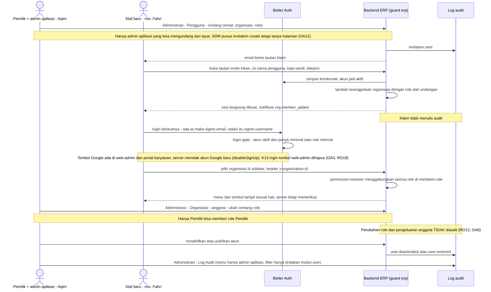

Yang tercatat di audit modul user: `invitation.sent`, `invitation.resent`,
`invitation.cancelled`, `invitation.deleted`, `user.precreated`,
`user.deactivated`, `user.restored`, `user.deleted`. Yang tidak tercatat:
klaim undangan, login, perubahan role, pengeluaran anggota, ekspor.

**Masalah di alur ini**

* RO12 / OA5 / OA6: audit fire-and-forget dan perubahan role tidak diaudit, padahal K1 bergantung pada audit.
* OA8: Log Audit hanya terbuka untuk admin aplikasi (Aqim), jadi tidak ada pembaca kedua.
* OA12: SDM punya hak undang tanpa halaman.
* OA3 / RO19: tombol Google masih ada di web-admin dan portal karyawan.
* OA14: pesan login akun nonaktif sama dengan akun yang belum klaim.
* RO18 / OA1: seluruh langkah pilih organisasi dan role per organisasi terdampak K12.

---

## 2. M09 - Faktur penjualan sampai kas dan rekonsiliasi

Dilihat dari sisi keuangan. Faktur dan kuitansi ada di modul sale
(programmer B), jurnalnya dibuat otomatis oleh posting finance. Penghapusan
piutang memakai pembuat-pemeriksa.

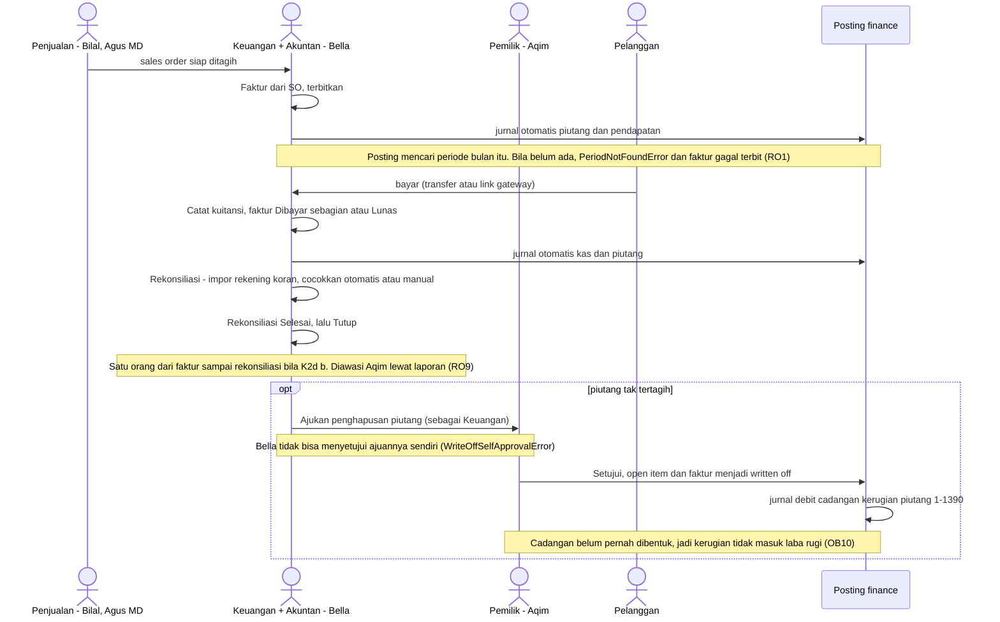

**Masalah di alur ini**

* RO1 / OB4: tanpa periode bulan berjalan, terbit faktur dan catat kuitansi gagal.
* RO2 / OB1: akun yang hanya Keuangan tidak bisa memuat daftar akun di form kas/bank dan rekonsiliasi (tidak terasa bila Bella memegang dua role).
* OB2: layar rekonsiliasi meminta 200 akun, server membatasi 100.
* OB10: write-off ke cadangan yang belum dibentuk.
* RO10: write-off ajuan Bella tertahan bila Aqim tidak sempat menyetujui.

---

## 3. M09 - Tagihan pemasok dan pembayaran

Tagihan dibuat dari PO yang barangnya sudah diterima, atau manual, lalu
direkam (jurnal utang). Pembayaran punya langkah ajukan, setujui, eksekusi,
tetapi tanpa cek pembuat dan tanpa layar bayar pemasok.

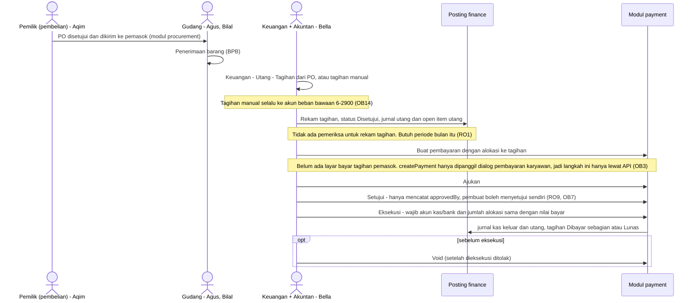

**Masalah di alur ini**

* OB3: tidak ada layar pembayaran pemasok, utang dagang tidak pernah lunas dari layar.
* RO9 / OB7: pembayaran tanpa pembuat-pemeriksa (diterima K7a, dengan audit OA6).
* OB14: tagihan manual tanpa pilihan akun beban.
* RO1: rekam tagihan butuh periode.
* Status `overdue` pada tagihan tidak pernah diisi kode; jatuh tempo hanya muncul sebagai pengingat.

---

## 4. M09 - Kasbon karyawan dan pertanggungjawaban

Kasbon diajukan teknisi, disetujui orang lain, lalu dicairkan lewat
pembayaran. Pertanggungjawaban butuh tiga orang berbeda: pengaju, verifikator,
penyetuju. Dengan susunan sekarang hak verifikasi dan setuju hanya ada di Aqim.

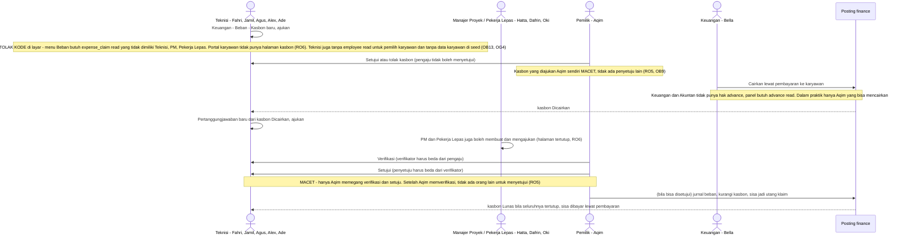

**Masalah di alur ini**

* RO5: persetujuan pertanggungjawaban selalu macet (verifikator ≠ penyetuju, keduanya Aqim).
* RO6: halaman kasbon dan pertanggungjawaban tertutup bagi pengaju; portal karyawan tidak punya halamannya.
* OB9: K1a (b) membuat kasbon ajuan Aqim macet.
* OB13: pencairan hanya bisa oleh Pemilik dari layar.
* OG4: teknisi tanpa data karyawan tidak bisa dipilih sebagai pengaju.
* RO16: Manajer Operasional (satu-satunya pemegang non-Pemilik) tidak dipakai.

---

## 5. M09 - Jurnal manual dan tutup periode

Periode akuntansi harus ada sebelum apa pun bisa diposting. Jurnal manual
memakai pembuat-pemeriksa: menyetujui sama dengan memposting. Tutup bulan
berurutan open, closed (snapshot saldo), locked.

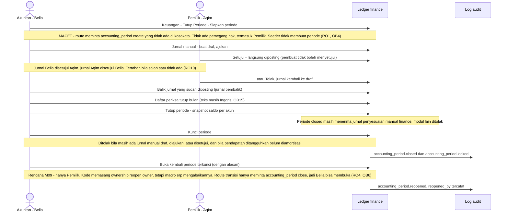

**Masalah di alur ini**

* RO1 / OB4: tidak ada yang bisa menyiapkan periode, semua posting gagal di database baru.
* RO4 / OB6: buka kembali periode terkunci tidak terbatas pada Pemilik.
* RO10: jurnal hanya bisa disetujui pasangan Bella dan Aqim.
* OB15: daftar periksa tutup bulan berbahasa Inggris.
* Status jurnal `approved` ada di schema tetapi tidak dipakai alur manual (setujui = posting). Catatan UAT yang menyebut "Posting" sebagai langkah terpisah perlu disesuaikan.

---

## 6. Gaji - siapkan, setujui, bayar

Rekap gaji disiapkan SDM, PPh 21 dan BPJS dihitung dari pengaturan yang hanya
bisa diubah admin aplikasi, lalu Pemilik menyetujui. Persetujuan mengunci data,
memposting jurnal gaji, dan menerbitkan slip. Pembayaran gaji terpisah lewat
kas/bank.

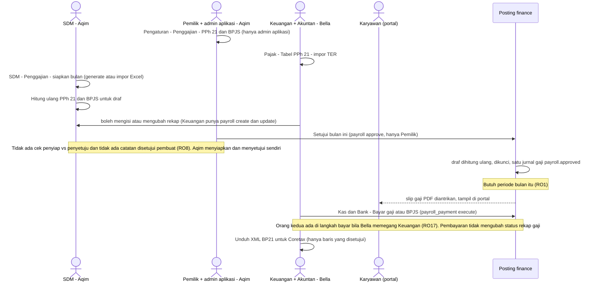

**Masalah di alur ini**

* RO8: persetujuan gaji tanpa cek pembuat dan tanpa catatan audit khusus.
* RO17: Bella melihat dan mengubah gaji semua karyawan bila memegang Keuangan.
* RO1: jurnal gaji butuh periode.
* OC8: tabel TER resmi dan format Coretax belum diuji impor.

---

## 7. M10 - Pajak bulanan

Catatan pajak dan pemotongan dibuat, diverifikasi, dan dilaporkan oleh orang
yang sama. Tutup PPN masa memposting jurnal; setor pajak lewat kas/bank.

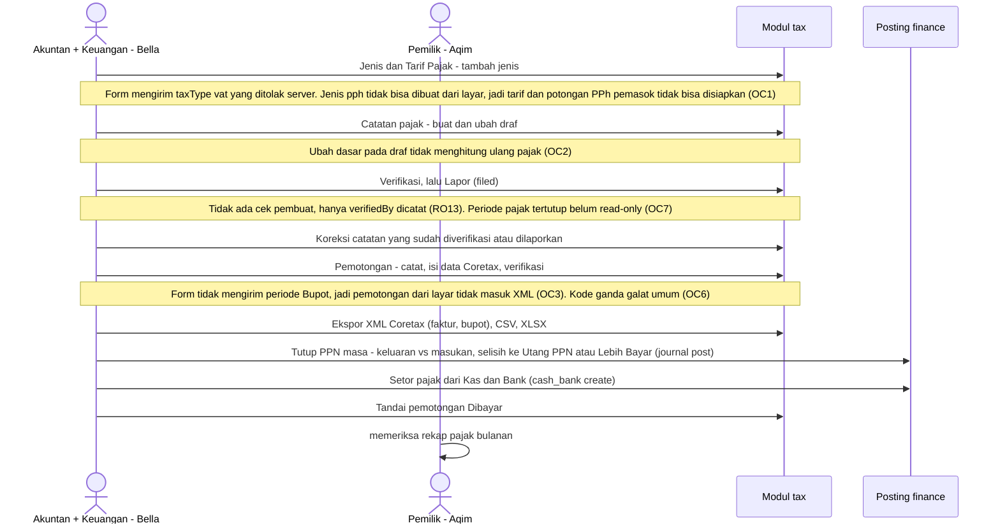

**Masalah di alur ini**

* OC1: bug jenis pajak `vat`.
* OC2: ubah draf tidak menghitung ulang.
* OC3: pemotongan dari layar tanpa periode Bupot, tidak masuk XML.
* OC5: Dibayar → Dibatalkan diizinkan server, tanpa tombol.
* OC7: periode pajak tertutup belum dikunci.
* RO13: pajak di satu tangan, tanpa pemeriksa.
* RO1: tutup PPN butuh periode.

---

## 8. M06 - Peminjaman alat

Pengajuan, persetujuan, penyerahan oleh Gudang, lalu kembali atau hilang.
Aturan "pembuat tidak boleh menyetujui" ada di service tetapi tidak pernah
berlaku.

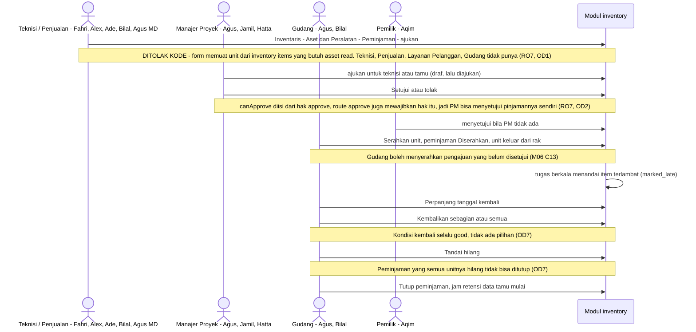

**Masalah di alur ini**

* RO7 / OD2: tidak ada pemeriksa, PM menyetujui pinjamannya sendiri.
* RO7 / OD1: form pengajuan tidak bisa dipakai pengaju tanpa `asset:read`.
* M06 C13: Gudang meminjamkan tanpa persetujuan.
* OD4: peminjam, nomor seri, dan gudang tampil sebagai id mentah.
* OD7: kondisi kembali selalu baik; semua hilang tidak bisa ditutup.

---

## 9. M06 dan M09 - Register aset, kapitalisasi, penyusutan, penghapusan

Aset didaftarkan di inventory, dikapitalisasi dan disusutkan di finance.
Penghapusan hanya Pemilik, dari usul sampai eksekusi.

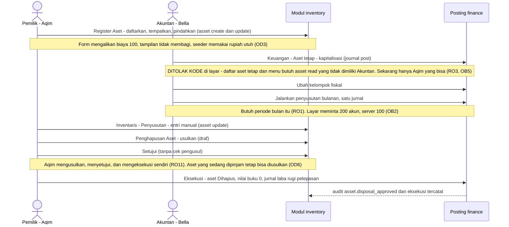

**Masalah di alur ini**

* RO3 / OB5: Akuntan tidak bisa membuka Aset tetap.
* OD3: satuan uang aset kali 100.
* OD6: aset yang sedang dipinjam bisa dihapus atau dinonaktifkan.
* RO11: penghapusan tanpa pemeriksa (sesuai K1, perlu tanda audit OA7).
* OD5 / OD9: catatan servis dan set peralatan setengah jadi; PIC dan kondisi aset tidak ada.
* OD8: rencana modul `assets` berbeda dari kode.

---

## 10. Portal karyawan - absen kantor, absen lokasi proyek, cuti, lembur

Portal tidak memakai role: syaratnya punya data karyawan hidup dan bukan
pemegang role aplikasi `admin`, `investor`, atau `customer`. Absen lokasi
proyek memakai GPS, swafoto wajib, dan pengecekan radius PostGIS.

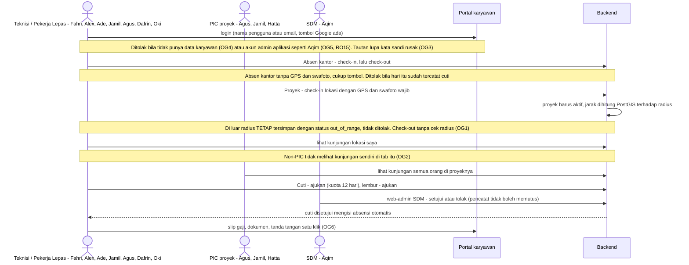

**Masalah di alur ini**

* OG1: absen di luar radius tetap tersimpan, tanpa peninjau.
* OG2: non-PIC tidak melihat kunjungannya sendiri.
* OG3: tautan lupa kata sandi rusak.
* OG4 / RO15: teknisi tanpa data karyawan tidak bisa masuk; menghapus role Anggota tidak menutup portal.
* OG5: Aqim (admin aplikasi) ditolak portal karyawan.
* OG6: tanda tangan tanpa konfirmasi, teks Inggris tersisa.
* RO6: portal tidak punya halaman kasbon dan pertanggungjawaban.
* RO19: tombol Google di portal karyawan masih ada di kode; diputuskan dihapus (K13, disetujui 27/11).

---

## 11. Status dokumen

Semua status di bawah diambil dari konstanta schema dan tabel transisi di
service. Nama orang di label adalah susunan rekomendasi.

### Jurnal manual dan periode akuntansi

Persetujuan jurnal langsung memposting; status `approved` tidak dipakai alur
manual. Periode tidak bisa dibuat siapa pun (RO1).

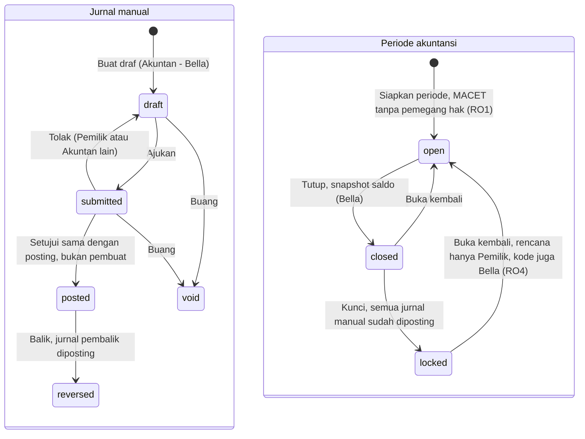

### Tagihan pemasok dan pembayaran

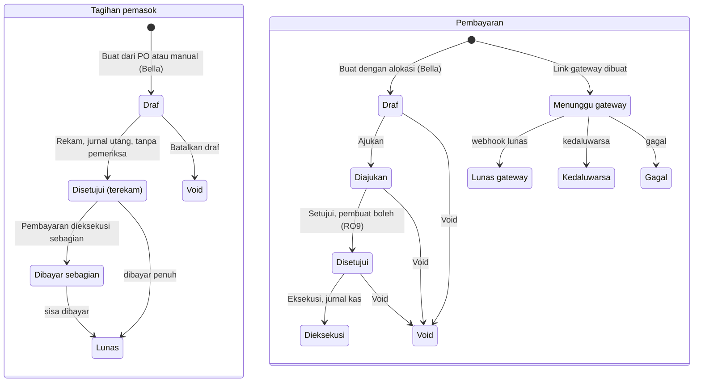

Catatan: status tagihan `overdue` dan status pembayaran `reversed` /
`cancelled` ada di schema tetapi tidak diisi alur yang dibaca di sini.

### Kasbon dan pertanggungjawaban

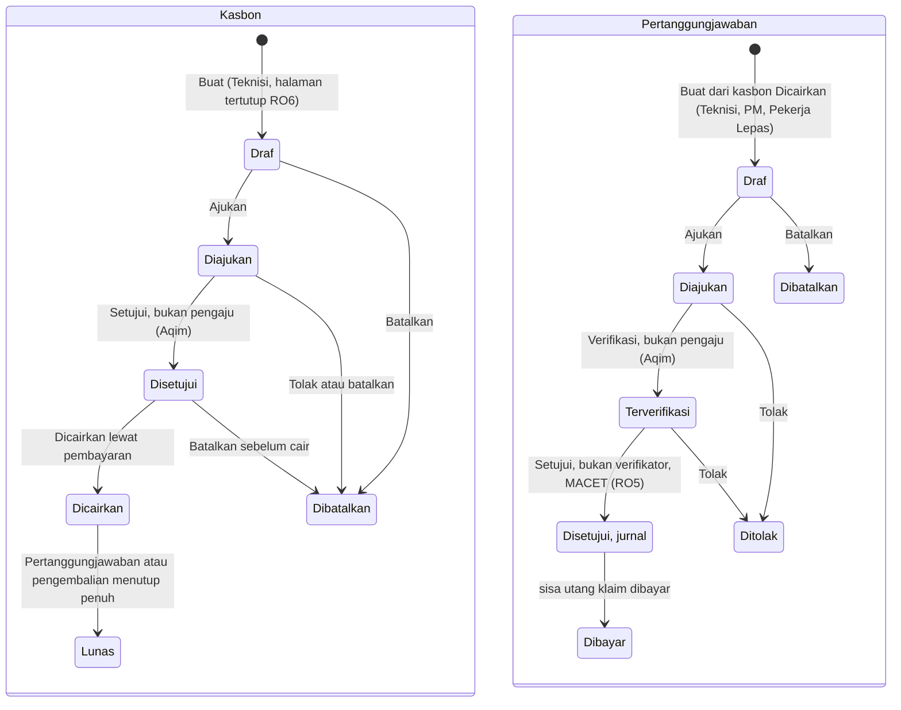

### Peminjaman alat dan penghapusan aset

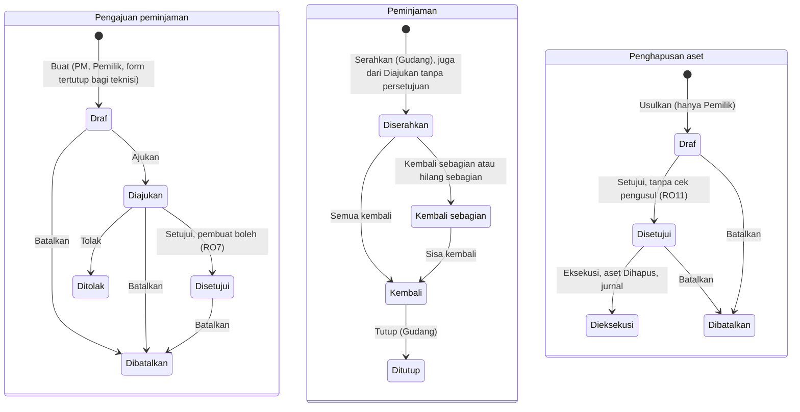

Catatan: status penghapusan `submitted` ada di schema, tetapi tidak ada
langkah ajukan; persetujuan menerima draf langsung. Terlambat bukan status
peminjaman, melainkan tanda `marked_late` per item.

### Catatan pajak, pemotongan, dan rekap gaji

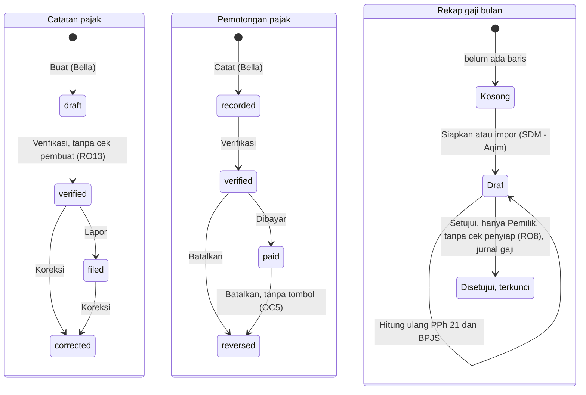

Catatan: status rekap gaji dihitung per bulan dari baris
`employee_salary_records` (`draft` / `approved`); bulan dianggap draf selama
masih ada satu baris draf. Pembayaran gaji lewat kas/bank tidak mengubah
status ini.
