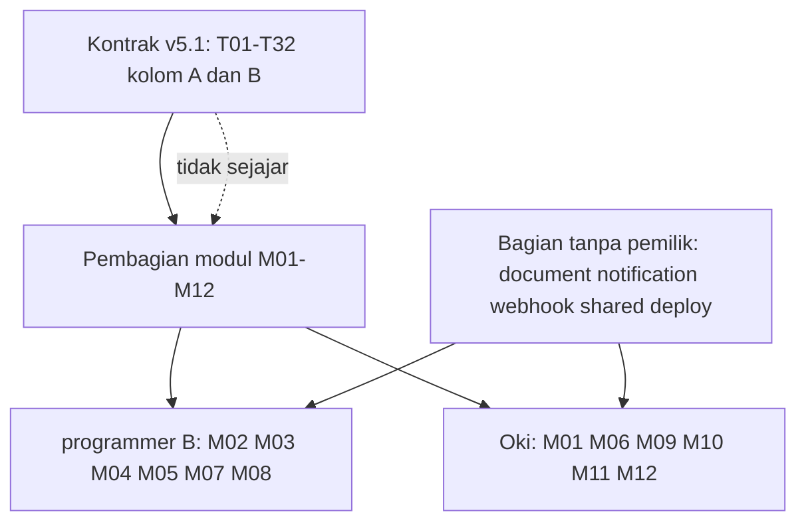

# Di luar pembagian modul dan kontrak

Kembali ke [README](README.md). Dicatat 2026-11-26. Pembanding:
`docs/plan/erp-plan-id.md` (kontrak v5.1, task T01–T32, batas per modul),
`docs/plan/erp-module-plans/*.md`, dan kode di `main` (9974a817). File
`.agents/docs/erp-plan.md` yang disebut di permintaan **tidak ada**; versi
Inggrisnya `docs/plan/erp-plan-en.md`.

Penilaian "di luar kontrak" di bawah adalah pembacaan programmer B atas teks
batas modul; keputusan resminya tetap di Pemilik.

## Kondisi saat ini

### (a) Fitur ada di kode, tidak ada di pembagian modul atau melewati batas kontrak

| Fitur | Lokasi di kode | Batas kontrak yang dilewati | Modul terdekat |
|---|---|---|---|
| Banyak gudang, rak, penanggung jawab gudang (ADR-0017, ADR-0026) | `apps/backend/src/app/warehouse/`, `src/authorization/warehouse-pic-resolver.ts` | M05: "Satu gudang; tanpa multi-gudang" | M05 |
| Permintaan pembelian dengan persetujuan | `procurement/services/purchase-request.service.ts` | M05: "tanpa PR/PO berjenjang" (PR satu tingkat, abu-abu) | M05 |
| Retur pembelian dan retur penjualan | `procurement/services/purchase-return.service.ts`, `sale/services/sales-return.service.ts` | M05: "tanpa reservasi/retur otomatis" (retur manual, abu-abu) | M05, M02 |
| HPP/nilai stok otomatis | `inventory/services/stock-valuation.service.ts`, migrasi `20261124214438_erp0136_grir_cogs` | M05: "HPP otomatis" dikecualikan; rekap HPP lewat finance | M05/M09 |
| Penyusutan aset otomatis, buku aset tetap | `finance/services/depreciation.service.ts`, `fixed-asset.service.ts`, migrasi `erp0145_fixed_asset_books` | M06: "tanpa penyusutan otomatis" | M06/M09 (Oki) |
| Perawatan, pelepasan aset, tool set | `inventory/services/maintenance.service.ts`, `disposal.service.ts`, `tool-set.service.ts` | M06: "tanpa jadwal servis" (catatan servis boleh) | M06 (Oki) |
| Portal karyawan | `apps/web-employee`, `human-resource/controllers/employee-portal.controller.ts`, `/projects/me`, `/documents/me` | M12: "Tanpa aplikasi pegawai" | M08/M12 |
| Absen lokasi proyek dengan GPS (PostGIS) | `project/services/site-attendance.service.ts`, `project.addresses.site_point`, migrasi `20261125201740_postgis_extension` | M08: "Tanpa mesin/GPS absensi" | M08/M07 |
| Jadwal kerja (shift per tanggal, ERP-0118) | `human-resource/services/schedule.service.ts` | M08: "tanpa shift kompleks" (satu shift per hari, abu-abu) | M08 |
| PPh 21, BPJS, file BP21 Coretax | `human-resource/services/payroll-statutory.service.ts`, `pph21-table.service.ts` (tax), `tax/services/coretax-export.service.ts` | M08: "tanpa seluruh skenario pajak payroll"; M10: "tanpa pelaporan resmi DJP" (file ekspor, bukan lapor) | M08, M10 |
| Perluasan keuangan kelas ERP (ADR-0030): proyeksi kas, rasio, management pack, pendapatan ditangguhkan, pusat biaya, nota kredit, anggaran proyek, impor mutasi bank | `finance/services/cash-forecast.service.ts`, `ratio.service.ts`, `management-pack.service.ts`, `deferred-revenue.service.ts`, `cost-center.service.ts`, `project-budget.service.ts`, `bank-reconciliation.service.ts` | M09: "tanpa otomasi jurnal semua aktivitas"; sebagian tidak disebut kontrak | M09 (Oki) |
| Dua gateway pembayaran (Xendit + SingaPay) | `payment/`, `webhook/contracts/webhook.contract.ts` | M04/add-on: "Satu gateway" | M02/M04 |
| Pengingat tindak lanjut lead/SPH otomatis (ERP-0066) | `project/queues/lead-follow-up.*`, `sale/queues/quotation-follow-up.*` | M02: "follow-up dicatat manual; tanpa CRM otomatis penuh" | M02 |
| Tanda tangan digital, tautan berbagi, tag, log akses dokumen | `document/services/signature.service.ts`, `document.service.ts` (`createShare`) | M02: "satu template per dokumen"; tidak disebut | tidak ada |
| Login passkey, magic link, email OTP, Google, multi-session | `providers/better-auth/plugins/` | T02 hanya "login peran dan audit" | M12 (Oki) |
| Notifikasi realtime (socket `/ws`) dan kotak masuk | `notification/`, `providers/realtime/` | Kontrak hanya menyebut notifikasi WA/handoff | tidak ada |
| Portal pelanggan: anggota akun, perangkat, tutup akun | `customer/controllers/portal.controller.ts` | T25: "Akun, order, dokumen, lisensi, proyek/BAST dan tiket milik sendiri" | M07/M12 |
| Banyak organisasi (ADR-0007, ADR-0012-multi-organization; ADR-0010 departemen masih "proposed") | `auth.organizations`, kolom `organization_id` di semua schema | Kontrak: "satu badan usaha" | M12 |
| Tabel tanpa alur: `sale.discount_requests`, `sale.contracts`, `sale.targets`, sebagian tabel `project` (phases, milestones, daily_reports, kpi_*, work_plans) | `drizzle/schemas/sale.schema.ts`, `project.schema.ts` | Tidak disebut | M02, M07 |

### (b) Task kontrak yang belum tercakup atau belum dibangun

| Task | Isi kontrak | Kondisi di `main` | Catatan |
|---|---|---|---|
| T13, T29, T30 | Bonus/investor, portal investor, izin data dan ekspor investor | **Belum dibangun.** Schema `investor` dihapus ADR-0024; `apps/web-investor` template kosong; hanya `finance/services/exported-profit.service.ts` (laba periode terkunci) disiapkan | Butuh ADR baru untuk schema bagi hasil |
| T21 | Checkout dan order online | Sebagian: checkout gateway dari invoice ada; pesanan online dari website/portal belum ada endpoint (`web-landing` checkout statis) | Lihat [portal-dan-website.md](portal-dan-website.md) |
| T25 | Akun pelanggan dan dokumen | Sebagian: akun, proyek, tiket ada; dokumen, SPH, invoice, pembayaran di portal belum ada route (`web-customer-portal/src/services/portal/erp-routes.ts`) | |
| T24 | Integrasi lisensi aplikasi pilot | API `/projects/api/v1/licenses` ada; integrasi ke aplikasi pilot ada di luar repo, belum ada bukti | Perlu akses source aplikasi pilot (syarat kontrak) |
| T17 | Deployment dan uji backup/restore | Deploy (GHCR + compose) ada; backup/restore "Not established" (`docs/architecture/runbook.md`) | |
| T16, T31 | Impor terbatas, UAT, perbaikan | Impor ada untuk absensi, gaji, jurnal, pajak, undangan; UAT berjalan (`../uat-modul/`) | 32 skenario U01–U32 ada di Excel, **tidak di repo** |
| T01, T18, T32 | Kickoff, pelatihan, serah terima | Bukan kode | Keluaran serah terima (panduan, endpoint, backup, rollback) belum dikumpulkan |
| T14 | Dashboard + satu webhook dasar | Dashboard (M01, Oki) dan outbox n8n (M04, B) ada | Satu task, dua pemilik |

### (c) Tanpa pemilik atau pemiliknya belum jelas

| Bagian | Lokasi | Kenapa tidak jelas |
|---|---|---|
| Modul `document` (register, tanda tangan, berbagi, PDF) | `apps/backend/src/app/document/` | Tidak ada di M01–M12; dipakai 8 modul |
| Modul `notification` + socket realtime | `app/notification/`, `providers/realtime/` | Tidak ada di pembagian |
| Modul `webhook` | `app/webhook/` | Pintu masuk `payment` (M02) dan `automation` (M04) |
| Modul `company` (profil perusahaan, kode dokumen `{COMPANY}`) dan `location` (wilayah Indonesia) | `app/company/`, `app/location/` | Data master (T03), tidak disebut modul |
| Lapisan bersama: penomoran, galeri foto, audit writer | `src/shared/numbering/`, `src/shared/media/`, `src/shared/audit/` | Dipakai kedua programmer; perubahan PO 32 karakter (2026-11-25) dibuat programmer B |
| Lapisan HTTP bersama | `src/http/plugin.ts`, `response.ts`, `errors.ts` | Diubah programmer B 2026-11-25 (error 500 JSON), "perlu diberitahukan ke Oki" |
| Schema `inventory` dipakai dua pemilik | `drizzle/schemas/inventory.schema.ts` | Stok (M05, programmer B) dan aset/peminjaman/perawatan (M06, Oki) di satu schema; aturan "satu modul satu schema" dan pembagian orang tidak sejajar |
| Deploy, compose, CI, image GHCR | `docker-compose*.yml`, `.github/workflows/`, `apps/*/Dockerfile` | Image diterbitkan di akun Oki; tidak tertulis di pembagian |
| Paket bersama | `packages/common`, `locales`, `ui`, `react-email`, `design-tokens` | `erp-permissions.ts` milik M12 (Oki); sisanya tidak tertulis |
| T03 master data, T16–T18, T31–T32 | — | Kontrak: A+B bersama |

### Kolom A/B kontrak tidak sama dengan pembagian modul

Dengan anggapan A = Oki dan B = programmer B (Dafrin):

| Task | Kontrak | Pembagian modul sekarang | Harga alokasi (Rp) |
|---|---|---|---|
| T02 Login peran dan audit | B | M12 → Oki | 337.500 |
| T12 Kertas kerja pajak | B | M10 → Oki | 168.750 |
| T13 Bonus investor dan bagi hasil | B | M11 → Oki | 168.750 |
| T29 Dashboard modal dan bagi hasil | B | M11 → Oki | 500.000 |
| T30 Izin data dan ekspor investor | B | M11/M12 → Oki | 250.000 |
| T19 Perhitungan payroll otomatis | A | M08 → programmer B | 600.000 |
| T20 Slip, approval, jurnal payroll | A | M08 → programmer B (jurnal di M09 Oki) | 400.000 |
| T23 API key dan aturan lisensi | A | M03 → programmer B | 750.000 |
| T24 Integrasi lisensi aplikasi pilot | A | M03 → programmer B | 500.000 |
| T27 FAQ AI dan integrasi n8n | A | M04 → programmer B | 850.000 |
| T28 Notifikasi, handoff, log WA | A | M04 → programmer B | 400.000 |
| T07 Pembelian, stok, aset dasar | A | Stok M05 → programmer B, aset M06 → Oki | 337.500 (dibagi) |
| T14 Dashboard dan satu webhook dasar | A | Dashboard M01 → Oki, webhook M04 → programmer B | 337.500 (dibagi) |

Jumlah (tanpa T07/T14 yang dibagi): task kontrak B yang pindah ke Oki
Rp1.425.000; task kontrak A yang pindah ke programmer B Rp3.500.000. Harga
ini alokasi paket, bukan tagihan (kontrak hal. 5–6).

## Alur lintas modul

## Catatan dan temuan

1. Kode `main` jauh melewati batas kontrak di gudang, aset, SDM, keuangan,
   dan portal karyawan. Ini menambah beban UAT dan pemeliharaan, sementara
   kontrak menyatakan cadangan "tidak berarti penambahan fitur bebas" dan
   perubahan lingkup harus dicatat Pemilik.
2. Sebaliknya, beberapa task kontrak berbayar belum dibangun (investor, order
   online, dokumen portal, backup/restore).
3. Pembagian modul menukar beberapa task berbeda nilai antara A dan B
   dibanding kontrak. Belum ada catatan resmi pertukaran ini.
4. Beberapa modul dan lapisan bersama tidak punya pemilik; perubahan di sana
   (contoh: PO 32 karakter, error 500 JSON) dibuat siapa saja yang sedang
   terhambat.
5. Skenario UAT resmi U01–U32 tidak ada di repo; checklist di `../uat-modul/`
   disusun dari kode, bukan dari Excel.

## Perubahan mendatang

| Perubahan | Sumber | Dampak | Status |
|---|---|---|---|
| Pemilik mencatat fitur di luar kontrak (tabel a): diterima sebagai bonus, dibekukan, atau disembunyikan dari UAT | temuan 1, kontrak hal. 4 "Acuan perubahan" | Menentukan cakupan UAT dan serah terima | menunggu keputusan |
| Putuskan nasib T13/T29/T30 (investor): tetap dibangun (siapa, ADR schema baru) atau dikeluarkan | tabel b | Modul + schema baru atau revisi kontrak | menunggu keputusan |
| Catat resmi pertukaran task A/B (tabel kolom) dan dampaknya ke pembayaran | temuan 3 | Administrasi kontrak/Tracker Excel | menunggu keputusan |
| Tetapkan pemilik `document`, `notification`, `webhook`, `company`, `location`, lapisan `shared/` dan `http/`, deploy/CI | tabel c | Menghindari perubahan tanpa koordinasi | menunggu keputusan |
| Sepakati pembagian schema `inventory` (stok vs aset) antar dua programmer | tabel c | Aturan review dan migrasi | usulan |
| Masukkan skenario U01–U32 dari Excel ke repo (atau peta U ke checklist `uat-modul`) | temuan 5 | Dokumen | usulan |
| Selesaikan T17 backup/restore sebelum rilis | tabel b | Script + runbook | direncanakan |
| Selesaikan T21/T25 (order online, dokumen portal) | tabel b | Lihat [portal-dan-website.md](portal-dan-website.md) | direncanakan |
| Tabel yang tidak dipakai (`discount_requests`, dll.): hapus dari target atau masukkan alur | `../uat-modul/catatan-skema-dan-alur.md` S6 | `docs.dbml` + migrasi bila dihapus | usulan |
