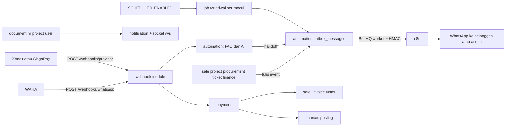

# Notifikasi, otomasi, dan integrasi

Kembali ke [README](README.md). Dicatat 2026-11-26, dicek ke kode di `main`.
Bagian ini menyatukan semua jalur "keluar-masuk" sistem: pemberitahuan di
aplikasi, email, event ke n8n, WhatsApp/AI, webhook penyedia, dan job
terjadwal. Sebagian besar ada di M04 (programmer B), tetapi dipanggil dari
banyak modul.

## Kondisi saat ini

### Notifikasi di aplikasi (modul `notification`)

- Modul: `apps/backend/src/app/notification/`; tabel
  `notification.push_notifications` dan `push_notification_templates`.
- Modul lain memanggil `ExportedNotificationService.notify` lewat token.
  Pemakai di `main`: `document` (tanda tangan), `human-resource` (cuti,
  jadwal gaji, slip, tugas), `organization`, `project` (absen lokasi),
  `user` (undangan).
- Dikirim lewat antrean BullMQ (`notification/queues/`), lalu dorongan
  realtime lewat **satu socket** `GET /ws` (`providers/realtime/`,
  ADR-0016). Pembersihan lama: `SCHEDULER_NOTIFICATION_RETENTION_CRON`,
  `NOTIFICATION_RETENTION_DAYS` (bawaan 90).
- Web-admin: lonceng di header; menu Notifikasi tidak ada lagi di sidebar
  setelah merge main 2026-11-26. Portal karyawan punya halaman
  `/notifications`.

### Email

- `providers/mailer/` (antrean `MAIL_QUEUE_NAME`, worker, template React
  Email dari `packages/react-email`). Penyedia: `MAIL_PROVIDER` dengan
  `MAIL_SMTP_*` atau `MAIL_RESEND_API_KEY`; pengirim `MAIL_FROM`.
- Dipakai untuk undangan staf (`user/adapters/queue-mailer.ts`) dan akun
  portal pelanggan (`customer/adapters/queue-portal-mailer.ts`).
- Lokal: Mailpit `http://localhost:8025` (container `ims-erp-mailpit-1`,
  dibuat manual, tidak ada di compose).

### Event ke n8n (outbox, ADR-0020)

- Tabel `automation.outbox_messages`; service `automation/services/outbox.service.ts`;
  worker `automation/queues/outbox.worker.ts` mengirim ke
  `N8N_WEBHOOK_URL` dengan tanda tangan HMAC `X-Erp-Signature`
  (`N8N_WEBHOOK_SECRET`) dan `X-Erp-Event-Id` (`adapters/n8n-webhook.ts`).
- Jenis event (`automation/contracts/outbox.contract.ts`): `lead.created`,
  `invoice.issued`, `receipt.recorded`, `license.due`,
  `service_ticket.updated`, `whatsapp.handoff`, `lead.follow_up_due`,
  `quotation.follow_up_due`, `quotation.sent`, `supplier_bill.recorded`,
  `supplier_bill.due`, `purchase_return.updated`, `sales_return.updated`.
- Penerbit: `project` (lead, lisensi, inquiry website), `sale` (SPH, invoice,
  pembayaran, retur), `procurement` (retur pembelian), `ticket`, `finance`
  (tagihan pemasok, wilayah Oki).
- Log dan kirim ulang manual: `/automation/outbox` (menu Integrasi → Webhook
  n8n, izin `automation.read_log`).
- Workflow n8n-nya sendiri ada di luar ERP; panduan di
  `docs/user-guide/n8n-workflows.id.md`.

### WhatsApp dan AI

- Masuk: WAHA mengirim chat ke `/webhooks/whatsapp`; modul `webhook`
  meneruskan ke `ExportedWhatsappWebhookService` (automation). Kirim balasan:
  `automation/adapters/waha.ts` (`WAHA_URL`, `WAHA_API_KEY`, `WAHA_SESSION`,
  `WAHA_WEBHOOK_SECRET`).
- Tabel: `whatsapp_conversations`, `whatsapp_messages`, `faq_entries`.
- AI opsional dan netral penyedia: `adapters/openai-compatible.ts`
  (`AI_BASE_URL`, `AI_API_KEY`, `AI_MODEL`). Tanpa AI, semua chat diserahkan
  ke admin (`whatsapp.handoff`). AI tidak boleh memberi diskon atau transaksi
  (kontrak M04).
- Menu: Integrasi → Percakapan / FAQ (izin `whatsapp.read`).
- Alternatif Meta Cloud API baru ada di workflow n8n (template), belum di
  asisten ERP.

### Webhook penyedia (modul `webhook`)

- `POST /webhooks/:provider`, `WEBHOOK_PROVIDERS = ['xendit', 'singapay', 'whatsapp']`
  (`webhook/contracts/webhook.contract.ts`). Tanpa sesi; keaslian dicek modul
  pemilik (token/tanda tangan atas body mentah). Hasil `accepted`,
  `duplicate`, `ignored` = 200; `rejected` = 401. Kiriman ulang tidak
  menimbulkan efek kedua.
- Modul `webhook` **tidak punya schema**; ia hanya pintu masuk ke
  `payment` (Xendit, SingaPay) dan `automation` (WhatsApp).

### Gateway pembayaran (modul `payment`, ADR-0021, ADR-0023)

- Penyedia netral: Xendit (`XENDIT_SECRET_KEY`, `XENDIT_CALLBACK_TOKEN`,
  `XENDIT_BASE_URL`) dan SingaPay (`SINGAPAY_PARTNER_ID`,
  `SINGAPAY_CLIENT_ID`, `SINGAPAY_CLIENT_SECRET`, `SINGAPAY_ACCOUNT_ID`,
  `SINGAPAY_BASE_URL`, `SINGAPAY_WEBHOOK_TOLERANCE_MS`). Pilihan aktif:
  `PAYMENT_GATEWAY_PROVIDER`; pengaturan di `/admin/payments/gateways`.
- Checkout dibuat dari invoice (`payment/services/gateway-checkout.service.ts`),
  pembayaran sah dialokasikan ke invoice di `sale`, dan diposting ke `finance`
  (`gateway-settlement.service.ts`, wilayah Oki).

### Job terjadwal dan antrean (Redis + BullMQ)

- Koneksi antrean: `providers/queue/queue.connection.ts`, database Redis
  `REDIS_QUEUE_DB` (bawaan 1); cache memakai `REDIS_DB`. Worker dikumpulkan
  `providers/queue/worker-registry.ts`; error worker dicatat, tidak
  mematikan HTTP API.
- **`SCHEDULER_ENABLED`** (bawaan `false`): hanya bila `true` job terjadwal
  dipasang. Jadwal (env, bawaan):

| Job | Env | Bawaan | Modul |
|---|---|---|---|
| Sapuan peminjaman terlambat | `SCHEDULER_LATE_SWEEP_CRON` | `*/15 * * * *` | inventory |
| Sapuan retensi data tamu | `SCHEDULER_RETENTION_SWEEP_CRON` | `0 3 * * *` | inventory |
| Pengingat lisensi jatuh tempo | `SCHEDULER_LICENSE_DUE_CRON` | `0 8 * * *` | project (M03) |
| Pengingat tindak lanjut lead/SPH | `SCHEDULER_SALES_FOLLOW_UP_CRON` | `0 8 * * 1-5` | project, sale (M02) |
| Tagihan pemasok jatuh tempo | `SCHEDULER_BILL_DUE_CRON` | `0 8 * * *` | finance |
| Draf gaji pada hari gajian | `SCHEDULER_PAYROLL_CRON` | `0 1 * * *` | human-resource (M08) |
| Retensi notifikasi | `SCHEDULER_NOTIFICATION_RETENTION_CRON` | `0 4 * * *` | notification |

- Antrean tanpa jadwal (selalu jalan): email, avatar, logo organisasi,
  notifikasi, outbox n8n, WhatsApp, PDF SPH terkirim, PDF perjanjian kerja,
  PDF slip gaji.

## Alur lintas modul

## Catatan dan temuan

1. **Pemilik modul `notification` dan `webhook` tidak tertulis** di
   pembagian modul. Secara isi, notifikasi WA ada di M04 (programmer B), tapi
   kotak masuk aplikasi dipakai modul SDM dan dokumen.
2. **Pembagian kontrak tidak cocok dengan pembagian modul.** Kontrak
   menaruh T27 (FAQ AI + n8n) dan T28 (notifikasi, handoff, log WA) di
   kolom A, dan T14 (dashboard + satu webhook dasar) di A; pembagian modul
   memberi M04 ke programmer B. Lihat [di-luar-scope.md](di-luar-scope.md).
3. **Dua gateway, padahal kontrak "satu gateway".** Xendit dan SingaPay
   sama-sama dibangun (keputusan Pemilik 2026-11-14: pluggable). Biaya
   pemeliharaannya di luar paket.
4. **Job terjadwal mati secara bawaan.** Tanpa `SCHEDULER_ENABLED=true`,
   tidak ada pengingat lisensi, tindak lanjut, tagihan, atau draf gaji. Ini
   harus diingat saat deploy dan saat UAT pengingat.
5. **Seeder mengosongkan Redis** (`flushall`), termasuk antrean BullMQ yang
   belum selesai (lihat [infrastruktur-dan-pengembangan.md](infrastruktur-dan-pengembangan.md)).
6. Kirim ulang outbox masih manual (log + tombol). Kontrak mengizinkan
   "log/manual retry".

## Perubahan mendatang

| Perubahan | Sumber | Dampak | Status |
|---|---|---|---|
| Tetapkan pemilik `notification` dan `webhook` | temuan 1 | Keputusan tim | menunggu keputusan |
| Asisten WhatsApp ERP lewat Meta Cloud API (bukan hanya WAHA) | memori M04 2026-11-16, risiko blokir WAHA | Adapter baru di `automation/adapters/`, provider webhook baru | usulan |
| Event outbox baru bila alur berubah (misalnya SO Terkirim/Selesai, C1) | `../bahan-keputusan.md` C1 | `outbox.contract.ts` + workflow n8n | menunggu keputusan |
| Pastikan `SCHEDULER_ENABLED=true` di server dan didokumentasikan di runbook | temuan 4 | Konfigurasi deploy (Oki) | usulan |
| Konfirmasi ke Pemilik: tetap dua gateway atau pakai satu | temuan 3 | Bisa mengurangi pengujian | usulan |
