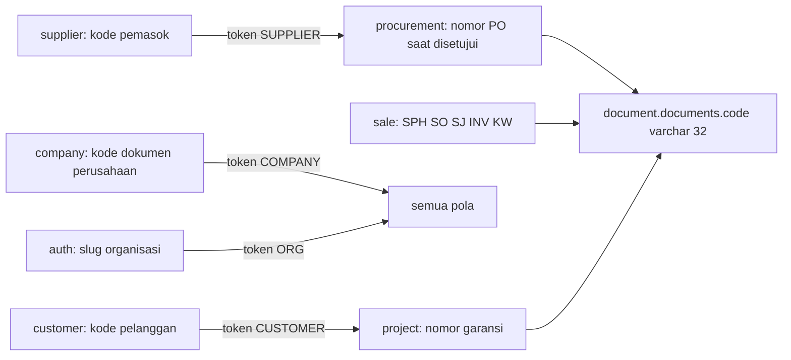

# Penomoran dokumen

Kembali ke [README](README.md). Dicatat 2026-11-26, dicek ke kode di `main`.
Penomoran dipakai hampir semua modul. Aturannya ada di lapisan bersama
`apps/backend/src/shared/numbering/`, yang **tidak dimiliki modul mana pun**
(lihat [di-luar-scope.md](di-luar-scope.md) bagian c).

## Kondisi saat ini

### Satu tabel per schema, tanpa modul pusat (ADR-0024 Q6)

- Modul `code-number` lama sudah dihapus. Setiap schema yang menerbitkan nomor
  punya tabel `<schema>.code_numberings` sendiri, dibuat dengan
  `createCodeNumberingTable` (`src/shared/numbering/table.ts`), dan
  `<Module>NumberingService` sendiri (turunan `service-base.ts`).
- Ada **14 schema** dengan tabel ini: `customer`, `supplier`, `product`,
  `warehouse`, `inventory`, `sale`, `procurement`, `finance`, `tax`,
  `payment`, `project`, `ticket`, `human_resource`, `document`. Enam schema
  lain (`auth`, `company`, `location`, `notification`, `audit`,
  `automation`) tidak menerbitkan nomor.
- Daftar jenis kode per schema: `CODE_TYPES_BY_SCHEMA` di
  `src/shared/numbering/domain.ts`.

### Token pola

`{SEQ}` / `{SEQ:n}`, `{TYPE}`, `{COMPANY}` (kode dokumen dari profil
perusahaan), `{ORG}` (slug organisasi, huruf besar), `{MM}`, `{MM_ROMAN}`,
`{YY}`, `{YYYY}`. Token konteks hanya untuk jenis tertentu: `{SUPPLIER}` dan
`{CATEGORY}` hanya PO, `{CUSTOMER}` hanya sertifikat garansi. Tanggal memakai
zona Asia/Jakarta.

### Pola bawaan (bisa diganti Pemilik)

| Jenis | Pola bawaan | Contoh | Reset |
|---|---|---|---|
| Umum (SPH, SO, SJ, INV, KW, RTJ, PR, BPB, RTB, JE, dll.) | `{SEQ:4}/{TYPE}/{COMPANY}/{MM_ROMAN}/{YY}` | `0001/QT/IMS/XI/26` | tahunan |
| PO | `{TYPE}/{COMPANY}-{SUPPLIER}/{CATEGORY}/{MM}{YY}/{SEQ:3}` | `PO/IMS-HIT/HW/1026/001` | bulanan |
| BAST | `{SEQ:3}/{TYPE}/{COMPANY}/{MM_ROMAN}/{YYYY}` | `001/BAST/IMS/XII/2026` | tahunan |
| Garansi | `{SEQ:3}/{TYPE}/{COMPANY}-{CUSTOMER}/{YYYY}` | `001/SG-GARANSI/IMS-APP/2025` | tahunan |
| Referensi website (RFQ, MSG, DEMO) | `{TYPE}-{YYYY}-{SEQ:5}` | `RFQ-2026-00123` | tahunan |
| Pemasok | `{COMPANY}-{ORG}-{TYPE}-{SEQ:5}` | `IMS-PT-ENTRAGATE-SUP-00001` | tidak pernah |
| Pelanggan, perusahaan pelanggan, karyawan | `{TYPE}-{SEQ:5}` | `CUS-00001` | tidak pernah |
| Barang, gudang | `{TYPE}-{COMPANY}-{SEQ:5}` / `{SEQ:4}` | `PRD-IMS-00001` | tidak pernah |
| Mutasi stok, aset, peminjaman, dll. | pola tetap ERP-0009 | `MV-202611-000042` | sesuai jenis |

### Pengaturan: Administrasi → Nomor Kode

- Halaman `apps/web-admin/src/routes/_authed/settings/code-numbers/index.tsx`
  memanggil 14 seksi (`CODE_NUMBERING_SECTIONS` di
  `apps/web-admin/src/lib/code-numbering-api.ts`), satu per schema.
- Backend: setiap modul me-mount controller bersama
  (`src/shared/numbering/controller.ts`):
  `GET {prefix}/code-numberings`, `POST .../:codeType/preview`,
  `PUT .../:codeType`.
- Akses: `adminOrErpGuard`; admin aplikasi selalu lolos; anggota butuh
  `code_number:read` / `code_number:update`. Seksi gudang `appAdminOnly`.
- Pratinjau memakai konteks contoh `PREVIEW_CONTEXT` (`supplier: 'SUP'`,
  `category: 'HW'`, `customer: 'CUS'`) dan `ORG` bila tidak ada organisasi
  aktif. Respons memuat `maxLength` untuk jenis yang dibatasi.

### Batas panjang

`CODE_MAX_LENGTH` di `domain.ts`: pelanggan, perusahaan pelanggan, pemasok =
32 (kolom `varchar(32)`), dan **PO = 32** (ditambahkan 2026-11-25). Kode yang
lebih panjang ditolak 422 `numbering.codeTooLong`, bukan dipotong.

## Alur lintas modul

Nomor yang diterbitkan modul bisnis disalin ke register dokumen
(`document.documents.code`) lewat `DocumentService.register` (lihat
[dokumen-tanda-tangan-dan-file.md](dokumen-tanda-tangan-dan-file.md)). Jadi
batas panjang efektif sebuah nomor adalah **kolom terpendek di jalurnya**,
bukan kolom tabel pemiliknya.

## Catatan dan temuan

1. **Masalah panjang kode PO (UAT M05 D3, 2026-11-25).** Kode pemasok
   otomatis `DEV-ENTRAGATE-SUP-00001` (pola `{COMPANY}-{ORG}-{TYPE}-{SEQ:5}`)
   masuk ke token `{SUPPLIER}`, sehingga nomor PO menjadi
   `PO/DEV-DEV-ENTRAGATE-SUP-00001/HW/1126/005` (42 karakter).
   `procurement.purchase_orders.code` hanya `varchar(40)` dan register dokumen
   `varchar(32)`. Dulu gagal sebagai error SQL 500; sejak 2026-11-25 ditolak
   422 dengan pesan yang jelas. **Akar masalahnya belum diperbaiki:** dengan
   pola bawaan, setiap PO ke pemasok berkode otomatis tetap gagal disetujui.
2. **Pola bawaan pemasok dan PO saling bertentangan.** Pola pemasok sendiri
   sudah 23+ karakter, padahal pola PO menyisakan ±17 karakter untuk
   `{SUPPLIER}` di batas 32. Contoh PO di komentar kode (`IMS-HIT`) memakai
   kode pemasok pendek gaya lama.
3. **Pratinjau menyesatkan.** Pratinjau PO memakai `SUP`, jadi peringatan
   "terlalu panjang" tidak muncul walau kode pemasok asli panjang.
4. **Kolom tidak seragam:** `purchase_orders.code` 40, register 32,
   `goods_receipts.code` dan `purchase_returns.code` 32.
5. **Garansi juga dekat batas.** `customerNumberCode` membuang tanda hubung
   (`CUS-00001` → `CUS00001`), sehingga `001/SG-GARANSI/IMS-CUS00001/2026`
   tepat 32 karakter. Kode perusahaan lebih dari 3 huruf, atau urutan di atas
   999, akan melewati batas; `warranty` tidak ada di `CODE_MAX_LENGTH`.
   Belum diuji, perlu dicek.
6. **Nomor dialokasikan di luar transaksi.** Bila penyimpanan gagal setelah
   nomor diambil, urutan tetap maju (PO 5 → 6 pada uji 2026-11-25). Invoice
   draf juga langsung bernomor, dan nomornya hilang bila di-void
   (`../uat-modul/catatan-skema-dan-alur.md` A8).
7. **Komentar usang:** `drizzle/schemas/document.schema.ts` (tabel
   `templates`) masih menyebut "the numbering authority is
   `code_number.series`", modul yang sudah dihapus. ADR-0013 (one numbering
   authority) sudah digantikan ADR-0024 Q6.
8. AGENTS.md menulis "every schema owns a `code_numberings` table"; nyatanya
   14 dari 20 schema.

## Perubahan mendatang

| Perubahan | Sumber | Dampak | Status |
|---|---|---|---|
| Opsi 1: ubah pola bawaan pemasok menjadi pendek, misalnya `{TYPE}-{SEQ:5}` (`SUP-00001`) | `../catatan-progres.md` 2026-11-25 "Belum dilakukan" | Hanya untuk pemasok baru; kode lama tetap. PO jadi ±28 karakter. Satu baris di `domain.ts` + test | usulan |
| Opsi 2: Pemilik mengatur pola di Administrasi → Nomor Kode (pemasok pendek atau PO tanpa `{SUPPLIER}`) | idem | Tanpa kode; perlu panduan; data pemasok lama yang panjang perlu kode manual | usulan (bisa langsung, tanpa rilis) |
| Opsi 3: perlebar `document.documents.code` (dan kolom nomor lain) ke 40–64 lewat migrasi append-only + `docs.dbml` | temuan 4 | Menyentuh schema `document` (pemilik belum jelas) dan semua modul yang mendaftarkan dokumen; perlu ADR kecil | usulan |
| Opsi 4: token `{SUPPLIER}` memakai kolom singkatan pemasok (kolom baru) bukan kode penuh | temuan 2 | Kolom baru di `supplier.suppliers` + form; `docs.dbml` | usulan |
| Pratinjau memakai kode pemasok/pelanggan terpanjang yang ada, atau validasi saat pola pemasok disimpan | temuan 3 | `service-base.ts` / controller bersama + web-admin | usulan |
| Tambah `warranty` (dan jenis lain yang masuk register) ke `CODE_MAX_LENGTH` | temuan 5 | `domain.ts` + test | usulan |
| Alokasi nomor di dalam transaksi dokumen (atau terima celah nomor) | temuan 6 | `service-base.ts`, semua service penerbit; keputusan bisnis soal celah nomor | menunggu keputusan |
| Perbaiki komentar usang dan kalimat AGENTS.md | temuan 7, 8 | Dokumen/komentar saja | usulan |
