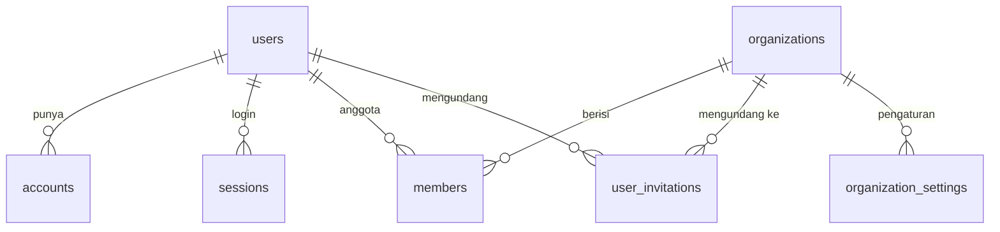

# Schema auth

Identitas: pengguna, sesi login, organisasi internal, keanggotaan + role, undangan, dan pengaturan per organisasi.

- **Modul/pemilik:** Oki (M12 Laporan dan Hak Akses). Schema bersama dua modul backend: `user` dan `organization`. Tabel inti dimiliki Better Auth.
- **Path backend:** `apps/backend/src/app/user/`, `apps/backend/src/app/organization/`, konfigurasi Better Auth di `apps/backend/src/providers/better-auth/` (`auth.options.ts`, `plugins/`).
- **Drizzle:** `apps/backend/drizzle/schemas/auth.schema.ts` (ditulis tangan; `auth:generate` **tidak boleh** dijalankan).

## Tabel

9 tabel inti Better Auth + 2 tabel milik ERP.

| Tabel | Fungsi | Kolom penting | Status (vocabulary) |
|---|---|---|---|
| `users` | Akun login semua orang (staf ERP) | `email` (unik), `username` (unik), `role` (tanda role aplikasi, mis. `admin`), `banned`, `status`, `claimed_at`, `phone`, `gender`, `birth_date`, `deleted_at` (**timestamp**, bukan unix ms) | `status`: `pending` / `active` / `deactivated`; `gender`: `male`/`female`; `marital_status`: `single`/`married`/`divorced`/`widowed` |
| `sessions` | Sesi login (definisi Better Auth) | `token`, `user_id`, `active_organization_id`, `impersonated_by`, `expires_at` | tidak ada; dihapus permanen saat dicabut |
| `accounts` | Kredensial (password hash) dan akun OAuth | `provider_id`, `account_id`, `password`, token OAuth | tidak ada |
| `verifications` | Token sekali pakai (verifikasi email, OTP, magic link) | `identifier`, `value`, `expires_at` | tidak ada; dihapus setelah dipakai |
| `organizations` | Organisasi internal perusahaan (bukan batas tenant, ADR-0001/0007) | `name`, `slug` (unik, sumber token `{ORG}`), `logo`, `deleted_at` (timestamp) | tidak ada |
| `members` | Keanggotaan user di organisasi | `organization_id`, `user_id`, `role` (kunci role ERP dipisah koma, mis. `owner,hr`) | tidak ada; dihapus permanen oleh Better Auth |
| `invitations` | Undangan organisasi bawaan Better Auth | `email`, `role`, `status`, `inviter_id` | `status` default `pending` (diatur Better Auth) |
| `passkeys` | Kredensial passkey/WebAuthn | `credential_id`, `public_key`, `counter` | tidak ada |
| `apikeys` | API key Better Auth | `key`, `reference_id`, batas rate (`rate_limit_time_window` dalam ms) | `enabled` |
| `user_invitations` | Undangan ERP (alur undangan saja, ADR-0029) untuk dua jalur | `type` (`app`/`org`), `email`, `org_role`, `token_hash` (SHA-256), `expires_at`, `resent_count`, `delivery_failed`, `claimed_at` | `status`: `pending` -> `accepted` / `cancelled` / `expired` (konstanta `USER_INVITATION_STATUSES` di TypeScript, tanpa CHECK di database) |
| `organization_settings` | Key-value pengaturan per organisasi | `organization_id`, `setting_group`, `setting_key`, `setting_value`, `value_type`, `is_secret` | `value_type`: `string`/`number`/`boolean`/`json`/`date` |

## Relasi

Foreign key di dalam schema (semua `ON DELETE CASCADE`):

- `sessions.user_id`, `accounts.user_id`, `passkeys.user_id`, `members.user_id`, `invitations.inviter_id`, `user_invitations.invited_by` -> `users.id`
- `members.organization_id`, `invitations.organization_id`, `user_invitations.organization_id` -> `organizations.id`
- `organization_settings.organization_id` dan `updated_by` hanya referensi logis di dalam schema (tanpa FK di dbml).

**Referensi lintas modul:** schema ini tidak menunjuk ke schema lain. Sebaliknya, `auth.organizations.id` dirujuk 62 kolom dan `auth.users.id` 32 kolom di modul lain.

| Target | Contract yang mengecek | Aturan |
|---|---|---|
| `auth.organizations.id` (dari semua modul) | kontrak modul `organization` (`ExportedOrganizationService`, guard organisasi) | organisasi hidup, aktor anggota organisasi itu |
| `auth.users.id` (kolom `*_by`, `user_id`) | `ExportedUserService` (`findById`, `findByEmail`, `assertUser`, `getUsersByIds`) | user hidup |

## Alur data

1. **Undang pengguna** (admin aplikasi atau Pemilik/Admin/SDM): `InvitationService` membuat `users` dengan `status = pending` (user dibuat lebih dulu), lalu `user_invitations` (`status = pending`, `token_hash`), email terkirim. Audit `invitation.sent`, `user.precreated`.
2. **Kirim ulang**: baris yang sama dipakai, token lama mati, `resent_count` naik.
3. **Klaim undangan** (`/invitations/claim/:token`, tanpa login): `accounts` (password) dibuat, `users.status` -> `active`, `claimed_at`, `phone`, data diri terisi; jalur `org` menambah `members` dengan `org_role`. Audit `invitation.claimed`.
4. **Login**: Better Auth memverifikasi `accounts`; sesi disimpan di **Redis** (secondary storage, `storeSessionInDatabase: false`), jadi tabel `sessions` praktis tidak terisi. Hook sesi mengaktifkan organisasi pertama user.
5. **Ubah role anggota**: `members.role` ditulis ulang (beberapa role dipisah koma). Audit `member.added` / `member.removed` / `role.*`.
6. **Nonaktifkan / hapus user**: `users.status = deactivated` atau `users.deleted_at` diisi (soft delete); `members` dihapus permanen oleh Better Auth.

## Penomoran

Tidak ada tabel `code_numberings` di schema ini. Namun `organizations.slug` (huruf besar) menjadi token `{ORG}` pada pola nomor dokumen semua modul (`ExportedOrganizationService.requireOrganizationCode`).

## Catatan dan temuan

- `validate-dbml.ts` (dijalankan 2026-11-26): `OK`, 0 drift kolom dbml vs Drizzle.
- `users.deleted_at` dan `organizations.deleted_at` bertipe `timestamp` (Date), satu-satunya pengecualian aturan unix ms, karena adapter Better Auth membaca Date.
- Tabel Better Auth lain (`sessions`, `accounts`, `members`, ...) **tidak boleh** diberi `deleted_at` dan tidak boleh di-query dengan filter itu.
- `sessions` ada di schema tetapi sesi disimpan di Redis. Seeder yang memanggil `flushall()` ikut menghapus sesi dev.
- `organization_settings` sudah ada di dbml, Drizzle, dan migrasi, tetapi **belum dipakai kode mana pun** (CRUD-nya ERP-0045b, `planned`).
- `apikeys`: semua endpoint API key Better Auth dimatikan (`disabledPaths`). API key mesin lisensi memakai `project.license_api_keys`, bukan tabel ini.
- `invitations` (Better Auth) berbeda dengan `user_invitations` (ERP). Alur ERP memakai `user_invitations`; jangan tertukar.
- Role ERP tidak punya tabel: kosakatanya di `packages/common/src/authorization/erp-permissions.ts` (17 role organisasi). `users.role` adalah tanda role **aplikasi** (admin aplikasi), bukan role organisasi.

## Perubahan mendatang

| Perubahan | Sumber | Dampak ke schema | Status |
|---|---|---|---|
| Rapikan role anggota (Aqim: Pemilik + SDM; hapus rangkapan) | `validasi-konsep-saat-ini.md` 3.8, R7; `bahan-keputusan.md` D1 | none (data `members.role` saja) | menunggu keputusan |
| SDM hanya untuk Aqim | R1 (3.2) | none (data) | menunggu keputusan |
| Beberapa role per orang tetap dipakai | `bahan-keputusan.md` D2 (sudah didukung) | none | usulan |
| Hak baru (Gudang baca PO/SO, Admin tambah pelanggan, Admin baca proyek) di `erp-permissions.ts` | `bahan-keputusan.md` B3, B4, C3, D3 | none (kode) | menunggu keputusan |
| CRUD pengaturan organisasi memakai `organization_settings` | ERP-0045b | none (tabel sudah ada) | direncanakan |
| ADR-0029 (undangan saja) masih `proposed` walau sudah berjalan | ADR-0029 | none | usulan |
| `security-and-access.md` masih menulis 19 role; seharusnya 17 (ADR-0018) | `bahan-keputusan.md` E3, `ringkasan-arsitektur.md` D3 | none (dokumen) | menunggu keputusan |
