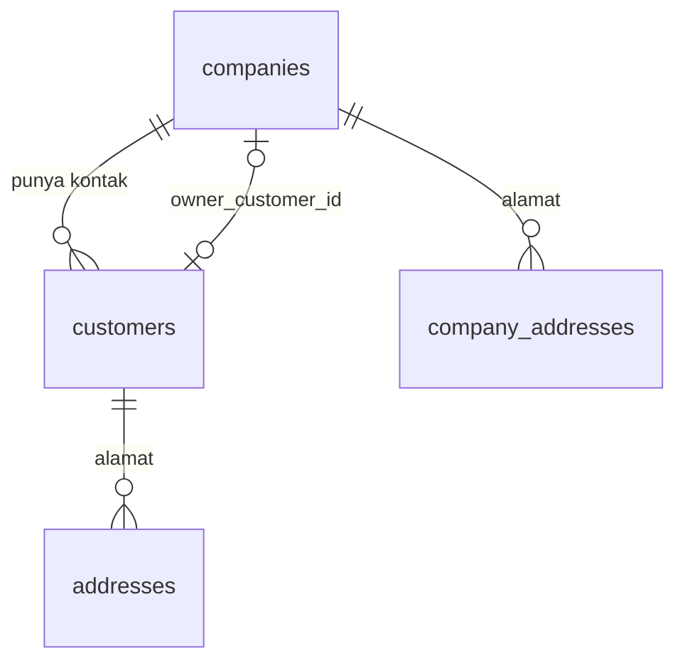

# Schema customer

Data pelanggan: perusahaan pelanggan (B2B), orang (perorangan atau kontak perusahaan), alamat, dan akun portal pelanggan.

- **Modul/pemilik:** M02 (CRM & Penjualan) dan M07 (portal pelanggan), programmer B.
- **Backend:** `apps/backend/src/app/customer/` (dulu `crm`). Drizzle: `apps/backend/drizzle/schemas/customer.schema.ts`.
- **Lingkup:** seluruh perusahaan (ADR-0011), tidak ada `organization_id`.

## Tabel

| Tabel | Fungsi | Kolom penting | Status (vocabulary) |
|---|---|---|---|
| `companies` | Perusahaan pelanggan (badan usaha, instansi, mitra), tanpa login sendiri | `code`, `name`, `company_type`, `tax_id` (NPWP 15/16 digit), `phone` (E.164), `owner_customer_id` | `status`: active, inactive. `company_type`: company, government, partner |
| `customers` | Orang: pelanggan perorangan atau kontak sebuah perusahaan; sekaligus identitas portal | `code`, `company_id`, `customer_type`, `user_id` (akun Better Auth), `portal_role`, `portal_status`, `portal_password_change_required` | `status`: active, inactive. `customer_type`: individual, contact. `portal_role`: owner, approver, finance, viewer. `portal_status`: active, suspended, revoked |
| `addresses` | Alamat orang | `customer_id`, `kind`, `address_line`, `village_id`, `is_primary` | `kind`: residence, office, billing, other |
| `company_addresses` | Alamat perusahaan (penagihan, pengiriman, servis, lokasi) | `company_id`, `kind`, `contact_name`, `village_id`, `is_primary` | `kind`: billing, shipping, service, site, other |
| `settings` | Pengaturan modul (key-value) | `setting_group`, `setting_key`, `value_type` | `value_type`: string, number, boolean, json, date |
| `code_numberings` | Seri nomor kode pelanggan | `code_type`, `pattern`, `reset_policy`, `period_key`, `next_number` | `reset_policy`: never, yearly, monthly |

Email orang tidak disimpan di sini; email ada di `auth.users.email` (ERP-0114). Satu akun = satu `customers`.

## Relasi

Foreign key di dalam schema:

- `customers.company_id` → `companies.id` (restrict). Wajib terisi kecuali `customer_type = individual` (CHECK).
- `companies.owner_customer_id` → `customers.id` (set null). Unik di antara baris hidup; satu pemilik per perusahaan.
- `addresses.customer_id` → `customers.id` (cascade).
- `company_addresses.company_id` → `companies.id` (cascade).

### Referensi lintas modul

| Kolom | Target | Diperiksa oleh |
|---|---|---|
| `customers.user_id`, `customers.portal_invited_by`, `*.created_by`, `settings.updated_by` | `auth.users` | Diisi dari sesi atau dari pembuatan akun Better Auth (modul `user`) |
| `addresses.village_id`, `company_addresses.village_id` | `location.villages` | `ExportedLocationService.assertVillage`; jalur provinsi-kabupaten-kecamatan diturunkan lewat `resolveVillagePath` (tidak disimpan) |

Modul lain yang merujuk ke schema ini (lewat `ExportedCustomerService.assertCustomer`, `getActiveCustomer`, `getActiveCompany`, `getSnapshot`, `resolvePortalIdentity`): `sale.quotations/orders/invoices/returns`, `project.projects/warranties/license_contracts/leads.customer_id`, `ticket.tickets`, `inventory.item_serials`, `inventory.borrowing_requests.borrower_customer_id`, dan beberapa tabel `finance`.

## Alur data

1. **Tambah perusahaan** (menu CRM → Pelanggan): insert `companies` (+ `company_addresses`). Kode kosong → diambil dari `code_numberings` (`customer_company`).
2. **Tambah orang / kontak**: insert `customers` (+ `addresses`). Bila memilih "perusahaan baru" langsung dari form, `companies` dibuat dalam transaksi yang sama. Setiap orang dibuatkan akun Better Auth; `user_id` terisi, `portal_status = active`, `portal_password_change_required = true` bila memakai kata sandi bawaan.
3. **Jadikan pelanggan dari lead** (`project.leads`): menautkan pelanggan aktif yang sudah ada, atau membuat `customers` baru (dan bila perlu `companies`) lewat `createCustomer`; lalu lead ditandai `won` dengan `customer_id` (ditulis modul project).
4. **Portal**: undangan kontak perusahaan mengisi `portal_role` (approver/finance/viewer) dan `portal_invited_by`; perorangan mendaftar sendiri dengan `portal_role = owner`. Cabut akses: `portal_status = revoked` (sesi berakhir, `user_id` tetap). Login portal memperbarui `portal_last_login_at`.
5. **Dipakai dokumen**: SPH/SO/invoice menyalin data pelanggan ke kolom `customer_snapshot` (jsonb) di schema `sale`, sehingga perubahan pelanggan tidak mengubah dokumen lama.

## Penomoran

| `code_type` | Singkatan | Pola bawaan | Reset |
|---|---|---|---|
| `customer` | CUS | `{TYPE}-{SEQ:5}` (contoh CUS-00001) | never |
| `customer_company` | CMP | `{TYPE}-{SEQ:5}` (contoh CMP-00001) | never |

Kode yang diketik pengguna dipakai apa adanya. Kode hasil generate harus muat di `varchar(32)`.

## Catatan dan temuan

- **Parity:** `validate-dbml.ts` (dijalankan 2026-11-26) OK: kolom, tipe, dan nullability sama antara dbml dan Drizzle. Indeks unik parsial (`code`, `user_id`, `owner_customer_id` di antara baris hidup) ada di Drizzle; di dbml hanya disebut di catatan kolom.
- Inactive menghalangi pemakaian di dokumen baru, tetapi baris lama tetap bisa dibaca (soft delete lewat `deleted_at`).
- `logical-references.md` (tabel "Contract obligations") menyebut `ExportedCustomerService.assertActiveCustomer`; nama di kode adalah `assertCustomer` / `getActiveCustomer`. Dokumen yang usang, kodenya benar.
- Temuan UAT M02: alamat tidak bisa diubah, hanya ditambah atau dihapus; daftar alamat tidak menampilkan desa/kecamatan; memilih "Perusahaan terdaftar" tanpa memilih perusahaan tersimpan sebagai perorangan tanpa peringatan; "Jadikan Pelanggan" tidak menampilkan dialog akun.
- S4 (`catatan-skema-dan-alur.md`): rujukan dari `sale`/`project` ke tabel ini hanya kolom id biasa tanpa foreign key (ADR-0014), jadi garis relasinya tidak terlihat di database.

## Perubahan mendatang

| Perubahan | Sumber | Dampak ke schema | Status |
|---|---|---|---|
| Admin Kantor diberi hak tambah/ubah pelanggan | C3 (`bahan-keputusan.md`) | none (hak role) | menunggu keputusan (3.3: tidak relevan selama Admin = Pemilik) |
| Wajib ganti kata sandi bawaan saat login pertama portal, login dengan username, UI pemilik/staf | ERP-0115 | aturan (kolom `portal_password_change_required` sudah ada) | direncanakan |
| Ubah alamat dan tampilkan jalur wilayah | Temuan UAT M02 | none (UI/endpoint) | usulan |
| Peringatan saat "Perusahaan terdaftar" dipilih tanpa perusahaan | Temuan UAT M02 | aturan (validasi form) | usulan |
| Perbarui nama kontrak di `logical-references.md` | Temuan dokumen ini | none (dokumen) | usulan |
