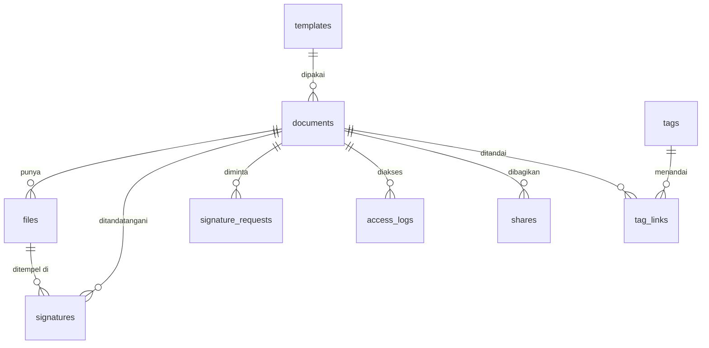

# Schema document

Register dan penerbitan dokumen: salinan terbit dokumen bisnis (SPH, PO, invoice, kuitansi, BAST, slip gaji, perjanjian kerja, ...), file-nya, tanda tangan, permintaan tanda tangan, jejak akses, tautan berbagi, dan tag.

- **Modul/pemilik:** inti bersama. Data bisnisnya tetap di tabel modul pemilik; schema ini hanya memegang salinan terbit, file, dan tanda tangan.
- **Path backend:** `apps/backend/src/app/document/` (`document.service.ts`, `signature.service.ts`, `employee-document-portal.service.ts`, `document-numbering.service.ts`). URL `/documents`, tautan publik `/documents/public/v1/shares`.
- **Drizzle:** `apps/backend/drizzle/schemas/document.schema.ts`.
- `organization_id` **boleh kosong** di semua tabel: `NULL` = berlaku untuk seluruh perusahaan.

## Tabel

| Tabel | Fungsi | Kolom penting | Status (vocabulary) |
|---|---|---|---|
| `templates` | Template dokumen berversi | `code`, `document_type`, `module`, `version`, `content_template`, `numbering_pattern` (hanya tampilan) | `is_active` |
| `documents` | Induk register: satu dokumen terbit | `code` (nomor dari modul pemilik), `document_type`, `title`, `template_id`, `module`, `source_type`, `source_id`, `issued_on`, `issued_by_user_id`, `approved_by_user_id`, `version`, `is_current`, `supersedes_document_id` | `draft`/`submitted`/`approved`/`issued`/`void`/`expired`/`archived`. Punya `deleted_at`, tetapi aturan: tidak pernah dihapus, diganti versi baru |
| `files` | File lampiran (PDF, gambar) | `document_id`, `file_name`, `storage_key` (unik, bukan URL publik), `mime_type`, `size_bytes`, `checksum` | tidak ada |
| `signatures` | Bukti tanda tangan (tidak berubah) | `document_id`, `signer_type`, `signer_user_id`, `signer_name`, `signed_at`, `signature_method`, `signature_image_key` (snapshot), `source_file_id`, `signed_file_key` | `signer_type`: `internal`/`customer`/`partner`; `signature_method`: `electronic`/`wet_ink`/`stamp` |
| `signature_requests` | Alur permintaan tanda tangan (ERP-0048) | `document_id`, `requested_by_user_id`, `signer_user_id`, `signer_name`, `expires_at`, `responded_at`, `decline_reason` | `pending` -> `signed` / `declined` / `cancelled`; `expired` dihitung saat dibaca |
| `user_signatures` | Gambar tanda tangan/stempel milik user (ERP-0049) | `user_id` (satu hidup per user), `object_key` (WebP) | tidak ada |
| `access_logs` | Jejak akses dokumen | `document_id`, `accessed_by_user_id`, `action`, `accessed_at`, `ip_address`, `user_agent` | `action`: `view`/`download`/`print`/`share`/`delete`/`pdf_sign` |
| `shares` | Berbagi ke luar (portal, tautan publik) | `document_id`, `share_type`, `token` (uuid unik), `shared_with_type/id`, `expires_at`, `is_revoked` | `share_type`: `internal`/`customer`/`portal`/`public_link` |
| `tags` | Tag bebas | `tag` | `is_active` |
| `tag_links` | Tautan dokumen-tag | `document_id`, `document_tag_id` | tidak ada |
| `settings` | Key-value pengaturan modul dokumen (tanpa `organization_id`) | `setting_group`, `setting_key`, `value_type` | `value_type`: `string`/`number`/`boolean`/`json`/`date` |
| `code_numberings` | Seri nomor modul dokumen | `code_type`, `pattern`, `reset_policy`, `next_number` | `reset_policy`: `never`/`yearly`/`monthly` |

## Relasi

FK di dalam schema:

- `documents.template_id` -> `templates.id` (set null); `documents.supersedes_document_id` -> `documents.id` (set null)
- `files`, `signatures`, `signature_requests`, `access_logs`, `shares`, `tag_links` (`.document_id`) -> `documents.id` (cascade)
- `signatures.source_file_id` -> `files.id` (set null)
- `tag_links.document_tag_id` -> `tags.id` (cascade)

**Referensi lintas modul** (keluar):

| Kolom | Target | Contract yang mengecek |
|---|---|---|
| `documents.module` + `source_type` + `source_id` | baris modul pemilik (mis. `sale` invoice, `human_resource` employee, `employee_salary_record`) | dicek modul pemanggil sebelum `issue`/`register`; polimorfik tanpa FK |
| `shares.shared_with_type/id` | pelanggan/kontak portal | dicek saat membuat share |
| `*_user_id`, `user_signatures.user_id`, `organization_id` | `auth.users.id`, `auth.organizations.id` | kontrak Identity |

Arah masuk (6 kolom ke `document.documents.id`, dokumen harus terbit, bukan draft/void): `finance.expense_claim_items.receipt_document_id`, `finance.expense_settlement_items.receipt_document_id`, `inventory.items.document_id`, `inventory.maintenances.document_id`, `sale.contracts.document_id`, `tax.corrections.evidence_document_id`.

## Alur data

1. **Terbitkan dari modul pemilik** (SPH dikirim, PO, invoice, kuitansi, BAST, ...): modul pemilik memanggil `DocumentService.issue` / `register` dengan **nomor milik modul itu** -> `documents` (`issued`, `issued_on` = tanggal Jakarta) -> PDF hasil render ke `files` (`attachGeneratedFileTo`). Nama file mengikuti judul dokumen (ERP-0158). Pemanggil saat ini: sale, human_resource, inventory, procurement, project, ticket, payment (kuitansi gateway).
2. **Draft untuk modul tanpa nomor sendiri** (perjanjian kerja karyawan, ERP-0121): `createDraft` memberi nomor dari seri `document` sendiri, `status = draft`, `module = human_resource`, `source_type = employee`. Slip gaji: `issueForSource` (langsung `issued`, `source_type = employee_salary_record`).
3. **Unggah/hapus file** manual: `files` (soft delete) + `access_logs` (`delete`).
4. **Lihat/unduh/cetak**: URL presigned 5 menit; setiap akses menulis `access_logs` (tidak pernah di-cache atau dilewati).
5. **Bagikan**: `shares` dengan `token`; tautan publik diselesaikan tanpa sesi, menolak yang `is_revoked` atau kedaluwarsa. Akses menulis `access_logs` (`share`).
6. **Minta tanda tangan**: `signature_requests` (`pending`, satu per dokumen per penanda tangan) -> penanda tangan `sign` -> `signatures` (gambar dari `user_signatures` di-snapshot, PDF bertanda tangan `signed_file_key`) dan permintaan `signed`; atau `declined` / `cancelled`. Akses `pdf_sign` dicatat.
7. **Void**: `documents.status = void` (langsung atau `voidBySource` saat dokumen sumber dibatalkan); file tidak bisa diubah lagi.
8. **Versi baru**: baris baru `documents` dengan `supersedes_document_id`; versi lama `is_current = false`.

## Penomoran

`document.code_numberings`, satu jenis: `document` -> `{TYPE}` = `DOC`, pola default `{SEQ:4}/{TYPE}/{COMPANY}/{MM_ROMAN}/{YY}`, reset `yearly`. Hanya dipakai `createDraft`/dokumen tanpa nomor sendiri. Dokumen lain memakai nomor dari `code_numberings` modul pemiliknya (mis. `sale` INV, `procurement` PO). `templates.numbering_pattern` hanya tampilan, bukan sumber nomor.

## Catatan dan temuan

- `validate-dbml.ts` (2026-11-26): `OK`, 0 drift kolom.
- **Tidak dipakai kode:** `tags`, `tag_links`, `settings` (ada di Drizzle, tidak ada service/repository yang memakainya).
- Status `submitted`, `approved`, `expired`, `archived` di `documents` tidak ditemukan penulisannya; alur nyata hanya `draft` -> `issued` -> `void`.
- `user_signatures` belum dirender ke tata letak dokumen mana pun (catatan dbml); dipakai sebagai snapshot saat `sign`.
- Keunikan kode di Drizzle memakai dua indeks parsial: `documents_org_code_uq` (`organization_id IS NOT NULL`) dan `documents_global_code_uq` (kode unik untuk dokumen perusahaan, `organization_id IS NULL`). dbml hanya menulis indeks pertama tanpa kondisi; indeks kedua tidak terlihat di dbml (DBML tidak bisa menyatakan indeks parsial).
- `approved_by_user_id` tidak pernah diisi kode.
- ERP-0085 (refactor document) masih `in-progress` di backlog.

## Perubahan mendatang

| Perubahan | Sumber | Dampak ke schema | Status |
|---|---|---|---|
| Persetujuan Pemilik atas dokumennya sendiri dicatat di audit (bukan di `documents`) | A1 (b), 3.8 butir 2 | none (audit di `audit.audit_logs`) | menunggu keputusan |
| Pakai atau buang `tags`/`tag_links`/`settings` dan status register yang tidak terpakai | temuan | tabel/aturan | usulan |
| Render gambar tanda tangan user ke tata letak cetak | catatan dbml `user_signatures` | none | usulan |
| Tutup ERP-0085 (UI dan bukti exit) | backlog | none | direncanakan |
