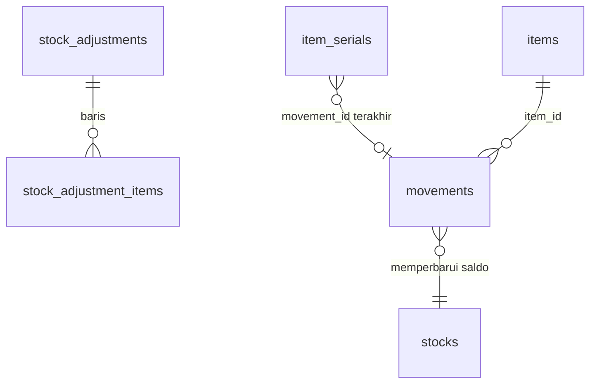

# Schema inventory

Kebenaran stok: buku besar pergerakan barang, saldo per gudang/rak, unit bernomor seri, penyesuaian stok; ditambah aset/alat fisik dan peminjamannya.

- **Modul/pemilik:** bagian stok = M05 (programmer B). Bagian aset (`items`, peminjaman, perawatan, pelepasan, tool set) = wilayah M06, dicatat di sini hanya sebagai konteks.
- **Backend:** `apps/backend/src/app/inventory/`. Drizzle: `apps/backend/drizzle/schemas/inventory.schema.ts`.
- **Lingkup:** `organization_id` boleh NULL = global (ADR-0008). Saldo mengikuti lingkup **gudang**, bukan lingkup pengguna.

## Pembagian pemilik tabel

Diperbarui 2026-11-27 (OD8, jawaban programmer B, menunggu konfirmasi Oki): satu schema, dua pemilik.

| Bagian | Tabel | Pemilik |
|---|---|---|
| Stok | `movements`, `stocks`, `item_serials`, `stock_adjustments`, `stock_adjustment_items`, `settings`, `code_numberings` (seri stok) | M05, programmer B (Dafrin) |
| Aset dan peminjaman | `items`, `item_images`, `item_categories`, `documents`, `borrowing_*`, `maintenances`, `condition_checks`, `disposals`, `tool_sets`, `tool_set_items` | M06, Oki |

`movements` dipakai kedua bagian (baris aset memakai `item_id`): perubahan
aturannya dibicarakan berdua. Schema dipecah hanya bila aset menjadi banyak
atau rumit, kedua programmer saling ganggu di schema ini, atau aset menjadi
aplikasi terpisah.

## Tabel

| Tabel | Fungsi | Kolom penting | Status (vocabulary) |
|---|---|---|---|
| `movements` | Buku besar pergerakan (append-only, tidak pernah di-update; koreksi = baris baru) untuk produk **dan** aset | `code`, `movement_type`, `product_id` / `item_id` (tepat satu), `warehouse_id`, `bin_id`, `target_warehouse_id`, `quantity`, `unit_cost`, `reference_type`, `reference_id`, `occurred_at` | `status`: draft, posted, reversed. `movement_type`: receipt, issue, transfer_in, transfer_out, adjustment_in, adjustment_out, return_in, return_out, consumption, borrow_out, borrow_return, project_site, disposal, lost |
| `stocks` | Proyeksi saldo produk per (gudang, rak, produk); dirawat service dalam transaksi yang sama | `quantity_on_hand`, `quantity_reserved`, `quantity_available` (= on_hand − reserved), `average_cost`, `total_value` | — (tanpa `deleted_at`) |
| `item_serials` | Satu unit fisik produk berseri | `product_id`, `serial_number`, `is_provisional_serial`, `warehouse_id`, `bin_id`, `purchase_order_line_id`, `customer_id`, `movement_id` | `status`: pre_order, in_stock, lost, sold, applied_warranty, returned, damaged |
| `stock_adjustments` | Dokumen penyesuaian stok dengan persetujuan | `code`, `warehouse_id`, `adjustment_type`, `requested_by`, `approved_by`, `posted_at` | `status`: draft, submitted, approved, rejected, posted, cancelled. `adjustment_type`: increase, decrease, recount |
| `stock_adjustment_items` | Baris penyesuaian (qty sebelum/sesudah, bukan selisih) | `product_id`, `bin_id`, `quantity_before`, `quantity_after`, `unit_cost` | — |
| `items` (M06) | Aset/alat, satu baris per unit fisik | `code`, `item_kind`, `acquisition_cost`, `book_value`, `warehouse_id`, `custodian_employee_id` | `status`: ready, borrowed, maintenance, inactive, disposed, lost |
| `item_images`, `item_categories`, `documents` (M06) | Foto aset, kategori aset, lampiran produk/aset | — | `documents.document_type`: photo, manual, datasheet, certificate, invoice, contract |
| `borrowing_requests`, `borrowings`, `borrowing_items`, `borrowing_events`, `borrowing_request_events` (M06) | Permintaan dan pengeluaran pinjaman alat | — | request: draft, requested, approved, rejected, cancelled. borrowing: issued, partially_returned, returned, closed |
| `maintenances`, `condition_checks`, `disposals`, `tool_sets`, `tool_set_items` (M06) | Perawatan, cek kondisi, pelepasan aset, paket alat | — | lihat `docs.dbml` |
| `settings`, `code_numberings` | Pengaturan dan seri nomor modul | — | `reset_policy`: never, yearly, monthly |

## Relasi

Foreign key di dalam schema (bagian stok): `stock_adjustment_items.stock_adjustment_id` → `stock_adjustments.id` (cascade); `movements.item_id` → `items.id` (restrict). Bagian aset punya FK ke `items`, `borrowing_requests`, `borrowings`, `tool_sets` (lihat dbml). `movements` **tidak** punya FK ke dokumen sumber; tautannya `reference_type` + `reference_id` (teks).

### Referensi lintas modul (bagian stok)

| Kolom | Target | Diperiksa oleh |
|---|---|---|
| `movements/stocks/item_serials/stock_adjustment_items.product_id` | `product.products` | `ExportedProductService.assertProduct` / `productsById` |
| `movements.warehouse_id`, `target_warehouse_id`, `stocks.warehouse_id`, `stock_adjustments.warehouse_id`, `item_serials.warehouse_id` | `warehouse.warehouses` | `ExportedWarehouseService.warehouseIsActive`, `isLinked` |
| `*.bin_id`, `target_bin_id` | `warehouse.warehouse_storages` | `ExportedWarehouseService.storageInWarehouse` |
| `item_serials.customer_id`, `company_id` | `customer.customers`, `customer.companies` | Kontrak modul customer |
| `item_serials.purchase_order_line_id` | `procurement.purchase_order_items` | Diisi saat BPB oleh procurement |
| `*.organization_id` | `auth.organizations` | Kontrak modul organization |

Yang merujuk ke sini: `procurement.goods_receipt_items.movement_id`, `procurement.purchase_return_items.movement_id`, `sale.delivery_note_items.movement_id`, `sale.return_items.movement_id`, `ticket.tickets.item_serial_id`, `finance.fixed_asset_books.item_id`.

## Alur data

Semua dokumen sumber memanggil `StockService.postMovement` (dan `SerialUnitService` untuk seri) dalam **satu transaksi** dengan dokumennya, lalu `stocks` diperbarui (rata-rata bergerak) dan jurnal diposting lewat finance.

| Aksi pengguna | Dokumen (schema lain) | `movement_type` | Efek `item_serials` |
|---|---|---|---|
| Terima barang (BPB) | `procurement.goods_receipts` | receipt (biaya = harga PO tanpa PPN) | unit baru `in_stock` (seri wajib sebanyak qty) |
| Kirim surat jalan | `sale.delivery_notes` (status shipped) | issue (biaya = rata-rata) | `sold` |
| Terima retur penjualan | `sale.returns` (status received) | return_in (biaya = biaya kirim) | kembali `in_stock` atau `damaged` |
| Kirim retur pembelian | `procurement.purchase_returns` (status shipped) | return_out | `returned` (terminal) |
| Catat penyesuaian | `stock_adjustments` (status posted) | adjustment_in / adjustment_out | — |
| Terima/keluarkan manual (menu Stok) | — | receipt / issue | — |

**Penyesuaian stok:** draft → submitted → approved / rejected → posted / cancelled. Hanya `posted` yang menulis `movements`; baris tanpa selisih tidak menulis apa pun; posting idempoten.

## Penomoran

| `code_type` | Singkatan | Pola bawaan | Reset |
|---|---|---|---|
| `stock_movement` | MV | `{TYPE}-{YYYY}{MM}-{SEQ:6}` | never |
| `stock_adjustment` | ADJ | `{SEQ:4}/{TYPE}/{COMPANY}/{MM_ROMAN}/{YY}` | yearly |
| `asset` | AST | `{TYPE}-{SEQ:6}` | never |
| `borrowing` | BRW | `{TYPE}-{YYYY}{MM}-{SEQ:4}` | monthly |
| `maintenance`, `disposal` | MNT, DSP | `{TYPE}-{YYYY}-{SEQ:5}` | yearly |
| `tool_set` | TST | `{TYPE}-{SEQ:5}` | never |

## Catatan dan temuan

- **S2:** stok tidak disimpan di dokumen; dokumen hanya membuat baris `movements`, saldo dan HPP ada di `stocks`.
- **Drift dbml ← Drizzle (CHECK):** Drizzle punya CHECK yang tidak ada di dbml: `stock_adjustments` "status approved/posted wajib `approved_by` + `approved_at`" dan "status posted wajib `posted_at`", serta indeks parsial unit pinjaman yang belum kembali. Validator tidak memeriksa CHECK, jadi selisih ini lolos. dbml perlu disusulkan.
- **`quantity_reserved` tidak pernah diisi** (selalu 0 di `stock.repository.ts`); catatan dbml `sale.orders` ("stock commitment ... logical reservation") belum terwujud. `quantity_available` praktis sama dengan `quantity_on_hand`.
- `movement_type` `transfer_in/transfer_out` hanya dipakai untuk **aset** (`item-custody.service.ts`); pindah stok produk antar gudang belum ada (ERP-0032). `consumption` belum dipakai sama sekali.
- **A3:** penyesuaian stok boleh disetujui pembuatnya sendiri (pengecualian disengaja di `adjustment.controller.ts`), bertentangan dengan ADR-0006 butir 6.
- **Temuan M02 E6:** retur "Rusak" untuk barang tanpa nomor seri tetap menambah stok jual (`sales-return.service.ts`), karena kondisi rusak hanya tercatat di unit berseri.
- `logical-references.md` masih menyebut target `inventory.products` / `inventory.warehouses`; sejak ADR-0026 targetnya `product.products` dan `warehouse.*`.

## Perubahan mendatang

| Perubahan | Sumber | Dampak ke schema | Status |
|---|---|---|---|
| Hanya Pemilik yang boleh menyetujui penyesuaiannya sendiri (dengan audit); pengecualian lama dihapus | A1 (b), 3.8 butir 4 | aturan | menunggu keputusan (Pemilik + Oki, ADR-0006) |
| Barang tanpa seri yang diretur "Rusak" tidak menambah stok jual (misalnya ke rak/gudang rusak) | Temuan UAT M02 E6 | aturan (mungkin rak khusus) | usulan |
| Pindah stok produk antar gudang/rak (pasangan transfer_out + transfer_in) | ERP-0032, ADR-0010 | none (tipe sudah ada) | usulan (ADR-0010 `proposed`) |
| Tampilan saldo per gudang/rak dan riwayat pergerakan | ERP-0033 | none | usulan |
| Rekonsiliasi nilai persediaan ke akun GL | ERP-0014 | none | direncanakan |
| Reservasi stok saat SO dikonfirmasi (isi `quantity_reserved`) atau hapus janji di dbml | Temuan dokumen ini | aturan | usulan |
| Salin CHECK `stock_adjustments` dari Drizzle ke dbml | Temuan dokumen ini | none (dokumen) | usulan |
| Nilai uang aset (`items.acquisition_cost`, `book_value`, nilai disposal/penyusutan): sen di penyimpanan, rupiah di layar; perbaiki form, tampilan, dan seeder | OD3 (jawaban programmer B 27/11), ADR-0002 | none (aturan + data seed dev) | diputuskan, menunggu konfirmasi |
| Penghapusan/nonaktif `items` berstatus `borrowed` ditolak | OD6 (jawaban programmer B 27/11) | aturan (`disposal.service.ts`, `item.service.ts`) | diputuskan, menunggu konfirmasi |
| Pengembalian pinjaman dengan kondisi Baik/Rusak/Tidak lengkap + catatan; peminjaman yang semua unitnya hilang bisa ditutup | OD7 (jawaban programmer B 27/11) | aturan (kosakata kondisi di `borrowing_items` dicek ke dbml sebelum dikerjakan) | diputuskan, menunggu konfirmasi |
| Unit pinjaman wajib disetujui sebelum diserahkan | C13 (jawaban programmer B 27/11) | aturan (`borrowing.service.ts`) | diputuskan, menunggu konfirmasi |
| Catatan servis dan cek kondisi dipakai layar; `tool_sets` disembunyikan di menu (tabel tetap) | OD5 (jawaban programmer B 27/11) | none | diputuskan, menunggu konfirmasi |
| Schema tetap: aset fisik di `inventory`, nilai di `finance`; tanpa modul `assets`. Pemilik tabel dibagi (lihat "Pembagian pemilik tabel"); dipecah ke schema sendiri hanya bila muncul tanda: aset banyak/rumit, kedua programmer saling ganggu di schema ini, atau aset jadi aplikasi terpisah | OD8 (jawaban programmer B 27/11) | none (dokumen: `module-ownership.md`, rencana M06) | diputuskan, menunggu konfirmasi |
