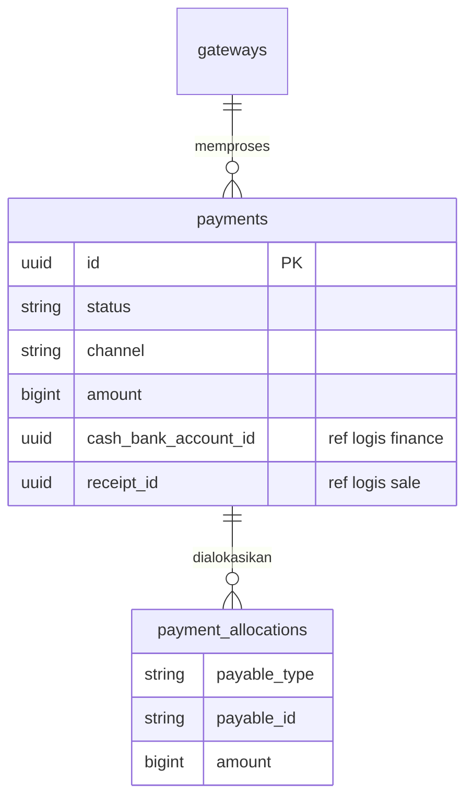

# Schema payment

Semua perpindahan uang ERP dalam satu buku pembayaran: penerimaan dan pengeluaran, manual maupun lewat gateway (Xendit/SingaPay), beserta alokasinya ke dokumen yang dibayar.

- **Modul/pemilik:** inti bersama. Pembayaran manual dan settlement dipakai M09 (Oki); checkout gateway untuk invoice dibangun dari sisi penjualan/portal (ERP-0020, ADR-0021, ADR-0023).
- **Path backend:** `apps/backend/src/app/payment/` (`payment.service.ts`, `gateway-checkout.service.ts`, `gateway-config.service.ts`, `exported-payment.service.ts`, `exported-payment-webhook.service.ts`). Webhook masuk di modul `webhook` (tanpa schema): `/webhooks/{xendit,singapay}`. Admin gateway di `/admin/payments/gateways`.
- **Drizzle:** `apps/backend/drizzle/schemas/payment.schema.ts`.

## Tabel

| Tabel | Fungsi | Kolom penting | Status (vocabulary) |
|---|---|---|---|
| `payments` | Buku pembayaran tunggal (gabungan `gateway_payments` lama, Q18) | `code`, `payment_type`, `direction`, `channel`, `gateway_id`, `provider`, `provider_reference`, `payment_url`, `paid_amount`, `receipt_id`, `counterparty_type/id`, `amount`, `payment_method`, `cash_bank_account_id`, `requested_by`, `approved_by`, `executed_by`, `withholding_tax_id`, `withholding_amount`, `tax_object_code`, `last_event` (jsonb), `void_reason` | `status`: `draft`/`submitted`/`approved`/`executed` (manual), `pending`/`paid`/`expired`/`failed` (gateway), `reversed`/`void`/`cancelled`; `payment_type`: `receipt`/`disbursement`/`refund`/`advance_disbursement`/`payroll`/`profit_distribution`/`investment`; `direction`: `in`/`out`; `channel`: `manual`/`gateway`; `payment_method`: `bank_transfer`/`cash`/`card`/`e_wallet`/`cheque`/`offset` |
| `payment_allocations` | Alokasi satu pembayaran ke satu dokumen (cicilan, banyak-ke-banyak) | `payment_id`, `payable_type`, `payable_id` (text), `amount`, `allocated_at` | `payable_type`: `sale_invoice`/`supplier_bill`/`employee_advance`/`expense_claim`/`expense_settlement`/`employee_salary_record` |
| `gateways` | Konfigurasi penyedia gateway per organisasi | `provider`, `code`, `mode`, `config` (jsonb, non-rahasia), `secret_ciphertext/iv/tag` (AES-256-GCM, kunci di env `PAYMENT_SECRET_KEY`), `secret_last4`, `key_version`, `webhook_token_*`, `is_default`, `rotated_at` | `provider`: `xendit`/`singapay`/`fake`; `mode`: `sandbox`/`live`; `is_active` |
| `settings` | Key-value pengaturan modul pembayaran | `setting_group`, `setting_key`, `setting_value` | tidak ada |
| `code_numberings` | Seri nomor pembayaran | `code_type`, `pattern`, `reset_policy`, `next_number` | `reset_policy`: `never`/`yearly`/`monthly` |

`payment_allocations` sengaja tanpa kolom FK per jenis dokumen (dulu `sales_invoice_id`, `supplier_bill_id`, `employee_advance_id`); jenisnya ada di `payable_type`.

## Relasi

FK di dalam schema:

- `payment_allocations.payment_id` -> `payments.id` (cascade)
- `payments.gateway_id` -> `gateways.id` (set null)

**Referensi lintas modul:**

| Kolom | Target | Contract yang mengecek |
|---|---|---|
| `payments.cash_bank_account_id` | `finance.cash_bank_accounts.id` | `ExportedCashBankAccountService` (rekening aktif) |
| `payments.receipt_id` | `sale.receipts.id` | kontrak modul Sale (satu kuitansi per checkout, indeks unik parsial) |
| `payments.withholding_tax_id` | `tax.taxes.id` | kontrak modul Tax |
| `payment_allocations.payable_type/payable_id` | `sale.invoices`, `finance.supplier_bills`, `finance.employee_advances`, `finance.expense_claims`, `finance.expense_settlements`, `human_resource.employee_salary_records` | polimorfik; dicek lewat port settlement `finance` (`ILedgerSettlementPort`) dan modul pemilik |
| `payments.counterparty_type/id` | pelanggan, pemasok, karyawan | dicek modul pemanggil |
| `organization_id`, `*_by` | `auth.*` | kontrak Identity |

Arah masuk: `sale.receipts.payment_id`, `finance.expense_claims/employee_advances/expense_settlements.payment_id` -> `payments.id` lewat `ExportedPaymentService.requireExecuted` (pembayaran harus `executed`).

## Alur data

**Pembayaran manual** (Keuangan):

1. Buat `payments` (`draft`) + `payment_allocations` (boleh diubah selama `draft`; jenis alokasi tidak boleh dicampur).
2. `submitted` (`submitted_at`) -> `approved` (`approved_by`, `approved_at`).
3. **Eksekusi** (hanya dari `approved`), satu transaksi: alokasi ke invoice/tagihan dicek statusnya -> cermin `finance.ar_open_items`/`ap_open_items` dan total dokumen diperbarui -> `finance.cash_bank_transactions` + saldo rekening -> jurnal otomatis (Dr kas / Cr piutang, atau Dr utang / Cr bank; PPh dipotong -> `tax.withholding_tax_records`) -> `status = executed`.
4. Void sebelum eksekusi: `status = void` tanpa jurnal. Void sesudah eksekusi (tutup bulan, `month-end-close.service.ts`): jurnal balik dengan kunci `payment-void:<id>`, mutasi kas pembalik, cermin AR/AP dikembalikan, `status = void` + `void_reason`.

**Checkout gateway** (invoice, dari web-admin atau portal pelanggan):

1. `GatewayCheckoutService.open`: memakai gateway default organisasi, membuat `payments` (`channel = gateway`, `pending`, `provider_reference`, `payment_url`, `expires_at`) dialokasikan ke invoice; checkout `pending` dengan nominal sama dipakai ulang.
2. Webhook (`/webhooks/<provider>`) diverifikasi terhadap `gateways` -> baris dikunci -> `paid`: satu kuitansi `sale.receipts` (maks. sisa tagihan), didaftarkan ke `document`, `receipt_id` diisi; jurnal Dr kliring gateway / Cr piutang. Ulangan webhook menemukan `receipt_id` dan tidak berbuat apa-apa. Uang yang tidak bisa diterapkan tetap `paid` tanpa kuitansi + `settlement_note`.
3. `expired` / `failed` dari webhook atau saat dibaca.
4. Pencairan dari penyedia dicatat di finance (`payment.gateway_settled`): mutasi bank neto + biaya gateway.

## Penomoran

`payment.code_numberings`, satu jenis: `payment` -> `{TYPE}` = `PAY`, pola default `{SEQ:4}/{TYPE}/{COMPANY}/{MM_ROMAN}/{YY}`, reset `yearly`. `gateways.code` diketik manual.

## Catatan dan temuan

- `validate-dbml.ts` (2026-11-26): `OK`, 0 drift kolom.
- `payments` mencampur dua mesin status (manual dan gateway) di satu kolom; `reversed` dan `cancelled` tidak ditemukan penulisannya di kode (void pasca-eksekusi memakai `void`).
- `payment.settings` ada di Drizzle tetapi tidak dipakai kode (gateway default disimpan di `gateways.is_default`).
- `payment_type` `profit_distribution` dan `investment` disiapkan untuk M11 (bagi hasil/investor), belum ada alurnya.
- Tidak ada larangan menyetujui pembayaran sendiri (`approve` hanya mencatat `approved_by`). Untuk tim saat ini Aqim menyiapkan, menyetujui, dan mengeksekusi (R6, 3.7 "tanpa pemeriksa").
- Rahasia gateway hanya bisa ditulis; API tidak pernah mengembalikan ciphertext maupun plaintext.
- ERP-0081 (refactor payment) dan ERP-0020 (checkout) masih `in-progress` di backlog.

## Perubahan mendatang

| Perubahan | Sumber | Dampak ke schema | Status |
|---|---|---|---|
| Pemeriksaan pembayaran oleh orang kedua (Bella lewat jurnal dan rekonsiliasi), tanpa aturan baru di service | R6, 3.7, 3.8 (alur Pembelian/Gaji tetap 🟡) | none | usulan |
| Bila A1 diperluas ke pembayaran: catat "disetujui pembuat (Pemilik)" di audit | A1 (b), 3.8 butir 2 | aturan (audit; `requested_by`/`approved_by` sudah ada) | menunggu keputusan |
| Refund lewat gateway / nota kredit | `docs/architecture/modules/finance.md` (not built) | aturan (`payment_type = refund` sudah ada) | usulan |
| Impor laporan settlement penyedia untuk rekonsiliasi kliring | ERP-0139 (not built) | mungkin tabel | usulan |
| Distribusi laba dan setoran modal investor | M11, ERP-0023 | aturan (`payment_type` sudah ada); tabel investor di modul lain | menunggu keputusan |
| Tutup ERP-0081 dan ERP-0020 | backlog | none | direncanakan |
