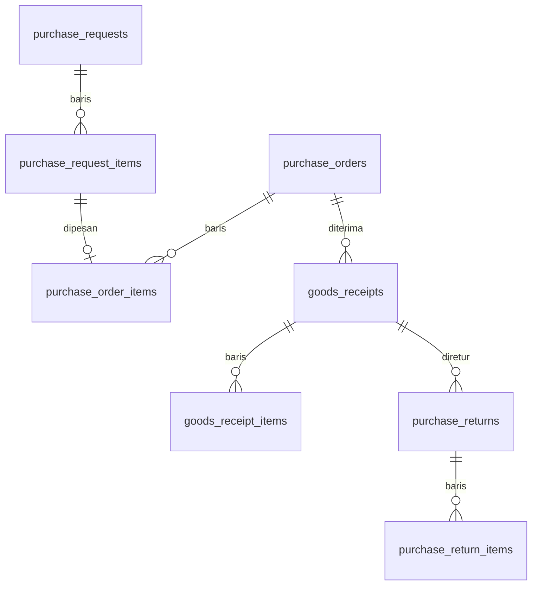

# Schema procurement

Alur pembelian: permintaan pembelian (PR) → purchase order (PO) → penerimaan barang (BPB) → retur pembelian.

- **Modul/pemilik:** M05 (Inventaris & Pembelian), programmer B. Tagihan pemasok dan pembayarannya ada di modul finance.
- **Backend:** `apps/backend/src/app/procurement/`. Drizzle: `apps/backend/drizzle/schemas/procurement.schema.ts`.
- **Lingkup:** seluruh perusahaan (ADR-0011). Data pemasok ada di schema `supplier`.

## Tabel

| Tabel | Fungsi | Kolom penting | Status (vocabulary) |
|---|---|---|---|
| `purchase_requests` | PR: gerbang persetujuan sebelum PO | `code` (diberi saat diajukan), `requested_by`, `subject`, `project_name`, `request_date`, `needed_by`, `estimated_total` | `status`: draft, submitted, approved, ordered, cancelled |
| `purchase_request_items` | Baris PR (boleh teks bebas tanpa `product_id`) | `product_id`, `name`, `unit`, `quantity`, `estimated_unit_price` | — |
| `purchase_orders` | PO ke pemasok | `code` (diberi saat disetujui), `supplier_company_id`, `supplier_pic_id`, `project_id`, `supplier_snapshot`, `category`, `vat_mode`, `vat_rate_bps`, `subtotal`, `tax_total`, `grand_total`, `payment_terms` | `status`: draft, submitted, approved, sent, partially_received, received, cancelled. `category`: hardware, software, service, other. `vat_mode`: none, included, added |
| `purchase_order_items` | Baris PO | `product_id`, `sku`, `quantity`, `unit_price`, `quantity_received`, `purchase_request_item_id` | — |
| `goods_receipts` | BPB; langsung diposting saat dibuat, tidak bisa diubah | `code`, `purchase_order_id`, `warehouse_id`, `bin_id`, `receipt_date`, `supplier_delivery_ref` | `status`: posted (satu-satunya) |
| `goods_receipt_items` | Baris BPB | `purchase_order_item_id`, `quantity`, `unit_cost` (tanpa PPN), `serial_numbers`, `movement_id` | — |
| `purchase_returns` | Retur ke pemasok untuk penggantian | `code` (diberi saat disetujui), `goods_receipt_id`, `purchase_order_id`, `supplier_company_id`, `warehouse_id`, `reason`, `journal_entry_id` | `status`: draft, submitted, approved, shipped, cancelled |
| `purchase_return_items` | Baris retur pembelian | `goods_receipt_item_id`, `quantity`, `unit_cost`, `serial_numbers`, `movement_id` | — |
| `code_numberings` | Seri nomor modul | `code_type`, `pattern` | `reset_policy`: never, yearly, monthly |

Schema ini tidak punya tabel `settings`.

## Relasi

FK di dalam schema: `purchase_request_items` → `purchase_requests` (cascade); `purchase_order_items` → `purchase_orders` (cascade) dan → `purchase_request_items` (restrict; satu baris PO hidup per baris PR); `goods_receipts` → `purchase_orders` (restrict); `goods_receipt_items` → `goods_receipts` (cascade) dan → `purchase_order_items`; `purchase_returns` → `goods_receipts` dan `purchase_orders`; `purchase_return_items` → `purchase_returns`, `goods_receipt_items`, `purchase_order_items`.

### Referensi lintas modul

| Kolom | Target | Diperiksa oleh |
|---|---|---|
| `purchase_orders.supplier_company_id`, `purchase_returns.supplier_company_id` | `supplier.companies` | `ExportedSupplierService.assertActiveCompany` |
| `purchase_orders.supplier_pic_id` | `supplier.suppliers` | `ExportedSupplierService.findPerson` (PIC milik pemasok yang sama) |
| `purchase_orders.project_id` | `project.projects` | `ProjectLookupService.getProject` |
| `*_items.product_id` | `product.products` | `ExportedProductService.assertProduct` |
| `goods_receipts/purchase_returns.warehouse_id`, `bin_id` | `warehouse.*` | `ExportedWarehouseService.warehouseIsActive`, `storageInWarehouse` |
| `goods_receipt_items/purchase_return_items.movement_id` | `inventory.movements` | Diisi dari hasil `StockService.postMovement` |
| `purchase_returns.journal_entry_id` | `finance.journal_entries` | Diisi dari hasil `PostingService.postBusinessEvent` |
| `purchase_requests.organization_id` | `auth.organizations` | Hanya informasi (PR seluruh perusahaan) |

Yang merujuk ke sini: `finance.supplier_bills.purchase_order_id`, `finance.supplier_bill_items.purchase_order_item_id`, `inventory.items.purchase_order_id`, `inventory.item_serials.purchase_order_line_id` (lewat `ExportedPurchaseOrderService`).

## Alur data

1. **PR**: buat → insert `purchase_requests` (draft, tanpa kode) + items. Ajukan → submitted, kode PR diberi. Setujui (bukan peminta) → approved; Tolak → kembali draft dengan alasan. Saat baris PR dipakai PO hidup → `ordered`.
2. **PO**: buat (boleh dari baris PR yang approved, satu PR bisa dipecah ke beberapa PO) → insert `purchase_orders` (draft) + items, `supplier_snapshot` disalin. Ajukan → submitted. Setujui (bukan pembuatnya) → approved, kode PO diberi dan PO didaftarkan ke `document.documents`. **Tandai terkirim** → sent (wajib sebelum BPB, A1/B1). Batal hanya bila belum ada barang diterima.
3. **BPB**: pilih PO sent/partially_received → insert `goods_receipts` (posted) + items; per baris: `inventory.movements` receipt (biaya tanpa PPN), unit seri baru di `inventory.item_serials`, jurnal GR/IR (ERP-0136); `purchase_order_items.quantity_received` naik; PO → partially_received atau received. Koreksi lewat penyesuaian stok.
4. **Retur pembelian**: dari BPB → draft → submitted → approved (kode RTB, bukan pembuatnya) → shipped: `inventory.movements` return_out, unit seri → returned, jurnal; outbox `purchase_return.updated`. Batal sebelum shipped.
5. **Tagihan pemasok**: dicatat di finance dari PO (`finance.supplier_bills`), bukan di schema ini.

## Penomoran

| `code_type` | Singkatan | Pola bawaan | Reset | Kapan diberi |
|---|---|---|---|---|
| `purchase_request` | PR | `{SEQ:4}/{TYPE}/{COMPANY}/{MM_ROMAN}/{YY}` | yearly | saat diajukan |
| `purchase_order` | PO | `{TYPE}/{COMPANY}-{SUPPLIER}/{CATEGORY}/{MM}{YY}/{SEQ:3}` (contoh PO/IMS-HIT/HW/1026/001) | monthly | saat disetujui |
| `goods_receipt` | BPB | pola bawaan | yearly | saat dibuat |
| `purchase_return` | RTB | pola bawaan | yearly | saat disetujui |

`{SUPPLIER}` = kode pemasok, `{CATEGORY}` = HW/SW/JS/LN. Nomor PO dibatasi 32 karakter (disalin ke registri dokumen).

## Catatan dan temuan

- **Parity:** kolom dan tipe sama (validator OK). CHECK di Drizzle digabung (misalnya `quantity > 0 AND unit_price >= 0 ...`) sedangkan dbml memecahnya; isinya sama.
- **R2 (paling penting):** Pembelian dan satu-satunya Manajer Operasional sama-sama Aqim; karena pembuat tidak boleh menyetujui, PO, retur pembelian, dan PR buatan Aqim **macet**.
- **A1/B1:** PO approved belum muncul di Penerimaan Barang sebelum ditandai terkirim; sumber kebingungan di UAT.
- **A10/B4:** Gudang tidak bisa membuka PO dari BPB (tidak punya hak baca PO).
- **B2:** hanya Pemilik yang bisa membatalkan PO.
- `purchase_returns.total_amount` hanya informasi; catatan dbml masih menyebut "no journal", padahal sejak ERP-0136 ada `journal_entry_id` dan retur diposting.

## Perubahan mendatang

| Perubahan | Sumber | Dampak ke schema | Status |
|---|---|---|---|
| Pemilik boleh menyetujui PR/PO/retur miliknya sendiri, tercatat di audit | A1 (b), R2, 3.8 | aturan | menunggu keputusan (Pemilik + Oki, ubah ADR-0006) |
| PO approved langsung bisa diterima tanpa "Tandai terkirim" | B1, 3.3 no. 3, 3.8 butir 5 | aturan (status `sent` jadi opsional) | menunggu keputusan |
| Pembelian boleh membatalkan draf miliknya; Manajer Operasional semua PO sebelum diterima | B2 | aturan | menunggu keputusan |
| Gudang diberi hak baca PO | B4 | none (hak) | menunggu keputusan (rekomendasi b) |
| Perbaiki catatan dbml `purchase_returns.total_amount` ("no journal") | Temuan dokumen ini | none (dokumen) | usulan |
