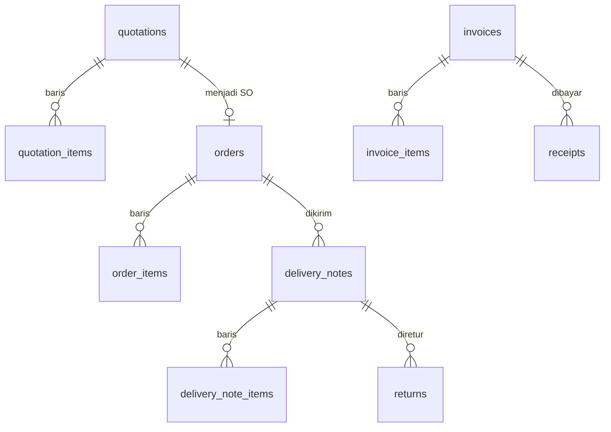

# Schema sale

Alur penjualan: SPH (quotation) → sales order → surat jalan → invoice → kwitansi, ditambah retur penjualan.

- **Modul/pemilik:** M02 (CRM & Penjualan), programmer B. Invoice dan kwitansi juga dipakai Keuangan.
- **Backend:** `apps/backend/src/app/sale/` (dulu `sales`). Drizzle: `apps/backend/drizzle/schemas/sale.schema.ts`.
- **Lingkup:** SPH, SO, surat jalan, retur seluruh perusahaan (tanpa `organization_id`). Invoice dan kwitansi punya `organization_id` = organisasi penerbit (ADR-0012).

## Tabel

| Tabel | Fungsi | Kolom penting | Status (vocabulary) |
|---|---|---|---|
| `quotations` | SPH; satu baris per revisi | `code` (base + `-R<n>`), `base_code`, `revision`, `previous_revision_id`, `customer_id`, `company_id`, `customer_snapshot`, `lead_id`, `valid_until`, `payment_schedule`, `vat_enabled`, `vat_rate_bps`, total (bigint) | `status`: draft, submitted, approved, rejected, sent, superseded, won, lost. `lost_reason`: price, competitor, project_cancelled, no_response, other |
| `quotation_items` | Baris SPH (snapshot nama/harga/foto) | `product_id`, `sku`, `name`, `unit`, `quantity`, `unit_price`, `discount_amount`, `line_total` | — |
| `quotation_status_history` | Riwayat status SPH (append-only) | `from_status`, `to_status`, `changed_by` | — |
| `orders` | Sales order dari SPH yang approved/sent | `code`, `quotation_id` (satu SO hidup per SPH), `customer_id`, `company_id`, `lead_id`, `customer_po_number`, total | `status`: confirmed, in_progress, delivered, completed, cancelled |
| `order_items` | Baris SO, disalin dari baris SPH | `quotation_item_id`, `quantity`, `quantity_delivered` | `fulfillment_status`: pending, reserved, partial, fulfilled, cancelled |
| `order_status_history` | Riwayat status SO | `from_status`, `to_status` | — |
| `delivery_notes` | Surat jalan | `code`, `order_id`, `warehouse_id`, `bin_id`, `recipient_name`, `driver_name`, `vehicle_number`, `shipped_at`, `received_at` | `status`: prepared, shipped, delivered, cancelled |
| `delivery_note_items` | Baris surat jalan | `order_item_id`, `quantity`, `unit_cost`, `serial_numbers` (jsonb), `movement_id` | — |
| `returns` | Retur penjualan (penggantian barang, tanpa nota kredit) | `code` (diberi saat disetujui), `delivery_note_id`, `order_id`, `warehouse_id`, `reason` | `status`: draft, submitted, approved, received, cancelled |
| `return_items` | Baris retur | `delivery_note_item_id`, `quantity`, `unit_cost`, `serial_numbers`, `condition`, `bin_id`, `movement_id` | `condition`: good, damaged |
| `invoices` | Invoice satu termin | `code`, `invoice_type`, `term_kind`, `order_id`, `project_id`, `percentage_bps`, `due_date`, `grand_total`, `paid_total`, `outstanding_total` | `status`: draft, issued, partially_paid, paid, written_off, void, cancelled. `invoice_type`: sales, proforma, recurring. `term_kind`: down_payment, installment, settlement |
| `invoice_items` | Baris invoice | `product_id`, `quantity`, `unit_price`, `tax_amount`, `service_period_start/end` (pendapatan ditangguhkan, ERP-0135) | — |
| `receipts` | Kwitansi (bukti bayar untuk pelanggan) | `code`, `invoice_id`, `payment_id`, `amount` (> 0), `method` | `status`: draft, verified, posted, reversed, void. `method`: bank_transfer, cash, card, e_wallet, cheque |
| `discount_requests`, `contracts`, `targets` | **Target**: hanya di dbml, belum ada di Drizzle/DB | — | lihat dbml |
| `settings`, `code_numberings` | Pengaturan dan seri nomor | — | — |

## Relasi

FK di dalam schema: `quotation_items/quotation_status_history` → `quotations` (cascade); `quotations.previous_revision_id` → `quotations`; `orders.quotation_id` → `quotations` (restrict); `order_items` → `orders` (cascade) dan → `quotation_items` (restrict); `delivery_notes.order_id` → `orders`; `delivery_note_items` → `delivery_notes` (cascade) dan → `order_items`; `returns` → `delivery_notes` dan `orders`; `return_items` → `returns`, `delivery_note_items`, `order_items`; `invoice_items` → `invoices` (cascade); `receipts.invoice_id` → `invoices` (restrict). Catatan: `invoices.order_id` sengaja **tanpa** FK (id biasa, invoice proforma/berulang boleh tanpa SO).

### Referensi lintas modul

| Kolom | Target | Diperiksa oleh |
|---|---|---|
| `quotations/orders/invoices/returns.customer_id` | `customer.customers` | `ExportedCustomerService.getActiveCustomer`, snapshot lewat `getSnapshot` |
| `quotations/orders/invoices.company_id` | `customer.companies` | `ExportedCustomerService.getActiveCompany` |
| `quotations.lead_id`, `orders.lead_id` | `project.leads` | `LeadService.noteQuotation` (lead harus hidup; status lead → quotation) |
| `*_items.product_id` | `product.products` | `ExportedProductService.assertProduct` |
| `delivery_notes/returns.warehouse_id`, `*.bin_id` | `warehouse.*` | `ExportedWarehouseService.warehouseIsActive`, `storageInWarehouse` |
| `delivery_note_items/return_items.movement_id` | `inventory.movements` | Diisi dari hasil `StockService.postMovement` |
| `invoices.project_id` | `project.projects` | `ProjectLookupService.getProject` |
| `invoices.payment_term_id` | `finance.payment_terms` | Kontrak modul finance |
| `receipts.payment_id` | `payment.payments` | Kontrak modul payment |

Yang merujuk ke sini: `project.projects.order_id` dan `project.license_contracts.order_id` (lewat `SalesFulfilmentService.getLiveOrder` / `ExportedOrderService.findOrder`), `finance.ar_open_items/credit_memos/deferred_revenue_schedules.invoice_id`.

## Alur data

1. **SPH**: buat → insert `quotations` (status draft, kode langsung dari penomoran) + `quotation_items`; bila ada `lead_id`, lead menjadi `quotation`. Ajukan → submitted; Setujui (bukan pembuatnya) → approved, atau Tolak → rejected (kembali bisa diubah). Kirim → sent (PDF SPH dibuat, outbox `quotation.sent`). Revisi → baris lama `superseded`, baris baru `revision + 1`. Batal → lost. Setiap transisi menulis `quotation_status_history`.
2. **SO**: dari SPH approved/sent → insert `orders` (confirmed) + `order_items`; SPH menjadi `won` dalam transaksi yang sama; SO didaftarkan ke `document.documents`. Batalkan SO → SPH dibuka lagi.
3. **Surat jalan**: buat → insert `delivery_notes` (prepared) + `delivery_note_items`, `order_items.quantity_delivered` dialokasikan. Kirim → shipped: per baris stok `inventory.movements` (issue, biaya rata-rata), unit seri → sold, jurnal HPP, SO → in_progress. Diterima → delivered.
4. **Invoice**: per termin dari SO (DP / termin / pelunasan; total tidak melebihi SO) → insert `invoices` (draft, **sudah bernomor**) + `invoice_items`. Terbitkan → issued (jurnal piutang, outbox `invoice.issued`). Void bila belum dibayar.
5. **Kwitansi**: catat pembayaran → insert `receipts` (langsung `posted`, maks. sisa tagihan), invoice → partially_paid / paid, jurnal kas, outbox `receipt.recorded`. Pembayaran gateway masuk lewat modul payment.
6. **Retur**: draft → submitted → approved (kode RTJ diberi, bukan pembuatnya) → received: `inventory.movements` return_in, unit → in_stock / damaged; outbox `sales_return.updated`.

## Penomoran

Semua memakai pola bawaan `{SEQ:4}/{TYPE}/{COMPANY}/{MM_ROMAN}/{YY}`, reset yearly (contoh `0001/QT/IMS/XI/26`).

| `code_type` | Singkatan | Kapan nomor diberi |
|---|---|---|
| `quotation` | QT | saat dibuat (revisi menambah `-R<n>`) |
| `order` | SO | saat dibuat |
| `delivery_note` | SJ | saat dibuat |
| `invoice` | INV | saat draf dibuat |
| `receipt` | KW | saat dicatat |
| `return` | RTJ | saat disetujui |

## Catatan dan temuan

- **dbml usang soal penomoran:** catatan `sale.code_numberings` menyebut `web_rfq`, `web_contact`, `web_demo`; di kode tipe itu milik schema `project` (`CODE_TYPES_BY_SCHEMA`). Catatan `invoices.code` menyebut pola `INV-<YYYYMM>-<#5>` dan "draf boleh tanpa kode"; kenyataannya draf langsung bernomor dengan pola bawaan (A8).
- **`orders.company_id` dan `orders.lead_id` tidak pernah diisi**: `SalesOrderService.create` hanya menyalin `customer_id` dari SPH. Laporan per perusahaan/lead dari SO akan kosong.
- **SO tidak pernah delivered/completed** (A4, C1); `order_items.fulfillment_status = reserved` juga tidak pernah dipakai.
- **Kwitansi Rp 0**: validasi API menerima 0, tetapi DB punya CHECK `amount > 0`, sehingga hasilnya error umum, bukan pesan yang jelas (temuan UAT M02 D4).
- **S6:** `discount_requests`, `contracts`, `targets` hanya ada di dbml; hak `sales_discount` dan `sales_order.approve` ada di role tetapi tidak dipakai.
- Sales bisa menandai SPH Batal tanpa persetujuan (M02 B10).

## Perubahan mendatang

| Perubahan | Sumber | Dampak ke schema | Status |
|---|---|---|---|
| SO otomatis delivered saat semua barang terkirim, completed saat lunas | C1, A4 | aturan (status sudah ada) | disetujui 27/11 (C1) |
| Buka menu Uang Muka (invoice termin `down_payment`) | C2, A5 | none | disetujui 27/11 (C2) |
| Pemilik boleh menyetujui SPH/retur miliknya sendiri, dengan audit | A1 (b), A2 | aturan | disetujui 27/11 (K1) |
| Gudang diberi hak baca SO | B4 | none (hak) | disetujui 27/11 (B4) |
| Draf invoice tanpa nomor (nomor saat terbit) atau ubah teks "Draf (belum bernomor)" | A8 | aturan | usulan |
| Isi `orders.company_id` dan `lead_id` dari SPH | Temuan dokumen ini | aturan | usulan |
| Tolak kwitansi Rp 0 di validasi API | M02 D4 | aturan | usulan |
| Putuskan nasib tabel target `discount_requests`, `contracts`, `targets` | S6 | tabel (dibuat atau dihapus dari dbml) | menunggu keputusan |
| Perbaiki catatan dbml soal `web_*` dan pola invoice | Temuan dokumen ini | none (dokumen) | usulan |
