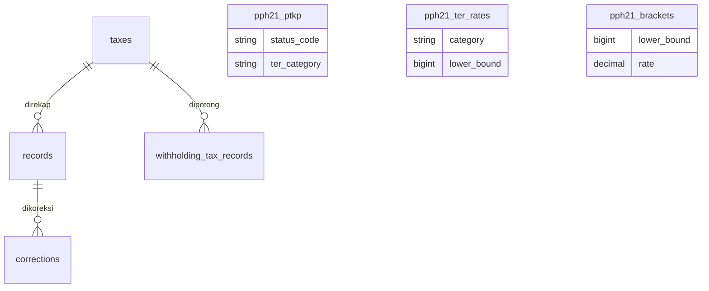

# Schema tax

Pajak: tarif PPN/PPh berlaku per tanggal, kertas kerja rekap per periode beserta koreksinya, catatan pemotongan PPh, tabel PPh 21 (PTKP, TER, Pasal 17), dan ekspor Coretax.

- **Modul/pemilik:** Oki (M10 Pajak). Dipisah dari `accounting` lama (ADR-0024). Jurnal pajak tetap ditulis lewat posting service `finance`.
- **Path backend:** `apps/backend/src/app/tax/` (`tax.service.ts`, `pph21-table.service.ts`, `coretax-export.service.ts`, `exported-tax.service.ts`, `tax-numbering.service.ts`). URL `/taxes`; UI di `/finance/tax/*`.
- **Drizzle:** `apps/backend/drizzle/schemas/tax.schema.ts`.

## Tabel

| Tabel | Fungsi | Kolom penting | Status (vocabulary) |
|---|---|---|---|
| `taxes` | Tarif pajak berlaku per tanggal (dulu `accounting.tax_types`) | `code`, `tax_type`, `rate` numeric(9,4) persen, `base_type`, `is_inclusive`, `effective_from`, `effective_to` | `tax_type`: `ppn`/`pph`/`ppn_input`/`ppn_output`/`other`; `base_type`: `gross`/`net`/`specific`; `is_active` |
| `records` | Kertas kerja rekap pajak satu jenis per bulan | `code`, `tax_type_id`, `period_year/month`, `taxable_base`, `tax_amount`, `filed_on`, `verified_by` | `filing_status`: `draft` -> `verified` -> `filed`; `corrected` setelah ada koreksi |
| `corrections` | Koreksi bertanda (+/-) atas rekap; nilai asli tidak diubah | `tax_record_id`, `amount` (tidak 0), `reason` (wajib), `evidence_document_id` | tidak ada |
| `withholding_tax_records` | Catatan PPh yang dipotong (mis. saat bayar pemasok, ERP-0140) | `code`, `tax_type_id`, `counterparty_type/id`, `base_amount`, `tax_amount`, `tax_object_code`, `withholding_slip_number`, `counterparty_tax_id`, `source_module/id` | `status`: `recorded` -> `verified` -> `paid`, `reversed`; `coretax_status`: `not_exported`/`exported`/`uploaded` |
| `pph21_ptkp` | PTKP per status (TK/0..K/3) dan kategori TER | `status_code`, `annual_amount`, `ter_category`, `effective_from` | `status_code`: `TK/0`..`TK/3`, `K/0`..`K/3`; `ter_category`: `A`/`B`/`C` |
| `pph21_ter_rates` | Tarif efektif bulanan PPh 21 (PP 58/2023) | `category`, `lower_bound`, `rate`, `effective_from` | `category`: `A`/`B`/`C` |
| `pph21_brackets` | Tarif progresif Pasal 17 (UU HPP) untuk perhitungan tahunan | `lower_bound`, `rate`, `effective_from` | tidak ada |
| `code_numberings` | Seri nomor modul pajak | `code_type`, `pattern`, `reset_policy`, `next_number` | `reset_policy`: `never`/`yearly`/`monthly` |

`pph21_*` adalah data referensi undang-undang yang global: **tanpa** `organization_id`. Perubahan tarif = baris baru dengan `effective_from` lebih baru.

## Relasi

FK di dalam schema (restrict):

- `records.tax_type_id` -> `taxes.id`
- `corrections.tax_record_id` -> `records.id`
- `withholding_tax_records.tax_type_id` -> `taxes.id`

**Referensi lintas modul:**

| Kolom | Target | Contract yang mengecek |
|---|---|---|
| `corrections.evidence_document_id` | `document.documents.id` | kontrak modul Document (dokumen terbit) |
| `withholding_tax_records.counterparty_type/id`, `source_module/id` | polimorfik (pemasok, karyawan; dokumen sumber, mis. `payment`) | dicek modul sumber saat menulis; tidak ada FK |
| `organization_id`, `verified_by`, `created_by` | `auth.*` | kontrak Identity |

Arah masuk: `payment.payments.withholding_tax_id` -> `tax.taxes.id` (dicek lewat kontrak Tax). Coretax membaca invoice lewat kontrak `sale` dan NPWP penjual dari `company.profiles.tax_id`.

## Alur data

1. **Master tarif:** Akuntan membuat baris `taxes`. Service menolak rentang `effective_from`..`effective_to` yang tumpang tindih untuk kode yang sama. Kode dan tanggal mulai tidak bisa diubah.
2. **Tabel PPh 21:** PTKP dan Pasal 17 di-seed; TER **tidak pernah di-seed**, diimpor dari CSV resmi (impor mengganti baris dengan `effective_from` yang sama).
3. **Gaji (HR):** perhitungan PPh 21 bulanan memakai TER, bulan terakhir tahun pajak memakai Pasal 17; persetujuan gaji memosting jurnal lewat `finance`.
4. **Bayar pemasok dengan PPh:** `payment.payments.withholding_amount` -> jurnal Dr utang penuh / Cr bank neto / Cr utang PPh -> baris `withholding_tax_records` (`source_module = payment`, `recorded`). Void pembayaran membalik keduanya (`reversed`).
5. **Rekap bulanan:** `records` dibuat `draft` (satu per jenis pajak per periode), nilai boleh diubah hanya saat `draft` -> `verified` -> `filed`. Pelaporan sendiri dilakukan di luar ERP.
6. **Koreksi:** baris `corrections` (hanya untuk status `verified`/`filed`/`corrected`); rekap berubah ke `corrected`. Utang bersih = `tax_amount` + jumlah koreksi aktif, dihitung saat dibaca.
7. **Penyelesaian PPN / setor pajak:** jurnal `finance.ppn_settled` dan `finance.tax_paid` (lihat `finance.md`).
8. **Coretax:** ekspor XML Faktur Keluaran (`TaxInvoiceBulk`), Bukti Potong Unifikasi (`BpuBulk`), dan BP21 untuk unggah manual; `coretax_status` -> `exported` -> `uploaded`, nomor bukti potong diisi setelah Coretax menerbitkannya.

## Penomoran

`tax.code_numberings`, pola default `{SEQ:4}/{TYPE}/{COMPANY}/{MM_ROMAN}/{YY}`, reset `yearly`.

| `code_type` | `{TYPE}` | Dipakai di |
|---|---|---|
| `tax_record` | TAX | `records.code` |
| `withholding_tax_record` | WHT | `withholding_tax_records.code` |

`taxes.code` diketik manual.

## Catatan dan temuan

- `validate-dbml.ts` (2026-11-26): `OK`, 0 drift kolom.
- `module-ownership.md` menulis tax 5 tabel dan hanya menyebut 4; dbml kini 8 (tambah `pph21_ptkp`, `pph21_ter_rates`, `pph21_brackets`, ERP-0138).
- `withholding_tax_records` punya `period_year/month` tetapi tanpa CHECK bulan 1..12 (berbeda dengan `records`).
- Kosakata `tax_type` mencampur `ppn` dengan `ppn_input`/`ppn_output`; perlu konvensi mana yang dipakai di aturan posting.
- Tarif yang ada masih **placeholder**; tarif final dan aturan pembulatan diblokir gerbang keuangan D14/D18.
- Format XML BP21 belum diverifikasi dengan impor uji; bukti potong tahunan (1721-A1) belum dibangun.
- `ExportedJournalService` untuk rekap pajak dari jurnal disebut di dokumen tetapi belum dibangun.

## Perubahan mendatang

| Perubahan | Sumber | Dampak ke schema | Status |
|---|---|---|---|
| Tarif pajak final dan aturan pembulatan | ERP-0016, gerbang D14/D18 (`features.md` M10 blocked) | none (data `taxes`) | menunggu keputusan |
| Bukti potong PPh 21 tahunan (1721-A1) | `docs/architecture/modules/finance.md` (not built) | mungkin kolom/tabel | usulan |
| Verifikasi format XML Coretax dengan impor uji | ERP-0140 | none | direncanakan |
| `ExportedJournalService` (rekap pajak dari GL) | `module-ownership.md` (Finance) | none | usulan |
| Perbarui angka tabel di `module-ownership.md` | temuan | none (dokumen) | usulan |
| Keputusan A1/R2 tidak menyentuh schema pajak | `bahan-keputusan.md` | none | — |
| Catatan pajak draf dihitung ulang otomatis (DPP × tarif) saat dasar diubah, di service | OC2 (jawaban programmer B 27/11) | aturan (`tax.service.ts`) | diputuskan, menunggu konfirmasi |
| Masa Bupot (`withholding_tax_records.period_year/month`) diisi otomatis dari tanggal transaksi (Asia/Jakarta) | OC3 (jawaban programmer B 27/11) | aturan | diputuskan, menunggu konfirmasi |
| Tarif PPN dokumen dari `taxes` (berlaku per `effective_from`..`effective_to`); dokumen menyimpan salinan tarif; pengecualian per dokumen dengan alasan | OC4 (jawaban programmer B 27/11) | aturan di `tax`; kolom alasan pengecualian mungkin perlu di `sale`/`procurement` (Dafrin), dicek ke `docs.dbml` | diputuskan, menunggu konfirmasi |
| Pemotongan berstatus terbayar bisa dibatalkan dengan alasan (tombol di layar) | OC5 (jawaban programmer B 27/11) | mungkin kolom alasan pembatalan; dicek ke `docs.dbml` | diputuskan, menunggu konfirmasi |
| Kode pemotongan ganda (unique `withholding_tax_records_org_code_uq`) dipetakan ke pesan jelas | OC6 (jawaban programmer B 27/11) | none | diputuskan, menunggu konfirmasi |
| Masa pajak yang sudah ditutup read-only (ikut status periode keuangan) | OC7 (jawaban programmer B 27/11) | aturan | diputuskan, menunggu konfirmasi |
| **PPh 21 otomatis belum dipakai**: setelan PPh 21 di penggajian dimatikan, PPh 21 dihitung di luar aplikasi; tabel `pph21_*` tetap (tidak dihapus), TER resmi tidak diimpor sekarang | OC8 (jawaban programmer B 27/11) | none | diputuskan, menunggu konfirmasi |
