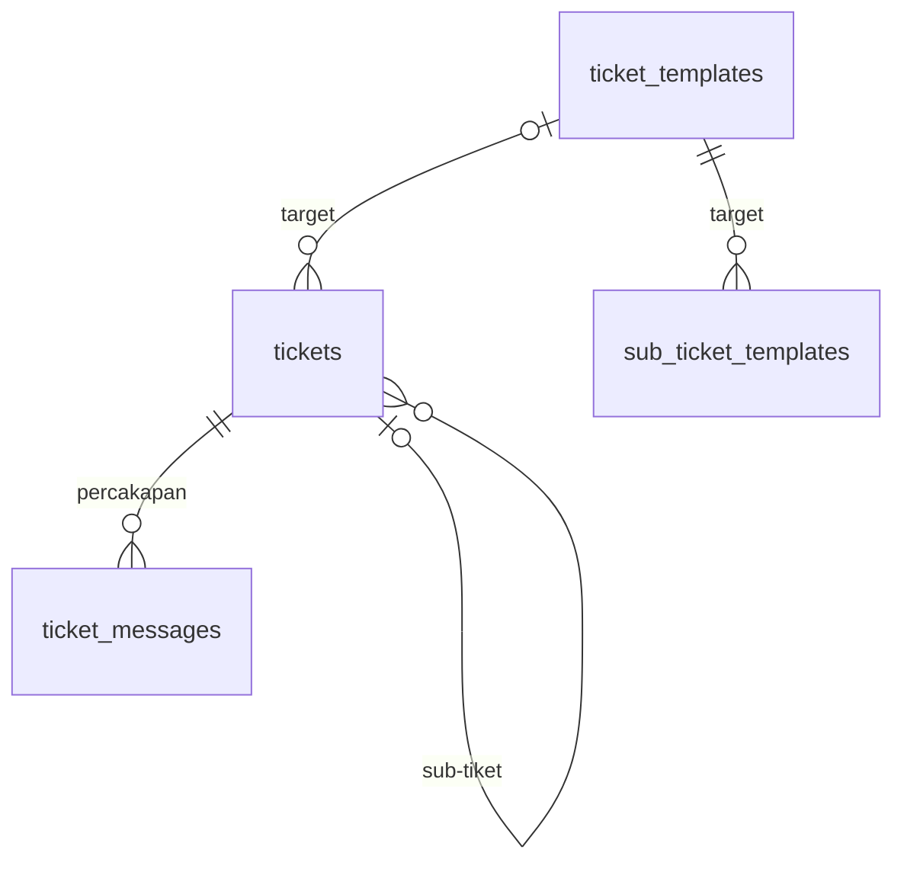

# Schema ticket

Tiket servis (purna jual): pelanggan melapor (lewat staf atau portal), teknisi mengerjakan, pelanggan mengonfirmasi, plus percakapan per tiket.

- **Modul/pemilik:** M07 (proyek & purna jual), programmer B. Portal pelanggan memakai tabel yang sama (ERP-0022).
- **Backend:** `apps/backend/src/app/ticket/` (dulu tiket di `aftersales`, ADR-0024 Q13). Portal lewat `apps/backend/src/app/customer/` (`/customers/portal/v1`). Drizzle: `apps/backend/drizzle/schemas/ticket.schema.ts`.
- **Lingkup:** seluruh perusahaan.

## Tabel

| Tabel | Fungsi | Kolom penting | Status (vocabulary) |
|---|---|---|---|
| `tickets` | Tiket servis | `code`, `ticket_type`, `parent_ticket_id`, `ticket_template_id`, `customer_id`, `company_id`, `customer_name` (snapshot), `project_id`, `warranty_id`, `item_serial_id`, `serial_number`, `complaint`, `reporter_name`, `in_warranty`, `warranty_ends_on`, `warranty_code`, `assignee_user_id`, `resolution`, `service_cost` (bigint), `confirmed_by_name`, `confirmation_channel` | `status`: new, in_progress, resolved, closed. `priority`: low, normal, high, urgent. `ticket_type`: installation, repair, maintenance, warranty_service, inspection, other. `channel` / `confirmation_channel`: phone, whatsapp, email, web, onsite, portal, other |
| `ticket_messages` | Percakapan tiket | `ticket_id`, `author_type`, `author_user_id`, `author_name`, `body` | `visibility`: internal, customer. `author_type`: staff, customer (pelanggan selalu `customer`) |
| `ticket_templates` | **Target** (hanya dbml): template yang membuat sub-tiket | `code`, `ticket_type`, `default_priority`, `sla_hours`, `checklist` | `is_active` |
| `sub_ticket_templates` | **Target**: definisi sub-tiket dalam template | `ticket_template_id`, `title`, `sort_order` | — |
| `settings` | Pengaturan modul | `setting_group`, `setting_key` | `value_type`: string, number, boolean, json, date |
| `code_numberings` | Seri nomor tiket | `code_type`, `pattern` | `reset_policy`: never, yearly, monthly |

## Relasi

FK di dalam schema: `tickets.parent_ticket_id` → `tickets.id` (set null); `tickets.ticket_template_id` → `ticket_templates.id` (set null, di DB tetap uuid biasa karena tabel template belum ada); `ticket_messages.ticket_id` → `tickets.id` (cascade); `sub_ticket_templates` → `ticket_templates` (cascade).

### Referensi lintas modul

| Kolom | Target | Diperiksa oleh |
|---|---|---|
| `tickets.customer_id` | `customer.customers` | `ExportedCustomerService.getActiveCustomer` |
| `tickets.company_id` | `customer.companies` | (tidak diisi, lihat temuan) |
| `tickets.project_id` | `project.projects` | `ProjectLookupService.getProject`; proyek harus milik pelanggan yang sama |
| `tickets.warranty_id` | `project.warranties` | (tidak diisi; hasil cek garansi disimpan sebagai `in_warranty`, `warranty_ends_on`, `warranty_code`) |
| `tickets.item_serial_id` | `inventory.item_serials` | (tidak diisi; yang disimpan `serial_number` teks) |
| `tickets.assignee_user_id`, `*_by`, `ticket_messages.author_user_id` | `auth.users` | Sesi / daftar teknisi organisasi |

## Alur data

1. **Buat tiket** (staf, menu Tiket): pelanggan dicek aktif, proyek (bila diisi) harus milik pelanggan itu. **Cek garansi** dijalankan: nomor seri → surat jalan terkirim → proyek → surat garansi; hasilnya disimpan di `in_warranty`, `warranty_ends_on`, `warranty_code` (tidak berubah walau garansi berubah kemudian). Insert `tickets` (status new, kode TKT). Outbox `service_ticket.updated`.
2. **Buat tiket dari portal**: `createFromPortal` → `channel = portal`, pelapor = akun portal. Foto, kategori, dan prioritas dari portal belum disimpan.
3. **Kerjakan**: tugaskan teknisi (`assignee_user_id`) → Mulai (new → in_progress) → Selesaikan (→ resolved, isi `resolution`, `service_cost`) → Buka lagi (resolved → in_progress) bila belum beres.
4. **Tutup**: resolved → closed, wajib nama pelanggan yang mengonfirmasi (`confirmed_by_name`, `confirmation_channel`); pelanggan juga bisa mengonfirmasi dari portal. Tiket didaftarkan ke `document.documents`.
5. **Percakapan**: staf menulis catatan `internal` atau balasan `customer`; pelanggan menulis dari portal (selalu `customer`). Hanya pesan `customer` yang tampil di portal.

## Penomoran

| `code_type` | Singkatan | Pola bawaan | Reset |
|---|---|---|---|
| `ticket` | TKT | `{SEQ:4}/{TYPE}/{COMPANY}/{MM_ROMAN}/{YY}` | yearly |

## Catatan dan temuan

- **Parity:** kolom dan tipe sama (validator OK); `ticket_templates` dan `sub_ticket_templates` tidak ada di Drizzle (target).
- **Kolom baru ADR-0024 belum dipakai kode:** `ticket_type` (selalu bawaan `other`), `parent_ticket_id`, `company_id`, `warranty_id`, `item_serial_id` tidak pernah ditulis `TicketService`. Aturan "induk hanya tutup bila semua anak tutup" (Q29) belum ada di kode.
- **Temuan M07:** prioritas dari portal selalu kembali `normal`; foto tidak disimpan ("photos not stored yet"); portal mengizinkan pesan hanya-lampiran, tetapi ERP mewajibkan teks; tiket tidak bisa diubah setelah dibuat; tiket orang lain tidak terlihat sama sekali oleh teknisi; Admin kemungkinan tidak bisa membuat tiket (butuh `customer:read` dan `project:read`).
- Klaim garansi dibuat dan disetujui oleh orang yang sama (🟡 di peta bentrok 3.7).

## Perubahan mendatang

| Perubahan | Sumber | Dampak ke schema | Status |
|---|---|---|---|
| Simpan prioritas (dan kategori/`ticket_type`) dari portal | Temuan M07 no. 8 | aturan (kolom sudah ada) | usulan |
| Simpan foto tiket dari portal | Temuan M07 no. 8 | tabel (lampiran tiket belum ada) atau pakai `document` | usulan |
| Izinkan pesan portal hanya lampiran, atau larang di portal | Temuan M07 no. 9 | aturan | usulan |
| Tombol Ubah tiket (seri, pelapor, keluhan) | Temuan M07 no. 14 | none | usulan |
| Isi `warranty_id`, `item_serial_id`, `company_id` dari hasil cek garansi | Temuan dokumen ini | aturan | usulan |
| Template tiket dan sub-tiket | ADR-0024 Q29, S6 | tabel | menunggu keputusan |
| Admin bisa membuat tiket (hak baca pelanggan/proyek) | M07 C12, D3 | none (hak) | menunggu keputusan |
