# Diagrams — business flows (UML)

Mermaid diagrams of the M02 (sales), M05 (procurement, inventory) and M07
(projects, after-sales) flows as implemented on `merge/main-sync`
(ADR-0011 port, 2026-11-06). They render on GitHub and in VS Code (Markdown
preview with Mermaid). State names are the values stored in the database;
the Indonesian screen label is given after the slash.

Used by both guides: [English](en.md) · [Bahasa Indonesia](id.md).

## 1. End-to-end flow (activity)

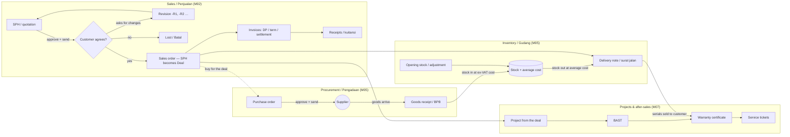

## 2. Sales: quotation to cash (sequence)

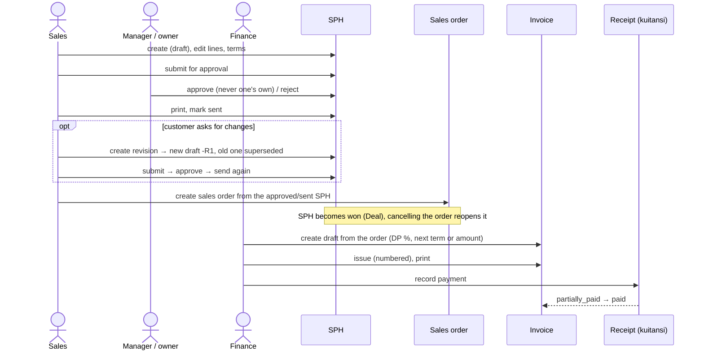

## 3. Purchasing to stock (sequence)

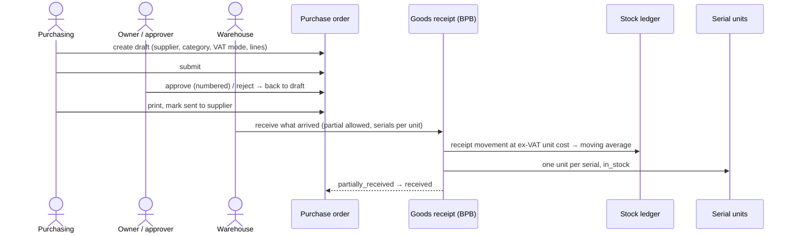

## 4. Delivery note (sequence)

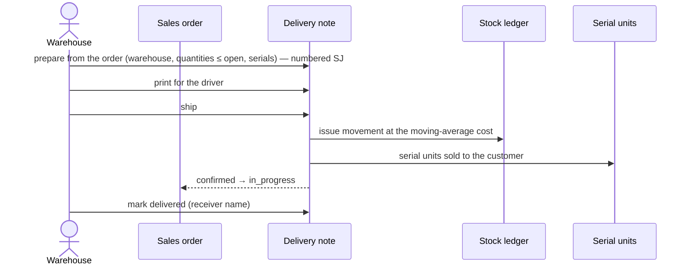

## 5. Document states

### SPH (quotation)

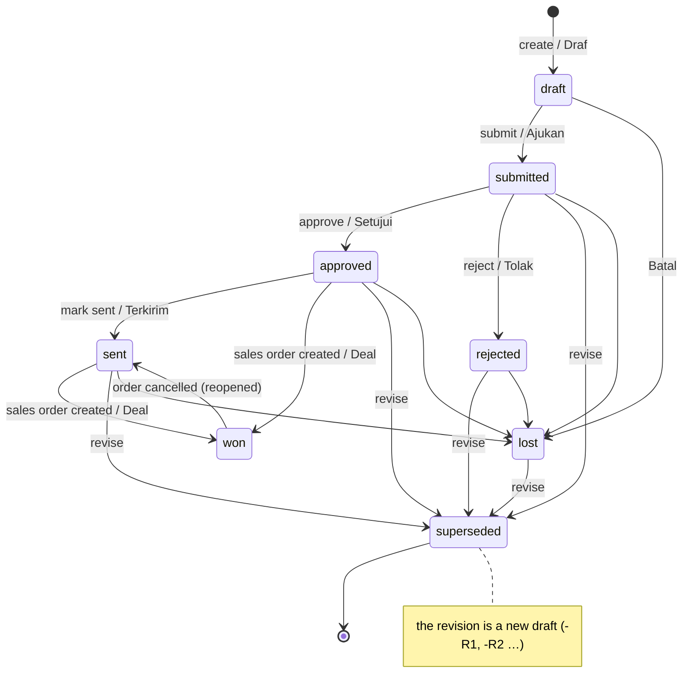

### Sales order and invoice

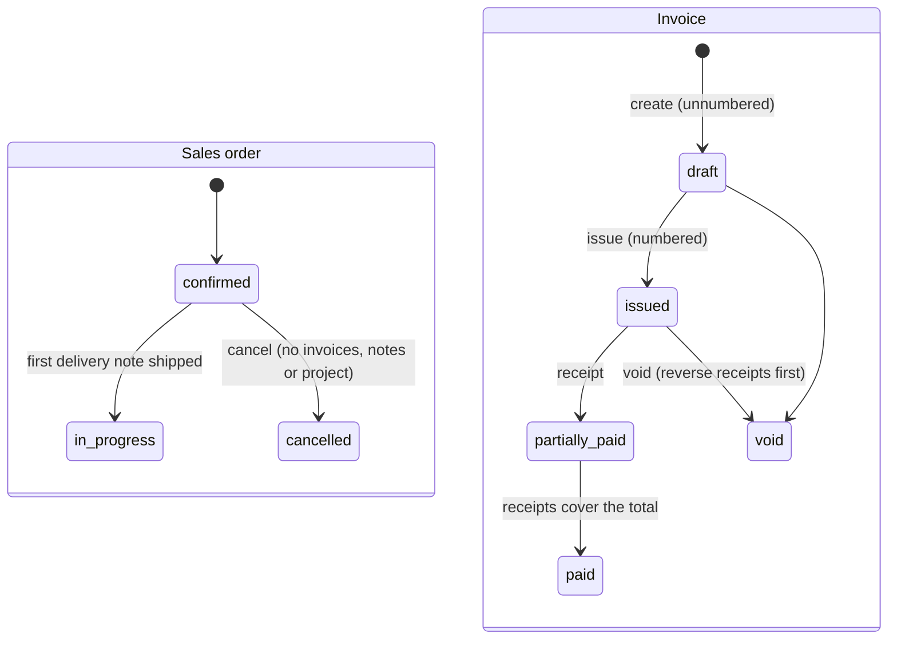

### Purchase order and stock adjustment

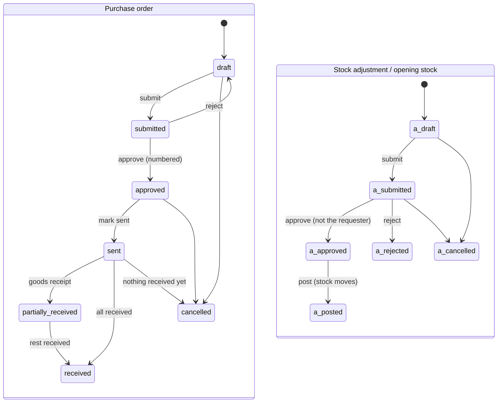

### Delivery note, project, BAST, ticket

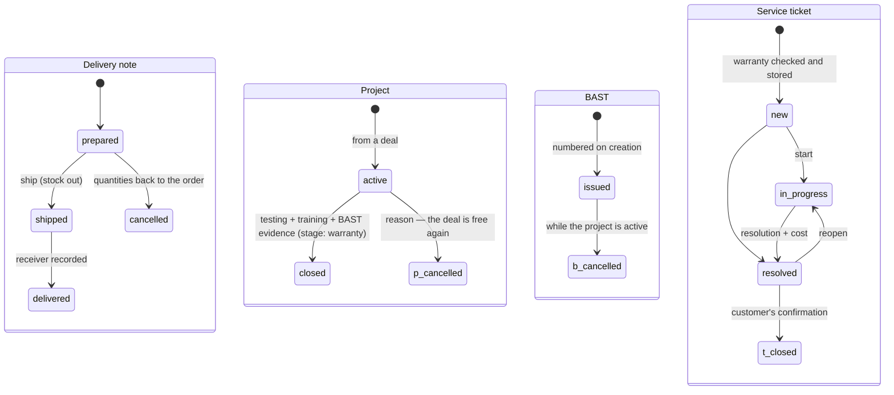

### Serial unit (inventory)

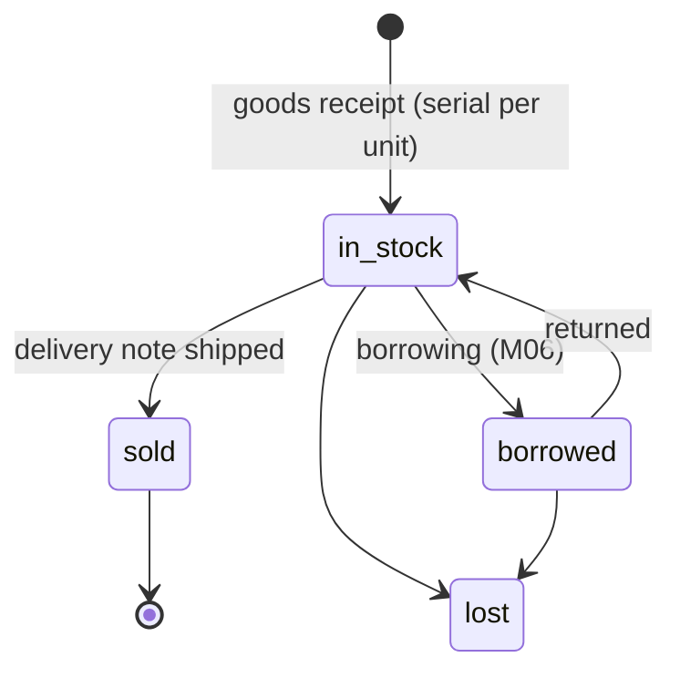

## 6. Modules and contracts (component)

Cross-module calls go through exported contracts only (AGENTS.md); no
module reads another module's tables.

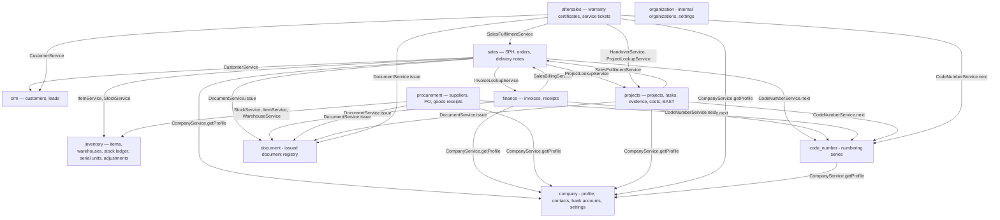

## 7. Cost (HPP) in stock

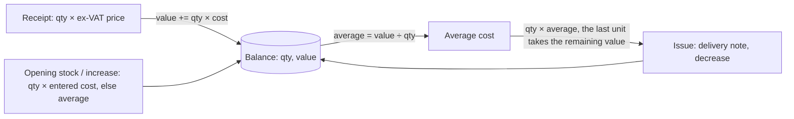
